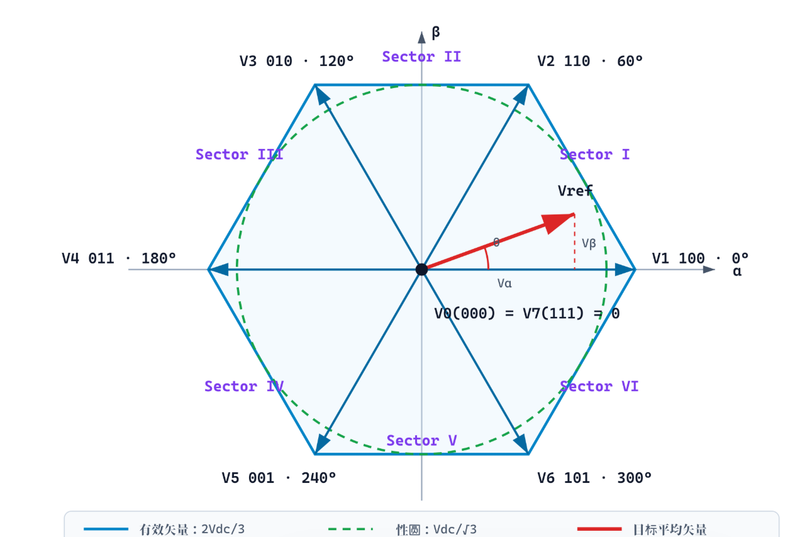
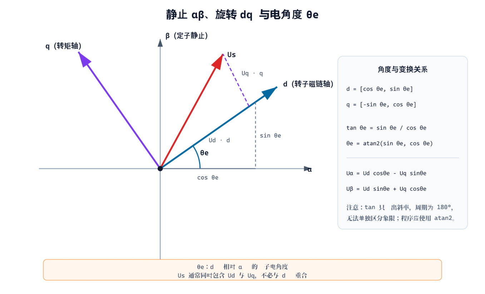
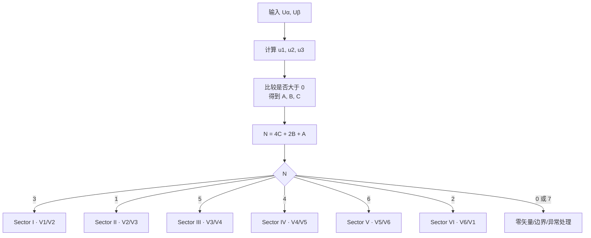
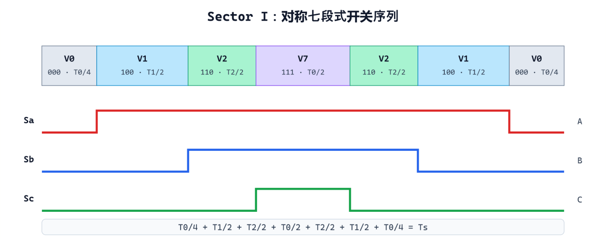
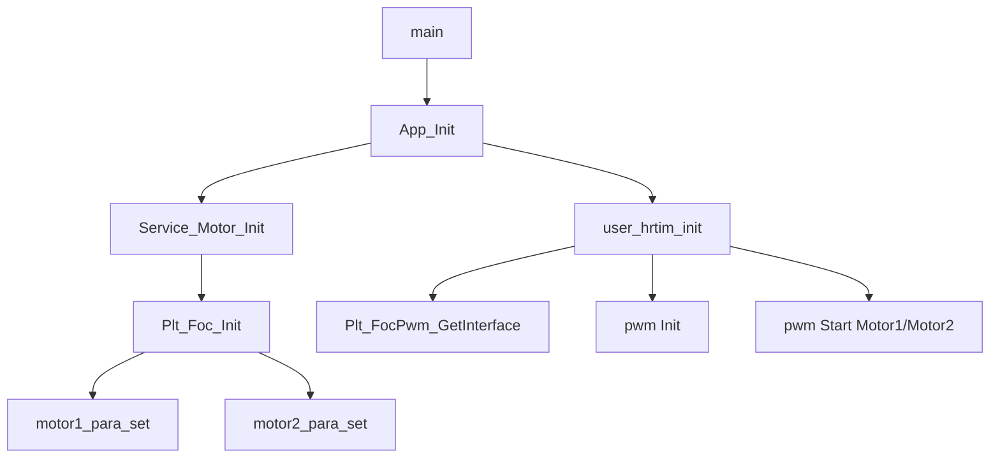

---

# SVPWM：从空间矢量原理到 STM32G474 FOC 工程实践

> 适用对象：已经了解三相逆变器、Clarke/Park 变换和 FOC 基本结构，希望进一步弄清“目标矢量怎样定位、七段式怎样形成、代码怎样落到 PWM”的嵌入式工程师。
> 
> 名词约定：原需求中的“dp 轴”按电机控制中的常用术语 **dq 轴**处理。本文采用幅值不变 Clarke 变换、$\alpha$ 轴与 A 相重合、$\beta$ 轴相对 $\alpha$ 轴超前 $90^\circ$ 的约定。

**配套交互图：** [打开 ECharts 空间矢量交互推演](./svpwm-space-vector-echarts.html)

交互页可以拖动电角度、参考电压幅值、母线电压和 PWM 频率，并同步观察：

- 目标矢量所在扇区与相邻有效矢量；
- $T_1$、$T_2$、$T_0$；
- `tan(θ)` 曲线、扇区边界与渐近线；
- 当前扇区的对称七段式序列；
- 三相 duty 及重构后的 $U_\alpha,U_\beta$。

> 普通 Markdown 渲染器不会执行 ECharts JavaScript，所以交互内容单独放在 HTML 中；本文同时提供 SVG 静态图，离线阅读不受影响。ECharts 脚本通过 jsDelivr CDN 加载，首次打开需要网络。

**一句话结论：**

SVPWM 不是电流控制器，也不是坐标变换；它是 FOC 的**电压执行器映射层**：在一个 PWM 周期内按比例使用两个相邻有效矢量和零矢量，使它们的平均伏秒积等于目标电压矢量。

$$
(U_d,U_q)
\xrightarrow{\text{逆 Park}}
(U_\alpha,U_\beta)
\xrightarrow{\text{SVPWM}}
(d_a,d_b,d_c)
\xrightarrow{\text{定时器与功率级}}
(u_a,u_b,u_c)
$$

本文对工程结论使用以下证据标记：

|标记|含义|
|--|--|
|`confirmed`|已由当前工程源码或本笔记的主机数值检查直接确认|
|`inferred`|根据变量、调用关系或配置推断，仍需接口契约或实测确认|
|`unverified`|必须通过交叉编译、目标板、示波器或硬件资料验证|

---

## 第一部分：什么是 SVPWM

### 1. SVPWM 的定义、输入与输出

SVPWM（Space Vector Pulse Width Modulation，空间矢量脉宽调制）把三相逆变器视为一个能够在 $\alpha\beta$ 平面产生离散电压矢量的执行器。

两电平三相逆变器在任意瞬间只能处于 $2^3=8$ 种开关状态，但 FOC 产生的 $U_\alpha,U_\beta$ 是连续量。SVPWM 的任务是：

1. 判断目标矢量处于哪个 $60^\circ$ 扇区；
2. 选择该扇区两侧的有效矢量；
3. 计算两个有效矢量和零矢量的作用时间；
4. 安排具体开关顺序；
5. 输出三相 duty 或定义清楚的比较时刻。


一个清晰的 SVPWM 接口应当明确：

|属性|推荐约定|
|--|--|
|输入|$U_\alpha,U_\beta$，单位明确为 V 或统一标幺值 pu|
|必要参数|$V_{dc}$、PWM 周期 $T_s$、线性调制裕量|
|输出|$d_a,d_b,d_c\in[0,1]$，或明确命名的三相比较时刻|
|饱和反馈|返回是否限幅以及缩放比例，供电流 PI anti-windup 使用|
|执行特性|有界运行时间、无阻塞、无动态内存；可在 FOC ISR 中调用|
|不负责|PWM 极性、死区、互补输出、break/fault、preload 和同步更新|

“duty”和“比较时刻”虽然可以换算，但数学语义不同。接口中不能把二者都命名为 `Tcm` 或 `duty` 后依赖调用者猜测。

### 2. 两电平逆变器为什么只有 8 个矢量

令 $S_a=1$ 表示 A 相上桥臂导通、下桥臂关断，$S_a=0$ 表示相反；B、C 相同。忽略死区、器件压降和换相瞬态时：

$$
S_a,S_b,S_c\in\{0,1\}
$$

电机中性点悬浮时，相对中性点的三相电压为：

$$
\begin{bmatrix}u_{an}\\u_{bn}\\u_{cn}\end{bmatrix}=\frac{V_{dc}}{3}\begin{bmatrix}
2&-1&-1\\-1&2&-1\\-1&-1&2
\end{bmatrix}
\begin{bmatrix}
S_a\\S_b\\S_c
\end{bmatrix}
$$

复空间矢量可以写成：

$$
\boxed{
\vec V_s=
\frac{2}{3}V_{dc}
\left(
S_a+S_be^{j\frac{2\pi}{3}}+S_ce^{j\frac{4\pi}{3}}
\right)
}
$$

代入 8 种状态可得到：

|矢量|$S_aS_bS_c$|$V_\alpha$|$V_\beta$|角度|类型|
|--|--|--:|--:|--:|--|
|$V_0$|000|0|0|—|零矢量|
|$V_1$|100|$2V_{dc}/3$|0|$0^\circ$|有效矢量|
|$V_2$|110|$V_{dc}/3$|$\sqrt3V_{dc}/3$|$60^\circ$|有效矢量|
|$V_3$|010|$-V_{dc}/3$|$\sqrt3V_{dc}/3$|$120^\circ$|有效矢量|
|$V_4$|011|$-2V_{dc}/3$|0|$180^\circ$|有效矢量|
|$V_5$|001|$-V_{dc}/3$|$-\sqrt3V_{dc}/3$|$240^\circ$|有效矢量|
|$V_6$|101|$V_{dc}/3$|$-\sqrt3V_{dc}/3$|$300^\circ$|有效矢量|
|$V_7$|111|0|0|—|零矢量|



`000` 与 `111` 的桥臂状态不同，但三相线电压都为零，所以在 $\alpha\beta$ 平面中同处原点。它们不是“关闭功率级”：开关器件仍处于确定状态，安全停机应使用 PWM output disable、栅极驱动 disable 或硬件 fault/break。

### 3. $\alpha\beta$ 轴与 $dq$ 轴表格

FOC 同时使用一个静止坐标系和一个旋转坐标系：

|轴|所属坐标系|参考方向|是否旋转|FOC 中的典型含义|
|--|--|--|--|--|
|$\alpha$|定子静止 $\alpha\beta$|通常与 A 相轴重合|否|定子电流/电压的静止轴分量|
|$\beta$|定子静止 $\alpha\beta$|比 $\alpha$ 超前 $90^\circ$|否|与 $\alpha$ 正交的静止轴分量|
|$d$|转子旋转 $dq$|通常对齐转子永磁体磁链|是|磁链分量；表贴式 PMSM 常令 $I_d^*=0$|
|$q$|转子旋转 $dq$|比 $d$ 轴超前 $90^\circ$|是|转矩分量；$I_q$ 通常主要决定转矩|



在本文与当前工程采用的符号下，Park 变换为：

$$
\begin{aligned}I_d &= I_\alpha\cos\theta_e+I_\beta\sin\theta_e\\I_q &=-I_\alpha\sin\theta_e+I_\beta\cos\theta_e
\end{aligned}
$$

逆 Park 变换为：

$$
\boxed{\begin{aligned}U_\alpha &= U_d\cos\theta_e-U_q\sin\theta_e\\U_\beta  &= U_d\sin\theta_e+U_q\cos\theta_e
\end{aligned}}
$$

这里有两个容易混淆的角度：

- $\theta_e$：转子 $d$ 轴相对定子 $\alpha$ 轴的电角度；
- $\theta_u=\operatorname{atan2}(U_\beta,U_\alpha)$：目标电压矢量相对 $\alpha$ 轴的角度。

一般情况下 $U_q\ne0$，所以目标电压矢量不必与 $d$ 轴重合：

$$
\theta_u
=\theta_e+\operatorname{atan2}(U_q,U_d)
\pmod{2\pi}
$$

### 4. 如何确定目标矢量位置

#### 4.1 方法一：使用 `atan2`

最直观的方法是：

$$
\theta_u=\operatorname{atan2}(U_\beta,U_\alpha)
$$

将角度归一化到 $[0,2\pi)$：

$$
\boxed{
sector=
\left\lfloor\frac{\theta_u}{\pi/3}\right\rfloor+1
}
$$

它容易验证和调试，但要明确处理 $0/2\pi$、精确边界和浮点误差。本笔记配套交互页在精确 $60^\circ$ 边界使用了极小的数值容差，避免计算结果因浮点舍入落回前一扇区。

#### 4.2 `tan` 电角度示意与局限

如果 $U_\alpha\ne0$，目标矢量斜率为：

$$
\tan\theta_u=\frac{U_\beta}{U_\alpha}
$$

对转子 $d$ 轴的单位方向向量也有：

$$
\tan\theta_e=\frac{\sin\theta_e}{\cos\theta_e}
$$

六个扇区边界的 `tan` 值为：

|电角度|几何位置|$\tan\theta$|说明|
|--:|--|--:|--|
|$0^\circ$|I 的起点|0|$+\alpha$ 轴|
|$60^\circ$|I/II 边界|$\sqrt3$|有效矢量 $V_2$|
|$120^\circ$|II/III 边界|$-\sqrt3$|有效矢量 $V_3$|
|$180^\circ$|III/IV 边界|0|$-\alpha$ 轴|
|$240^\circ$|IV/V 边界|$\sqrt3$|有效矢量 $V_5$|
|$300^\circ$|V/VI 边界|$-\sqrt3$|有效矢量 $V_6$|
|$360^\circ$|回到 I|0|与 $0^\circ$ 等价|

但是 `tan` 的周期只有 $180^\circ$：$20^\circ$ 与 $200^\circ$ 的正切相同。并且 $90^\circ/270^\circ$ 是正切渐近线，却不是 SVPWM 的 $60^\circ$ 扇区边界。因此程序不能只用 `atan(Uβ/Uα)` 判扇区；应使用 `atan2` 或同时包含象限信息的符号法。

交互曲线见：[tan(θ) 与扇区边界](./svpwm-space-vector-echarts.html)。

#### 4.3 方法二：三个符号测试——当前工程采用

定义：

$$
\begin{aligned}u_1 &= U_\beta\\u_2 &= \frac{\sqrt3}{2}U_\alpha-\frac12U_\beta\\u_3 &=-\frac{\sqrt3}{2}U_\alpha-\frac12U_\beta
\end{aligned}
$$

取符号位并编码：

$$
A=[u_1>0],\qquad B=[u_2>0],\qquad C=[u_3>0]
$$

$$
\boxed{N=4C+2B+A}
$$

当前工程源码：

```c_cpp
/* Platform/Midderware_Platform/control_loop.c:25-35 */
float u1 = motor_id->Ubeta;
float u2 = 0.866025404f * motor_id->Ualpha
         - 0.5f * motor_id->Ubeta;
float u3 = -0.866025404f * motor_id->Ualpha
         - 0.5f * motor_id->Ubeta;

uint8_t A = u1 > 0 ? 1 : 0;
uint8_t B = u2 > 0 ? 1 : 0;
uint8_t C = u3 > 0 ? 1 : 0;
uint8_t N = 4 * C + 2 * B + A;
```

编码 $N$ 与按角度编号的几何扇区不是顺序对应：

|几何扇区|角度范围|编码 $N$|相邻有效矢量|
|--:|--|--:|--|
|I|$0^\circ\le\theta<60^\circ$|3|$V_1,V_2$|
|II|$60^\circ\le\theta<120^\circ$|1|$V_2,V_3$|
|III|$120^\circ\le\theta<180^\circ$|5|$V_3,V_4$|
|IV|$180^\circ\le\theta<240^\circ$|4|$V_4,V_5$|
|V|$240^\circ\le\theta<300^\circ$|6|$V_5,V_6$|
|VI|$300^\circ\le\theta<360^\circ$|2|$V_6,V_1$|



在精确边界上，某个 $u_i$ 等于 0，`>` 与 `>=` 会让内部扇区编号落在不同一侧。这本身不应造成物理线电压跳变；如果边界处 duty 或重构电压异常，应优先检查相序、符号、置换表和 duty/compare 语义。

### 5. 伏秒平衡：怎样用离散矢量合成连续目标

假设参考矢量位于第 $k$ 扇区，相邻有效矢量为 $\vec V_k$、$\vec V_{k+1}$。在一个 PWM 周期 $T_s$ 内：

$$
\boxed{
\vec V_{ref}T_s
=\vec V_kT_1
+\vec V_{k+1}T_2
+\vec0T_0
}
$$

并且：

$$
\boxed{T_0+T_1+T_2=T_s}
$$

这就是 SVPWM 的核心：不要求逆变器的瞬时电压等于目标，而要求一个足够短的周期内伏秒积相等。电机绕组的电感滤除主要开关纹波后，低频平均效果接近连续目标。

#### 5.1 第一扇区的 $T_1,T_2$ 推导

第一扇区使用：

$$
\vec V_1=
\begin{bmatrix}
\frac23V_{dc}\\0
\end{bmatrix},
\qquad
\vec V_2=
\begin{bmatrix}
\frac13V_{dc}\\\frac{\sqrt3}{3}V_{dc}
\end{bmatrix}
$$

代入平均方程：

$$
\begin{bmatrix}
U_\alpha\\U_\beta
\end{bmatrix}T_s
=\begin{bmatrix}\frac23V_{dc}\\0\end{bmatrix}T_1+
\begin{bmatrix}
\frac13V_{dc}\\\frac{\sqrt3}{3}V_{dc}
\end{bmatrix}T_2
$$

由 $\beta$ 轴先得到：

$$
\boxed{T_2=\frac{\sqrt3T_s}{V_{dc}}U_\beta}
$$

再代入 $\alpha$ 轴：

$$
\boxed{
T_1=\frac{T_s}{V_{dc}}
\left(\frac32U_\alpha-\frac{\sqrt3}{2}U_\beta\right)
}
$$

最后：

$$
\boxed{T_0=T_s-T_1-T_2}
$$

#### 5.2 六个扇区的统一公式

设 $\theta_s\in[0,\pi/3)$ 是目标矢量相对本扇区起点的局部角度，则：

$$
\boxed{
T_1=
\frac{\sqrt3T_s|V_{ref}|}{V_{dc}}
\sin\left(\frac\pi3-\theta_s\right)
}
$$

$$
\boxed{
T_2=
\frac{\sqrt3T_s|V_{ref}|}{V_{dc}}
\sin\theta_s
}
$$

$$
\boxed{T_0=T_s-T_1-T_2}
$$

线性区要求：

$$
T_0,T_1,T_2\ge0
$$

如果 $T_1+T_2>T_s$，目标已进入过调制请求区。最简单的线性限幅是：

$$
k=\frac{T_s}{T_1+T_2},\qquad
T_1'=kT_1,\quad T_2'=kT_2,\quad T_0'=0
$$

工程中还应将缩放比例反馈给电流 PI，避免积分器继续累积不可实现的电压命令。

### 6. 对称七段式 SVPWM 输出

#### 6.1 第一扇区序列

第一扇区的典型对称七段式为：

$$
V_0\rightarrow V_1\rightarrow V_2\rightarrow V_7
\rightarrow V_2\rightarrow V_1\rightarrow V_0
$$

即：

$$
000\rightarrow100\rightarrow110\rightarrow111
\rightarrow110\rightarrow100\rightarrow000
$$




它有三个直接作用：

1. 相邻状态只改变一个桥臂，减少无意义的同时换相；
2. 前后镜像，使波形中心对称；
3. 零矢量分布可为同步 ADC 采样和共模策略提供设计空间。

#### 6.2 六个扇区的七段式状态表

为了让 `000` 到第一个有效矢量、最后一个有效矢量到 `111` 都只改变一个桥臂，偶数扇区会反转两个有效矢量在序列中的先后次序：

|扇区|七段式开关状态|
|--:|--|
|I|`000 → 100 → 110 → 111 → 110 → 100 → 000`|
|II|`000 → 010 → 110 → 111 → 110 → 010 → 000`|
|III|`000 → 010 → 011 → 111 → 011 → 010 → 000`|
|IV|`000 → 001 → 011 → 111 → 011 → 001 → 000`|
|V|`000 → 001 → 101 → 111 → 101 → 001 → 000`|
|VI|`000 → 100 → 101 → 111 → 101 → 100 → 000`|

#### 6.3 从 $T_0,T_1,T_2$ 得到比较时刻

若将零矢量对称分配，半周期内三个累计切换时刻可写为：

$$
\boxed{t_a=\frac{T_0}{4}}
$$

$$
\boxed{t_b=t_a+\frac{T_1}{2}}
$$

$$
\boxed{t_c=t_b+\frac{T_2}{2}}
$$

当前工程对应代码：

```c_cpp
/* Platform/Midderware_Platform/control_loop.c:76-89 */
if ((Tm + Tn) > Ts)
{
    float sum = Tm + Tn;
    Tm = Tm * Ts / sum;
    Tn = Tn * Ts / sum;
}

float Ta = (Ts - Tm - Tn) / 4.0f;
float Tb = Ta + Tm / 2.0f;
float Tc = Tb + Tn / 2.0f;
```

#### 6.4 从作用时间得到三相 duty

以第一扇区为例：

$$
\begin{aligned}
d_a &= \frac{T_1+T_2+T_0/2}{T_s}\\d_b &= \frac{T_2+T_0/2}{T_s}\\d_c &= \frac{T_0/2}{T_s}
\end{aligned}
$$

六个扇区的 duty 置换为：

|扇区|$d_aT_s$|$d_bT_s$|$d_cT_s$|
|--:|--|--|--|
|I|$T_1+T_2+T_0/2$|$T_2+T_0/2$|$T_0/2$|
|II|$T_1+T_0/2$|$T_1+T_2+T_0/2$|$T_0/2$|
|III|$T_0/2$|$T_1+T_2+T_0/2$|$T_2+T_0/2$|
|IV|$T_0/2$|$T_1+T_0/2$|$T_1+T_2+T_0/2$|
|V|$T_2+T_0/2$|$T_0/2$|$T_1+T_2+T_0/2$|
|VI|$T_1+T_2+T_0/2$|$T_0/2$|$T_1+T_0/2$|

如果 $t_a,t_b,t_c$ 是“从半周期边缘累计的比较时刻”，则在本文这一极性约定下：

$$
d_x=1-\frac{2t_x}{T_s},\qquad x\in\{a,b,c\}
$$

实际硬件中是否需要取反，取决于：计数方向、set/reset 事件、输出极性和栅极驱动器极性。这也是为什么数学层应输出语义明确的 duty，而定时器层只做一次、可审查的换算。

### 7. 完整数值例子

设：

- $V_{dc}=24\ \mathrm V$；
- $f_s=20\ \mathrm{kHz}$，所以 $T_s=50\ \mu\mathrm s$；
- $|V_{ref}|=8\ \mathrm V$；
- $\theta=20^\circ$，位于第一扇区。

先检查线性范围：

$$
\frac{V_{dc}}{\sqrt3}=13.856\ \mathrm V>8\ \mathrm V
$$

目标分量为：

$$
U_\alpha=8\cos20^\circ=7.5175\ \mathrm V
$$

$$
U_\beta=8\sin20^\circ=2.7362\ \mathrm V
$$

作用时间：

$$
T_1=18.5557\ \mu\mathrm s,qquad
T_2=9.8733\ \mu\mathrm s,qquad
T_0=21.5710\ \mu\mathrm s
$$

三相占空比：

$$
(d_a,d_b,d_c)=(0.78429,0.41318,0.21571)
$$

|相|duty|
|--|--:|
|A|78.429%|
|B|41.318%|
|C|21.571%|

这些值已经由 `checks/validate-svpwm.mjs` 的主机全角度扫描和矢量重构验证，但它们不代表当前目标板引脚已经产生相同波形。

---

## 第二部分：为什么需要 SVPWM

### 1. 它连接了连续控制器与离散逆变器

FOC 的电流 PI 可以产生任意连续的 $U_d,U_q$，逆 Park 后得到连续的 $U_\alpha,U_\beta$。但功率级任意瞬间只有 8 个状态。

如果没有调制层，控制器就缺少从“连续期望电压”到“实际桥臂开关”的定义。SVPWM 利用高频时间平均完成这一映射：

```text
连续电压命令
→ 相邻有效矢量 + 零矢量
→ 每段作用时间
→ 开关序列
→ 三相 PWM
→ 电机电感看到近似连续的平均电压
```

因此，SVPWM 在系统中的价值首先是**可实现性**，而不只是“波形更漂亮”。

### 2. 直流母线利用率更高

六个有效矢量构成正六边形，其外接圆半径为：

$$
R=\frac23V_{dc}
$$

若目标矢量要在任意角度连续旋转，必须位于六边形内切圆内：

$$
V_{ref,max}
=R\cos30^\circ
=\frac23V_{dc}\cdot\frac{\sqrt3}{2}
=\frac{V_{dc}}{\sqrt3}
$$

标准正弦 SPWM 的相电压基波峰值上限通常为：

$$
V_{phase,pk,SPWM}=\frac{V_{dc}}{2}
$$

二者之比：

$$
\frac{V_{phase,pk,SVPWM}}{V_{phase,pk,SPWM}}
=\frac{V_{dc}/\sqrt3}{V_{dc}/2}
=\frac{2}{\sqrt3}
\approx1.1547
$$

所以在线性区，母线利用率提高约：

$$
\boxed{(1.1547-1)\times100\%\approx15.47\%}
$$

|调制方式|最大相电压基波峰值|最大线电压基波 RMS|
|--|--:|--:|
|标准 SPWM|$V_{dc}/2$|$0.612V_{dc}$|
|线性 SVPWM|$V_{dc}/\sqrt3$|$0.707V_{dc}$|

从另一个角度看，SVPWM 等价于给三相参考同时注入合适的零序/共模分量。三相都加上同一个值不会改变线电压，却能让参考值更好地放入母线允许范围。

### 3. 七段式 SVPWM 的工程优势

|优势|作用|条件与边界|
|--|--|--|
|固定开关周期|便于电流环离散化、滤波与损耗估算|PWM 更新必须与控制周期一致|
|相邻状态只切一个桥臂|避免不必要的多桥臂同时换相|具体序列必须与扇区匹配|
|中心对称|减少偶次开关不对称，便于中心对齐 PWM|定时器计数模式与 compare 事件必须一致|
|更高母线利用率|在同一 $V_{dc}$ 下获得更大的线性电压矢量|超出 $V_{dc}/\sqrt3$ 后不再是线性关系|
|可规划零矢量|可设计 ADC 采样窗口、共模和开关损耗|分流拓扑与运放建立时间会改变最优序列|
|与 FOC 坐标天然衔接|直接接收 $U_\alpha,U_\beta$|相序、角度方向与 Park 符号必须一致|

### 4. SVPWM 不是无条件“最好”

|方法|优点|代价或边界|典型用途|
|--|--|--|--|
|六步换相|简单、可获得较高电压|谐波和转矩脉动较大|BLDC 梯形波、成本敏感场景|
|SPWM|直观、容易实现|线性母线利用率较低|教学、简单逆变器|
|对称七段 SVPWM|连续、对称、母线利用率高|分支、序列和采样窗口必须一致|PMSM/感应电机 FOC|
|五段/DPWM|可减少开关次数和损耗|共模、纹波、采样窗口发生变化|高功率或效率优化|

“SVPWM 一定使所有谐波更低”不是无条件结论。实际结果还取决于：

- 开关频率和控制带宽；
- 死区、器件压降与补偿；
- 过调制策略；
- 电机参数和负载；
- ADC 采样位置；
- 评价的是相电压、线电压、电流纹波还是共模电压。

---

## 第三部分：如何使用 SVPWM

### 1. 当前 STM32G474 工程的真实位置

当前工程是双电机、裸机 FOC。`main()` 初始化 HAL 和外设，随后调用 `App_Init()`，主循环执行 `App_Task()`；高频电机控制不在 `while(1)` 中，而在 HRTIM 同步触发的 ADC 注入完成 ISR 链路内。

```mermaid
flowchart LR
    H[HRTIM Timer A CMP4<br/>ADC trigger] --> ADC[ADC1/ADC2 注入组]
    ADC --> ISR[HAL_ADCEx_InjectedConvCpltCallback]
    ISR --> RAW[读取双电机六路相电流]
    RAW --> IRQ[Plt_Foc_IRQ_Callback]
    IRQ --> MC[Motor_Control]
    MC --> CL[current_loop<br/>Clarke + Park + Id/Iq PI]
    CL --> IP[FOC_ApplyDQVoltage<br/>逆 Park]
    IP --> SV[svpwm<br/>Uαβ → Tcm1/2/3]
    SV --> SET[Set_Pwm → SetDuty]
    SET --> CMP[HRTIM 三相 compare]
```



|机制角色|工程证据|结论|
|--|--|--|
|程序入口|`Vendor/Core/Src/main.c:94-146`|`confirmed`：裸机 `App_Init()` + `App_Task()`|
|FOC 参数初始化|`Platform/Service_Platform/Motor/service_motor.c:49-58`、`foc_port.c:19-26`|`confirmed`：Service 调用 `Plt_Foc_Init()`，绑定两套电机参数|
|PWM/ADC 启动|`App/Src/app_init.c:63-123,407-456`|`confirmed`：HRTIM Master、PWM/ADC 与输出在 App 初始化阶段启动|
|PWM 同步触发|`Vendor/Core/Src/hrtim.c:62-83`|`confirmed`：Timer A CMP4 触发 ADC Trigger 1/2，Period 为 34000|
|电流采样入口|`Platform/MCU_Platform/Interrupt/interrupt.c:19-48`|`confirmed`：读取 ADC1/2 六路注入值后进入 FOC 回调|
|控制调度|`Platform/Midderware_Platform/foc_port.c:693-743,755-905`|`confirmed`：双电机状态机、位置/速度/电流环和 SVPWM 位于 ISR 链内|
|Clarke/Park/PI|`Platform/Midderware_Platform/foc_close_loop.c:44-133`|`confirmed`：两电流 Clarke、Park 和双 PI|
|逆 Park/SVPWM|`Platform/Midderware_Platform/control_loop.c:17-164`|`confirmed`：$U_d,U_q\to U_\alpha,U_\beta\to Tcm$|
|PWM Platform 契约|`Platform/MCU_Platform/Pwm_Adc/plt_pwm_adc.h:37-75`|`confirmed`：三相 duty 声明范围为 0～10000|
|HRTIM 写入|`Platform/MCU_Platform/Pwm_Adc/impl_pwm_adc.c:275-415`|`confirmed`：duty 换算 compare 后成组三相软件更新|

> 证据边界：本文没有修改工程源码，没有交叉编译或烧录，也没有驱动电机；PWM 频率、死区、ADC 采样窗口、ISR 最坏执行时间和实际线电压仍为 `unverified`。

### 2. 初始化路径

当前初始化关系为：



`Plt_Foc_Init()` 将函数指针绑定到每个静态 `FOC_para_t` 对象：

```c_cpp
/* Platform/Midderware_Platform/user_config.c:19-31 */
motor1.Set_Pwm     = motor1_set_pwm;
motor1.Get_Angle   = motor1_get_angle;
motor1.Get_Speed   = motor1_get_speed;
motor1.Get_Current = motor1_get_current;

motor1.motor_para.power_vol  = 12.0f;
motor1.motor_para.pole_pairs = 1;
motor1.motor_para.encoder_dir = 1;
```

对象是文件级静态存储期实例 `motor1`、`motor2`，控制路径没有动态内存分配。函数指针完成算法层与具体采样/PWM 适配的绑定，但当前 `FOC_para_t` 仍直接包含较多控制状态，尚未形成纯算法输入输出接口。

### 3. 实时控制路径

#### 3.1 ADC 回调读取两台电机的相电流

```c_cpp
/* Platform/MCU_Platform/Interrupt/interrupt.c:19-48，节选 */
if (hadc->Instance == ADC1)
{
    mtr1_adc[0] = HAL_ADCEx_InjectedGetValue(&hadc2, ADC_INJECTED_RANK_1);
    mtr1_adc[1] = HAL_ADCEx_InjectedGetValue(&hadc2, ADC_INJECTED_RANK_2);
    mtr1_adc[2] = HAL_ADCEx_InjectedGetValue(&hadc2, ADC_INJECTED_RANK_3);
    Plt_Foc_IRQ_GetCurrent(PLT_MOTOR_1, mtr1_adc[0], mtr1_adc[1], mtr1_adc[2]);

    mtr2_adc[0] = HAL_ADCEx_InjectedGetValue(&hadc1, ADC_INJECTED_RANK_1);
    mtr2_adc[1] = HAL_ADCEx_InjectedGetValue(&hadc1, ADC_INJECTED_RANK_2);
    mtr2_adc[2] = HAL_ADCEx_InjectedGetValue(&hadc1, ADC_INJECTED_RANK_3);
    Plt_Foc_IRQ_GetCurrent(PLT_MOTOR_2, mtr2_adc[0], mtr2_adc[1], mtr2_adc[2]);

    Plt_Foc_IRQ_Callback();
}
```

回调只在 `ADC1` 注入完成时进入，因此 ADC1/ADC2 的同步性、触发时刻和完成顺序是控制链正确性的前置条件。

#### 3.2 电流环产生 $U_d,U_q$

当前 Clarke/Park 代码：

```c_cpp
/* Platform/Midderware_Platform/foc_close_loop.c:44-79，节选 */
motor->Ialpha = motor->cur_sampling.Ia_real;
motor->Ibeta  = 0.57735026f *
                (motor->cur_sampling.Ia_real +
                 2.0f * motor->cur_sampling.Ib_real);

motor->Id = motor->Ialpha * cos_a + motor->Ibeta * sin_a;
motor->Iq = -motor->Ialpha * sin_a + motor->Ibeta * cos_a;
```

随后 `current_loop()` 的 $d/q$ 两个 PI 把电流误差转换为 `pid_out`。在位置—速度—电流串级模式中：

```c_cpp
/* Platform/Midderware_Platform/foc_port.c:693-724，节选 */
motor_id->Get_Current();
angle_dispose(motor_id, motor_id->motor_para.rad_float);

/* 低频位置环、速度环略 */
current_loop(motor_id);

FOC_ApplyDQVoltage(
    motor_id,
    motor_id->cur_id_loop.pid_out,
    motor_id->cur_iq_loop.pid_out);
```

#### 3.3 逆 Park 后调用 SVPWM

```c_cpp
/* Platform/Midderware_Platform/control_loop.c:146-164 */
void angle_dispose(FOC_para_t *motor_id, float angle_el)
{
    angle_el = motor_id->motor_para.pole_pairs *
               (angle_el - motor_id->angle_cail.angle_offset);
    angle_el = NormalizeAngle_0_2PI(angle_el);
    motor_id->park_rad_raw = angle_el;
}

void FOC_ApplyDQVoltage(FOC_para_t *motor_id, float Ud, float Uq)
{
    motor_id->Ualpha = Ud * arm_cos_f32(motor_id->park_rad_raw)
                     - Uq * arm_sin_f32(motor_id->park_rad_raw);
    motor_id->Ubeta  = Ud * arm_sin_f32(motor_id->park_rad_raw)
                     + Uq * arm_cos_f32(motor_id->park_rad_raw);

    svpwm(motor_id);
    motor_id->Set_Pwm();
}
```

`angle_dispose()` 表明当前工程采用：

$$
\theta_e=p(\theta_m-\theta_{offset})
$$

这不是所有项目都必须采用的唯一符号。编码器方向、相序、Park 符号和 PWM 极性必须作为一组闭环验证。

#### 3.4 SVPWM 计算扇区、作用时间与 `Tcm`

```c_cpp
/* Platform/Midderware_Platform/control_loop.c:37-127，结构化节选 */
float X =  u1;
float Y = -u3;
float Z = -u2;

switch (N)
{
    case 1: Tm =  Z; Tn =  Y; break;
    case 2: Tm =  Y; Tn = -X; break;
    case 3: Tm = -Z; Tn =  X; break;
    case 4: Tm = -X; Tn =  Z; break;
    case 5: Tm =  X; Tn = -Y; break;
    case 6: Tm = -Y; Tn = -Z; break;
}

float Ta = (Ts - Tm - Tn) / 4.0f;
float Tb = Ta + Tm / 2.0f;
float Tc = Tb + Tn / 2.0f;

/* N=3，即几何第一扇区 */
motor_id->Tcm1 = Ta;
motor_id->Tcm2 = Tb;
motor_id->Tcm3 = Tc;
```

这里的 `Ta/Tb/Tc` 从公式上更像半周期累计切换时刻。后续代码却把 `Tcm` 作为 duty 传给 Platform，这形成了必须验证的语义边界，见后文“风险 1”。

#### 3.5 输出到 Platform duty

```c_cpp
/* Platform/Midderware_Platform/user_config.c:158-180，节选 */
motor1.Tcm1 = motor1.Tcm1 > 0.9f ? 0.9f : motor1.Tcm1;
motor1.Tcm2 = motor1.Tcm2 > 0.9f ? 0.9f : motor1.Tcm2;
motor1.Tcm3 = motor1.Tcm3 > 0.9f ? 0.9f : motor1.Tcm3;

motor1.Tcm1 = motor1.Tcm1 < 0.1f ? 0.1f : motor1.Tcm1;
motor1.Tcm2 = motor1.Tcm2 < 0.1f ? 0.1f : motor1.Tcm2;
motor1.Tcm3 = motor1.Tcm3 < 0.1f ? 0.1f : motor1.Tcm3;

Plt_Motor_Duty_t duty = {
    .duty_a = (uint16_t)(motor1.Tcm1 * 10000),
    .duty_b = (uint16_t)(motor1.Tcm2 * 10000),
    .duty_c = (uint16_t)(motor1.Tcm3 * 10000),
};
pwm->SetDuty(PLT_MOTOR_1, &duty);
```

Motor2 使用相同路径，但限制窗口是 $[0.2,0.8]$；Motor1 为 $[0.1,0.9]$。

#### 3.6 Platform duty 到 HRTIM compare

公开接口约定 `0..10000` 对应 `0%..100%`：

```c_cpp
/* Platform/MCU_Platform/Pwm_Adc/plt_pwm_adc.h:37-47 */
typedef struct
{
    uint16_t duty_a;
    uint16_t duty_b;
    uint16_t duty_c;
} Plt_Motor_Duty_t;
```

Impl 层执行：

$$
CMP_x=
\frac{(10000-duty_x)\cdot Period}{2\cdot10000}
$$

并使用 `HAL_HRTIM_UpdateDisable()`、写入三相 compare、`HAL_HRTIM_UpdateEnable()`、`HAL_HRTIM_SoftwareUpdate()`，意图使三相同一更新事件生效。源码证据：`Platform/MCU_Platform/Pwm_Adc/impl_pwm_adc.c:275-415`。

### 4. 当前工程的单位与接口契约

当前 `control_loop.c` 中：

```c_cpp
float Ts = 1;

/* 原有母线归一化写法已被注释 */
/* u1 = Ubeta * 1.73205f / power_vol; */

float u1 = Ubeta;
float u2 = 0.866025404f * Ualpha - 0.5f * Ubeta;
float u3 = -0.866025404f * Ualpha - 0.5f * Ubeta;
```

因此存在两个互斥解释：

1. `Ud/Uq/Ualpha/Ubeta` 已是标幺值，线性范围也按 `Ts=1` 统一缩放；
2. 从物理电压到调制度的 $V_{dc}$ 归一化被遗漏。

结合电流 PI 输出大多限制在约 $[-1,1]$，第一种解释更合理，但源码没有形成明确单位契约，所以只能标为 `inferred`。`user_config.c:28,83` 虽然把 `power_vol` 固定为 12 V，活动 SVPWM 计算没有使用它，也没有确认的实时 VBUS 采样链。

推荐二选一并写进接口：

```text
方案 A：物理电压
Ualpha/Ubeta [V] + Vbus [V] → duty [0,1]

方案 B：统一标幺
ualpha/ubeta [pu]，线性圆半径定义为 1 → duty [0,1]
```

不要让 PI、SVPWM 和定时器三个层次分别猜缩放比例。

### 5. 当前源码中需要先验证的风险

以下是静态代码审查结果，不等于板上已经发生故障。

#### 风险 1：`Tcm` 的数学语义与 Platform duty 语义可能错位

- `control_loop.c:87-89` 的 `/4`、`/2` 公式产生对称七段序列的累计切换时刻；
- `user_config.c:173-177,294-298` 直接把 `Tcm` 乘 10000 当 duty；
- `impl_pwm_adc.c:298-317` 又对 duty 取反并除以 2 换算 compare。

`inferred`：这三层可能发生“比较时刻 → duty → 比较时刻”的重复或不一致变换。必须用纯算法重构和示波器波形确认，不能仅靠变量名下结论。

#### 风险 2：Motor1 写 CMP2，但输出 ResetSource 配置为 CMP3

- `Vendor/Core/Src/hrtim.c:186-214`：A～F 输出统一配置 `SetSource=TIMCMP1`、`ResetSource=TIMCMP3`；
- `impl_pwm_adc.c:325-359`：Motor1 的 A/B/C 更新 `CMP1 + CMP2`；
- `impl_pwm_adc.c:374-408`：Motor2 的 D/E/F 更新 `CMP1 + CMP3`。

`confirmed`：源码的比较单元存在不一致。若没有其他运行时重配置，Motor1 写 CMP2 可能不会改变配置的 reset 事件。

#### 风险 3：Motor1 的 Timer C 计数模式与 A/B 不一致

- Timer A/B 使用 `HRTIM_TIMERUPDOWNMODE_UPDOWN`；
- `Vendor/Core/Src/hrtim.c:242-258` 在 Timer C 前改成 `HRTIM_TIMERUPDOWNMODE_UP`；
- Timer D/E/F 又恢复为 UPDOWN。

`confirmed`：Motor1 C 相与 A/B 相计数模式不同。除非有明确硬件目的，否则不满足三相中心对齐的共同假设。

#### 风险 4：母线电压没有进入活动调制

`confirmed`：`power_vol=12.0f` 是固定参数，活动 `svpwm()` 没有使用它。实际 VBUS 变化是否通过其他标幺链被补偿尚未确认。

#### 风险 5：限幅没有形成完整 anti-windup 闭环

- $T_1+T_2>T_s$ 时会缩放；
- 两台电机又分别把三相量钳位到不同窗口；
- 饱和比例没有返回电流 PI。

结果可能是矢量方向/幅值失真与积分累积。推荐先做统一矢量限幅，再把饱和状态反馈到条件积分或 back-calculation。

#### 风险 6：HRTIM dead-time 与 fault 侧尚未闭环

`Vendor/Core/Src/hrtim.c:132-138` 显示 `FaultEnable=NONE`、`DeadTimeInsertion=DISABLED`。这不能证明外部栅极驱动器没有死区或保护，但说明当前 HRTIM 配置没有承担这些职责。原理图、驱动器寄存器和上下桥实测波形仍为 `unverified`。

#### 风险 7：高频控制全部位于 ADC ISR

双电机状态机、位置/速度分频、电流环、三角函数、SVPWM 和 PWM 更新都沿 `HAL_ADCEx_InjectedConvCpltCallback()` 执行。接口目前没有动态分配或阻塞等待，但仍应测量：

- ISR 最坏执行时间；
- 采样到新 compare 生效的延迟；
- 控制周期抖动；
- 更高优先级中断造成的抢占；
- 两台电机顺序执行产生的更新时间差。

### 6. 推荐的 FOC + SVPWM 接入步骤

#### 步骤 1：冻结坐标与极性约定

一次性确认：

- 相序 ABC/ACB；
- $\alpha$ 轴是否与 A 相重合；
- $\beta$ 的正方向；
- 编码器正方向；
- $\theta_e=p(\theta_m\pm\theta_{offset})$ 的符号；
- Park/逆 Park 的符号；
- duty 增大究竟提高还是降低上桥臂平均电压；
- 电流传感器正方向。

#### 步骤 2：定义电压单位和 VBUS 来源

若使用物理电压，SVPWM 每周期应获得有效的 $V_{dc}$。VBUS 用于快速调制还是慢速监控，会决定 ADC 的触发和滤波路径。

#### 步骤 3：在旋转不变的矢量模长上限幅

Park 旋转不改变矢量模长，所以可以在 $dq$ 或 $\alpha\beta$ 平面统一限制：

$$
\sqrt{U_d^2+U_q^2}
\le m_{margin}\frac{V_{dc}}{\sqrt3},
\qquad 0<m_{margin}<1
$$

$m_{margin}$ 为最小脉宽、死区、采样窗口和母线纹波留余量。

#### 步骤 4：只输出一种语义

建议算法层直接输出：

```c_cpp
typedef struct
{
    float duty_a;       /* [0, 1] */
    float duty_b;       /* [0, 1] */
    float duty_c;       /* [0, 1] */
    float voltage_scale;/* 1: 未限幅；<1: 已缩放 */
    bool saturated;
} SvpwmOutput_t;
```

如果确实需要输出 compare time，应另建 `SvpwmCompareTime_t`，并明确单位、计数方向和零点，不能复用 duty 类型。

#### 步骤 5：硬件层唯一一次完成 duty → tick

定时器 Impl 负责：

- duty 到 compare 的唯一一次换算；
- 输出极性和边沿/中心对齐；
- 互补输出与 dead time；
- preload/shadow；
- 三相原子更新；
- fault/break 硬件关断；
- Start/Stop 生命周期。

#### 步骤 6：和 ADC 采样窗口协同设计

采样点不能只笼统地称为“PWM 中点”，还要结合：

- 三分流、双分流或单分流拓扑；
- 当前扇区的开关状态；
- 最小有效矢量时间；
- 运放建立时间和 ADC sample-and-hold；
- dead time 与 blanking time；
- 采样结果到新 PWM 生效的延迟。

当前工程以 Timer A CMP4 触发 ADC 注入组，具备同步基础；该点在所有扇区是否位于稳定采样窗口内仍为 `unverified`。

### 7. 内存、并发和生命周期边界

|项目|当前工程/推荐结论|
|--|--|
|对象所有权|`motor1`、`motor2` 为静态调用者持有对象，没有 heap 所有权转移|
|输入生命周期|ADC 原始值立即复制到 FOC 对象；SVPWM 读取同一对象内的 $U_\alpha,U_\beta$|
|输出生命周期|`Tcm1/2/3` 保存在对象内，随后同步调用 `Set_Pwm()` 消费|
|动态内存|当前高频路径未发现动态分配，应继续禁止在 ISR 使用 malloc/free|
|阻塞|高频路径不应调用等待式 HAL、日志或不可控总线访问|
|可重入性|当前两个电机共享函数但状态在各自对象中；文件级全局 `Ts/Tcm1/2/3` 中只有 `Ts` 实际参与，仍建议清理无用共享状态|
|线程安全|当前主要由同一 ADC ISR 顺序调用；若未来加入 RTOS，不能让任务并发修改同一 FOC 对象或 PWM compare|
|失败状态|NaN、Inf、VBUS 欠压、编码器异常和非法 duty 都应导向可定义的安全状态，而不是静默继续输出|

### 8. 验证计划：从数学到真实功率级

#### 8.1 已完成：主机数值检查

本笔记配套脚本：`checks/validate-svpwm.mjs`。

它已经检查：

- 20° 数值例子的 $T_1,T_2,T_0$ 和 duty；
- 六扇区符号编码；
- 精确 $0/60/120/180/240/300/360^\circ$ 边界；
- $0\ldots360^\circ$ 全角度扫描；
- $T_0+T_1+T_2=T_s$；
- duty 始终有界；
- 从 duty 重构的 $U_\alpha,U_\beta$ 与目标一致；
- 超线性幅值的限幅行为。

PowerShell 运行：

```powershell
node .\checks\validate-svpwm.mjs
```

预期输出：

```text
SVPWM_NUMERIC_CHECK_OK
```

打开交互页：

```powershell
Start-Process .\svpwm-space-vector-echarts.html
```

#### 8.2 仍需完成：交叉编译与静态检查

- 打开全部编译告警；
- 检查 NaN/Inf、除零、浮点到整数截断和 compare 溢出；
- 检查 HRTIM CMP 单元与 output set/reset source 一一对应；
- 检查三相计数模式、周期、preload 和 update trigger 一致；
- 确认最坏 ISR 执行时间小于控制周期并留有裕量。

#### 8.3 仍需完成：目标板波形

|观察项|工具|合格判据示例|
|--|--|--|
|PWM 频率和计数模式|示波器/逻辑分析仪|三相同周期，边沿/中心对齐与设计一致|
|三相 duty|示波器|与软件计算一致，扇区边界无异常跳变|
|上下桥死区|合适的差分探头|无交叠导通，满足器件和驱动要求|
|三相同步更新|三通道以上示波器|同一 update event 生效，无单相提前一周期|
|ADC trigger|PWM + GPIO/DAC 标记|位于稳定电流采样窗口，避开开关尖峰|
|ISR 时间|DWT/GPIO/SystemView|小于控制周期且最坏情况有明确裕量|
|线电压重构|差分探头|基波幅值和相位与目标一致|

涉及功率级时必须使用正确的隔离、差分测量和限流措施。普通接地示波器探头不得直接短接高侧开关节点。

### 9. 常见故障定位

|现象|优先根因|首个检查点|
|--|--|--|
|电机完全不转|PWM 没有真正 enable、栅极驱动未使能、compare 单元不匹配|先看 MCU PWM 引脚，再看驱动输出|
|一相波形异常|A/B/C 定时器模式不同、CMP 写错、相序错|对比三相 time-base 与 set/reset source|
|每 $60^\circ$ 出现电流尖峰|扇区映射、边界符号、相序或角度方向不一致|全角度 duty 扫描并重构 $\alpha\beta$|
|高速时电流 PI 失控|VBUS 未归一化、饱和未反馈 anti-windup|同时记录命令电压、scale 和 PI 积分项|
|低 duty 电流噪声大|最小脉宽不足、采样靠近边沿、运放未建立|同屏观察 PWM、ADC trigger 和采样值|
|三相都是 50% 仍有电流|50% 不是安全关断，可能有偏置、死区或硬件故障|使用硬件 disable 并检查实际线电压|
|duty 正确但相电压反向|PWM 极性或上下桥定义相反|低压、限流条件下核对单相极性|
|母线下降后转矩明显变弱|物理电压没有按实时 VBUS 归一化|记录 VBUS、命令矢量和重构矢量|

推荐排查顺序：

```text
输入单位和 VBUS
→ 坐标、角度、相序
→ 扇区与 T1/T2/T0
→ duty/compare 语义
→ 定时器极性和同步更新
→ 栅极驱动、死区与功率级
→ ADC 采样窗口
→ 最后再调整电流 PI
```

### 10. 自测 Q&A

#### 基础

1. **SVPWM 的输入输出是什么？**  
输入是 $U_\alpha,U_\beta$ 及 $V_{dc},T_s$ 的尺度信息；输出是三相 duty 或定义明确的 compare time。
2. **为什么 8 个状态能够合成连续矢量？**  
因为一个 PWM 周期内通过时间比例满足伏秒平衡，电机电感滤除高频开关分量。
3. **零矢量等于关闭 PWM 吗？**  
不等于。`000/111` 线电压为零，但器件仍处于开关状态；安全关断需要独立硬件路径。

#### 进阶

4. **为什么不能只用 `tan θ` 判扇区？**  
因为 `tan` 周期为 $180^\circ$，无法区分相反象限；应使用 `atan2` 或符号编码。
5. **为什么 SVPWM 比标准 SPWM 多约 15.47% 母线利用率？**  
因为线性旋转圆半径从 $V_{dc}/2$ 提升到 $V_{dc}/\sqrt3$，比例是 $2/\sqrt3$。
6. **$T_1+T_2>T_s$ 表示什么？**  
目标矢量超出线性可实现范围，应限幅或进入定义明确的过调制策略，并反馈 PI。

#### 困难

7. **算法 duty 正确是否证明电机端电压正确？**  
不能。其后仍有取反、缩放、计数模式、compare 事件、极性、dead time、驱动器和母线纹波。
8. **更换 MCU 时哪些内容应保持不变？**  
伏秒平衡、扇区和 duty 数学应保持；定时器 compare、dead-time、fault、preload 和 ADC trigger 绑定必须重做。

### 11. 总结

SVPWM 可以分成三层理解：

1. **数学层**：用相邻有效矢量与零矢量满足伏秒平衡；
2. **调制层**：把 $U_\alpha,U_\beta$ 变成语义明确的 duty，并处理饱和；
3. **硬件层**：用一致的极性、计数模式、比较事件、preload、dead time、fault 和同步更新生成真实 PWM。

当前 STM32G474 工程已经存在完整的静态调用链：HRTIM 同步 ADC → FOC 电流环 → 逆 Park → SVPWM → Platform duty → HRTIM compare。但是，`Tcm/duty/compare` 语义、Motor1 CMP2/CMP3、Timer C 计数模式、VBUS 和 anti-windup 仍需要先闭环验证。

正确的下一步不是直接提高 PI 参数，而是按顺序完成：纯算法重构 → 定时器配置审查 → 禁止功率输出时的 PWM 引脚测量 → 低压限流功率级验证 → 电流环闭环。

### 12. 图示与关联笔记

- [ECharts 空间矢量交互推演](./svpwm-space-vector-echarts.html)
- [空间矢量 SVG](./assets/svpwm-space-vector.svg)
- [dq/alpha-beta/电角度 SVG](./assets/dq-alpha-beta-angle.svg)
- [七段式 SVG](./assets/svpwm-seven-segment.svg)
- [React/SVG 图示源码](./src/SvpwmVisuals.tsx)
- [[Clarke变换推导]]
- [[Park与逆Park变换]]
- [[FOC电流环]]
- [[中心对齐PWM与ADC同步采样]]
- [[电机控制中的标幺化]]
