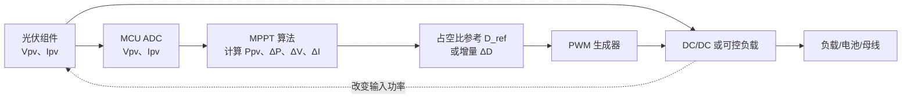
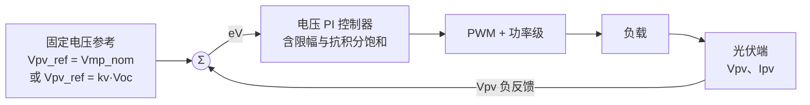
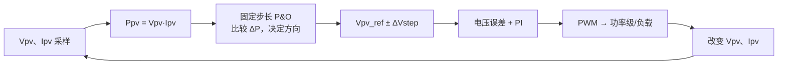
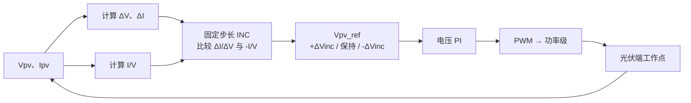

# MPPT 算法控制的光伏输入闭环系统

> 适用范围：通用单峰 P–V 曲线的光伏组件或光伏电池输入，MCU 通过 PWM 控制 DC/DC 功率级或可控电子负载，使光伏端工作点尽量靠近最大功率点（MPP）。
> 
> 本笔记将“扰动观测法”按工程中最常见的两类实现组织为：固定步长 P&O 和变步长/自适应步长 P&O；将“电导增量法”按三类实现组织为：固定步长 INC、变步长 INC、自适应/优化型 INC。后两类属于实现家族，具体公式可按项目约束调整。

## 1. 结论先行

推荐使用两层闭环：

```text
MPPT 外环：根据 Vpv、Ipv 计算工作点，并生成 Vpv_ref
        ↓
光伏端电压内环：Vpv_ref - Vpv → PI/控制器 → PWM 占空比 D
        ↓
DC/DC 功率级或电子负载改变输入阻抗
        ↓
光伏端 Vpv、Ipv 改变，重新反馈到 MCU
```

这种结构比“MPPT 直接修改占空比”更容易限制电压、电流和占空比，也更容易加入软启动、抗积分饱和、过压/过流保护和负载变化抑制。

直接占空比扰动也可以构成闭环，但 MPPT 算法需要直接输出 `D_ref` 或 `ΔD`，且 `D` 对光伏端电压的作用方向依赖具体拓扑，必须通过小信号测试或仿真确认。

## 2. 系统闭环框图

### 2.1 推荐结构：MPPT 外环 + 光伏端电压内环

```mermaid
flowchart LR
    PV[光伏组件/电池阵列<br/>工作点：Vpv、Ipv、Ppv]
    PWR[DC/DC 功率级或可控电子负载<br/>改变光伏端等效输入阻抗]
    LOAD[负载/电池/母线]

    SNS[电压/电流采样与调理<br/>分压、放大、隔离、ADC]
    ADC[MCU ADC + 同步采样<br/>滤波、标定、限幅]
    MPPT[MPPT 外环<br/>CV / P&O / INC]
    VREF[光伏端参考值<br/>Vpv_ref]
    ERR[电压误差<br/>eV = Vpv_ref - Vpv]
    CTRL[电压控制器<br/>PI / PR / 状态反馈]
    LIM[限幅与保护协调<br/>Dmin、Dmax、OVP、OCP、软启动]
    PWM[MCU PWM 定时器<br/>互补输出/死区/同步触发]
    GATE[栅极驱动]

    PV --> PWR --> LOAD
    PV --> SNS --> ADC
    ADC --> MPPT --> VREF
    VREF --> ERR
    ADC -- Vpv --> ERR
    ERR --> CTRL --> LIM --> PWM --> GATE --> PWR
    PWR -.输入功率/输入阻抗变化.-> PV

    classDef power fill:#e8f4ff,stroke:#1976d2,color:#102a43;
    classDef control fill:#fff4d6,stroke:#c58b00,color:#4a3500;
    classDef sense fill:#e9f7ef,stroke:#2e8b57,color:#123b25;
    class PV,PWR,LOAD power;
    class MPPT,VREF,ERR,CTRL,LIM,PWM control;
    class SNS,ADC sense;
```



### 2.2 直接占空比扰动结构



直接占空比路径的核心闭环是：

```text
Vpv、Ipv → Ppv → MPPT 决策 → D_ref/ΔD → PWM → 功率级 → Vpv、Ipv
```

它省去了显式电压内环，软件较简单，但有以下边界：

- `D` 增大后，`Vpv` 是上升还是下降，取决于 Buck、Boost、Buck-Boost、输入电流控制方式和负载状态；不能直接套用某个拓扑的方向判断。
- 负载突变时，MPPT 算法可能把负载变化误认为扰动引起的功率变化。
- 没有电压内环时，电压约束、限流和功率软启动更依赖 MPPT 逻辑与保护逻辑。

## 3. 光伏模型与最大功率点条件

光伏侧瞬时功率为：

$$
P_{pv}=V_{pv}I_{pv}
$$

沿 P–V 曲线求导：

$$
\frac{dP_{pv}}{dV_{pv}}
 = I_{pv}+V_{pv}\frac{dI_{pv}}{dV_{pv}}
$$

最大功率点满足：

$$
\frac{dP_{pv}}{dV_{pv}}=0
$$

因此有：

$$
\frac{dI_{pv}}{dV_{pv}}=-\frac{I_{pv}}{V_{pv}}
$$

工程实现中使用离散量：

$$
P_k=V_kI_k
$$

$$
\Delta V_k=V_k-V_{k-1},\qquad
\Delta I_k=I_k-I_{k-1},\qquad
\Delta P_k=P_k-P_{k-1}
$$

采样点必须在功率级暂态基本结束后再用于 MPPT 决策，否则控制器会把 PWM 纹波、采样延迟或负载变化误判为太阳辐照度变化。

## 4. 固定电压法（CV，Constant Voltage）

### 4.1 实现原理

固定电压法不实时搜索最大功率点，而是认为光伏组件的最大功率点电压与开路电压近似成比例：

$$
V_{mp}\approx k_vV_{oc},\qquad 0<k_v<1
$$

常见实现有两种：

1. **固定绝对电压**：直接设置 `Vpv_ref = Vmp_nom`，适合组件型号、温度范围和串并联配置比较固定的场景。
2. **开路电压比例法**：周期性停止功率传输或使用专用采样支路获取 `Voc`，然后设置 `Vpv_ref = kv Voc`。

`k_v` 不是普适常数，应根据组件数据、温度范围、实际工作点和标定数据确定。温度变化、组件老化和局部遮挡都会使该近似产生误差。

### 4.2 固定电压法闭环路径

推荐采用电压内环时，闭环为：

```text
Vmp_nom 或 kv·Voc
        ↓
Vpv_ref ──┐
          ├─ eV = Vpv_ref - Vpv
Vpv  ←────┘
        ↓
PI/电压控制器
        ↓
占空比 D
        ↓
PWM → DC/DC/可控负载
        ↓
改变光伏端输入阻抗
        ↓
Vpv 反馈
```

对应的 Mermaid 路径：



实际硬件中“负载 → 光伏端”的闭环关系由功率级决定。电压环控制器的正负号、`Dmin/Dmax` 和故障动作必须通过具体拓扑确认。

### 4.3 优缺点

- 优点：计算量小，参数少，启动快，工程实现简单。
- 缺点：不是实时 MPPT；`Vpv_ref` 偏离真实 `Vmp` 时会产生稳态功率损失。
- 不适合直接应对：宽温度范围、组件型号变化、明显局部遮挡和多峰 P–V 曲线。

## 5. 扰动观测法（P&O）

扰动观测法通过对工作点施加小扰动，观察功率变化方向，再决定下一次扰动方向。为了减少功率级方向不确定性，以下说明优先以 `Vpv_ref` 为被扰动量；如果直接扰动 `D`，需根据拓扑映射方向。

### 5.1 固定步长 P&O

#### 原理

设上一周期的控制参考为 `Vref,k-1`，本周期施加扰动 `ΔVstep`。比较本次与上次功率：

$$
\Delta P_k=P_k-P_{k-1}
$$

若本次扰动使功率增加，则继续沿当前方向；若功率减小，则反向扰动。

可以用方向变量 `s_k∈{+1,-1}` 表示：

$$
s_k=
\begin{cases}s_{k-1}, & \Delta P_k>\varepsilon_P\\-s_{k-1}, & \Delta P_k<-\varepsilon_P\\s_{k-1}, & |\Delta P_k|\le\varepsilon_P
\end{cases}
$$

然后：

$$
V_{ref,k}=V_{ref,k-1}+s_k\Delta V_{step}
$$

其中 `εP` 用于抑制 ADC 噪声和 PWM 纹波导致的方向抖动。

#### 闭环路径

```text
Vpv、Ipv → Ppv=Vpv·Ipv → 与 Pprev 比较
       → 判断继续/反向扰动
       → Vpv_ref 加减固定步长
       → 电压内环 PI
       → PWM → 功率级/负载
       → Vpv、Ipv 重新采样
```



#### 特点

- 离 MPP 较远时搜索速度由固定步长决定。
- 接近 MPP 时会在最大功率点两侧来回摆动，产生稳态功率纹波。
- 辐照度快速变化时，`ΔP` 不一定只由自身扰动产生，可能出现误判。

### 5.2 变步长/自适应步长 P&O

#### 原理

固定步长 P&O 的核心问题是速度和稳态纹波无法同时优化。变步长方法根据功率变化量或功率-电压斜率调节扰动幅度。

一种通用形式为：

$$
g_k=\left|\frac{\Delta P_k}{\Delta V_k+\varepsilon_V}\right|
$$

$$
\Delta V_{step,k}
=\operatorname{sat}\left(K_{po}g_k,\Delta V_{min},\Delta V_{max}\right)
$$

其中：

- `sat(x, xmin, xmax)` 是限幅函数；
- 远离 MPP 时斜率通常较大，步长变大，跟踪更快；
- 接近 MPP 时斜率趋小，步长变小，稳态摆动减小；
- `ΔVmin` 不能为零，否则在噪声和量化误差下可能失去跟踪能力。

方向判断仍可沿用固定步长 P&O：功率上升则保持方向，功率下降则反向。

#### 闭环路径

```text
Vpv、Ipv → Ppv、ΔP、ΔV → P&O 方向判断
                     ↓
          自适应计算 ΔVstep,k
                     ↓
       Vpv_ref = Vpv_ref + s·ΔVstep,k
                     ↓
          电压 PI → PWM → 功率级
                     ↓
                 Vpv、Ipv 反馈
```

#### 特点

- 比固定步长 P&O 更容易兼顾动态响应和稳态纹波。
- 对采样噪声、采样延迟、功率级暂态更敏感，需要滤波和稳定判定时间。
- 步长调节不能过度依赖单次 `ΔP`，工程上通常需要滑动平均、死区和最大步长限制。

## 6. 电导增量法（INC）

### 6.1 公共判据

MPP 条件为：

$$
I+V\frac{dI}{dV}=0
$$

离散化后定义误差：

$$
E_k=\frac{\Delta I_k}{\Delta V_k+\varepsilon_V}
      +\frac{I_k}{V_k+\varepsilon_V}
$$

在一般光伏工作区间内：

<br/>

|E_k` 条件|工作位置|调节方向|
|--|--|--|
|`E_k > εE`|MPP 左侧，`dP/dV > 0`|提高 `Vpv_ref`|
|`E_k≤ εE`|接近 MPP|保持 `Vpv_ref`|
|`E_k < -εE`|MPP 右侧，`dP/dV < 0`|降低 `Vpv_ref`|

<br/>

这里的“提高/降低 `Vpv_ref`”仍然是以电压参考为控制变量。若直接控制占空比，必须将该方向经过功率级的小信号方向映射转换为 `D` 的增减。

### 6.2 固定步长 INC

#### 原理

固定步长 INC 根据 `E_k` 判断 MPP 相对位置，每次以固定电压步长移动：

$$
V_{ref,k+1}=\begin{cases}V_{ref,k}+\Delta V_{inc}, & E_k>\varepsilon_E\\V_{ref,k}, & |E_k|\le\varepsilon_E\\V_{ref,k}-\Delta V_{inc}, & E_k<-\varepsilon_E
\end{cases}
$$

#### 闭环路径

```text
Vpv、Ipv → ΔV、ΔI → ΔI/ΔV 与 -I/V 比较
       → 判断 MPP 左侧/附近/右侧
       → Vpv_ref 固定步长上调、保持或下调
       → 电压 PI → PWM → 功率级/负载
       → Vpv、Ipv 反馈
```



#### 特点

- 直接使用 MPP 的导数判据，理论上比 P&O 更容易区分工作点位置。
- 对电流传感器偏置、低电压除法、`ΔV` 接近零和采样噪声敏感。
- 固定步长仍然存在动态速度与稳态纹波的折中。

### 6.3 变步长 INC

#### 原理

根据导数误差 `E_k` 的绝对值调节步长：

$$
\Delta V_{inc,k}
=\operatorname{sat}\left(K_{inc}|E_k|,
\Delta V_{min},\Delta V_{max}\right)
$$

控制参考更新为：

$$
V_{ref,k+1}=V_{ref,k}+\operatorname{sgn}(E_k)\Delta V_{inc,k}
$$

当 `|E_k|` 较大时，说明离 MPP 较远，步长较大；当 `|E_k|` 较小时，步长减小，降低 MPP 附近振荡。

#### 闭环路径

```text
Vpv、Ipv → ΔI/ΔV + I/V → E_k
       → 由 |E_k| 计算自适应步长
       → 由 sign(E_k) 决定 Vpv_ref 上调/下调
       → 电压 PI → PWM → 功率级/负载
       → Vpv、Ipv 反馈
```

### 6.4 自适应/优化型 INC

#### 原理

“自适应 INC”不是唯一固定算法，而是一类在基本 INC 外增加在线参数调整、归一化误差、扰动观测辅助、变采样周期、模糊规则或预测机制的实现。一个容易在 MCU 上实现的形式是同时使用导数误差和功率变化量：

$$
E_k=\frac{\Delta I_k}{\Delta V_k+\varepsilon_V}
      +\frac{I_k}{V_k+\varepsilon_V}
$$

$$
\Delta V_{inc,k}
=\operatorname{sat}\left(
K_E|E_k|+K_P|\Delta P_k|,
\Delta V_{min},\Delta V_{max}
\right)
$$

并在 MPP 附近设置保持区：

$$
|E_k|<\varepsilon_E
\quad\text{且}\quad
|\Delta P_k|<\varepsilon_P
\Rightarrow V_{ref,k+1}=V_{ref,k}
$$

工程上还可以根据以下状态切换参数：

- **稳定状态**：减小步长、降低 MPPT 更新频率，降低稳态纹波和 MCU 负载。
- **辐照度突变**：增大步长或临时提高更新频率，加快重新定位。
- **电压/电流接近限制**：冻结 MPPT 或优先执行保护限制。
- **`ΔV` 太小或电流接近零**：进入启动/异常分支，避免除零和错误方向判断。

#### 闭环路径

```text
Vpv、Ipv → ΔV、ΔI、ΔP → 归一化电导误差 E_k
       → 状态识别：稳定/快速变化/限幅/异常
       → 自适应选择步长、更新周期和保持区
       → Vpv_ref → 电压 PI → PWM → 功率级
       → Vpv、Ipv 反馈
```

#### 特点

- 在快速辐照度变化与稳态低纹波之间具有更大的调节空间。
- 需要更多阈值、状态机和参数整定，软件验证量明显增加。
- 不能把“自适应”当作自动正确；滤波延迟、阈值滞环、异常分支和计算定点化都需要验证。

## 7. 各方法的闭环路径总览

```mermaid
flowchart TB
    MEAS[光伏侧测量<br/>Vpv、Ipv、Ppv]
    ALG{MPPT 算法选择}

    CV[固定电压 CV<br/>Vpv_ref = Vmp_nom 或 kv·Voc]
    PO1[固定步长 P&O<br/>比较 ΔP，固定 ΔVstep]
    PO2[变步长 P&O<br/>比较 ΔP，自适应 ΔVstep]
    INC1[固定步长 INC<br/>比较 ΔI/ΔV 与 -I/V]
    INC2[变步长 INC<br/>步长随 |E| 变化]
    INC3[自适应/优化 INC<br/>状态识别 + 归一化误差]

    REF[Vpv_ref]
    CTRL[电压误差环<br/>eV = Vpv_ref - Vpv<br/>PI/限幅/抗饱和]
    PWM[PWM 占空比 D]
    STAGE[DC/DC 或可控负载]
    PV[光伏端工作点变化]

    MEAS --> ALG
    ALG --> CV --> REF
    ALG --> PO1 --> REF
    ALG --> PO2 --> REF
    ALG --> INC1 --> REF
    ALG --> INC2 --> REF
    ALG --> INC3 --> REF
    REF --> CTRL --> PWM --> STAGE --> PV --> MEAS
```

所有方法最终都可以归一到：

$$
\text{光伏测量}
\rightarrow \text{MPPT 决策}
\rightarrow V_{pv,ref}
\rightarrow \text{电压控制器}
\rightarrow D
\rightarrow \text{功率级}
\rightarrow \text{光伏工作点反馈}
$$

差异主要在于“MPPT 决策”这一块如何产生 `Vpv_ref`：

- CV：不搜索，只给定一个估计参考值；
- P&O：用功率变化方向推断下一次扰动方向；
- INC：用瞬时电导与增量电导的关系直接判断 MPP 相对位置。

## 8. MPPT 实现对比表

|方法|MPPT 输出|主要测量量|动态响应|MPP 附近稳态纹波|对温度/辐照变化|计算量与实现复杂度|主要风险/注意事项|
|--|--|--|--|--|--|--|--|
|固定电压 CV|固定 `Vpv_ref` 或 `kv·Voc`|电压；比例法还需 `Voc`|快，启动简单|低，主要取决于电压环|弱，`Vmp` 漂移会产生功率损失|最低|不是实时 MPPT；`kv` 依赖组件和温度；开路采样会造成功率中断|
|固定步长 P&O|`Vpv_ref ± ΔVstep` 或 `D ± ΔD`|电压、电流|中等，取决于固定步长|较明显，存在来回摆动|中等；辐照突变可能误判 `ΔP`|低|功率测量噪声、采样延迟、负载变化会影响方向判断|
|变步长 P&O|`Vpv_ref ± ΔVstep,k`|电压、电流|通常优于固定步长|通常较小|中等到较好|低到中|步长公式、最小步长、滤波和突变判定需要整定|
|固定步长 INC|`Vpv_ref` 固定步长移动|电压、电流|中等|较明显|通常优于 P&O 的方向判据|中等|`ΔV≈0`、低电压除法、电流偏置和量化噪声|
|变步长 INC|`Vpv_ref ± ΔVinc,k`|电压、电流|较快|较小|较好|中等|`E_k` 对采样噪声敏感；步长过大可能越过 MPP|
|自适应/优化型 INC|自适应 `Vpv_ref` 和更新周期|电压、电流，通常还用功率变化|可做得较快|可做到较小|较好|较高|状态机、阈值、滤波、定点范围和异常分支较多，验证成本高|

### 8.1 如何选择

|使用场景|建议|
|--|--|
|组件型号固定、成本和软件复杂度优先|CV；但应接受一定的失配功率损失|
|教学、原型验证、算力有限|固定步长 P&O|
|希望快速落地且降低稳态摆动|变步长 P&O|
|需要更直接利用 MPP 数学条件|固定步长或变步长 INC|
|辐照变化快、对稳态纹波和动态都有要求|自适应/优化型 INC，配合明确的状态机和保护优先级|
|存在明显局部遮挡、多峰 P–V 曲线|以上单峰算法都可能陷入局部峰值，应增加全局扫描或多峰识别策略|

## 9. MCU 软件执行时序建议

### 9.1 快速 PWM/采样路径

```text
PWM 定时器事件
    ↓
ADC 同步采样 Vpv、Ipv
    ↓
快速滤波、标定、越界检查
    ↓
更新电压内环 PI
    ↓
限幅、抗积分饱和、保护协调
    ↓
更新 PWM 比较值
```

### 9.2 慢速 MPPT 路径

```text
每 N 个 PWM 周期执行一次
    ↓
读取已稳定的 Vpv、Ipv
    ↓
计算 Ppv、ΔV、ΔI、ΔP
    ↓
执行 CV/P&O/INC 状态机
    ↓
生成新的 Vpv_ref
    ↓
检查 Vpv_ref、功率和电流边界
```

MPPT 更新频率不应盲目等于 PWM 频率。一般需要满足：功率级和电压内环先完成主要暂态，再进行下一次 MPPT 判断。实际比例必须根据功率级带宽、采样滤波延迟、PWM 频率和负载动态验证。

## 10. 必须加入的边界处理

### 10.1 电压、电流和占空比限幅

$$
V_{ref}\in[V_{min},V_{max}],\qquad
D\in[D_{min},D_{max}],\qquad
I_{pv}\le I_{max}
$$

当过压、过流、过温或功率级故障发生时，保护逻辑优先于 MPPT，MPPT 应冻结、降额或复位到安全参考值。

### 10.2 除零与低信号处理

INC 中的 `ΔI/ΔV` 和 `I/V` 必须处理：

- `|ΔV| < εV`：不直接做除法，可使用相邻多点差分或进入保持/特殊分支；
- `Vpv < Vstart`：禁止执行普通 INC 判据；
- `Ipv` 接近零：判定为启动、夜间或断路状态；
- ADC 饱和、断线或校准失败：进入故障路径。

### 10.3 抗积分饱和

电压 PI 输出已经达到 `Dmin/Dmax` 时，应停止相同方向的积分，或者采用回算式抗饱和。否则 MPPT 改变 `Vpv_ref` 后，PI 可能长时间恢复，表现为过冲或响应迟缓。

### 10.4 采样同步与滤波

采样最好与 PWM 固定相位同步，并避开开关瞬态。滤波应在“抑制开关纹波”和“保留辐照变化速度”之间折中。滤波太重会使 P&O/INC 使用过时数据，滤波太轻会导致方向抖动。

## 11. 未确认项与验证计划

以下内容必须结合实际硬件进一步确认，不能仅凭通用算法说明确定：

|项目|当前状态|需要的证据|
|--|--|--|
|DC/DC 拓扑及 `D → Vpv` 方向|`unverified`|原理图、功率级控制方式、小信号测试或仿真|
|PWM 极性、互补输出、死区|`unverified`|MCU 定时器配置、栅极驱动逻辑和示波器波形|
|电压/电流采样比例与偏置|`unverified`|原理图、ADC 标定数据和实测值|
|MPPT 更新周期|`unverified`|功率级带宽、采样滤波、负载阶跃测试|
|`Vmp/Voc` 比例 `kv`|`unverified`|组件数据手册、温度扫描或标定实验|
|部分遮挡下是否需要全局 MPPT|`unverified`|组件串并联方式和遮挡场景测试|

建议按以下证据等级验证：

1. **主机测试**：用离散光伏模型和功率级模型验证方向判断、边界、限幅、噪声和突变。
2. **数字仿真/半实物**：验证 DC/DC 拓扑、`D → Vpv` 方向、内外环带宽和稳定性。
3. **低压限流台架**：验证启动、占空比方向、采样极性和保护动作。
4. **目标板运行**：验证 PWM、ADC 触发、ISR/任务时序和实时性。
5. **示波器/功率分析仪**：验证 `Vpv`、`Ipv`、输入功率、PWM、过冲、纹波和 MPP 跟踪效率。

## 12. 推荐的最小落地方案

如果需要先做一个可控、易验证的版本，建议采用：

```text
变步长 P&O 或变步长 INC
        ↓
生成 Vpv_ref
        ↓
光伏端电压 PI 内环
        ↓
PWM 控制 DC/DC 或可控负载
```

最小软件模块可以划分为：

```text
pv_measurement
    ├─ ADC 标定、滤波、有效性检查
mppt_cv
mppt_perturb_observe
mppt_incremental_conductance
pv_voltage_controller
    ├─ PI、限幅、抗积分饱和
pwm_power_stage
    ├─ 占空比映射、PWM 更新、保护关断
pv_protection
    ├─ 过压、过流、过温、传感器故障
```

推荐的第一版验收指标应至少包括：启动不失控、`Vpv` 不超过上限、过流能关断、稳定辐照下功率纹波可接受、辐照度阶跃后能重新收敛，并且明确这些结论分别来自主机测试、目标板测试还是实际功率测试。
