## 闭环控制系统原理

单环闭环控制系统的结构一般为：

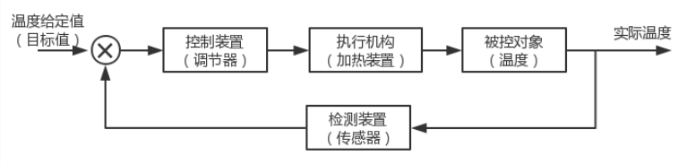

由图可知，闭环控制是由实际值与目标值的关系来控制被控对象的属性

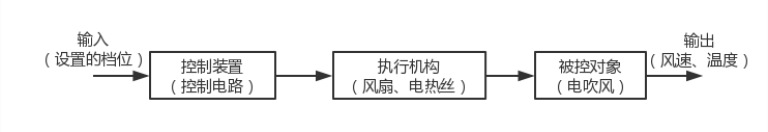

开环就是目标值控制被控对象

## PID算法

### 什么是PID?

PID是Proportional（比例）、Integral（积分）、Differential（微分）的首字母缩写； 是**一种结合比例、积分和微分三种环节于一体的闭环控制算法**

$u(t)=\frac{1}{p}\left(e(t)+\frac{1}{T_I}\int_{0}^{t}e(t)\,dt+T_D\frac{de(t)}{dt}\right)$

由pid公式可以看出整体由好几个关键元素组成

- $e(t)$: 输入值和反馈值的差值
- $u(t)$:PID控制器的输出值
- $p$:比例度
- $T_t$:积分时间系数
- $T_D$:微分时间系数

1. 连续信号（如模拟信息温度等）下公式为：实际使用中只需要调整$K_p,K_i,K_d$即可
   
   $u(t)=K_p e(t)+K_i\int_{0}^{t}e(t)\,dt+K_d\frac{de(t)}{dt}$
2. 离散信号（如数字信号ADC采样值）下公式为：
   
   $u(t) = K_p e(t) + K_i \sum_{i=1}^{N} e(i) + K_d \frac{e(i) - e(i-1)}{\Delta t}$

#### 比例增益——$K_p$

比例控制是最简单的一种控制方式，成比例的反应控制系统中输入与输出的偏差信号，**只要偏差一旦产生，就立即产生控制的作用来减小产生的误差**

单独的比例控制，将公式其他两个系数都设置为零就有：

$u(t)=K_p * e(t)$

由公式可知$K_p$越大，输出值越大，现在以一辆小车的运动来演示P控制的作用

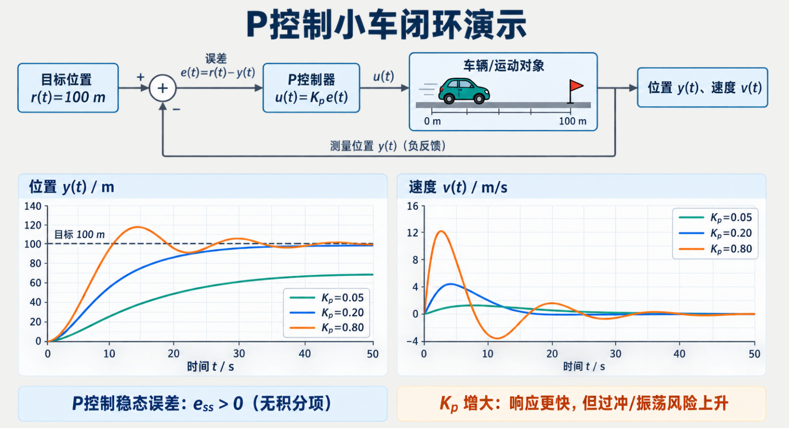

**在实际使用中会发现P过大会产生振荡以及只有P控制时会存在稳态误差**

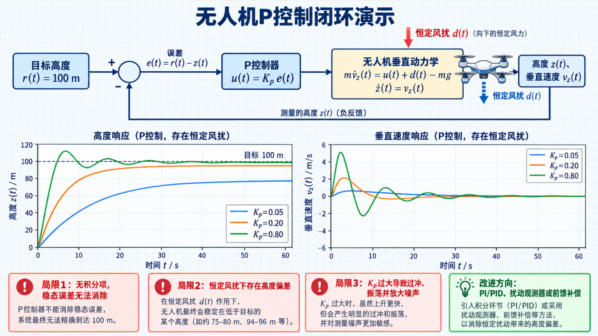

其稳态误差产生的原因是：

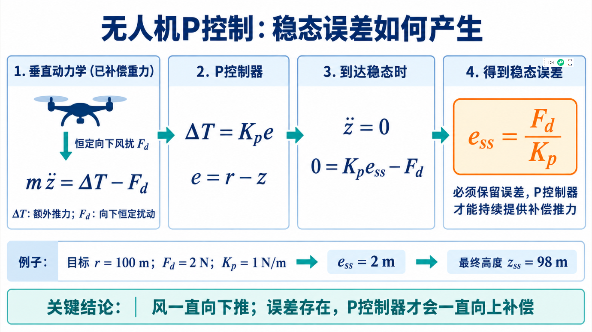

*其P过大出现超调现象振荡的原因*是：执行器的延迟和物体的惯性等等

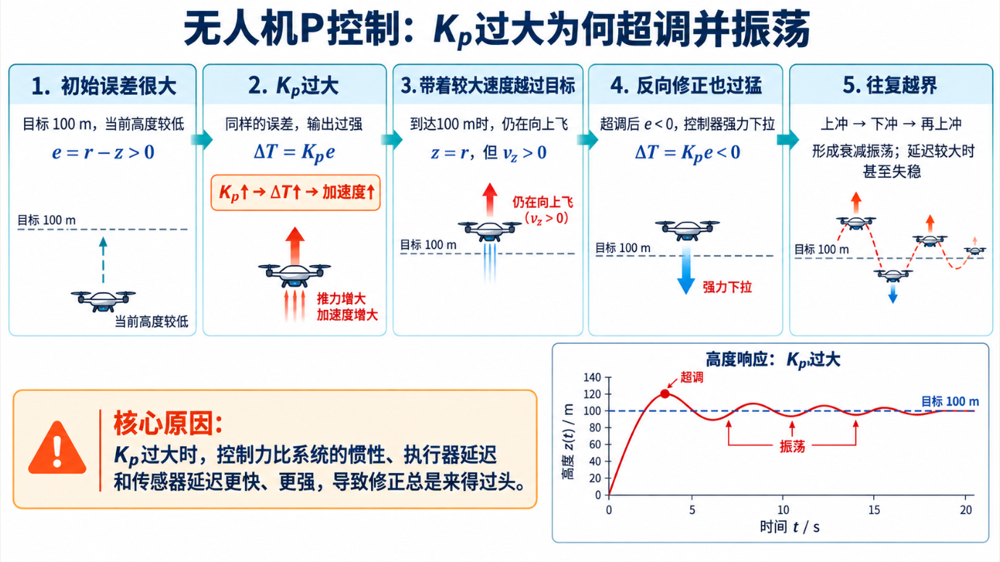

一般稳态误差的解决方法为，需要引入积分环节使用PI控制来消除稳态误差

#### 积分系数——$K_i$

在比例控制环节产生了静态误差，**在积分环节中，主要用于就是消除静态误差提高系统的无差度**。积分作用的强弱，取决于积分时间常数Ti， Ti越大积分作用越弱，反之则越强。**积分控制作用的存在与偏差e(t)的存在时间有关，只要系统存在着偏差，积分环节就会不断起作用**，并且积分积累是无法消除的，只能通过P比例来控制整体的输出了，所以一般都是PI输出，没有单独的I输出

PI控制将K_d设置为零即可就有：

$u(t) = K_p e(t) + K_i \sum_{i=1}^{N} e(i) $

还是使用无人机的例子来说明积分系统的作用——消除稳态误差

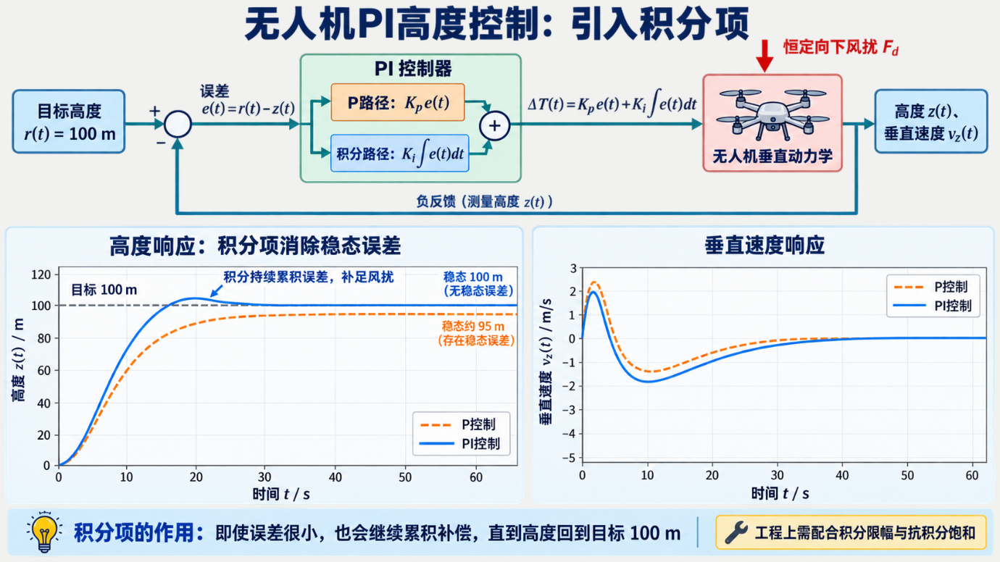

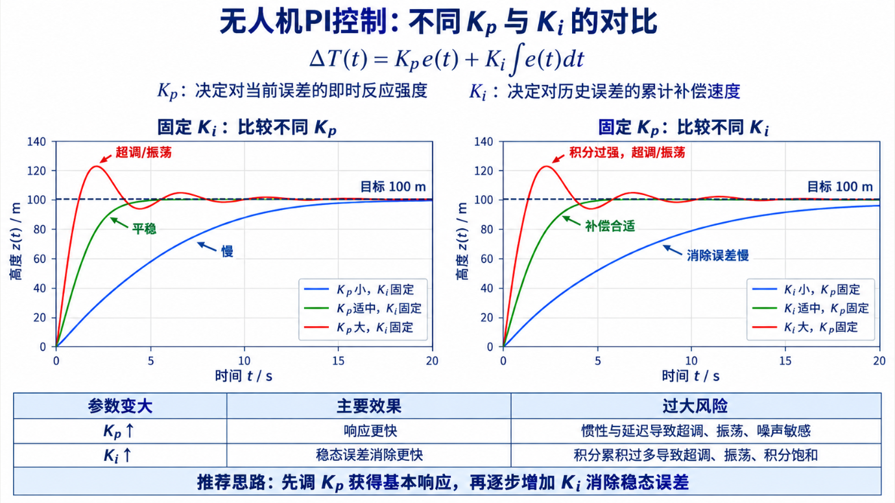

能够发现积分积累I过大也会引起超调和振荡，也就是积分饱和现象

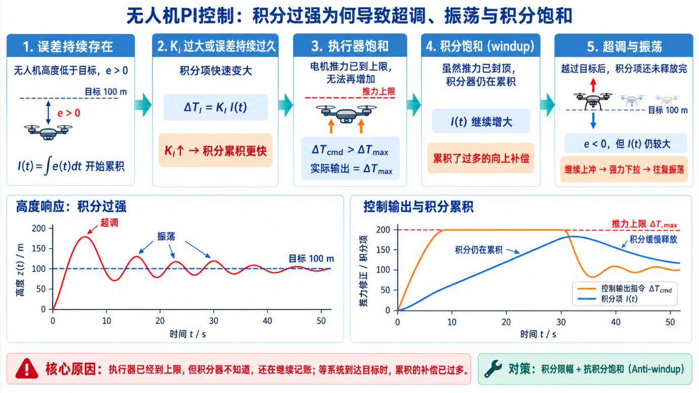

积分饱和导致过多的调制量利用**积分限幅（设置一个积分最大值，积分不能超过该最大值）**，因为目标值的大幅度变化导致积分快速变换（累加值过大）导致超调利用**积分分离（定义一个最大误差值，超过阈值，积分输入调整为0）**来解决问题或者引入微分来解决

#### 微分系统——$K_d$

**微分环节的作用是反应系统偏差的一个变化趋势，也可以说是变化率，可以在误差来临之前提前引入一个有效的修正信号， 有利于提高输出响应的快速性,减小被控量的超调和增加系统的稳定性**，虽然积分环节可以消除静态误差但是降低了系统的响应速度， 所以引入微分控制器就显得很有必要，尤其是具有较大惯性的被控对象使用PI控制器很难得到很好的动态调节品质，系统会产生较大的超调和振荡， 这时可以引入微分作用

引入k_d是为了减少P或者I引起的超调问题，其整体公式为：

$u(t) = K_p e(t) + K_i \sum_{i=1}^{N} e(i) + K_d \frac{e(i) - e(i-1)}{\Delta t}$

也可以为：

$u(t) = K_p e(t)  + K_d \frac{e(i) - e(i-1)}{\Delta t}$

使用无人机的例子来说明积分系统的作用——阻尼作用，对系统输出的值进行修正防止超过阈值过多

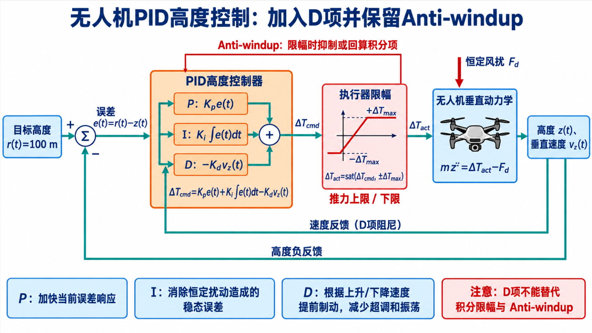

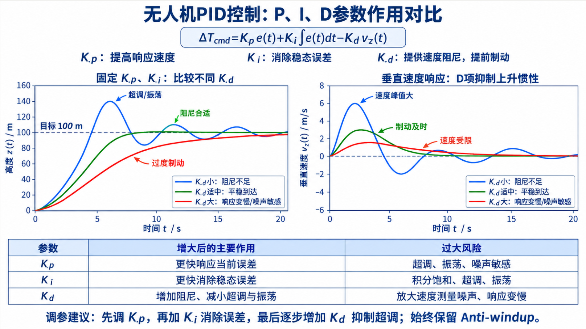

$K_d$过大会影响响应时间，**设定值发生阶跃时，由于阶跃信号导数趋于无穷大，则意味着$\frac{e(i) - e(i-1)}{\Delta t}$趋于无穷大导致输出值无限大该现象也叫微分冲击，解决该问题就使用使用微分先行**即只对实际值进行微分：$u(t) = K_p e(t) + K_i \sum_{i=1}^{N} e(i) + K_d \frac{- e(i-1)}{\Delta t}$

### 为什么需要使用PID？

PID算法是控制领域非常常见的算法，小到控制温度，大到控制飞机的飞行姿态和速度等等，都会涉及到PID控制， 在控制领域可以算是万能的算法，如果你能够掌握PID算法的控制与实现，那么已经足以应对控制领域的一般问题了。 并且在众多控制算法中PID是最能体现反馈思想的算法；

以小车速度为例，你一定会发现这样一个问题，当你刚把充满的12V电池装在小车上时，然后在程序上给了一个固定50%的占空比， 此时小车跑的很快动力很足，但是跑着跑着就慢了下来，因为电池电压的影响小车速度变慢了，在刚充满的时候12V电池50%的占空比 相当于直接作用在电机两端的电压是12V x 50% = 6V ,当使用一段时间后电池的电压变为9V，虽然程序占空比没有变，但是由于电池电压降低了， 所以作用在电机两端的电压也就变了，所以小车变慢了。那么怎么才能够使小车按照恒定速度行驶呢？其思想就是当小车速度慢了，就增加占空比。 那么速度慢多少开始增加占空比呢？怎么增加？增加多少呢？

### 如何使用PID?

#### PID参数整定

##### 试凑法

采样周期的选择，要**根据所设计的系统的具体情况，用试凑的方法，在试凑过程中根据各种合理的建议来预选采样周期**， 多次试凑，选择性能较好的一个作为最后的采样周期

调节思路

1. 先是比例（P），再积分（I），最后是微分（D）
2. 按纯比例系统整定比例系数，使其得到比较理想的调节过程曲线，然后再**把比例系数缩小 1.2 倍左右，将积分系数从小到大改变，使其得到较好的调节过程曲线**
3. 在这个积分系数下重新改变比例系数，再看调节过程曲线有无改善
4. 如果有改善，可将原整定的比例系数减少，改变积分系数，这样多次的反复，就可得到合适的比例系数和积分系数
5. 如果存在外界的干扰，系统的稳定性不好，可把比例、积分系数适当减小，使系统足够稳定
6. 如果系统存在小幅度超调，可以将整定好的比例系数和积分系数适当减小，增大微分系数，以得到超调量最小、调节作用时间最短的系统曲线。

##### 临界比例法

临界比例法：**适用于闭环控制系统里将调节器置于纯比例的作用下，从大到小逐渐改变调节器的比例度，并且得到等幅度的震荡过程就叫做临界比例度**

调节思路

1. 将积分、微分系数置零，比例度取适当值，平衡操作一段时间，使控制系统按纯比例作用的方式投入运行
2. **慢慢地增大比例系数，细心观察曲线的变化情况。如果控制过程的曲线波动是衰减的，则把比例系数继续增大；如果曲线波动是发散的，则应把比例系数减小，直至曲线波动呈等幅振荡，此时记下临界比例系数 δK 和临界振荡周期 Tk 的值**
3. 根据记下的比例系数和周期，采用经验公式，计算调节器的参数
   
   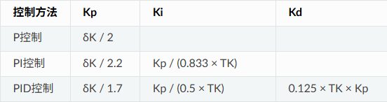

##### 一般调解法

这种方法**针对一般的PID控制系统所以称之为一般调节法**；其中Kp是加快系统响应速度，提高系统的调节精度；Ki用于消除稳态误差；Kd改善系统的稳态性能

调节思路

1. 首先将积分、微分系数置零，**使系统为纯比例控制。控制对象的值设定为系统允许的最大值的 60%~70%，接着逐渐增大比例系数，直至系统出现振荡**；此时再逐渐减小比例系数，直至系统振荡消失，然后记录此时的比例系数，并设定系统的比例系数为当前值的 60%~70%
2. **确定比例系数后，设定一个较小的积分系数，然后逐渐增大积分系数，直至系统出现振荡**；此时在逐渐减小积分系数，直至系统振荡消失，然后记录**此时的积分系数，并设定系统的积分系数为当前值的 55%~65%**
3. 微分系数一般不用设定，为 0 即可。若系统出现小幅度振荡，并且通过 PI 环节无法优化，这可以**采用与确定比例、积分系数相同的方法，微分系数取系统不振荡时的 30%左右**。
4. **系统空载、带载联调，再对 PID 参数进行微调**，直至满足要求

##### 上位机联调

> 参考网站：[VOFA+实现实时PID调参](https://blog.csdn.net/coward__123/article/details/131757291)

MCU通过串口与上位机通信，将PID的实际属性值输出到上位机显示界面显示PID曲线，利用串口修改PID参数，进而来实时观察PID曲线是否符合要求

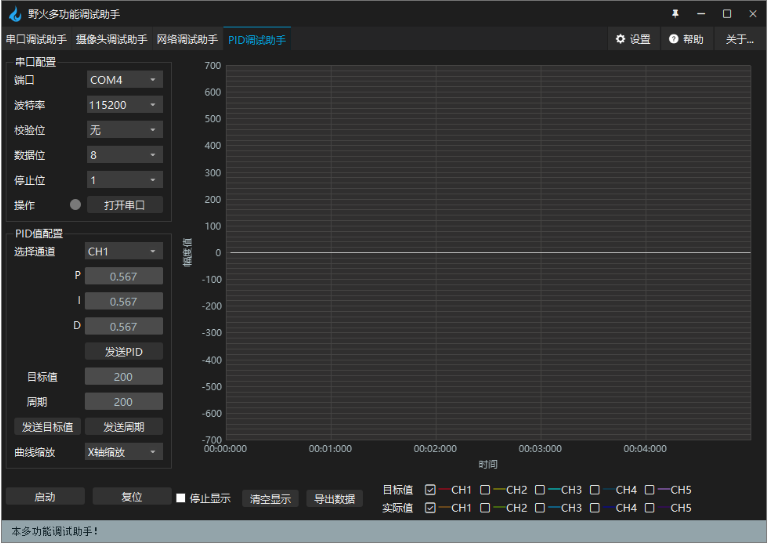

上位机和下位机的通信使用自定义或者开源的PID数据包格式发送，读取其中的PID参数来辅助调参，AI时代下也可以利用ai进行自动调参，还有一种就是利用keil的debug模式下读取寄存器或者变量值来进行调整观察现象

#### PID代码实现

##### 位置式PID

```c_cpp
typedef struct
{
    float kp;
    float ki;
    float kd;

    float dt_s;             /* 固定控制周期，单位：秒 */

    float output_min;
    float output_max;

    float integral_min;
    float integral_max;

    float integral;
    float last_error;
    float output;
} PID_Position_t;

static inline float PID_Clamp(float value, float min_value, float max_value)
{
    if (value > max_value)
    {
        return max_value;
    }

    if (value < min_value)
    {
        return min_value;
    }

    return value;
}

/* ---------- 位置式 PID ---------- */

static inline void PID_Position_Init(PID_Position_t *pid,
                                     float kp,
                                     float ki,
                                     float kd,
                                     float dt_s,
                                     float output_min,
                                     float output_max,
                                     float integral_min,
                                     float integral_max)
{
    if (pid == 0)
    {
        return;
    }

    pid->kp = kp;
    pid->ki = ki;
    pid->kd = kd;
    pid->dt_s = dt_s;

    pid->output_min = output_min;
    pid->output_max = output_max;
    pid->integral_min = integral_min;
    pid->integral_max = integral_max;

    pid->integral = 0.0f;
    pid->last_error = 0.0f;
    pid->output = 0.0f;
}

static inline void PID_Position_Reset(PID_Position_t *pid, float initial_output)
{
    if (pid == 0)
    {
        return;
    }

    pid->integral = 0.0f;
    pid->last_error = 0.0f;
    pid->output = PID_Clamp(initial_output,
                            pid->output_min,
                            pid->output_max);
}

static inline float PID_Position_Update(PID_Position_t *pid,
                                        float setpoint,
                                        float feedback)
{
    float error;
    float derivative;
    float candidate_integral;
    float raw_output;

    if ((pid == 0) || (pid->dt_s <= 0.0f))
    {
        return 0.0f;
    }

    error = setpoint - feedback;
    derivative = (error - pid->last_error) / pid->dt_s;

    candidate_integral = pid->integral + error * pid->dt_s;
    candidate_integral = PID_Clamp(candidate_integral,
                                   pid->integral_min,
                                   pid->integral_max);

    raw_output = pid->kp * error
               + pid->ki * candidate_integral
               + pid->kd * derivative;

    /*
     * 条件积分抗饱和：
     * 输出已被限幅且误差仍推动输出继续朝饱和方向增大时，
     * 不接受本次积分累积。
     */
    if (((raw_output > pid->output_max) && (error > 0.0f)) ||
        ((raw_output < pid->output_min) && (error < 0.0f)))
    {
        raw_output = pid->kp * error
                   + pid->ki * pid->integral
                   + pid->kd * derivative;
    }
    else
    {
        pid->integral = candidate_integral;
    }

    pid->output = PID_Clamp(raw_output,
                            pid->output_min,
                            pid->output_max);
    pid->last_error = error;

    return pid->output;
}

```

位置式PID的公式与默认的离散信号PID公式一致：$u(t) = K_p e(t) + K_i \sum_{i=1}^{N} e(i) + K_d \frac{e(i) - e(i-1)}{\Delta t}$

##### 增量式PID

```c_cpp
typedef struct
{
    float kp;
    float ki;
    float kd;

    float dt_s;             /* 固定控制周期，单位：秒 */

    float output_min;
    float output_max;

    float error_k;          /* e(k) */
    float error_k_1;        /* e(k-1) */
    float error_k_2;        /* e(k-2) */

    float output;
} PID_Incremental_t;

static inline float PID_Clamp(float value, float min_value, float max_value)
{
    if (value > max_value)
    {
        return max_value;
    }

    if (value < min_value)
    {
        return min_value;
    }

    return value;
}

/* ---------- 增量式 PID ---------- */

static inline void PID_Incremental_Init(PID_Incremental_t *pid,
                                        float kp,
                                        float ki,
                                        float kd,
                                        float dt_s,
                                        float output_min,
                                        float output_max)
{
    if (pid == 0)
    {
        return;
    }

    pid->kp = kp;
    pid->ki = ki;
    pid->kd = kd;
    pid->dt_s = dt_s;

    pid->output_min = output_min;
    pid->output_max = output_max;

    pid->error_k = 0.0f;
    pid->error_k_1 = 0.0f;
    pid->error_k_2 = 0.0f;
    pid->output = 0.0f;
}

static inline void PID_Incremental_Reset(PID_Incremental_t *pid,
                                         float initial_output)
{
    if (pid == 0)
    {
        return;
    }

    pid->error_k = 0.0f;
    pid->error_k_1 = 0.0f;
    pid->error_k_2 = 0.0f;
    pid->output = PID_Clamp(initial_output,
                            pid->output_min,
                            pid->output_max);
}

static inline float PID_Incremental_Update(PID_Incremental_t *pid,
                                           float setpoint,
                                           float feedback)
{
    float delta_p;
    float delta_i;
    float delta_d;
    float delta_output;

    if ((pid == 0) || (pid->dt_s <= 0.0f))
    {
        return 0.0f;
    }

    pid->error_k = setpoint - feedback;

    delta_p = pid->kp * (pid->error_k - pid->error_k_1);
    delta_i = pid->ki * pid->dt_s * pid->error_k;
    delta_d = pid->kd * (pid->error_k
                       - 2.0f * pid->error_k_1
                       + pid->error_k_2) / pid->dt_s;

    /*
     * 输出已经饱和且误差继续推动其向饱和方向变化时，
     * 抑制积分增量，避免持续累积。
     */
    if (((pid->output >= pid->output_max) && (pid->error_k > 0.0f)) ||
        ((pid->output <= pid->output_min) && (pid->error_k < 0.0f)))
    {
        delta_i = 0.0f;
    }

    delta_output = delta_p + delta_i + delta_d;

    pid->output = PID_Clamp(pid->output + delta_output,
                            pid->output_min,
                            pid->output_max);

    pid->error_k_2 = pid->error_k_1;
    pid->error_k_1 = pid->error_k;

    return pid->output;
}
```

增量式的PID公式以离散信号下的PID公式为基础，但是进行了扩展，计算相对上一周期应改变多少 Δu(t)，再累加得到 u(t)：$$
u(t) =
\operatorname{sat}
\left[
u(t - 1) + \Delta u(t)
\right]
$$

$$
\Delta u(t) =K_p \left[e(t) - e(t - 1)\right]+K_i T_s e(t)
-\frac{K_d}{T_s}
\left[
e(t) - 2e(t - 1) + e(t - 2)
\right]$$

位置式和增量式的差别是：

- 位置式 PID：直接问“现在应该输出多少？”
- 增量式 PID：先问“相对上一周期应该改多少？”，再累加恢复当前输出

位置式和增量式的应用场景：

|应用场景|被控对象与执行器特点|推荐 PID 形式|推荐原因|实现与调试关注点|
|--|--|--|--|--|
|恒温控制|加热片、制冷片、风扇；输出通常是 PWM 占空比或功率百分比|位置式 PI/PID|控制器可直接输出当前所需加热或制冷功率，物理意义直观|优先观察绝对输出、积分状态、超调量和稳态误差；温度噪声较小时再考虑 D 项|
|风扇转速控制|风扇惯性较大；输出为 PWM 占空比|位置式 PI|直接给出目标 PWM，通常 PI 已可满足需求|对低速启动区、最小占空比、反馈丢失和 PWM 限幅做保护|
|直流电机速度环|输出为 PWM、电压指令或电流参考；反馈为编码器测速|位置式 PI 或增量式 PID|调试和初期整定优先位置式；需要逐周期平滑修正输出时可选增量式|固定控制周期；处理 PWM 限幅、编码器速度噪声、积分饱和和电机堵转|
|直流电机位置环|输出通常是目标速度或目标转矩；反馈为编码器位置|位置式 PID|位置误差直接映射为速度或转矩目标，便于处理位置上限与目标切换|通常放在速度环之外形成串级控制；注意位置误差过大时的积分分离|
|电机电流环|高频、快速闭环；输出为 PWM 占空比；反馈含采样噪声|位置式 PI|电流环通常只需要 P 与 I；D 项易放大电流采样噪声|关注 ADC 同步采样、PWM 更新时刻、过流保护、死区和控制周期抖动|
|BLDC/PMSM 速度环|内部已有电流环；速度环输出为转矩或 $I_q$ 参考值|位置式 PI|输出的绝对值就是明确的转矩/电流参考，便于限流|速度环频率低于电流环；输出应受最大电流和加减速规划限制|
|阀门开度控制|电动阀、步进阀；执行器天然以“开一点/关一点”工作|增量式 PID|每周期输出增量可直接映射为开阀或关阀步数|限制单周期最大步数、总开度和到位时间；防止阀门长期顶在机械限位|
|步进电机微调|每周期按固定步数或微步调整；存在机械惯性和反向间隙|增量式 PID|控制结果可直接解释为本周期增加或减少多少脉冲|需要处理步数限速、加减速、反向间隙、丢步检测和机械限位|
|泵速/流量控制|执行器为泵 PWM 或变频器；反馈为流量计|位置式 PI/PID|流量目标通常直接对应泵功率或转速设定值|处理传感器滤波、空转、堵塞、最小流量和泵速上下限|
|液位控制|水箱液位；执行器为进水阀、排水阀或泵|位置式 PI/PID|可直接输出阀门开度或泵功率；便于限制安全液位|液位变化慢，优先 PI；积分分离阈值应覆盖大误差快速补偿区域|
|压力控制|气压、液压或管路压力；执行器为比例阀、泵或压缩机|位置式 PI/PID|绝对输出易映射到阀门开度或泵功率|注意压力传感器噪声、管路迟滞、泄压保护和 D 项滤波|
|姿态角外环|云台、无人机、平衡车；反馈为角度|位置式 PID|输出常为目标角速度，绝对量语义明确|通常采用“角度外环 + 角速度内环”的串级结构；避免外环积分过强|
|角速度内环|云台、电机、飞控；反馈为陀螺仪角速度|位置式 PI/PD|需要快速直接生成力矩或电流参考；D 项需谨慎处理噪声|重点关注陀螺仪滤波、采样同步、限流和执行器带宽|
|平衡车姿态控制|反馈变化快，执行器为电机转矩或 PWM|位置式 PD 或 PID|姿态误差可直接转为驱动力矩请求|D 项通常基于陀螺仪反馈；必须严格控制周期和低延迟|
|手动/自动频繁切换的控制|人工先设定当前输出，再切换至自动闭环|增量式 PID|可从当前执行器输出继续微调，较容易实现无扰切换|`Reset()` 时将初始输出设为当前实际输出；首次更新应建立反馈历史|
|数字式调节器|输出本身是可累加的寄存器值、DAC 码值或内部数字命令|增量式 PID|增量可直接映射为寄存器或 DAC 的增减量|对累计输出做上下限保护，避免溢出或长期饱和|
|希望限制每周期变化速度的系统|执行器不允许大幅突变，如泵、阀、电机或功率模块|增量式 PID|$\Delta u(k)$ 可直接用于实现单周期变化限速|除输出总限幅外，还应限制 $\Delta u_{\min}$ 和 $\Delta u_{\max}$|
|需要快速整定和排障的首版闭环|项目刚开始，参数和对象模型尚不明确|位置式 PI/PID|P、I、D 和绝对输出更容易记录、画曲线和分析|建议先关闭 D、使用 PI 建立稳定闭环，再按需要启用反馈微分|
|高噪声反馈系统|编码器测速抖动、ADC 噪声、陀螺仪噪声明显|位置式 PI 或增量式 PI|两种 PID 的 D 项都会放大噪声；先避免或滤波 D 项|使用低通滤波、反馈微分、死区或降低 D 增益；不要仅因使用增量式就保留 D 项|

#### PID多环实现

##### 电流环控制

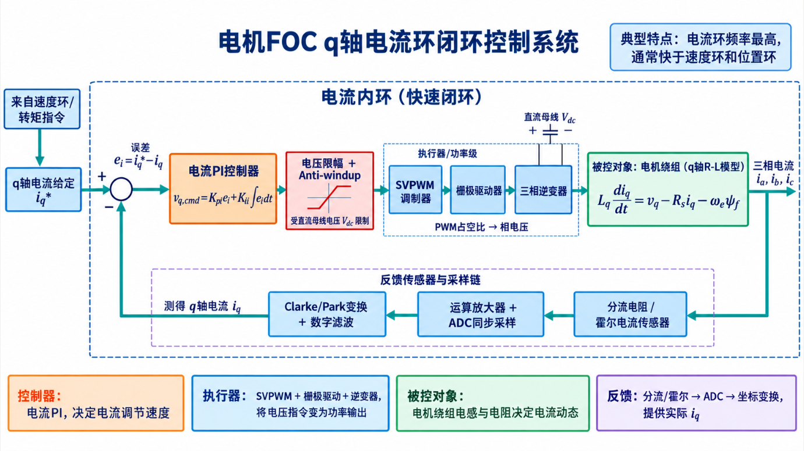

<br/>

##### 双环电压电流环控制

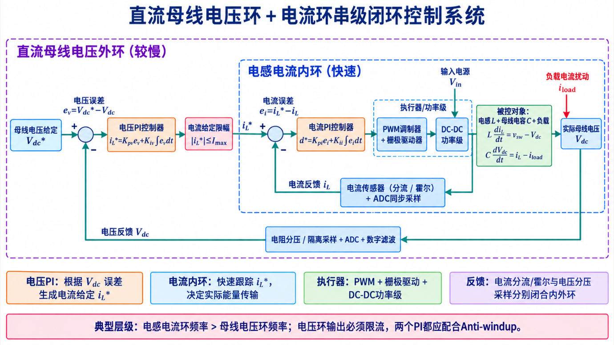

##### 双环速度电流环控制

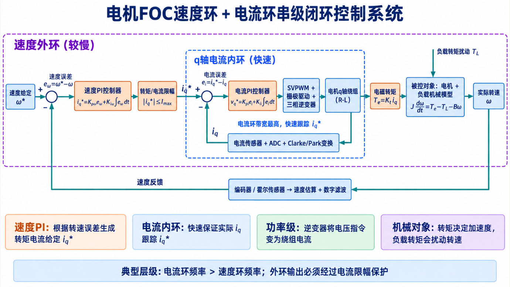

##### 双环位置速度环控制

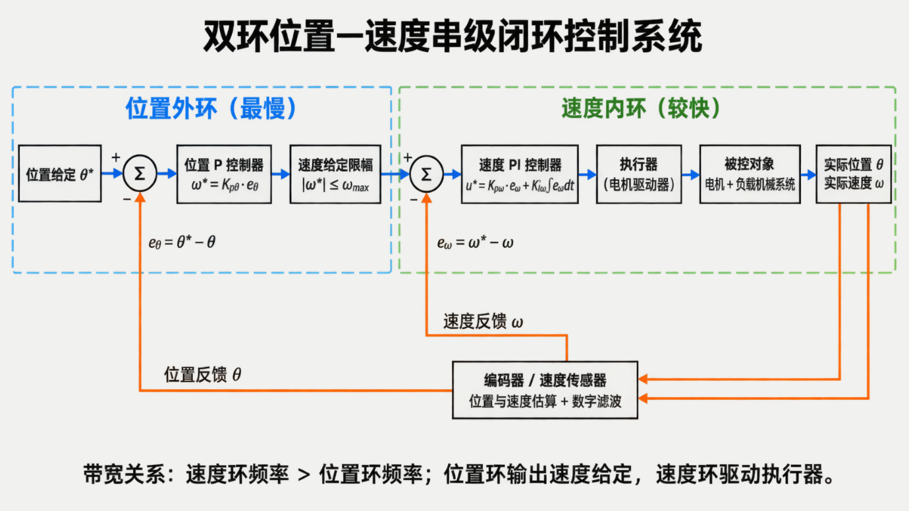

##### 三环位置速度电流环控制

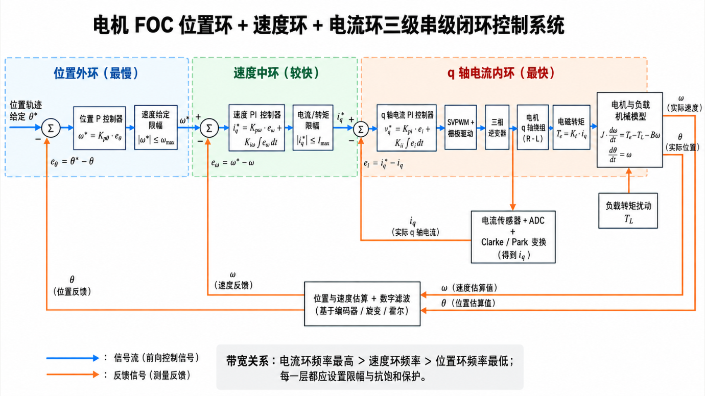

##### 项目整体级联闭环控制系统

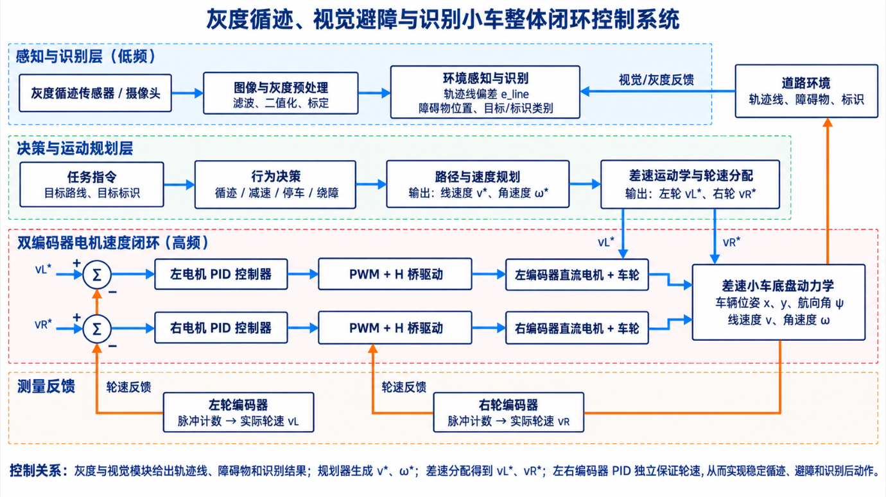

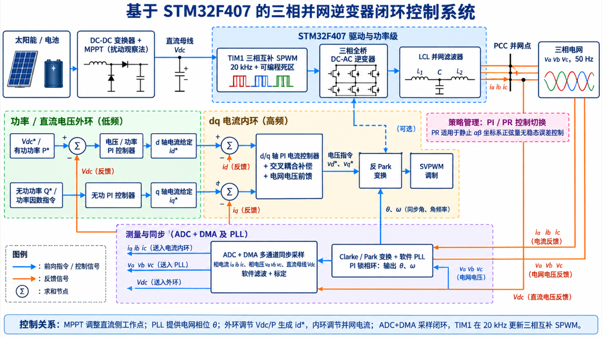

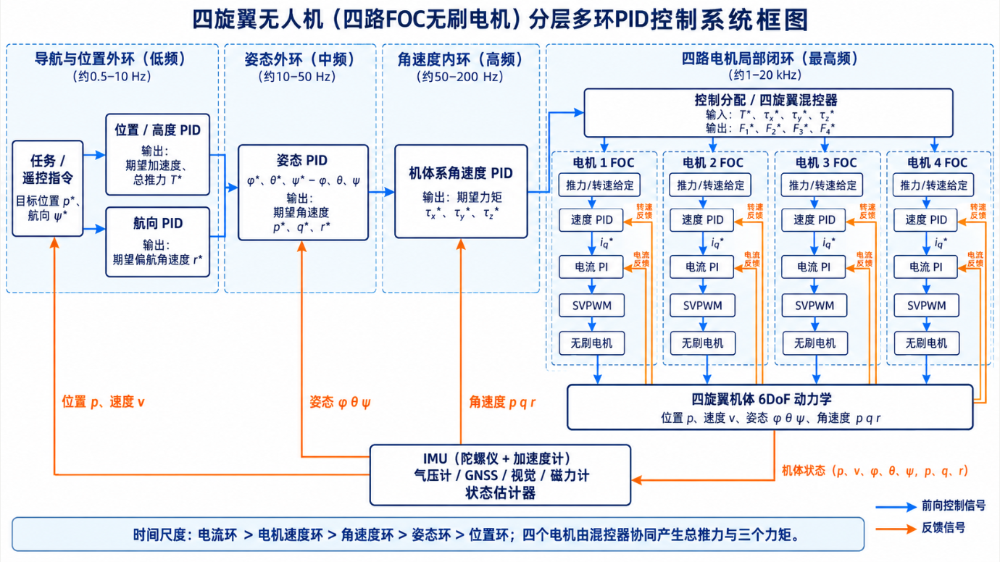

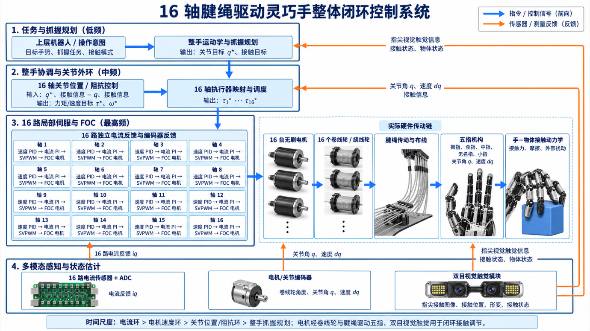

### 扩展部分——高级PID算法

#### 前馈控制

##### 1. 为什么在 PI 外再加前馈？

PI 是“发现误差后再纠正”：目标变化后，必须先产生误差 $e$，PI 才会输出控制量。

前馈则依据**目标值**或**可测扰动**预先计算一部分控制量，使被控对象一开始就朝正确方向运动。两者相加后：

- 前馈负责已知模型中的主要需求，改善跟踪速度；
- PI 负责模型不准、外扰和传感器偏差造成的剩余误差；
- 前馈不是反馈的替代品：模型失配时，仍需要 PI 保证稳态精度和鲁棒性。

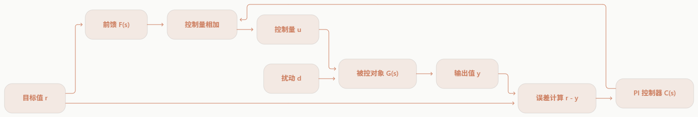

##### 2. 从框图到公式

设单位负反馈误差为

$$
e(s)=r(s)-y(s)
$$

PI 与前馈共同生成控制量：

$$
u(s)=C(s)e(s)+F(s)r(s)
$$

其中 PI 常写为：

$$
C(s)=K_p+\frac{K_i}{s}
$$

若扰动 $d(s)$ 加在对象输入端，则

$$
y(s)=G(s)\,[u(s)+d(s)]
$$

代入并整理，可得：

$$
\frac{y(s)}{r(s)}=\frac{G(s)\,[C(s)+F(s)]}{1+G(s)C(s)},\qquad
\frac{y(s)}{d(s)}=\frac{G(s)}{1+G(s)C(s)}
$$

若模型 $G(s)$ 完全准确，且允许实现其逆模型，取

$$
F(s)=G^{-1}(s)
$$

则参考输入到输出满足：

$$
\frac{y(s)}{r(s)}=1
$$

这说明理想前馈可让输出直接跟随目标；真实工程中 $G^{-1}(s)$ 往往含噪声敏感的微分项、非因果项或未知参数，因此只实现一个**有界、可滤波的近似前馈** $F(s)\approx G_m^{-1}(s)$。

##### 3. 电机速度环的常用形式

对于以 $i_q$ 产生转矩的 PMSM/BLDC 速度环，可用简化机械模型：

$$
J\dot{\omega}+B\omega=K_t i_q-T_L
$$

令目标速度为 $\omega^*$，已知或估计负载转矩为 $\hat{T}_L$，则前馈电流为：

$$
i_{q,ff}=\frac{J\dot{\omega}^*+B\omega^*+\hat{T}_L}{K_t}
$$

速度 PI 只处理残差：

$$
e_\omega=\omega^*-\omega
$$

$$
i_{q,pi}=K_p e_\omega+K_i\int e_\omega\,dt
$$

最终给电流环的参考值为：

$$
i_q^*=\operatorname{sat}\left(i_{q,ff}+i_{q,pi},\,-I_{q,\max},\,I_{q,\max}\right)
$$

**算例**：$J=0.002\ \mathrm{kg\cdot m^2}$，$B=0.01\ \mathrm{N\cdot m\cdot s/rad}$，$K_t=0.1\ \mathrm{N\cdot m/A}$；目标为 $\omega^*=20\ \mathrm{rad/s}$、$\dot{\omega}^*=50\ \mathrm{rad/s^2}$，估计负载 $\hat{T}_L=0.2\ \mathrm{N\cdot m}$。

$$
i_{q,ff}=\frac{0.002\times50+0.01\times20+0.2}{0.1}=5\ \mathrm{A}
$$

这 $5\ \mathrm{A}$ 预先覆盖加速、黏性阻尼和估计负载所需转矩；实际摩擦、母线电压受限、参数误差等由 PI 继续补偿。

##### 4. 实际使用方式

1. **先让 PI 独立稳定**：确认方向、单位、采样周期、限幅和抗积分饱和正确，再加入前馈。
2. **选择可获得的前馈量**：优先使用目标位置/速度/加速度，以及可测负载；目标加速度不要用未经滤波的差分直接计算。
3. **统一在执行器前相加并限幅**：前馈与 PI 使用同一物理单位，例如都为 $i_q$ 或都为电压；限幅后的差值要回送给 PI 做 anti-windup。
4. **由小到大验证**：先以较小前馈系数启用，观察跟踪误差、超调、电流峰值和饱和时间，再修正模型参数。

```c_cpp
/* 每个速度环周期调用；单位示例：rad/s、rad/s^2、A */
speed_error = speed_ref - speed_meas;
iq_pi = PI_Update(&speed_pi, speed_error);

iq_ff = (J * speed_ref_acc + B * speed_ref + load_torque_hat) / torque_constant;
iq_unsat = iq_pi + iq_ff;
iq_ref = Clamp(iq_unsat, -iq_limit, iq_limit);

PI_BackCalculate(&speed_pi, iq_ref - iq_unsat); /* 抗积分饱和 */
```

##### 5. 快速判断是否值得加前馈

适合：目标变化快、对象模型大致已知、目标或扰动可测，例如速度/位置轨迹跟踪。

不应盲加：模型未知且工况变化很大、前馈需要噪声很大的微分量、执行器长期饱和、或 PI 本身还未稳定。此时先解决采样、方向、限幅、PI 参数与传感器质量问题。
