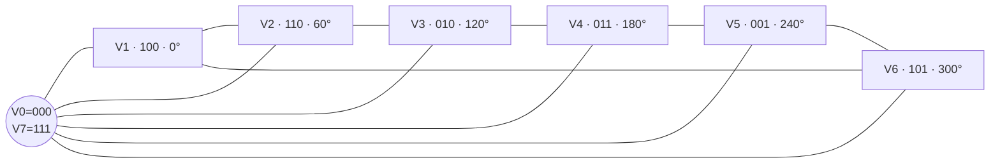

# SVPWM 原理、公式推演与 STM32 工程实践

> 适用对象：已经知道三相逆变器、Clarke/Park 变换和 FOC 基本结构，希望真正理解“为什么需要 SVPWM、公式从哪里来、代码怎样落到 PWM 寄存器”的嵌入式工程师。
> 
> 本文约定：两电平三相电压源逆变器、星形电机且中性点悬浮、幅值不变 Clarke 变换、理想开关。换相死区、器件压降、母线纹波和采样延迟将在工程章节单独处理。

## 0. 先给结论

SVPWM（Space Vector Pulse Width Modulation，空间矢量脉宽调制）不是电流控制器，也不是坐标变换。它是 FOC 的**电压执行器映射层**：

$$
(U_d,U_q)
\xrightarrow{\text{逆 Park}}
(U_\alpha,U_\beta)
\xrightarrow{\text{SVPWM}}
(d_a,d_b,d_c)
\xrightarrow{\text{定时器+栅极驱动}}
\text{三相逆变器}
$$

一句话概括其原理：

> 在每个 PWM 周期内，选择参考电压矢量两侧最近的两个有效开关矢量，再搭配零矢量，用不同的作用时间做时间平均，使逆变器在该周期内“平均等效”为目标连续电压矢量。

为什么值得使用：

- FOC 给出连续的二维电压矢量，而六管逆变器瞬时只有 8 种离散开关状态；SVPWM 完成二者之间的映射。
- 在线性区内，SVPWM 可把相电压基波峰值提高到 $V_{dc}/\sqrt{3}$；SPWM 通常为 $V_{dc}/2$，直流母线利用率提高约 $15.47\%$。
- 对称七段式序列固定开关频率、相邻状态只切换一个桥臂，并便于安排中心对齐 PWM 和同步 ADC 采样。
- 它输出的是三相占空比或比较时刻；电流 PI、速度环、位置环仍属于上游控制器。

---

## 1. 证据范围与结论等级

本文同时讲“通用原理”和“当前工程如何使用”，两者不能混为一谈。

|标记|含义|
|--|--|
|`confirmed`|已由当前工程源码直接确认|
|`inferred`|根据源码关系推断，仍需接口契约或实测确认|
|`unverified`|需要编译、目标板、示波器或硬件资料验证|

当前工程范围：STM32G474 双电机裸机 FOC，关键链路如下。


工程图可复制源码：

- [SVG：工程调用链](./assets/svpwm-project-flow.svg)
- [React/SVG：全部图示组件](./src/SvpwmVisuals.tsx)

关键源码证据：

|机制角色|源码证据|结论|
|--|--|--|
|PWM 同步触发|`Vendor/Core/Src/hrtim.c:62-83`|`confirmed`：Timer A CMP4 产生 ADC Trigger 1/2，周期寄存器为 34000|
|电流采样入口|`Platform/MCU_Platform/Interrupt/interrupt.c:19-48`|`confirmed`：ADC1 注入完成回调读取 ADC1/2 共六路电流后进入 FOC|
|控制调度|`Platform/Midderware_Platform/foc_port.c:693-743,755-905`|`confirmed`：位置/速度/电流环及 SVPWM 在 ADC ISR 链内执行|
|电流环|`Platform/Midderware_Platform/foc_close_loop.c:44-133`|`confirmed`：Clarke、Park、Id/Iq PI|
|逆 Park 与 SVPWM|`Platform/Midderware_Platform/control_loop.c:17-164`|`confirmed`：`Ud/Uq → Ualpha/Ubeta → svpwm → Set_Pwm`|
|PWM 抽象接口|`Platform/MCU_Platform/Pwm_Adc/plt_pwm_adc.h:37-75`|`confirmed`：三相量被声明为 $0\ldots10000$ 的 duty|
|HRTIM 写入|`Platform/MCU_Platform/Pwm_Adc/impl_pwm_adc.c:275-415`|`confirmed`：换算比较值后成组三相软件更新|

> 验证边界：本文做了静态源码核对和公式/数值交叉计算；没有编译固件、烧录、驱动电机，也没有用示波器验证 PWM、死区、ADC 采样点、ISR 时间或实际母线电压。

---

## 2. 什么是 SVPWM

### 2.1 从“每相波形”切换到“整体电压矢量”

SPWM 常从三条正弦参考波出发，分别与载波比较；SVPWM 则把三相系统看作 $\alpha\beta$ 平面内的一根电压矢量。

三相平衡系统满足：

$$
u_a+u_b+u_c=0
$$

因此三个相量实际上只有两个自由度，可以用二维坐标表示：

$$
\begin{bmatrix}
u_\alpha\\
u_\beta\end{bmatrix}=\frac{2}{3}\begin{bmatrix}
1 & -\frac{1}{2} & -\frac{1}{2}\\
0 & \frac{\sqrt{3}}{2} & -\frac{\sqrt{3}}{2}
\end{bmatrix}
\begin{bmatrix}u_a\\u_b\\u_c\end{bmatrix}
$$

FOC 在 $dq$ 旋转坐标系中算出 $U_d,U_q$ 后，通过逆 Park 得到定子静止坐标系电压：

$$
\begin{aligned}
U_\alpha &= U_d\cos\theta_e-U_q\sin\theta_e\\
U_\beta  &= U_d\sin\theta_e+U_q\cos\theta_e
\end{aligned}
$$

当前工程正是这样实现的：

```c_cpp
/* Platform/Midderware_Platform/control_loop.c:153-164 */
motor_id->Ualpha = Ud * cos(theta_e) - Uq * sin(theta_e);
motor_id->Ubeta  = Ud * sin(theta_e) + Uq * cos(theta_e);
svpwm(motor_id);
motor_id->Set_Pwm();
```

### 2.2 SVPWM 的输入和输出

理想、明确的接口契约应当是：

|项目|推荐定义|
|--|--|
|输入|$U_\alpha,U_\beta$，单位明确为 V 或标幺值 pu|
|必要参数|实测或受控更新的 $V_{dc}$、PWM 周期 $T_s$|
|输出|$d_a,d_b,d_c\in[0,1]$，或者明确命名的三相比较时刻|
|调用上下文|FOC 周期 ISR，可重入、无动态分配、无阻塞|
|饱和结果|返回是否进入限幅/过调制，供 PI anti-windup 使用|
|硬件责任|定时器层负责极性、中心对齐、互补输出、死区、预装载和同步更新|

“占空比”和“比较时刻”虽然可以互相换算，但绝不能共用同一个模糊变量名。这一点会在当前工程风险章节具体分析。

---

## 3. 为什么需要 SVPWM

### 3.1 连续控制量与离散开关状态之间有一道鸿沟

FOC 的电流 PI 算法可以给出任意连续的 $U_d,U_q$，但一个两电平三相逆变器的三个上桥臂只有开/关两种状态：

$$
S_a,S_b,S_c\in\{0,1\}
$$

所以瞬时组合只有：

$$
2^3=8
$$

SVPWM 的工作就是在一个很短的 PWM 周期内快速切换这些离散状态，让负载电感看到的**平均电压**接近连续目标。

### 3.2 为什么不直接输出三相正弦 PWM

直接 SPWM 当然能够驱动电机，但标准 SPWM 没有充分利用中性点浮动所允许的共模自由度。SVPWM 通过注入合适的零序/共模分量，在不改变线电压的前提下，把三相参考波整体平移并居中到 $[0,V_{dc}]$ 的可实现范围。

两电平逆变器有效矢量六边形的外接圆半径为：

$$
R=\frac{2}{3}V_{dc}
$$

为了让参考矢量能够以任意角度连续旋转，必须限制在六边形内切圆内：

$$
V_{ref,max}=R\cos 30^\circ
=\frac{2}{3}V_{dc}\cdot\frac{\sqrt3}{2}
=\frac{V_{dc}}{\sqrt3}
$$

标准 SPWM 的相电压基波峰值上限为：

$$
V_{phase,pk,SPWM}=\frac{V_{dc}}{2}
$$

于是线性区母线利用率之比为：

$$
\frac{V_{phase,pk,SVPWM}}{V_{phase,pk,SPWM}}
=\frac{V_{dc}/\sqrt3}{V_{dc}/2}
=\frac{2}{\sqrt3}
\approx 1.1547
$$

即约提升：

$$
(1.1547-1)\times100\%\approx15.47\%
$$

相应的最大线电压基波 RMS 为：

|调制方式|最大相电压基波峰值|最大线电压基波 RMS|
|--|--:|--:|
|标准 SPWM|$V_{dc}/2$|$\sqrt3V_{dc}/(2\sqrt2)\approx0.612V_{dc}$|
|线性 SVPWM|$V_{dc}/\sqrt3$|$V_{dc}/\sqrt2\approx0.707V_{dc}$|

### 3.3 和其他策略的边界

|方法|核心特点|优点|代价/边界|
|--|--|--|--|
|六步换相|每 60° 切换一次主状态|简单、母线利用率高|谐波和转矩脉动大，不适合精细正弦 FOC|
|SPWM|三相正弦参考与载波比较|直观、容易入门|线性母线利用率较低|
|对称七段 SVPWM|两个相邻有效矢量 + 两个零矢量|线性利用率高、对称、便于同步采样|扇区、时间和硬件映射必须严格一致|
|五段/DPWM|减少零矢量切换或钳位一相|可降低开关损耗|共模、电流纹波、采样窗口和噪声特性改变|

“SVPWM 一定比所有方法谐波更低”不是无条件真理；结果取决于开关序列、载波频率、死区、过调制、负载和评价指标。本文默认讨论对称七段式线性 SVPWM。

---

## 4. 两电平逆变器如何形成 8 个空间矢量

### 4.1 开关函数与三相电压

令 $S_a=1$ 表示 A 相上桥臂导通、下桥臂关断，$S_a=0$ 表示相反；B、C 相同。忽略死区时，逆变器相对浮动中性点的相电压为：

$$
\begin{bmatrix}
u_{an}\\u_{bn}\\u_{cn}
\end{bmatrix}
=

\frac{V_{dc}}{3}
\begin{bmatrix}
2 & -1 & -1\\
-1 & 2 & -1\\
-1 & -1 & 2
\end{bmatrix}
\begin{bmatrix}
S_a\\S_b\\S_c
\end{bmatrix}
$$

复空间矢量可写成：

$$
\vec V_s
=\frac{2}{3}V_{dc}
\left(
S_a+S_be^{j\frac{2\pi}{3}}+S_ce^{j\frac{4\pi}{3}}
\right)
$$

### 4.2 八种开关状态

|矢量|$S_aS_bS_c$|$V_\alpha$|$V_\beta$|角度|类型|
|--|--|--:|--:|--:|--|
|$V_0$|000|0|0|—|零矢量|
|$V_1$|100|$2V_{dc}/3$|0|0°|有效矢量|
|$V_2$|110|$V_{dc}/3$|$\sqrt3V_{dc}/3$|60°|有效矢量|
|$V_3$|010|$-V_{dc}/3$|$\sqrt3V_{dc}/3$|120°|有效矢量|
|$V_4$|011|$-2V_{dc}/3$|0|180°|有效矢量|
|$V_5$|001|$-V_{dc}/3$|$-\sqrt3V_{dc}/3$|240°|有效矢量|
|$V_6$|101|$V_{dc}/3$|$-\sqrt3V_{dc}/3$|300°|有效矢量|
|$V_7$|111|0|0|—|零矢量|


对应关系的 Mermaid 视图：



注意：$V_0$ 和 $V_7$ 的三个桥臂状态不同，但线电压都为零，所以在 $\alpha\beta$ 平面中位于同一个原点。它们的选择会影响开关次数、共模电压和采样窗口，却不改变理想平均线电压。

---

## 5. SVPWM 的核心：伏秒平衡与时间平均

### 5.1 通用平均方程

假设参考矢量落在第 $k$ 扇区，相邻有效矢量为 $\vec V_k$ 和 $\vec V_{k+1}$。在一个 PWM 周期 $T_s$ 内：

$$
\vec V_{ref}T_s
=\vec V_kT_1
+\vec V_{k+1}T_2
+\vec 0\,T_0
$$

并满足：

$$
T_0+T_1+T_2=T_s
$$

这就是 SVPWM 最核心的物理意义：不是要求逆变器每一瞬间等于 $\vec V_{ref}$，而是要求一个足够短周期内的伏秒积相等。

### 5.2 以第一扇区为例推导 $T_1,T_2$

第一扇区使用：

$$
\vec V_1=
\begin{bmatrix}
\frac{2}{3}V_{dc}\\0
\end{bmatrix},
\qquad
\vec V_2=
\begin{bmatrix}
\frac{1}{3}V_{dc}\\\frac{\sqrt3}{3}V_{dc}
\end{bmatrix}
$$

代入平均方程：

$$
\begin{bmatrix}
V_\alpha\\V_\beta
\end{bmatrix}T_s
=

\begin{bmatrix}
\frac{2}{3}V_{dc}\\0
\end{bmatrix}T_1
+
\begin{bmatrix}
\frac{1}{3}V_{dc}\\\frac{\sqrt3}{3}V_{dc}
\end{bmatrix}T_2
$$

先看 $\beta$ 轴：

$$
V_\beta T_s=\frac{\sqrt3}{3}V_{dc}T_2
$$

所以：

$$
\boxed{T_2=\frac{\sqrt3T_s}{V_{dc}}V_\beta}
$$

再代回 $\alpha$ 轴：

$$
V_\alpha T_s
=\frac{2}{3}V_{dc}T_1
+\frac{1}{3}V_{dc}T_2
$$

得到：

$$
\boxed{
T_1=\frac{T_s}{V_{dc}}
\left(
\frac{3}{2}V_\alpha-\frac{\sqrt3}{2}V_\beta
\right)
}
$$

最后：

$$
\boxed{T_0=T_s-T_1-T_2}
$$

### 5.3 用扇区内角度表达

若 $\theta_s\in[0,\pi/3)$ 是参考矢量相对当前扇区起点的局部角度，则六个扇区可以统一写成：

$$
\boxed{
T_1=\frac{\sqrt3T_s|V_{ref}|}{V_{dc}}
\sin\left(\frac{\pi}{3}-\theta_s\right)
}
$$

$$
\boxed{
T_2=\frac{\sqrt3T_s|V_{ref}|}{V_{dc}}
\sin\theta_s
}
$$

$$
\boxed{T_0=T_s-T_1-T_2}
$$

适用条件：

- $V_{dc}>0$；
- $T_1,T_2,T_0\ge 0$；
- 在线性调制圆内，任意角度都能满足 $T_1+T_2\le T_s$；
- 若 $T_1+T_2>T_s$，已经进入饱和/过调制，不能继续假装线性关系仍成立。

### 5.4 过调制时怎么办

最简单、可控的线性饱和策略是按比例缩放：

$$
k=\frac{T_s}{T_1+T_2}
$$

$$
T_1' = kT_1,\qquad T_2'=kT_2,\qquad T_0'=0
$$

当前工程 `control_loop.c:76-83` 就采用了这种方法。它能保持 $T_1:T_2$ 的方向比例，但已经把矢量压到六边形边界。工程上还应把“发生饱和”返回给电流 PI，避免积分器继续累积。

完整的 Overmodulation I/II 与六步区需要专门的角度重映射和谐波权衡，不属于基础线性 SVPWM。

---

## 6. 如何判断扇区

### 6.1 方法一：`atan2` 直接按角度划分

$$
\theta=\operatorname{atan2}(U_\beta,U_\alpha)
$$

将角度归一化到 $[0,2\pi)$ 后：

$$
sector=\left\lfloor\frac{\theta}{\pi/3}\right\rfloor+1
$$

优点是容易理解；缺点是要计算反正切，并要谨慎处理 $0/2\pi$ 和边界。

### 6.2 方法二：三个符号测试，当前工程采用

定义：

$$
\begin{aligned}
u_1 &= U_\beta\\
u_2 &= \frac{\sqrt3}{2}U_\alpha-\frac{1}{2}U_\beta\\
u_3 &= -\frac{\sqrt3}{2}U_\alpha-\frac{1}{2}U_\beta
\end{aligned}
$$

取符号位：

$$
A=[u_1>0],\quad B=[u_2>0],\quad C=[u_3>0]
$$

编码：

$$
\boxed{N=4C+2B+A}
$$

当前工程代码：

```c_cpp
/* Platform/Midderware_Platform/control_loop.c:25-35 */
float u1 = motor_id->Ubeta;
float u2 = 0.866025404f * motor_id->Ualpha
         - 0.5f * motor_id->Ubeta;
float u3 = -0.866025404f * motor_id->Ualpha
         - 0.5f * motor_id->Ubeta;

uint8_t A = u1 > 0 ? 1 : 0;
uint8_t B = u2 > 0 ? 1 : 0;
uint8_t C = u3 > 0 ? 1 : 0;
uint8_t N = 4 * C + 2 * B + A;
```

编码与几何扇区的对应关系不是顺序的：

|几何扇区|角度范围|编码 $N$|相邻矢量|
|--:|--|--:|--|
|I|$0^\circ\ldots60^\circ$|3|$V_1,V_2$|
|II|$60^\circ\ldots120^\circ$|1|$V_2,V_3$|
|III|$120^\circ\ldots180^\circ$|5|$V_3,V_4$|
|IV|$180^\circ\ldots240^\circ$|4|$V_4,V_5$|
|V|$240^\circ\ldots300^\circ$|6|$V_5,V_6$|
|VI|$300^\circ\ldots360^\circ$|2|$V_6,V_1$|

$N=0$ 或 $N=7$ 只会在零矢量、数值异常或特殊边界中出现。理想算法在扇区边界两侧应重构出连续的线电压；如果实测出现跳变，优先检查符号约定、扇区映射、相序和比较值语义，而不是简单增加滞回掩盖问题。

---

## 7. 从 $T_0,T_1,T_2$ 到三相 PWM

### 7.1 为什么使用对称七段序列

第一扇区常用序列是：

$$
V_0\rightarrow V_1\rightarrow V_2\rightarrow V_7
\rightarrow V_2\rightarrow V_1\rightarrow V_0
$$

对应状态：

$$
000\rightarrow100\rightarrow110\rightarrow111
\rightarrow110\rightarrow100\rightarrow000
$$


它有三个重要性质：

1. 相邻状态只改变一个桥臂，避免无意义的多桥臂同时切换；
2. 前后镜像，便于生成中心对齐波形；
3. 零矢量分布在两端和中心，便于控制对称性、采样窗口和共模特性。

### 7.2 比较时刻公式

把 $T_0$ 对称分配后，半周期内三个累积切换时刻为：

$$
\boxed{t_a=\frac{T_0}{4}}
$$

$$
\boxed{t_b=t_a+\frac{T_1}{2}}
$$

$$
\boxed{t_c=t_b+\frac{T_2}{2}}
$$

当前工程使用归一化周期 `Ts = 1`，对应：

```c_cpp
/* Platform/Midderware_Platform/control_loop.c:76-89 */
if ((Tm + Tn) > Ts) {
    Tm = Tm * Ts / (Tm + Tn);
    Tn = Tn * Ts / (Tm + Tn);
}

float Ta = (Ts - Tm - Tn) / 4.0f;
float Tb = Ta + Tm / 2.0f;
float Tc = Tb + Tn / 2.0f;
```

### 7.3 扇区置换表

`Ta/Tb/Tc` 是按当前扇区局部顺序得到的三个切换时刻，需要映射到物理 A/B/C 相。当前工程映射为：

|$N$|几何扇区|A 相|B 相|C 相|
|--:|--:|--|--|--|
|1|II|$T_b$|$T_a$|$T_c$|
|2|VI|$T_a$|$T_c$|$T_b$|
|3|I|$T_a$|$T_b$|$T_c$|
|4|IV|$T_c$|$T_b$|$T_a$|
|5|III|$T_c$|$T_a$|$T_b$|
|6|V|$T_b$|$T_c$|$T_a$|

证据：`Platform/Midderware_Platform/control_loop.c:91-127`。

### 7.4 “切换时刻”不是“占空比”

以第一扇区、对称中心对齐波形为例，若 $t_a,t_b,t_c$ 表示从半周期边缘累计得到的比较时刻，则上桥臂占空比为：

$$
\boxed{d_a=1-\frac{2t_a}{T_s}}
$$

$$
\boxed{d_b=1-\frac{2t_b}{T_s}}
$$

$$
\boxed{d_c=1-\frac{2t_c}{T_s}}
$$

也可以直接从七段序列统计导通时间：

$$
\begin{aligned}
d_a &= \frac{T_1+T_2+T_0/2}{T_s}\\
d_b &= \frac{T_2+T_0/2}{T_s}\\
d_c &= \frac{T_0/2}{T_s}
\end{aligned}
$$

因此，接口必须二选一并写清楚：

- `compare_time_a/b/c`：单位为 timer tick、秒或 $T_s$ 标幺；
- `duty_a/b/c`：无量纲，范围 $[0,1]$ 或整数 $[0,10000]$。

如果把 $t_a/T_s$ 直接当成 $d_a$，就会发生一次语义错误；如果下层又做一次反向换算，就会进一步改变波形。

---

## 8. 完整数值例子：从目标电压算到三相 duty

设：

- 直流母线 $V_{dc}=24\ \mathrm V$；
- PWM 频率 $f_s=20\ \mathrm{kHz}$，所以 $T_s=50\ \mu\mathrm s$；
- 参考电压幅值 $|V_{ref}|=8\ \mathrm V$；
- 参考角度 $\theta=20^\circ$，位于第一扇区。

先检查线性范围：

$$
\frac{V_{dc}}{\sqrt3}=13.856\ \mathrm V>8\ \mathrm V
$$

所以没有进入过调制。

### 8.1 计算 $\alpha\beta$ 分量

$$
V_\alpha=8\cos20^\circ=7.5175\ \mathrm V
$$

$$
V_\beta=8\sin20^\circ=2.7362\ \mathrm V
$$

### 8.2 计算作用时间

$$
T_1
=\frac{\sqrt3\cdot50\ \mu s\cdot8}{24}
\sin40^\circ
=18.5557\ \mu s
$$

$$
T_2
=\frac{\sqrt3\cdot50\ \mu s\cdot8}{24}
\sin20^\circ
=9.8733\ \mu s
$$

$$
T_0=50-18.5557-9.8733=21.5710\ \mu s
$$

检查：

$$
T_0+T_1+T_2=50.0000\ \mu s
$$

### 8.3 计算切换时刻

$$
t_a=T_0/4=5.3928\ \mu s
$$

$$
t_b=t_a+T_1/2=14.6706\ \mu s
$$

$$
t_c=t_b+T_2/2=19.6072\ \mu s
$$

### 8.4 换算占空比

$$
d_a=1-\frac{2t_a}{T_s}=0.78429
$$

$$
d_b=1-\frac{2t_b}{T_s}=0.41318
$$

$$
d_c=1-\frac{2t_c}{T_s}=0.21571
$$

即：

|相|duty|
|--|--:|
|A|78.429%|
|B|41.318%|
|C|21.571%|

这些 duty 包含共模偏置，但线电压仍实现目标 $V_\alpha,V_\beta$。

### 8.5 用当前工程的归一化变量复算

若把电压归一化为：

$$
u_{\alpha,n}=\frac{\sqrt3V_\alpha}{V_{dc}}=0.54253
$$

$$
u_{\beta,n}=\frac{\sqrt3V_\beta}{V_{dc}}=0.19747
$$

则当前工程的符号测试得到：

$$
u_1=0.19747,\quad
u_2=0.37111,\quad
u_3=-0.56858
$$

所以 $N=3$，即第一扇区，并且：

$$
T_1/T_s=0.37111,\quad
T_2/T_s=0.19747,\quad
T_0/T_s=0.43142
$$

与物理单位计算完全一致。

---

## 9. 等价的 min/max 共模注入法

扇区 + 作用时间法最适合理解物理过程；在软件实现中，还可以使用等价的“逆 Clarke + min/max 共模注入”法，避免显式扇区分支。

### 9.1 先得到三相相电压参考

$$
\begin{aligned}
u_a^* &= U_\alpha\\
u_b^* &= -\frac12U_\alpha+\frac{\sqrt3}{2}U_\beta\\
u_c^* &= -\frac12U_\alpha-\frac{\sqrt3}{2}U_\beta
\end{aligned}
$$

找出：

$$
u_{max}=\max(u_a^*,u_b^*,u_c^*)
$$

$$
u_{min}=\min(u_a^*,u_b^*,u_c^*)
$$

注入共模分量：

$$
\boxed{u_0=-\frac{u_{max}+u_{min}}{2}}
$$

最终占空比：

$$
\boxed{d_x=\frac12+\frac{u_x^*+u_0}{V_{dc}}},\qquad x\in\{a,b,c\}
$$

因为三相都加上同一个 $u_0$，任意线电压保持不变：

$$
(u_a^*+u_0)-(u_b^*+u_0)=u_a^*-u_b^*
$$

### 9.2 用前述例子验证

$$
u_a^*=7.5175\ \mathrm V,
\quad u_b^*=-1.3892\ \mathrm V,
\quad u_c^*=-6.1284\ \mathrm V
$$

$$
u_0=-\frac{7.5175+(-6.1284)}{2}=-0.6946\ \mathrm V
$$

代入后：

$$
(d_a,d_b,d_c)=(0.78429,0.41318,0.21571)
$$

与扇区作用时间法完全相同。

### 9.3 两种实现方案对比

|方案|优点|缺点|适用条件|
|--|--|--|--|
|扇区 + $T_1/T_2/T_0$|物理意义清晰，便于控制具体开关序列和采样窗口|分支与置换表较多，容易混淆比较时刻和 duty|教学、需要明确序列/单分流重构|
|min/max 共模注入|无三角函数、无扇区表、直接得到 duty，连续性测试简单|不直接暴露每段矢量时间|三分流/双分流、标准连续 SVPWM|

推荐：理解和核查当前工程时保留扇区法；若后续重构生产代码，可把 min/max 法作为独立参考实现，与原算法做逐角度差分测试后再选择。未经板级验证，不应直接替换现有算法。

---

## 10. 一个接口清晰的 C99 参考实现

下面示例采用物理电压输入和 min/max 法；它仅展示正确的职责与单位边界，不是对当前工程的直接补丁。

```c_cpp
#include <math.h>
#include <stdbool.h>
#include <stddef.h>

typedef enum
{
    SVPWM_STATUS_OK = 0,
    SVPWM_STATUS_SATURATED,
    SVPWM_STATUS_INVALID_ARGUMENT,
    SVPWM_STATUS_VBUS_TOO_LOW
} SvpwmStatus_t;

typedef struct
{
    float duty_a;       /* [0, 1] */
    float duty_b;       /* [0, 1] */
    float duty_c;       /* [0, 1] */
    float scale;        /* 1.0: 未限幅；<1.0: 已缩放 */
} SvpwmOutput_t;

static float svpwm_max3(float a, float b, float c)
{
    float max_ab = (a > b) ? a : b;
    return (max_ab > c) ? max_ab : c;
}

static float svpwm_min3(float a, float b, float c)
{
    float min_ab = (a < b) ? a : b;
    return (min_ab < c) ? min_ab : c;
}

SvpwmStatus_t Svpwm_Generate(
    float u_alpha_v,
    float u_beta_v,
    float vbus_v,
    float linear_margin,
    SvpwmOutput_t *output)
{
    const float sqrt3_by_2 = 0.8660254038f;
    const float one_by_sqrt3 = 0.5773502692f;
    SvpwmStatus_t status = SVPWM_STATUS_OK;
    float scale = 1.0f;

    if ((output == NULL) ||
        !isfinite(u_alpha_v) ||
        !isfinite(u_beta_v) ||
        !isfinite(vbus_v) ||
        !isfinite(linear_margin) ||
        (linear_margin <= 0.0f) ||
        (linear_margin > 1.0f))
    {
        return SVPWM_STATUS_INVALID_ARGUMENT;
    }

    if (vbus_v <= 0.1f)
    {
        output->duty_a = 0.5f;
        output->duty_b = 0.5f;
        output->duty_c = 0.5f;
        output->scale = 0.0f;
        return SVPWM_STATUS_VBUS_TOO_LOW;
    }

    /* 在线性调制圆内做矢量限幅。 */
    float limit = vbus_v * one_by_sqrt3 * linear_margin;
    float magnitude_sq =
        u_alpha_v * u_alpha_v + u_beta_v * u_beta_v;

    if (magnitude_sq > limit * limit)
    {
        scale = limit / sqrtf(magnitude_sq);
        u_alpha_v *= scale;
        u_beta_v *= scale;
        status = SVPWM_STATUS_SATURATED;
    }

    /* 逆 Clarke：得到三相相电压参考。 */
    float ua = u_alpha_v;
    float ub = -0.5f * u_alpha_v + sqrt3_by_2 * u_beta_v;
    float uc = -0.5f * u_alpha_v - sqrt3_by_2 * u_beta_v;

    /* 注入不影响线电压的共模分量。 */
    float u_max = svpwm_max3(ua, ub, uc);
    float u_min = svpwm_min3(ua, ub, uc);
    float u_offset = -0.5f * (u_max + u_min);

    output->duty_a = 0.5f + (ua + u_offset) / vbus_v;
    output->duty_b = 0.5f + (ub + u_offset) / vbus_v;
    output->duty_c = 0.5f + (uc + u_offset) / vbus_v;
    output->scale = scale;

    return status;
}
```

接口属性：

|属性|说明|
|--|--|
|阻塞|不阻塞|
|动态内存|无|
|ISR 可调用|数学运算有界；需测量 `sqrtf` 的目标耗时|
|线程安全|只使用栈和调用者对象，可重入|
|输入所有权|值传递|
|输出所有权|调用者提供并持有 `SvpwmOutput_t`|
|失败状态|欠压输出中性 duty；非法参数不产生有效控制输出|
|饱和反馈|`SVPWM_STATUS_SATURATED` 和 `scale` 应反馈给 PI anti-windup|

在真实功率级上，“三个 duty 都是 50%”只代表平均线电压为零，并不等于安全关断。安全关断必须使用 PWM output disable、栅极驱动 disable 或硬件刹车/故障输入。

---

## 11. 当前 STM32G474 工程如何使用 SVPWM

### 11.1 初始化路径

```text
main()
  ├─ MX_HRTIM1_Init()
  ├─ MX_ADC1_Init()/MX_ADC2_Init()/MX_ADC3_Init()
  └─ App_Init()
       └─ user_hrtim_init()
            ├─ HRTIM Master start
            ├─ pwm->Init(): ADC 校准、注入组启动、ADC3 DMA
            ├─ pwm->SetDuty()
            └─ pwm->Start()
```

证据：

- `Vendor/Core/Src/main.c:117-145`
- `App/Src/app_init.c:63-123,407-449`
- `Platform/MCU_Platform/Pwm_Adc/impl_pwm_adc.c:153-179,188-232`

### 11.2 实时控制路径

```text
HRTIM Timer A CMP4
  → ADC1/ADC2 注入同步转换
  → HAL_ADCEx_InjectedConvCpltCallback()
  → 读取双电机 Ia/Ib/Ic
  → Plt_Foc_IRQ_Callback()
  → Motor_Control()
  → current_loop()
  → FOC_ApplyDQVoltage()
  → svpwm()
  → motorX_set_pwm()
  → Plt_FocPwm_Interface_t::SetDuty()
  → HRTIM compare preload/software update
```

控制链位于 ADC 注入完成 ISR 中，因而：

- 不能阻塞、等待锁、打印长日志或动态分配；
- 两台电机依次执行，必须实测最坏执行时间；
- 要测量 ADC 采样结束到新 PWM 生效的延迟与抖动；
- 三相比较值必须同一更新边界生效，避免一个 PWM 周期内出现“半旧半新”。

### 11.3 当前代码的标幺约定

`control_loop.c:22-24` 保留了被注释的物理电压归一化：

```c_cpp
u1 = Ubeta * 1.73205f / Vdc;
u2 = (sqrt(3)/2 * Ualpha - 1/2 * Ubeta) * 1.73205f / Vdc;
u3 = (-sqrt(3)/2 * Ualpha - 1/2 * Ubeta) * 1.73205f / Vdc;
```

但当前实际执行的是不含 $V_{dc}$ 的版本：

```c_cpp
u1 = Ubeta;
u2 = sqrt(3)/2 * Ualpha - 1/2 * Ubeta;
u3 = -sqrt(3)/2 * Ualpha - 1/2 * Ubeta;
```

因此有两个互斥解释：

1. `Ud/Uq/Ualpha/Ubeta` 已经是标幺值，满足
$u_n=\sqrt3U/V_{dc}$；
2. 归一化被遗漏，算法随真实母线电压变化而改变实际增益。

结合电流 PI 输出限幅约为 $[-1,1]$，第一种解释较合理，但源码没有明确单位契约，所以只能标为 `inferred`。虽然 `user_config.c:28,83` 把 `power_vol` 固定为 12 V，当前活动 SVPWM 代码并未使用它。

### 11.4 当前输出路径

`motor1_set_pwm()` 和 `motor2_set_pwm()`：

- 分别把 `Tcm1/2/3` 限制到 $[0.1,0.9]$ 与 $[0.2,0.8]$；
- 乘以 10000 后填入 `Plt_Motor_Duty_t`；
- 调用平台 `SetDuty()`。

平台层再执行：

$$
CMP_x
=\frac{(10000-duty_x)\cdot Period}{2\cdot10000}
$$

随后写入三个 HRTIM 子定时器并发出成组软件更新。证据：

- `Platform/Midderware_Platform/user_config.c:158-180,279-301`
- `Platform/MCU_Platform/Pwm_Adc/impl_pwm_adc.c:275-415`

---

## 12. 当前工程中必须关注的源码风险

这一节是静态审查结论，不等同于已经观测到的板级故障。

### 风险 1：`Tcm` 的数学语义与接口 duty 语义可能错位

- `control_loop.c:87-89` 的 `/4`、`/2` 公式产生的是对称七段序列的累积切换时刻；
- `user_config.c:173-177,294-298` 直接把 `Tcm` 乘 10000 当成 duty；
- `impl_pwm_adc.c:298-317` 又把 duty 做反向、除 2 换算。

`inferred`：这三层可能发生了“比较时刻 → duty → 比较时刻”的重复或不一致变换。必须用纯算法重构测试和示波器波形确认，不能仅凭变量名判定实际引脚 duty。

### 风险 2：Motor1 写 CMP2，但 HRTIM 输出 ResetSource 配置为 CMP3

- `Vendor/Core/Src/hrtim.c:186-214`：A～F 相输出统一配置为 `SetSource = TIMCMP1`、`ResetSource = TIMCMP3`；
- `impl_pwm_adc.c:325-359`：Motor1 的 Timer A/B/C 更新 `CMP1 + CMP2`；
- `impl_pwm_adc.c:374-408`：Motor2 的 Timer D/E/F 更新 `CMP1 + CMP3`。

`confirmed`：源码配置存在比较单元不一致。若运行时没有其他重配置，Motor1 写入 CMP2 可能不会控制所配置的 reset 事件。

### 风险 3：Motor1 三相定时器的计数模式不一致

- Timer A/B 配置继承 `HRTIM_TIMERUPDOWNMODE_UPDOWN`；
- `Vendor/Core/Src/hrtim.c:242-258` 在配置 Timer C 前改成 `HRTIM_TIMERUPDOWNMODE_UP`；
- Timer D/E/F 又恢复为 UPDOWN。

`confirmed`：Motor1 的 C 相与 A/B 相计数模式不同。除非这是有明确硬件目的的设计，否则会破坏三相中心对齐假设。

### 风险 4：母线电压没有进入活动调制计算

- `power_vol=12.0f` 是固定参数；
- 实际 `svpwm()` 没有使用它；
- 没有确认的实时 VBUS ADC 链。

结果是：若 PI 输出被当作物理伏特，调制比例错误；若被当作标幺值，则必须明确归一化发生在哪里，并在 VBUS 变化时更新比例。

### 风险 5：输出限幅没有形成完整 anti-windup 闭环

- $T_1+T_2>T_s$ 时会缩放；
- 电机 1/2 又分别把三相量钳位到不同窗口；
- 这些二次饱和没有明确返回电流 PI。

结果可能是电压矢量方向/幅值失真以及积分累积。正确做法是先做矢量限幅，返回饱和比例，再由 PI 做 back-calculation 或条件积分。

### 风险 6：死区、硬件故障关断和采样窗口尚未闭环验证

`Vendor/Core/Src/hrtim.c:132-138` 中 HRTIM 定时器配置显示 `FaultEnable = NONE`、`DeadTimeInsertion = DISABLED`。这并不能证明整机没有外部驱动器死区或保护，但说明当前 HRTIM 侧没有提供这些能力。必须核对原理图、栅极驱动器配置和实际上下桥波形。

---

## 13. 如何把 SVPWM 正确接入 FOC

### 步骤 1：先冻结坐标与极性约定

必须一次性确认：

- 相序是 ABC 还是 ACB；
- $\alpha$ 轴是否对齐 A 相；
- $\beta$ 轴相对 $\alpha$ 是 +90° 还是 -90°；
- 编码器正方向；
- 电角度 $\theta_e=p\theta_m+\theta_{offset}$ 的符号；
- Park/逆 Park 的正负号；
- PWM duty 增大究竟提高还是降低桥臂平均电压；
- 电流传感器正方向。

这些符号必须组成一个闭环验证，不能只复制一段 Clarke、Park 或 SVPWM 公式。

### 步骤 2：定义 SVPWM 输入单位

推荐二选一：

```text
方案 A：物理电压
Ualpha/Ubeta [V] + Vbus [V] → duty [0,1]

方案 B：统一标幺
ualpha/ubeta [pu]，线性圆半径 = 1 → duty [0,1]
```

不要让 PI 输出、SVPWM 输入和定时器层各自猜测缩放比例。

### 步骤 3：在逆 Park 前后做一致的矢量限幅

物理电压线性范围：

$$
\sqrt{U_d^2+U_q^2}
\le m_{margin}\frac{V_{dc}}{\sqrt3}
$$

其中 $0<m_{margin}<1$，为最小脉宽、死区、采样窗口和母线纹波留余量。由于 Park 旋转不改变矢量模长，同样可以对 $U_\alpha,U_\beta$ 限幅。

### 步骤 4：生成 duty 或比较时刻

- 使用扇区法时，严格区分 $T_1/T_2/T_0$、累积切换时刻和 duty；
- 使用 min/max 法时，直接输出 $d_a,d_b,d_c$；
- 将饱和状态返回电流 PI；
- 对 NaN、Inf、VBUS 欠压和非法角度提供安全输出。

### 步骤 5：硬件层原子更新三相

硬件层应负责：

- duty 到 timer tick 的唯一一次换算；
- 极性、中心对齐/边沿对齐；
- 互补输出与死区；
- shadow/preload；
- 三相同一 update event 生效；
- fault/break 时硬件快速关断；
- 输出 enable/disable 生命周期。

### 步骤 6：把 ADC 采样点和开关序列一起设计

电流采样不能只说“在 PWM 中点采”。还要结合：

- 分流拓扑：三分流、双分流、单分流；
- MOSFET/IGBT 导通状态；
- 运放建立时间；
- ADC sample-and-hold 时间；
- dead time 与 blanking time；
- 最小有效矢量时间；
- 采样到新 PWM 生效的延迟。

当前工程由 HRTIM CMP4 触发 ADC 注入组，这是好的同步基础，但具体采样点是否落在所有扇区的稳定电流窗口内仍为 `unverified`。

### 步骤 7：从低风险测试逐步上电

1. 纯算法主机测试，不连接硬件；
2. 定时器输出关闭，仅检查变量与比较寄存器；
3. 栅极驱动禁止，示波器检查 MCU PWM 引脚；
4. 低压限流母线、无负载或受控负载，检查上下桥死区；
5. 开环小矢量旋转，检查相序和线电压；
6. 电流环低带宽、小电流限值；
7. 逐步加入速度环、位置环和负载。

涉及功率级时，应使用合适的差分探头、隔离和限流措施，严禁普通接地示波器探头直接短接高侧开关节点。

---

## 14. 验证计划

### 14.1 主机单元测试

|测试|输入|必须满足的性质|
|--|--|--|
|零矢量|$U_\alpha=U_\beta=0$|三相 duty 相等，通常为 0.5|
|六个轴向|0°、60°、…、300°|扇区映射正确，边界两侧重构电压连续|
|全角扫描|固定幅值，$0\ldots2\pi$|duty 有界、周期连续、120° 循环对称|
|幅值扫描|0 到线性上限|重构矢量与命令成比例|
|过调制|超过上限|有饱和标志，输出有界，无 NaN/Inf|
|母线变化|固定物理电压、变化 VBUS|duty 随 VBUS 反比变化，重构物理电压不变|
|两算法差分|扇区法 vs min/max 法|在线性区重构线电压一致|

重构验证可用：

$$
\begin{aligned}
\bar u_a &= V_{dc}d_a\\
\bar u_b &= V_{dc}d_b\\
\bar u_c &= V_{dc}d_c
\end{aligned}
$$

先去掉公共模：

$$
u_n=\frac{\bar u_a+\bar u_b+\bar u_c}{3}
$$

再做 Clarke，比较重构的 $\hat U_\alpha,\hat U_\beta$ 与输入。

### 14.2 编译与静态检查

- 开启 `-Wall -Wextra -Werror` 或等价告警；
- 检查浮点常量后缀、NaN/Inf、除零和整数溢出；
- 确认 ISR 中无动态分配、阻塞和不可控日志；
- 检查 HRTIM 比较单元和 output set/reset source 一一对应；
- 检查三相 timer 的计数模式、周期、预装载和 update trigger 一致。

### 14.3 目标板测量

|观察项|工具|合格判据示例|
|--|--|--|
|PWM 频率/对齐方式|示波器/逻辑分析仪|与设计值一致，三相同周期|
|三相 duty|示波器|与软件计算一致，扇区边界无异常跳变|
|上下桥死区|差分探头|满足驱动器/MOSFET 要求，无交叠导通|
|同步更新|三通道以上示波器|同一更新事件生效，无单相提前一周期|
|ADC 触发位置|PWM + GPIO/DAC 标记|落在稳定采样窗口，远离开关尖峰|
|ISR 最坏时间|DWT/GPIO/SystemView|小于控制周期并保留明确裕量|
|采样到 PWM 延迟|GPIO/DAC + 示波器|固定且抖动在控制预算内|
|线电压重构|差分探头|基波幅值/相位与命令一致|

证据等级必须分别记录为：主机测试、交叉编译、烧录成功、目标板运行、示波器测量，不能互相替代。

---

## 15. 常见问题与排查

|现象|优先根因|检查方法|
|--|--|--|
|电机完全不转|PWM 未真正 enable、栅极驱动未使能、Tcm/CMP 单元不匹配|先看 MCU 引脚，再看驱动输出和母线|
|一相波形异常|相定时器模式/周期不同，比较单元写错，相序错|对比 A/B/C timer 配置与 set/reset source|
|每 60° 出现电流尖峰|扇区映射不连续、边界符号错误、相序/角度方向不一致|全角度 duty 扫描并重构 $\alpha\beta$|
|高速时电流 PI 失控|电压饱和未反馈 anti-windup，VBUS 未参与归一化|记录饱和比例、PI 积分项和 VBUS|
|低 duty 电流噪声大|最小脉宽不足、采样靠近边沿、运放未建立|同屏观察 PWM、ADC trigger、采样值|
|三相都 50% 但仍有电流|50% 不是硬关断，死区/偏置/硬件故障或初始电流存在|使用硬件 disable，并检查实际线电压|
|duty 正确但相电压反向|PWM 极性或高低桥定义相反|用单相小 duty、安全低压核对极性|
|母线下降后转矩明显变弱|使用标幺输出却未随 VBUS 更新，或物理电压未归一化|记录 VBUS、命令电压和重构电压|

排查顺序应保持：

```text
数学输入单位
→ 坐标/角度/相序
→ 扇区与作用时间
→ duty/compare 语义
→ 定时器极性与同步更新
→ 栅极驱动和功率级
→ ADC 采样窗口
→ 电流闭环参数
```

---

## 16. 自测 Q&A

### 🟢 基础

#### Q1：SVPWM 的输入和输出分别是什么？

输入是静止坐标系目标电压 $U_\alpha,U_\beta$（或等价幅值与角度），并需要 $V_{dc}$ 与 $T_s$ 的尺度信息；输出是三相占空比或明确定义的三相比较时刻。

#### Q2：为什么只有 8 个开关状态却能生成连续旋转电压？

因为电机绕组具有电感，控制器在很短的 PWM 周期内按比例切换相邻矢量；只要伏秒平均等于目标矢量，负载看到的低频等效电压就是连续的。

#### Q3：零矢量是不是“关闭 PWM”？

不是。000 与 111 的线电压为零，但开关器件仍处于确定状态；50% 同相 duty 也只是平均线电压为零。安全关断需要专门的 output/gate disable 或硬件 fault 路径。

### 🟡 进阶

#### Q4：为什么 SVPWM 比标准 SPWM 多约 15.47% 的母线利用率？

SVPWM 利用浮动中性点的共模自由度，把三相参考整体平移到直流母线允许范围内。其旋转线性圆半径为 $V_{dc}/\sqrt3$，而标准 SPWM 为 $V_{dc}/2$，二者比值为 $2/\sqrt3$。

#### Q5：$T_1+T_2>T_s$ 说明什么？

说明目标矢量超出当前 PWM 周期可合成范围，进入饱和/过调制。应限幅或执行明确的过调制策略，并把饱和状态反馈给 PI anti-windup。

#### Q6：扇区边界切换时 duty 应不应该跳变？

理想线性 SVPWM 的物理线电压和等效矢量应连续。某些内部变量或状态编号会切换，但若三相 duty/重构电压出现不合理跳变，通常是扇区置换、相序、角度方向或 compare/duty 语义错误。

### 🔴 困难

#### Q7：为什么 min/max 法与扇区作用时间法等价？

二者都在不改变线电压的前提下利用同一个零序自由度。扇区法从相邻有效矢量的伏秒平衡出发；min/max 法把三相参考整体平移，使最大值和最小值关于母线中点对称。在线性连续 SVPWM 区域，它们得到相同的三相 duty。

#### Q8：为什么“算法 duty 正确”仍不能证明电机端电压正确？

算法之后仍有缩放、取反、计数模式、预装载、比较事件、PWM 极性、死区、驱动器极性、器件压降和母线纹波。必须从软件变量一直追到定时器寄存器、MCU 引脚、栅极和电机线电压，逐层验证。

---

## 17. 三问检查

### 为什么这样做可以工作？

因为在每个 PWM 周期内满足 $\vec V_{ref}T_s=\sum\vec V_iT_i$，即目标与实际开关序列具有相同伏秒积；电机电感滤除高频开关分量后，低频平均电压逼近目标矢量。

### 哪个参数或机制最关键？

最关键的不是某一个常数，而是完整的一致性：$V_{dc}$ 与电压单位、相序与坐标符号、$T_s$、扇区/时间映射、duty/compare 语义、同步更新以及 ADC 采样位置。

### 如果需求改变，应该改哪里？

- 换母线电压：更新 VBUS 测量与归一化，不改几何原理；
- 换 PWM 频率：更新 $T_s$、PI 离散时间、采样点和最小脉宽预算；
- 换 MCU/定时器：保留 SVPWM 纯算法，重写 Platform/Impl 的 compare、dead-time、fault 和 update 绑定；
- 换相序/编码器方向：统一修改相序和角度契约，并重新做全链验证；
- 换单分流采样：不仅改 ADC，还需根据矢量作用时间重构采样窗口，可能需要改变开关序列。

---

## 18. 学习状态与最小实验

### 学习深度

- 当前目标层级：L2（理解原理并能审查工程实现）。
- 笔记完成度：已覆盖定义、必要性、矢量推导、扇区、时间、占空比、代码路径和验证方法。
- 知识掌握度：未评估；尚未通过读者复述、练习答案或实验结果确认。
- 项目完成度：未改变；本文没有修改 SVPWM 源码，也没有完成目标板验证。

### 最小实验

- 假设：扇区法与 min/max 法在线性区重构的 $U_\alpha,U_\beta$ 一致。
- 设置：固定 $V_{dc}=24$ V，幅值从 0 扫到 13 V，角度从 0° 扫到 360°，步长不大于 0.1°。
- 观察：三相 duty 范围、扇区边界连续性、重构误差、饱和标志。
- 通过条件：线性区最大重构误差符合浮点容差，边界无异常跳变，所有输出有界。
- 实际结果：`未执行`。
- 是否集成回项目：`否`。

### Learning Backlog

- `[阻塞]` 当前工程的 `Tcm`/duty/CMP 语义闭环与 HRTIM CMP2/CMP3 不一致。
- `[高频]` HRTIM 中心对齐事件、preload/update、ADC trigger 的精确定时。
- `[后续]` dead-time compensation、DPWM、过调制 I/II、单分流电流重构。

---

## 19. 总结

SVPWM 的本质不是“套一张扇区表”，而是三层连续契约：

1. **数学层**：用相邻有效矢量和零矢量满足伏秒平衡；
2. **调制层**：把 $U_\alpha,U_\beta$ 明确地变成 duty 或比较时刻，并处理饱和；
3. **硬件层**：用一致的极性、计数模式、比较事件、预装载、死区和同步更新生成真实 PWM。

当前 STM32G474 工程已经具备完整静态链路：HRTIM 同步 ADC → FOC 电流环 → 逆 Park → SVPWM → Platform PWM 接口 → HRTIM 更新。但源码还存在单位契约不明确、`Tcm` 与 duty 语义可能错位、Motor1 CMP2/CMP3 不一致、Timer C 计数模式不一致等风险。下一步不应直接调 PI，而应先完成纯算法差分测试和无功率/低风险 PWM 波形验证，再进入电机闭环。

---

## 20. 参考资料与图示源码

### 官方资料

- [ST UM1052：STM32F PMSM single/dual FOC SDK v4.3，含 SVPWM implementation](https://www.st.com/resource/en/user_manual/cd00298474-stm32f-pmsm-singledual-foc-sdk-v43-stmicroelectronics.pdf)
- [TI SPRA524：Space-Vector PWM With TMS320C24x/F24x](https://www.ti.com/lit/an/spra524/spra524.pdf)

### 当前工程证据

- `Platform/Midderware_Platform/control_loop.c`
- `Platform/Midderware_Platform/foc_close_loop.c`
- `Platform/Midderware_Platform/foc_port.c`
- `Platform/Midderware_Platform/user_config.c/.h`
- `Platform/MCU_Platform/Pwm_Adc/plt_pwm_adc.h`
- `Platform/MCU_Platform/Pwm_Adc/impl_pwm_adc.c`
- `Platform/MCU_Platform/Interrupt/interrupt.c`
- `Vendor/Core/Src/hrtim.c`
- `Vendor/Core/Src/adc.c`

### 图示源码

- [SVPWM 空间矢量六边形 SVG](./assets/svpwm-vector-hexagon.svg)
- [第一扇区七段序列 SVG](./assets/svpwm-sector1-sequence.svg)
- [当前工程调用链 SVG](./assets/svpwm-project-flow.svg)
- [三张图的 React/SVG 源码](./src/SvpwmVisuals.tsx)

### 关联笔记

- [[Clarke变换推导]]
- [[Park与逆Park变换]]
- [[FOC电流环]]
- [[中心对齐PWM与ADC同步采样]]
- [[电机控制中的标幺化]]
