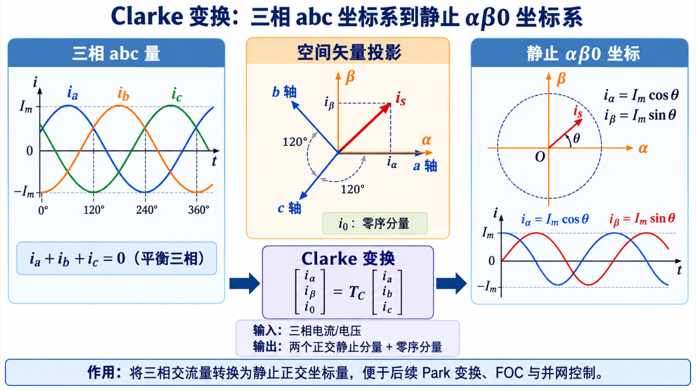
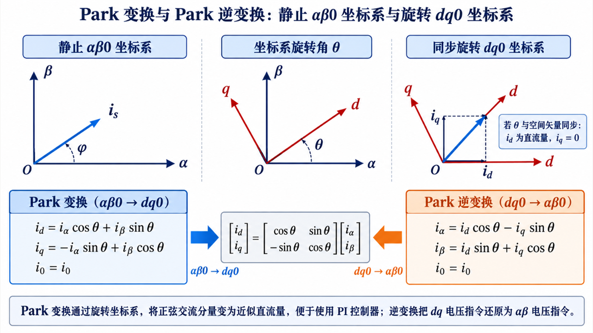

## clark变换

将三相电流的120度对称矢量坐标轴，降维为成αβ（静止）直角坐标系，利用正余弦定理，将电流矢量投影至α和β坐标轴上有：

## 1. 平衡三相前提

$$\begin{aligned}i_a &= I_m\cos\theta, \\i_b &= I_m\cos\left(\theta-\frac{2\pi}{3}\right), \\i_c &= I_m\cos\left(\theta+\frac{2\pi}{3}\right).\end{aligned}$$

$$\begin{aligned}\\i_a+i_b+i_c&=0.\end{aligned}$$

基础形态和等幅值形态

## 2. Clarke 变换基础形态（未归一化）

$$\begin{bmatrix}i_\alpha' \\i_\beta' \\i_0
\end{bmatrix}=\begin{bmatrix}
1 & -\frac{1}{2} & -\frac{1}{2} \\0 & \frac{\sqrt{3}}{2} & -\frac{\sqrt{3}}{2} \\\frac{1}{3} & \frac{1}{3} & \frac{1}{3}\end{bmatrix}\begin{bmatrix}i_a \\i_b \\i_c\end{bmatrix}.$$

$$
\begin{aligned}i_\alpha' &= i_a-\frac{1}{2}i_b-\frac{1}{2}i_c, \\i_\beta' &= \frac{\sqrt{3}}{2}(i_b-i_c), \\i_0 &= \frac{1}{3}(i_a+i_b+i_c).
\end{aligned}
$$

基础系统变换成等幅值形态，利用基尔霍夫电流定律可得三相相电流的电流大小矩阵，代入到基础形态并进行矩阵乘法运算后输出的结果要大于输入的三相相电流总大小，需要乘以2/3让输出结果等于输入

## 3. 等幅值 Clarke 变换（Amplitude-Invariant）

$$
k=\frac{2}{3}.
$$

$$
\begin{bmatrix}
i_\alpha \\i_\beta \\i_0\end{bmatrix}=\begin{bmatrix}\frac{2}{3} & -\frac{1}{3} & -\frac{1}{3} \\0 & \frac{1}{\sqrt{3}} & -\frac{1}{\sqrt{3}} \\\frac{1}{3} & \frac{1}{3} & \frac{1}{3}\end{bmatrix}\begin{bmatrix}i_a \\i_b \\i_c
\end{bmatrix}.
$$

$$ \begin{aligned} i_\alpha &= k i_\alpha'= \frac{2}{3} \left(i_a-\frac{1}{2}i_b-\frac{1}{2}i_c\right), \\i_\beta &= k i_\beta'= \frac{2}{3}\cdot\frac{\sqrt{3}}{2}(i_b-i_c), \\i_0 &= \frac{1}{3}(i_a+i_b+i_c). \end{aligned} $$

## park变换

因为转子的不断转动，αβ主标系的电流依旧是一直变换的，就需要转换为旋转直角坐标系dq,且d轴与N极与S极分界线垂直并指向N极，而q轴与分界线重合但是指向外部，而因为旋转导致的d轴与α轴的差角为θ,也就是电角度

利用电角度和正余弦定理将αβ映射到dq坐标系上

 

通常$i_d$$设置为零，只需要关注$i_q$的大小，$i_q$决定了定子三相电流的大小进而决定了电机磁场强度

## 2. Park 变换：等幅值 αβ 到 dq

$$
\begin{bmatrix}i_d \\i_q\end{bmatrix}=\begin{bmatrix}\cos\theta & \sin\theta \\-\sin\theta & \cos\theta\end{bmatrix}\begin{bmatrix}i_\alpha \\i_\beta
\end{bmatrix}.
$$

$$
\begin{aligned}
i_d &= i_\alpha\cos\theta+i_\beta\sin\theta, \\i_q &= -i_\alpha\sin\theta+i_\beta\cos\theta.
\end{aligned}
$$