## ADC框架

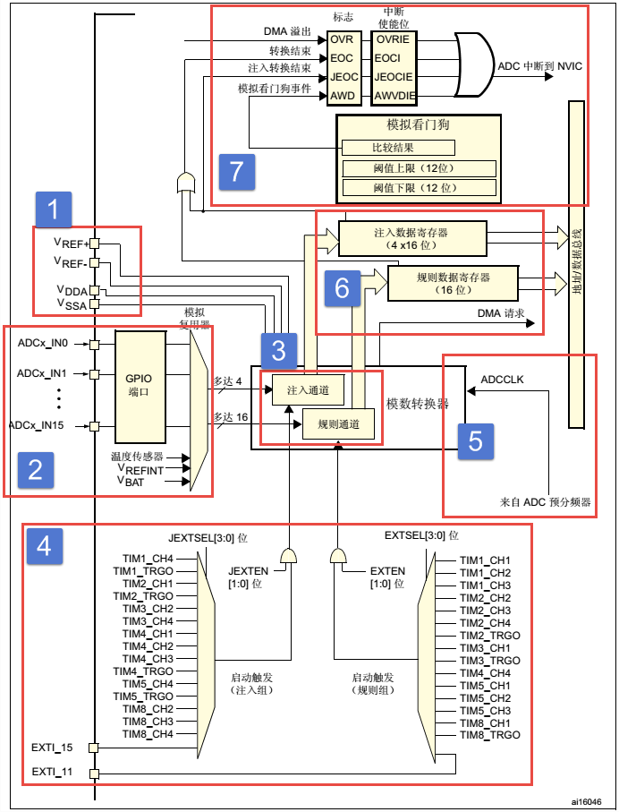

ADC的硬件框图主要由七个部分组成：

1. 输入参考电压
2. ADC采样通道
3. 模数转化器
4. 事件触发通道
5. ADC时钟输入
6. ADC数据寄存器
7. ADC中断与看门狗

### 第一部分——输入参考电压

ADC输入范围为：VREF- ≤ VIN ≤ VREF+。由VREF-、VREF+ 、VDDA 、VSSA、这四个外部引脚决定。

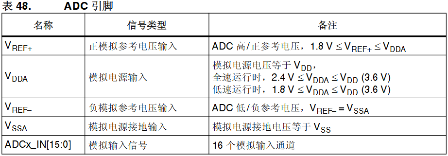

我们在设计原理图的时候**一般把VSSA和VREF-接地，把VREF+和VDDA 接3V3，得到ADC的输入电压范围为：0~3.3V**，需要采样更高电压的，需要将电压水平转换为TTL电平标准才让ADC进行采样

### 第二部分——ADC采样通道

#### 外部采样通道

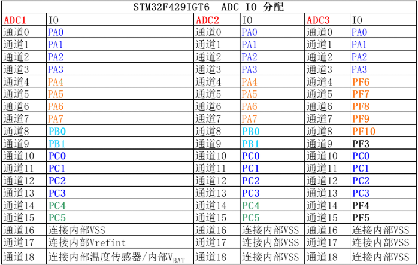

不同的芯片内部ADC通道分配不同，这里以stm32f4作为参考，总共有 16 条复用通道。可以将转换分为两组:**规则转换和注入转换。每个组包含一个转换序列, 该序列可按任意顺序在任意通道上完成**（什么是转换序列？一次触发到来后，ADC 按照 Rank 1、Rank 2、Rank 3……的顺序，对配置好的通道依次采样和转换）

#### 什么是规则通道？什么是注入通道？

1. 规则通道是按设定好的规则进行采样的通道
2. 注入通道是相对于规则通道注入，触发注入事件时优先处理注入通道数据（可以理解为医院急诊，谁伤更重先治）

#### 内部采样通道

==温度传感器内部连接到通道 ADC1_IN16。  内部参考电压 VREFINT 连接到 ADC1_IN17。VBAT（电池电压） 通道连接到通道 ADC1_IN18==

> 温度传感器、VREFINT 和VBAT 通道只在主ADC1 外设上可用

### 第三部分——转换顺序

#### 规则顺序

规则序列寄存器有3个，分别为SQR3、SQR2、SQR1，且每个寄存器都是24位

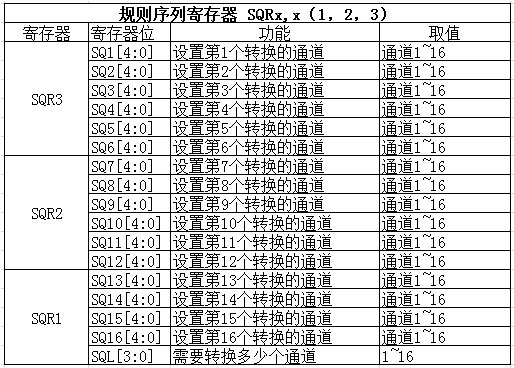

通过SQR寄存器来设置ADC规则通道的转换顺序（可以理解为转换的优先级），在没有注入采样时，规则采样需要按设定好的规矩排队一个一个进行采样

#### 注入顺序

注入序列寄存器JSQR只有一个，最多支持4个通道

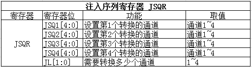

同时只能有4个通道支持注入采样

### 第四部分——触发源

规则通道和注入通道**最常用的触发转换的方法就是由ADC控制寄存器2: ADC_CR2的ADON这个位来控制， 写1的时候开始转换，写0的时候停止转换**

**ADC支持事件触发机制，简单来说就是支持内部定时器的TRGO信息以及各通道的更新等事件触发ADC采样，外部引脚IO的EXIT信号的触发ADC采样转换**

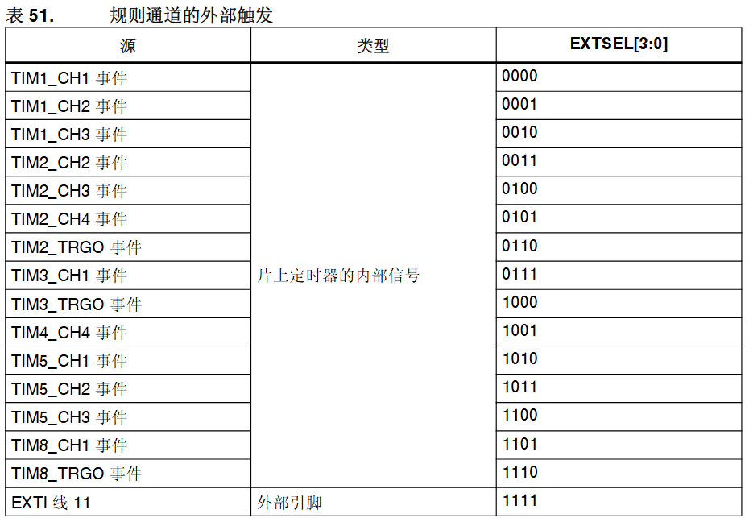

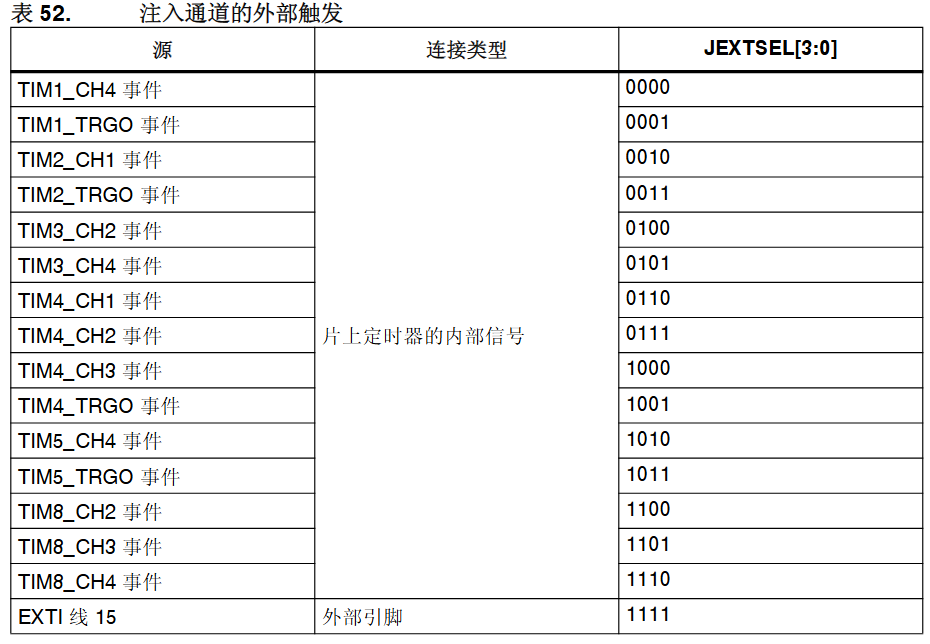

### 第五部分——ADC输入时钟

对于ADC转换的整体流程是，输入，采样，量化，编码，而ADC时钟需要负责的是ADC的整体的转换时间

ADC输入时钟ADC_CLK由PCLK2经过分频产生

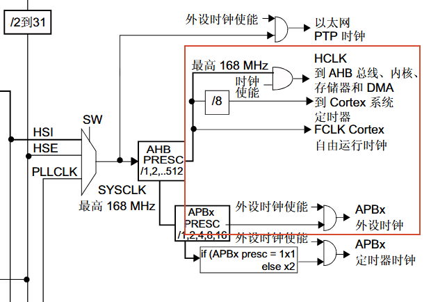

此时钟来自于经可编程预分频器分频的 APB2 时钟,该预分频器允许 ADC 在 fPCLK2/2、  /4、/6 或 /8 下工作（一般PCLK = HCLK / 2）

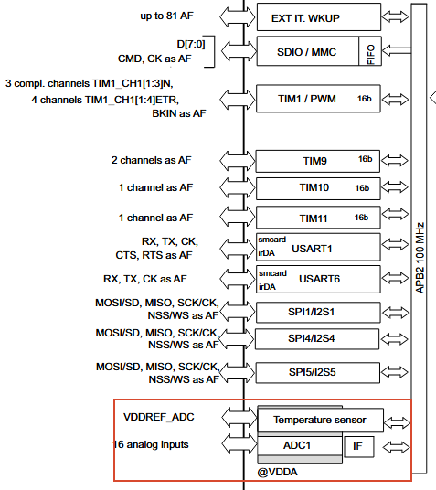

**总转换时间的计算公式如下:  T conv  = 采样时间 + 12 个周期** （12个周期是因为stm232中的ADC分辨率为12位，采样时间越长准确率越高）

 示例:  ADCCLK = 30 MHz 且采样时间 = 3 个周期时: 

- T conv  = 3 + 12 = 15 个周期 = 0.5 μs(APB2 为 60 MHz 时)

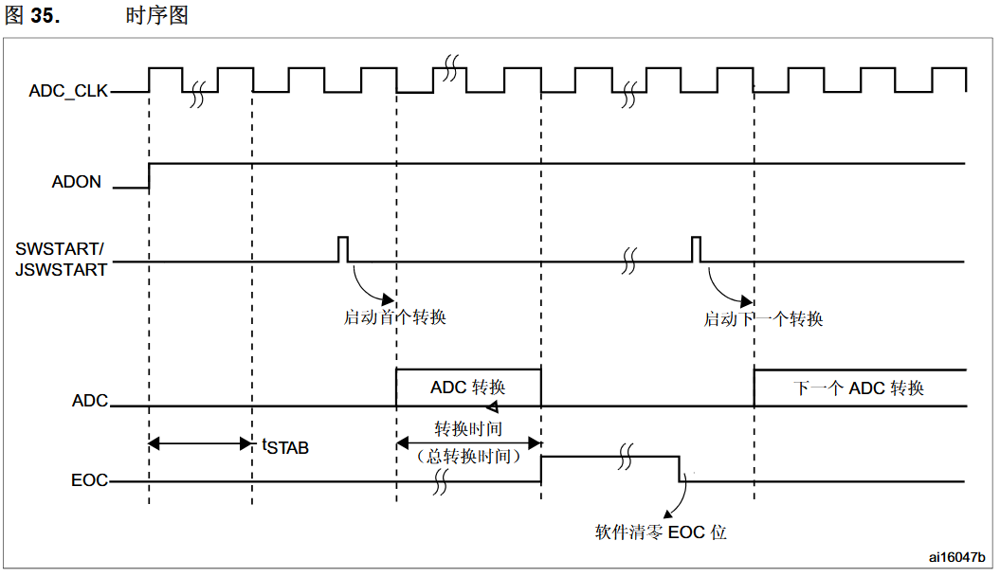

### 第六部分——数据寄存器

一切准备就绪后，ADC转换后的数据根据转换组的不同，**规则组的数据放在ADC_DR寄存器，注入组的数据放在JDRx**。 如果是**使用双重或者三重模式那规矩组的数据是存放在通用规矩寄存器ADC_CDR内的**。

#### 规则数据寄存器ADC_DR

**ADC规则组数据寄存器ADC_DR只有一个，是一个32位的寄存器，只有低16位有效并且只是用于独立模式存放转换完成数据**。因为ADC的最大精度是12位， ADC_DR是16位有效，这样允许ADC存放数据时候选择左对齐或者右对齐，具体是以哪一种方式存放，由ADC_CR2的11位ALIGN设置。假如设置ADC精度为12位， 如果设置数据为左对齐，那AD转换完成数据存放在ADC_DR寄存器的[4:15]位内；如果为右对齐，则存放在ADC_DR寄存器的[0:11]位内。

规则通道可以有16个这么多，可规则数据寄存器只有一个，如果使**用多通道转换，那转换的数据就全部都挤在了DR里面，前一个时间点转换的通道数据， 就会被下一个时间点的另外一个通道转换的数据覆盖掉**，所以当通道转换完成后就应该把数据取走，或者开启DMA模式，把数据传输到内存里面， 不然就会造成数据的覆盖。**最常用的做法就是开启DMA传输让ADC数据寄存器在连续模式下数据不被覆盖**。

如果没有使用DMA传输，我们一般都需要使用ADC状态寄存器ADC_SR获取当前ADC转换的进度状态，进而进行程序控制。

#### 注入数据寄存器ADC_JDRx

**ADC注入组最多有4个通道，刚好注入数据寄存器也有4个，每个通道对应着自己的寄存器，不会跟规则寄存器那样产生数据覆盖的问题**。 ADC_JDRx是32位的，低16位有效，高16位保留，数据同样分为左对齐和右对齐，具体是以哪一种方式存放，由ADC_CR2的11位ALIGN设置。

#### 通用规则数据寄存器ADC_CDR

规则数据寄存器ADC_DR是仅适用于独立模式的，而**通用规则数据寄存器ADC_CDR是适用于双重和三重模式的**。独立模式就是仅仅适用三个ADC的其中一个， 双重模式就是同时使用ADC1和ADC2，而三重模式就是三个ADC同时使用。**在双重或者三重模式下一般需要配合DMA数据传输使用**

### 第七部分——中断部分

数据转换结束后，可以产生中断，**中断分为四种：规则通道转换结束中断，注入转换通道转换结束中断，模拟看门狗中断和溢出中断**

#### 转换结束中断

就是正常的转换结束后发送中断请求，并使能对应中断

#### 看门狗中断

**当被ADC转换的模拟电压低于低阈值或者高于高阈值时**，就会产生模拟看门狗中断，其中低阈值和高阈值由ADC_LTR和ADC_HTR设置

#### 溢出中断

**如果发生DMA传输数据丢失**，会置位ADC状态寄存器ADC_SR的OVR位，如果**同时使能了溢出中断**，那在转换结束后会产生一个溢出中断

#### DMA请求

规则和注入通道转换结束后，除了产生中断外，还可以产生DMA请求，把转换好的数据直接存储在内存里面，常用于多重ADC模式

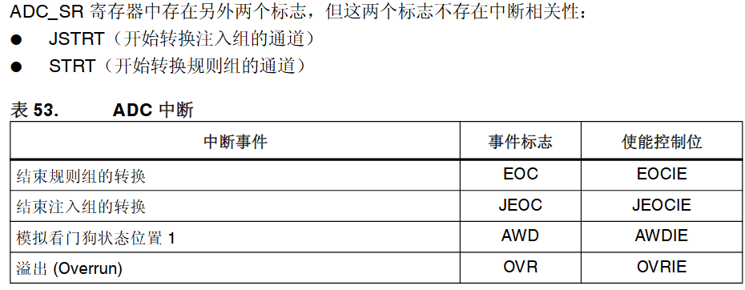

### 扩展部分——ADC采样电路与多重ADC模式

#### ADC采样电路

MCU中多使用的ADC采样类似与逐次逼近型ADC采样电路

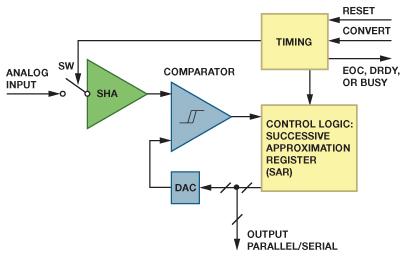

其主要组成为：

- 采样保持放大器(SHA)
- 模拟比较器
- 参考数模转换器(DAC)
- 逐次逼近型寄存器(SAR)

其采样过程为

1. 在上电和初始化之后，CONVERT 上的一个信号会启动转换。
2. 开关闭合，将模拟输入连接至 SHA，后者获得输入电压。
3. 当开关断开时，比较器将确定模拟输入（此时存储于保持电容）是大于还是小于 DAC 电压。开始时，最高有效位(MSB)开启， 将 DAC 输出电压设为中间电平。在比较器输出建立之后，如 果 DAC 输出大于模拟输入，逐次逼近寄存器将关闭 MSB；
4. 如 果输出小于模拟输入，则会使其保持开启。下一个最高有效位 会重复这一过程，如果比较器确定 DAC 输出大于模拟输入， 则关闭 MSB；如果输出小于模拟输入，则会使其保持开启。 
5. 这个二进制搜索过程将持续下去，直到寄存器中的每一位都测 试完毕为止。
6. 结果得到的 DAC 输入是采样输入电压的数字近 似值，并由 ADC 在转换结束时输出

> 因为ADC采样维持是利用了电容的充电原理，采样时间越长，电容充电越长，其电容电压与外部输入电压差距越小

#### 多重ADC模式

**多重的意思是使用多个ADC模块进行采样**，一般有双重(具有两个 ADC)和三重(具有三个 ADC)ADC模式,**解决了单个ADC采样需要等待转换结束才能继续采样的问题**

其ADC模式组合下又有:

- 注入同时模式 
- 规则同时模式 
- 交替模式 
- 交替触发模式 
- 注入同时模式 + 规则同时模式  
- 规则同时模式 + 交替触发模式

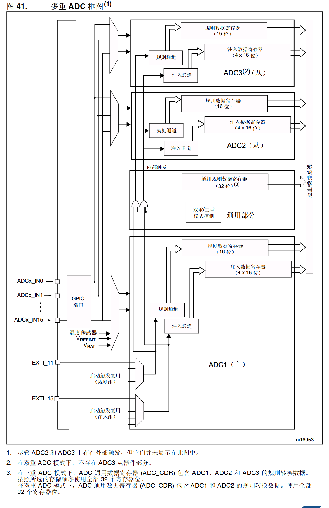

> 不要在两个/三个ADC 上转换同一通道(转换同一通道时,不允许两个/三个ADC 采样时间  重叠)

##### 多重ADC模式下DMA请求

1. DMA 模式 1:每发出一个 DMA 请求(一个数据项可用),就会传输**一个表示 ADC  转换的数据项的半字**，例如在三重 ADC 模式下,发出第一个请求时传输 ADC1 的数据,发出第二个请求时传输 ADC2 的数据,发出第三个请求时传输 ADC3 的数据;重复此序列。因此 DMA 首先 传输 ADC1 的数据,随后传输 ADC2 的数据,再传输 ADC3 的数据,依次类推
2. DMA 模式 2:每发送一个 DMA 请求(两个数据项可用),就会**以字的形式传输表示两个 ADC 转换数据项的两个半字**，例如在三重 ADC 模式下,将生成三个 DMA 请求:发出第一个请求时,会传输 ADC2 和 ADC1 的数据(ADC2 数据占用高位半字,ADC1 数据占用低位半字)。发出第 二个请求时,会传输 ADC1 和 ADC3 的数据(ADC1 数据占用高位半字,ADC3 数据占用低位半字)。发出第三个请求时,会传输 ADC3 和 ADC2 的数据(ADC3 数据占用高位半字,ADC2 数据占用低位半字),依此类推。
3. DMA 模式 3:此模式与 DMA 模式 2 相似。唯一的区别是:在这种模式下,每发送一个 DMA 请求(两个数据项可用),**就会以半字的形式传输表示两个ADC 转换数据项的两个字节**。
4. 溢出检测:如果在其中**一个相关的 ADC(双重和三重模式下的 ADC1 和 ADC2,仅有三重 模式时的 ADC3)上检测到溢出,则不再发出 DMA 请求**

##### 注入同时模式

此模式可转换注入通道组。外部触发源来自 ADC1 的注入组多路复用器，并且**在同时模式下,必须使用同一长度来转换序列,或必须确保触发之间的间隔长于2 个序列 (双重ADC 模式)/3 个序列(三重ADC 模式)中的较长时间**。否则,当序列较长的ADC 完 成上一次转换时,序列较短的ADC 可能重新开始转换

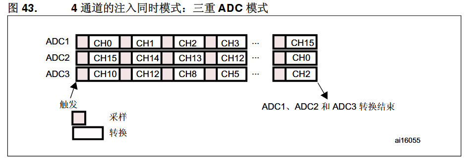

##### 规则同时模式

此模式可用于规则通道组。外部触发源来自 ADC1 的规则组多路复用器,  在规则同时模式下,必须使用同一长度来转换序列,或**必须确保触发之间的间隔长于2 个序 列(双重ADC 模式)/3 个序列(三重ADC 模式)中的较长转换时间**，**必须禁止注入转换**

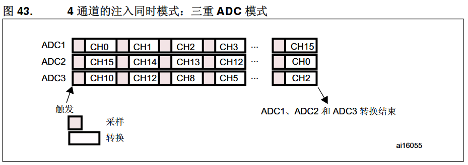

##### 交替模式

**此模式只能用于规则组(通常为一个通道)。外部触发源来自 ADC1 的规则通道多路复用器**

**交替模式下 2 个转换之间的最小延迟通过 ADC_CCR 寄存器中的 DELAY 位进行配置**。但 是,如果某个 ADC 的互补 ADC 仍在对其输入进行采样,则该 ADC 无法启动转换(在给定 时间内,只有一个 ADC 能够对输入信号采样)。在这种情况下,延迟时间为采样时间 + 2 个 ADC 时钟周期

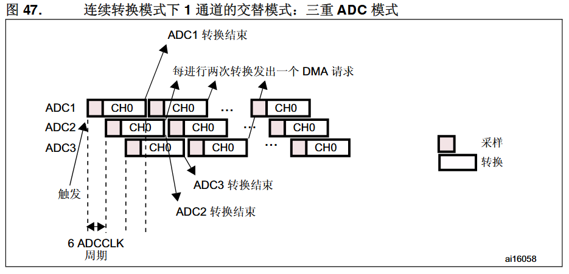

##### 交替触发模式

**此模式只能用于注入组。外部触发源来自 ADC1 的注入组多路复用器**

==两次触发事件之间的时间间隔必须大于或等于1 个ADC 时钟周期。同一个ADC 上可启动转 换的两个触发事件之间的最小时间间隔与单个ADC 模式下相同==

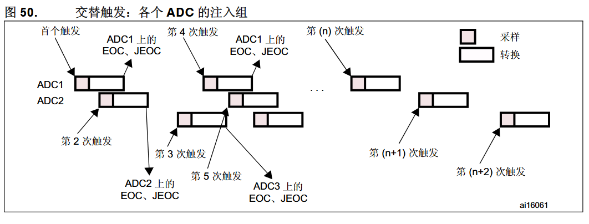

##### 混合性规则/注入同时模式

可以中断规则组的同时转换,然后开始注入组的同时转换。 

> 注意: 在混合型规则/注入同时模式下,必须使用同一长度来转换序列,或必须确保触发之间的间隔  长于2 个序列(双重ADC 模式)/3 个序列(三重ADC 模式)中的较长转换时间。否则,当 序列较长的ADC 完成上一次转换时,序列较短的ADC 可能重新开始转换

##### 规则同时+交替触发组合模式

**可以中断规则组的同时转换,然后开始注入组的交替触发转换**

> 在规则同时 + 交替触发组合模式下,必须使用同一长度来转换序列,或必须确保触发之间的  间隔长于2 个序列(双重ADC 模式)/3 个序列(三重ADC 模式)的长转换时间。否则,当 序列较长的ADC 完成上一次转换时,序列较短的ADC 可能重新开始转换。  如果转换序列中断(例如DMA 传输结束时),则必须首先通过在独立模式下进行配置来将 多重ADC 定序器复位(位DUAL[4:0] = 00000),然后才可以对交替模式进行编程

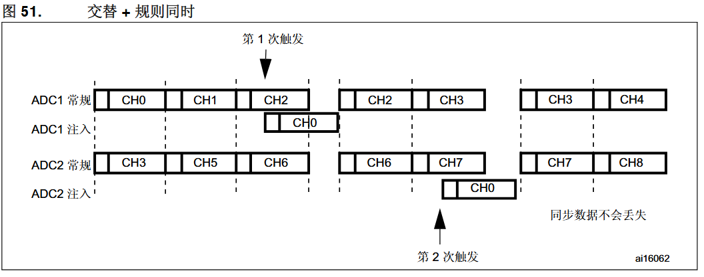
