## 如何控制电机的电压和电流？

一般电机控制可以分成两种：电压控制和电流控制

- 通过控制电压大小来控制电机的转速和方向
- 通过控制电流大小来控制电机的，电源供给电机的电流越大，电机输出的转矩就越大。同时转矩会使电机转子加速旋转，因此电机控制主要就是通过电流来控制转速以及转矩

### 利用定时器输出PWM

stm32通过定时器输出PWM到电机驱动模块上，驱动将信号放大或者转换后发送给电机

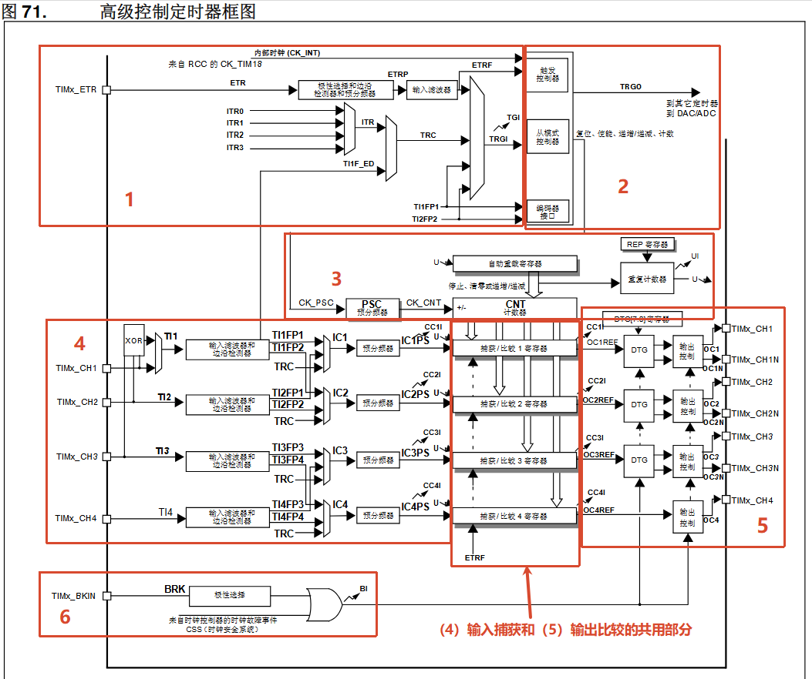

#### 第1部分——定时器的时钟源输入部分

定时器时钟共有四种输入源：

- 内部时钟源CK_INT
- 外部时钟模式1：外部输入引脚TIx（x=1,2,3,4）
- 外部时钟模式2：外部触发输入ETR
- 内部触发输入

##### 内部时钟源一般为系统时钟源

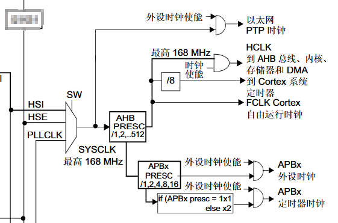

**系统时钟的时钟来源为HSI,HSE,PLLCLK三种来源，最常用的是PLL**，再通过分频器将时钟信号输入到各大总线上

##### 外部时钟输入1

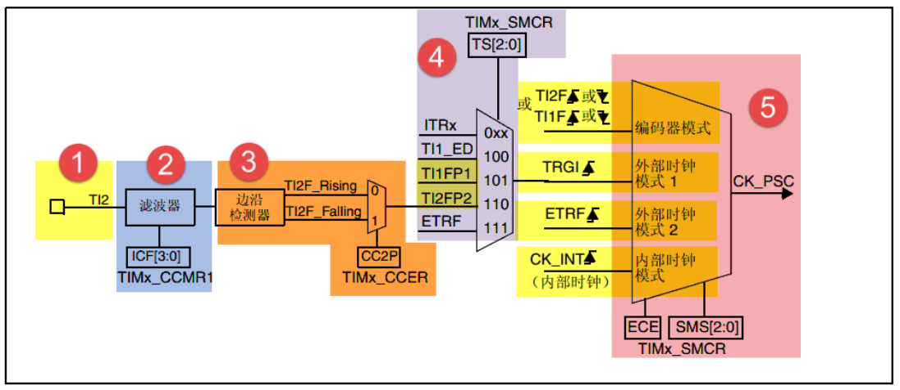

当**使用外部时钟模式1的时候，时钟信号来自于定时器的输入通道**，总共有4个对应定时器的四个输入输出IO口，其中滤波器的作用是去除高频信号干扰和将过高的输入时钟信号降频，边沿检测器决定上升沿有效还是下降沿有效——即**监控信号的上升或者下降的跳变事件**

当使用外部时钟模式1时，**触发源有两个，一个是滤波后的定时器输入1（TI1FP1）和滤波后的定时器输入2（TI2FP2）（定时器输入捕获通道 1 和通道 2 的处理后信号）**， 具体的由TIMxSMCR的位TS[2:0]配置。

最后就是从模式的选择了，外部时钟模式1连接TRGI作为CK_PSC的输入时钟源

##### 外部时钟输入2

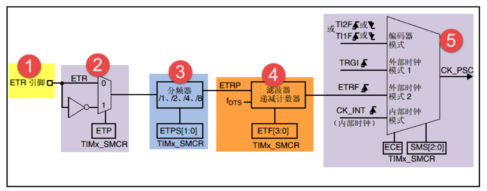

当**使用外部时钟模式2的时候，时钟信号来自于定时器的特定输入通道TIMx_ETR**，只有1个 ，来自ETR引脚输入的信号可以选择为上升沿或者下降沿有效，具体的由TIMx_SMCR的位ETP配置

**由于ETRP的信号的频率不能超过TIMx_CLK（168M）的1/4，当触发信号的频率很高的情况下， 就必须使用分频器来降频**，滤波器对ETRP数据进行滤波，其中$f_{DTS}$是由内部时钟CK_INT分频得到

经过滤波器滤波的信号连接到ETRF引脚后，触发信号成为外部时钟模式2的输入，最终等于CK_PSC，然后驱动计数器CNT计数

#### 第2部分——触发控制器

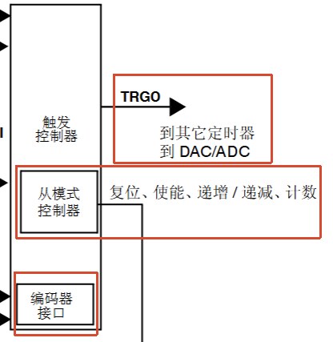

##### TRGO触发输出信号

TRGO 是 Trigger Output，定时器触发输出，通知其他定时器或者ADC/DAC，可以这样理解**定时器可以通过TRGO精确地控制 ADC/DAC 的采样或输出时刻，以及利用外部输入模式1控制从定时器的计数器**

##### 从模式控制器

从模式控制器是接收经过选择的触发输入 TRGI，根**据配置决定定时器是被复位、被门控、被触发**（三种模式），还是直接由外部脉冲驱动计数，即——**由外部时钟信号控制内部定时器动作，主要控制的是CNT计数器的启动暂停复位以及计数方向**，被控制的定时器为从定时器，主定时器通过TRGO输入到从定时器的外部输入ITR0~4通道中输出TRGI交给从模式控制器根据配置来控制从定时器的CNT计数器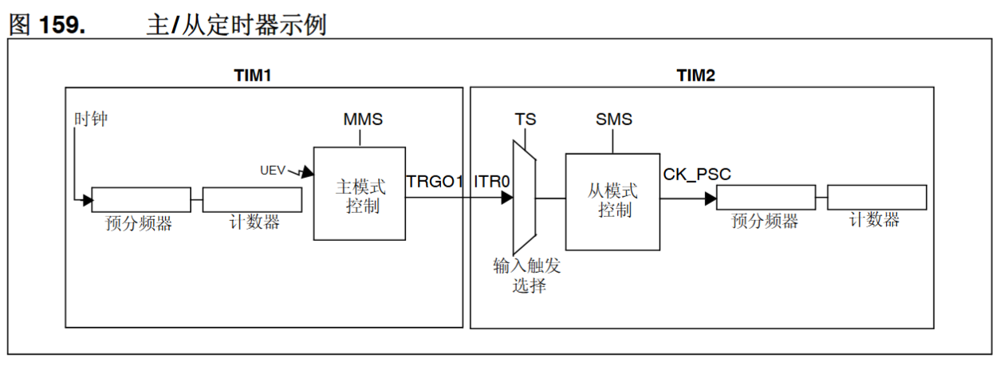

##### 编码器接口

**编码器接口的输入是定时器通道1和通道2处理后的输入时钟信号**，TI1 和 TI2 两个输入用于连接增量编码器，**编码器接口模式就相当于带有方向选择的外部时钟**。这意味着,计数器仅在 0 到 TIMx_ARR 寄存器中的自动重载值之间进行连续计数(根据具体方向,从 0 递增计数到 ARR,或从 ARR 递减计数到 0)。在此模式下,计数器会根据增量编码器的速度和方向自动进行修改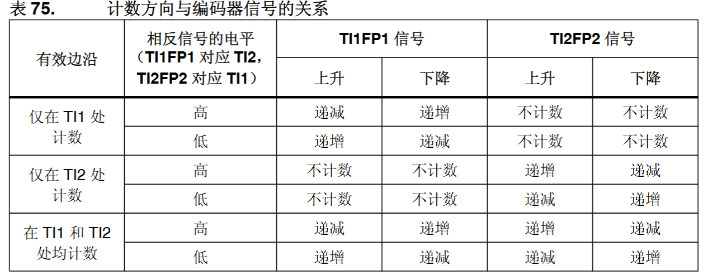

而在TI1和TI2都计数的且并未反相情况下计数器的工作情况

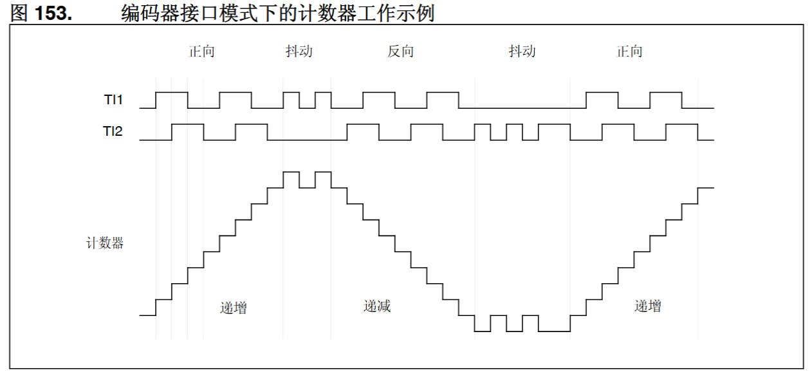

正向情况下,TI1比TI2超前90度，计数器递增；相反TI2比TI1超前90度，计数器递减

#### 第3部分——时基单元

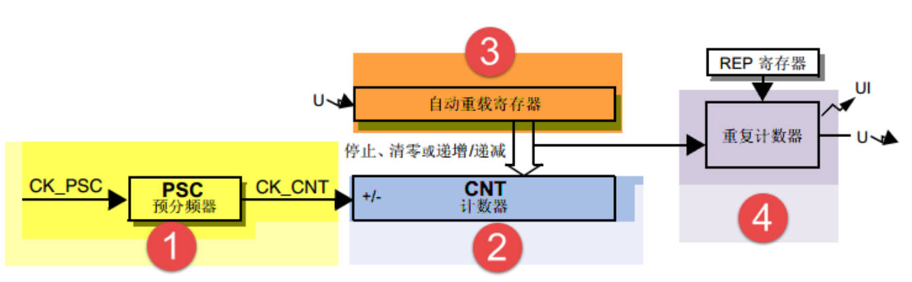

**高级控制定时器时基单元包括四个寄存器，分别是计数器寄存器(CNT)、预分频器寄存器(PSC)、自动重载寄存器(ARR)和重复计数器寄存器(RCR)**，其中RCR是高级定时器特有

##### PSC预分频

PSC是将定时器输入时钟信号（CK_PSC）根据预分频器PSC的值得到定时器输出时钟信号（CK_CNT），计算公式为$f_{CKCNT}$等于**f:sub:CK_PSC/(PSC[15:0]+1)，可以实现1至65536分频**，PSC寄存器越大能实现的分频越大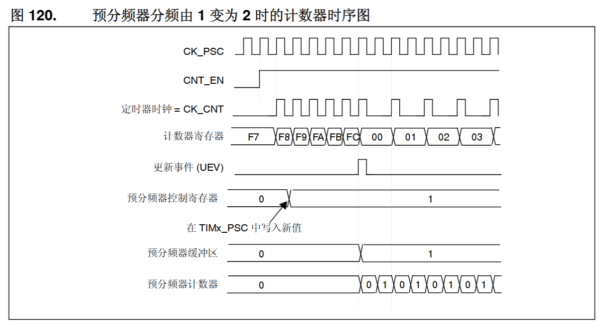

##### CNT计数器

计数器对于计数有三种模式，分别是递增计数，递减计数和中心对齐计数

###### 递增计数模式

在递增计数模式下,**计数器从 0 计数到自动重载值(TIMx_ARR 寄存器的内容),然后重新 从 0 开始计数并生成计数器上溢事件**

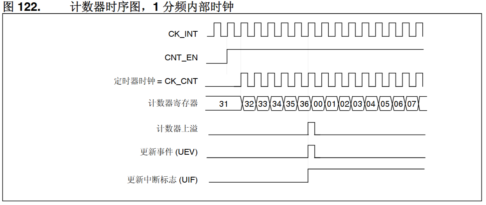

 **如果禁用重复计数器，在计数器生成上溢事件就马上生成更新事件(UEV)； 如果使能重复计数器，每生成一次上溢事件重复计数器内容就减1，直到重复计数器内容为0时才会生成更新事件**

###### 递减计数模式

在递减计数模式下,**计数器从自动重载值(TIMx_ARR 寄存器的内容)开始递减计数到 0, 然后重新从自动重载值开始计数并生成计数器下溢事件**

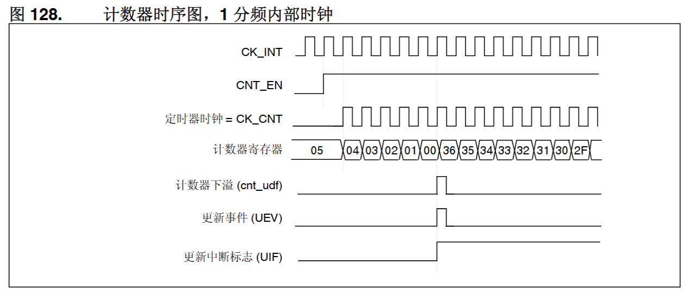

**如果禁用重复计数器，在计数器生成下溢事件就马上生成更新事件； 如果使能重复计数器，每生成一次下溢事件重复计数器内容就减1，直到重复计数器内容为0时才会生成更新事件。**

###### 中心对齐计数模式

在中心对齐模式下,**计数器从 0 开始计数到自动重载值(TIMx_ARR 寄存器的内容)— 1, 生成计数器上溢事件;然后从自动重载值开始向下计数到 1 并生成计数器下溢事件。之后从 0 开始重新计数**

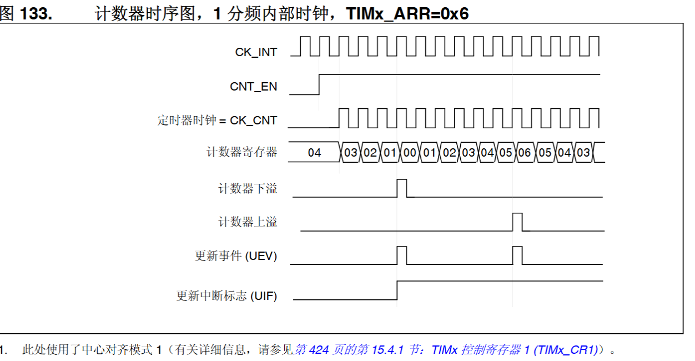

> 当 TIMx_CR1 寄存器中的 CMS 位不为“00”时,中心对齐模式有效

每次发生计数器上溢和下溢事件都会生成更新事件

##### ARR自动重载寄存器

**自动重载寄存器ARR用来存放与计数器CNT比较的值，如果两个值相等就递减重复计数器**。 可以通过TIMx_CR1寄存器的ARPE位控制自动重载影子寄存器功能（**防止程序运行期间修改ARR值导致输出紊乱，让修改在下一次计数生效，而不影响正在计数的事件**）， 如果ARPE位置1，**自动重载影子寄存器有效，只有在事件更新时才把TIMx_ARR值赋给影子寄存器。 如果ARPE位为0，则修改TIMx_ARR值马上有效**。

##### RCR重新计数器

在基本/通用定时器发生上/下溢事件时直接就生成更新事件，但对于高级控制定时器却不是这样， 高级控制定时器在硬件结构上多出了重复计数器，**在定时器发生上溢或下溢事件是递减重复计数器的值， 只有当重复计数器为0时才会生成更新事件**，RCR在输出PWM脉冲信号有很大帮助

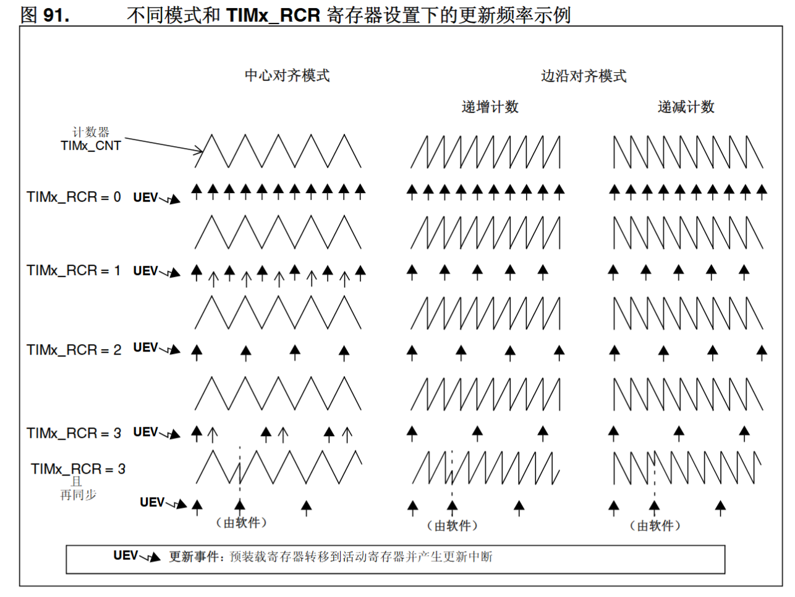

由图可知**RCP可以降低中断、DMA 和控制算法的执行频率**，也可以精确输出固定数量的 PWM 脉冲

#### 第4部分——输入捕获单元

输入捕获的大概的原理就是，**当捕获到信号的跳变沿的时候， 把计数器CNT的值锁存到捕获寄存器CCR中，把前后两次捕获到的CCR寄存器中的值相减，就可以算出脉宽或者频率**

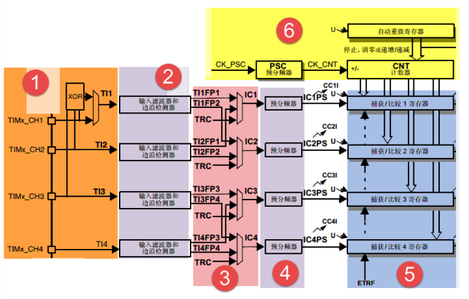

需要**被测量的信号从定时器的外部引脚TIMx_CH1/2/3/4进入**，通常叫TI1/2/3/4，当输入的信号存在高频干扰的时候，我们需要对输入信号进行滤波，**即进行重新采样，根据采样定律， 采样的频率必须大于等于两倍的输入信号，采样频率fSAMPLE可以由fCK_INT和fDTS分频后的时钟提供， 其中是fCK_INT内部时钟，fDTS是fCK_INT经过分频后得到的频率， 分频因子由CKD[1:0]决定**，边沿检测器用来设置信号在捕获的时候是什么边沿有效，可以是上升沿，下降沿，或者是双边沿，具体的由CCER寄存器的位CCxP和CCxNP决定

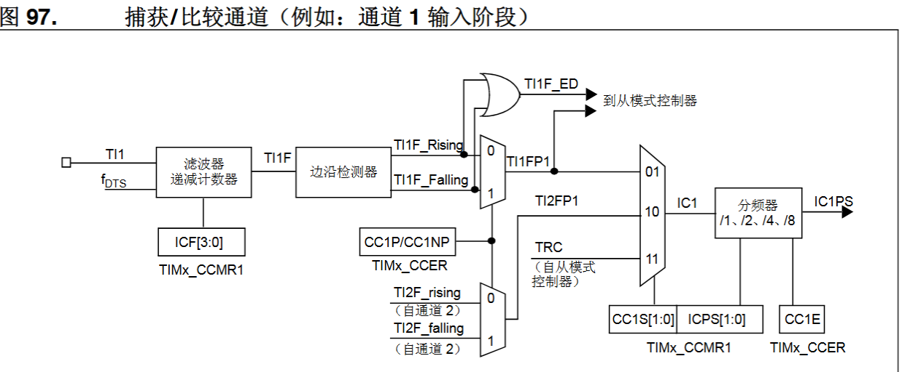

**捕获通道就是图中的IC1/2/3/4，每个捕获通道都有相对应的捕获寄存器CCR1/2/3/4， 当发生捕获的时候，计数器CNT的值就会被锁存到捕获寄存器中**，TI1F_ED是通道 1 的边沿检测输出，每次检测到边沿时产生一个触发脉冲，输入通道和捕获通道的映射关系（决定将哪条输入通道作为捕获信号）具体由寄存器CCMRx的位CCxS[1:0]配置。而**TRC一般是来自其他定时器的 TRGO**

ICx的输出信号会经过一个**预分频器，用于决定发生多少个事件时进行一次捕获**，ICxPS是最终被捕获的信号，**当发生捕获时（第一次）， 计数器CNT的值会被锁存到捕获寄存器CCR中，还会产生CCxI中断**，相应的中断位CCxIF（在SR寄存器中）会被置位， 通过软件或者读取CCR中的值可以将CCxIF清0。如果发生第二次捕获（即重复捕获：CCR寄存器中已捕获到计数器值且 CCxIF 标志已置 1）， 则捕获溢出标志位CCxOF（在SR寄存器中）会被置位，CCxOF只能通过软件清零。

输入捕获的实际应用一般为测量脉宽和频率

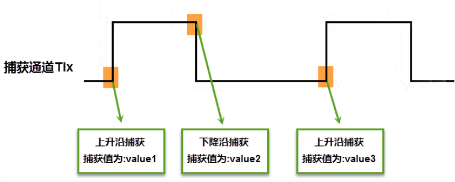

- 测量频率，**由图可知一个周期为第一个上升沿到第二个上升沿的时间，而周期可以由value3 - value1算出**，第一个上升沿进入捕获中断， 在中断服务程序中记录一次捕获（可以用一个标志变量来记录），并把捕获寄存器中的值读取到value1中。 当出现第二次上升沿时，发生第二次捕获，计数器CNT的值会再次被锁存到捕获寄存器CCR中，并再次进入捕获中断， 在捕获中断中，把捕获寄存器的值读取到value3中，并清除捕获记录标志，**在两个上升沿触发的捕获中断获得CCR的值记录到变量中**
- 测量脉宽，**脉宽由两个变化沿之间的时间决定**，当捕获通道TIx上出现上升沿时，发生第一次捕获，计数器CNT的值会被锁存到捕获寄存器CCR中，而且还会进入捕获中断， 在中断服务程序中记录一次捕获（可以用一个标志变量来记录），并把捕获寄存器中的值读取到value1中。然后把捕获边沿改变为下降沿捕获， 目的是捕获后面的下降沿。当下降沿到来的时候，发生第二次捕获，计数器CNT的值会再次被锁存到捕获寄存器CCR中，并再次进入捕获中断， 在捕获中断中，把捕获寄存器的值读取到value2中，并清除捕获记录标志。然后把捕获边沿设置为上升沿捕获，**在第一次上升沿触发的捕获中断中获得CCR值并且设置边沿检测器为下降沿有效，同理，下降沿捕获中断中设置上升沿有效**

##### PWM输入模式

测量脉宽和频率还有一个更简便的方法就是使用PWM输入模式，**PWM输入模式需要占用两个捕获寄存器**

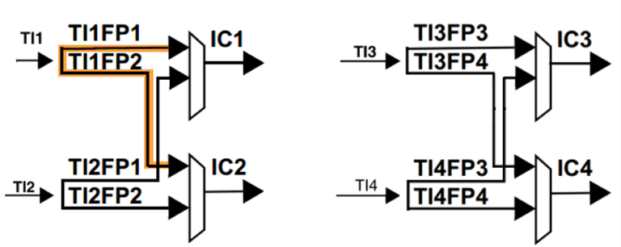

当使用PWM输入模式的时候，**因为一个输入通道(TIx)会占用两个捕获通道(ICx)， 所以一个定时器在使用PWM输入的时候最多只能使用两个输入通道(TIx)**

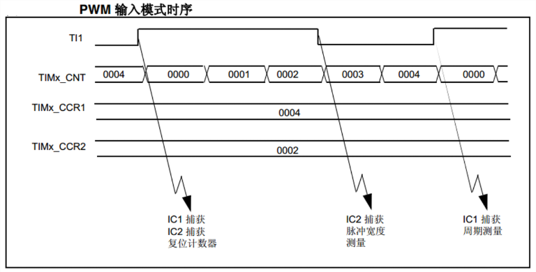

两个捕获通道根据设置后，**一个读取输入信号频率，一个读取输入信号占空比**，上升沿时，IC1和IC2同时捕获记录CNT计数量，而下降沿时只有IC2记录CNT，等待下一次上升沿时，只有IC1捕获记录CNT计数量，这样IC1可以计算出周期，IC2计算出脉宽

#### 第5部分——输出比较单元

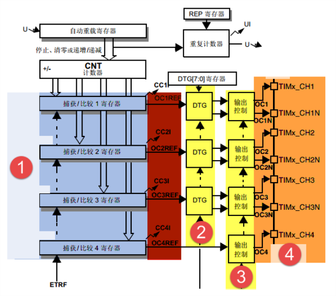

**输出比较就是通过定时器的外部引脚对外输出控制信号**，有这八种模式:

- 冻结，当计数器 CNT 与比较寄存器 CCRx 相等时，仍然可以产生比较事件，但不会改变输出信号
- 将通道X（x=1,2,3,4）设置为匹配时（CCR = CNT）输出有效电平
- 将通道X设置为匹配时输出无效电平
- 翻转，当 CNT == CCRx 时，OCxREF 翻转一次：有效变无效，无效变有效
- 强制变为无效电平，直接输出有效电平，与CCR和CNT无关系
- 强制变为有效电平
- PWM1，TIMx_CNT 总是与 TIMx_CCRx 进行比较，向上计数时：CNT < CCRx 为有效，CNT ≥ CCRx 为无效
- PWM2，与PWM1反相

##### 比较寄存器

**当计数器CNT的值跟比较寄存器CCR的值相等的时候，输出参考信号OCxREF的信号的极性就会改变**， 其中OCxREF=1（最终输出的电平信号不一定是高电平）称之为有效电平，OCxREF=0称之为无效电平，并且会产生比较中断CCxI， 相应的标志位CCxIF（SR寄存器中）会置位

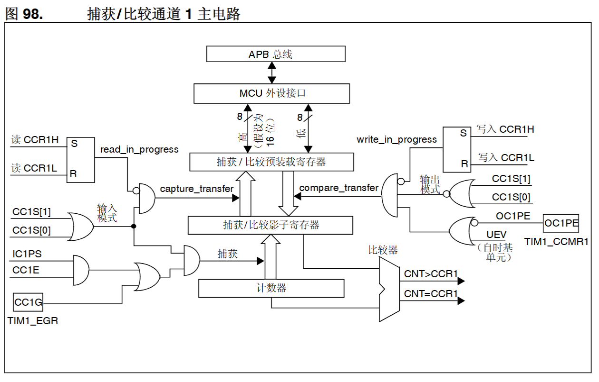

> UEV 是 Update Event，更新事件

用于与CNT比较的CCR是来自于影子寄存器存储的值，**而read_in_progress和write_in_process是锁存器，在读取和写入工程中防止被新的捕获事件将CCR数据破坏**，其中输入捕获路径为

```
TI1/TI2/TRC 输入
        ↓
极性选择、滤波、边沿检测
        ↓
捕获事件
        ↓
输入捕获预分频器 IC1PS
        ↓
CC1E 允许
        ↓
捕获触发
        ↓
CNT 值复制到 CCR1
```

而输出比较路径为

```
CPU 写入 CCR1
        ↓
捕获/比较预装载寄存器
        ↓ compare_transfer
捕获/比较影子寄存器
        ↓
CNT 与 CCR1 比较
        ↓
CNT == CCR1
        ↓
输出模式逻辑
        ↓
OC1REF / 输出通道
```

##### 死区发生器

**在生成的参考波形OCxREF的基础上，可以插入死区时间，用于生成两路互补的输出信号OCx和OCxN， 死区时间的大小具体由BDTR寄存器的位DTG[7:0]配置**

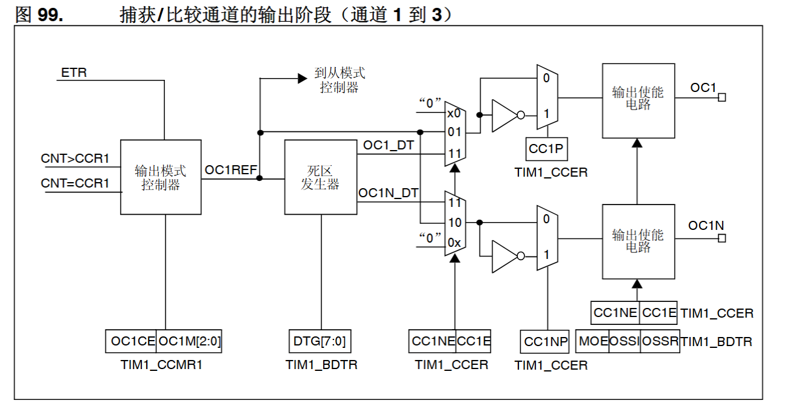

###### 死区时间的计算：

	死区时间主要是在逆变电路中，防止一个桥臂的上下两个开关器件同时导通，那么会导致电路电流上升，从而对系统造成损害。因为开关元器件的$t_{don}$​和$t_{doff}$​严格意义并不是相同的。所以**在驱动开关元器件门极的时候需要增加一段延时，确保另一个开关管完全关断之后再去打开这个开关元器件，这里的延时就是需要施加的死区时间**（死区时间不足：示波器显示互补信号有重叠，可能导致桥臂直通，死区时间过长：电机运行噪音大，效率降低）

	这里用 $T_{\text{dead}}$ 表示死区时间。因为门极上升和下降时间通常比延迟时间小很多，所以这里可以不用考虑它们。则死区时间满足：

$T_{dead}=\left[\left(T_{doffmax}-T_{donmin}\right)+\left(T_{pddmax}-T_{pddmin}\right)\right]\times 1.2$

其中：

$T_{\text{doff,max}}$：最大的关断延迟时间
$T_{\text{don,min}}$：最小的开通延迟时间；
$T_{\text{pdd,max}}$：最大的驱动信号传送延迟时间；
$T_{\text{pdd,min}}$：最小的驱动信号传送延迟时间。

其中，$T_{\text{doff,max}}$ 和 $T_{\text{don,min}}$ 正如上文所提到的，可以从元器件的数据手册中找到。

$T_{\text{pdd,max}}$ 和 $T_{\text{pdd,min}}$ 一般由驱动器厂家给出。如果是 MCU 的 IO 驱动，则需要考虑 IO 的上升时间和下降时间。另外，一般会加光耦进行隔离，这里还需要考虑光耦的开关延时。

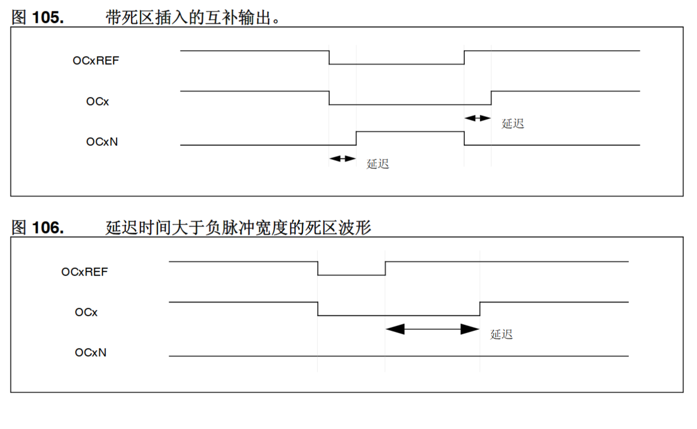

其中TIMx_BDTR寄存器可以控制插入死区时间

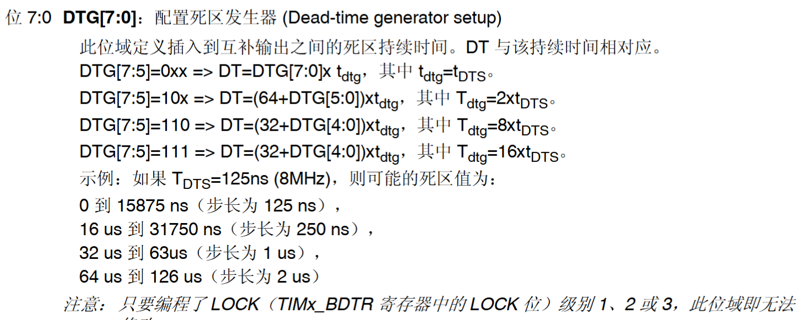

$t_{DTS}$由TIMx_CR1寄存器的CKD决定；如果这里配置成00，那么$t_{DTS}$​和内部定时器的频率相同

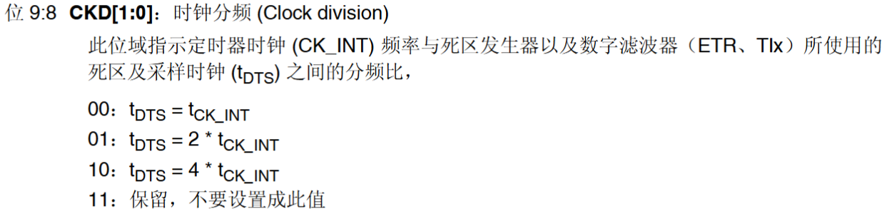

而$t_{CKINT}$由定时器时钟来源部分决定

###### 在stm32中计算死区时间

结合代码做一下计算；系统频率为72M,下面是时基单元的配置；

```c_cpp
#define PWM_FREQ ((u16) 16000) // in Hz  (N.b.: pattern type is center aligned)
#define PWM_PRSC ((u8)0)
#define PWM_PERIOD ((u16) (CKTIM / (u32)(2 * PWM_FREQ *(PWM_PRSC+1)))) 

TIM_TimeBaseStructInit(&TIM1_TimeBaseStructure);
/* Time Base configuration */
TIM1_TimeBaseStructure.TIM_Prescaler = 0x0;
TIM1_TimeBaseStructure.TIM_CounterMode = TIM_CounterMode_CenterAligned1;
TIM1_TimeBaseStructure.TIM_Period = PWM_PERIOD;
TIM1_TimeBaseStructure.TIM_ClockDivision = TIM_CKD_DIV2;
```

PWM的频率是16K，注意这里的PWM是中央对齐模式，因此配置的时钟频率为32K（**相同计数范围下，中央对齐模式完成一个 PWM 周期所需的时间大约是边沿对齐模式的两倍**）;

下面时刹车和死区时间，BDTR寄存器的配置，因此这里的CK_INT为32M

```c_cpp
#define CKTIM    ((u32)72000000uL)     /* Silicon running at 72MHz Resolution: 1Hz */
#define DEADTIME_NS    ((u16) 500)  //in nsec; range is [0...3500]
#define DEADTIME  (u16)((unsigned long long)CKTIM/2 \
          *(unsigned long long)DEADTIME_NS/1000 000 000uL)
          
TIM1_BDTRInitStructure.TIM_OSSRState = TIM_OSSRState_Enable;
TIM1_BDTRInitStructure.TIM_OSSIState = TIM_OSSIState_Enable;
TIM1_BDTRInitStructure.TIM_LOCKLevel = TIM_LOCKLevel_1; 
TIM1_BDTRInitStructure.TIM_DeadTime = DEADTIME;
TIM1_BDTRInitStructure.TIM_Break = TIM_Break_Disable;
TIM1_BDTRInitStructure.TIM_BreakPolarity = TIM_BreakPolarity_High;
TIM1_BDTRInitStructure.TIM_AutomaticOutput = TIM_AutomaticOutput_Disable;
```

例：若T_DTS = 31ns(32MHZ)，可能的死区时间为：

- 0到3970ns，若步长时间为31ns；
- 4000us到8us，若步长时间为62ns；
- 8us到16us，若步长时间为250ns；
- 16us到32us，若步长时间为500ns；

|`DTG[7:5]`|计算公式|编码范围|时间步长|
|--|--|--:|--:|
|`0xx`|`DT = DTG[7:0] × T_DTS`|`0x00～0x7F`|`T_DTS`|
|`10x`|`DT = (64 + DTG[5:0]) × 2 × T_DTS`|`0x80～0xBF`|`2T_DTS`|
|`110`|`DT = (32 + DTG[4:0]) × 8 × T_DTS`|`0xC0～0xDF`|`8T_DTS`|
|`111`|`DT = (32 + DTG[4:0]) × 16 × T_DTS`|`0xE0～0xFF`|`16T_DTS`|

|DTG 编码范围|精确死区时间范围|常用近似范围|步长|
|--|--:|--:|--:|
|`0x00～0x7F`|`0～3968.75 ns`|`0～3970 ns`|`31.25 ns`|
|`0x80～0xBF`|`4000～7937.5 ns`|`4～8 μs`|`62.5 ns`|
|`0xC0～0xDF`|`8000～15750 ns`|`8～16 μs`|`250 ns`|
|`0xE0～0xFF`|`16000～31500 ns`|`16～32 μs`|`500 ns`|

如果需要配置死区时间 500ns，系统频率72,000,000Hz，那么需要配置寄存器的值为；
$$
V_{\mathrm{REG}}=\frac{500}{31}=16
$$

###### 死区控制的应用

例如一对互补PWM信号控制一对MOS管的关断来实现半桥驱动

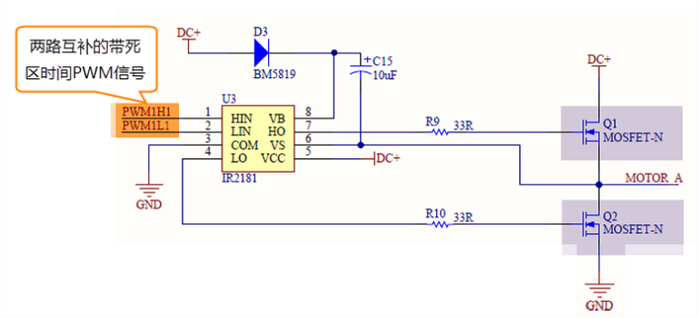

Q1导通，Q2截止，**此时我想让Q1截止Q2导通，肯定是要先让Q1截止一段时间之后， 再等一段时间才让Q2导通，那么这段等待的时间就称为死区时间**，因为Q1关闭需要时间（由MOS管的工艺决定）。 如果Q1关闭之后，马上打开Q2，那么此时一段时间内相当于Q1和Q2都导通了，这样电路会短路（死区控制的意义）。

> 参考资料：[STM32的高级定时器的死区时间计算](https://www.cnblogs.com/unclemac/p/12783344.html)

##### 输出控制

在输出比较的输出控制中，参考信号OCxREF在经过死区发生器之后会产生两路带死区的互补信号OCx_DT和OCxN_DT（**通道1~3才有互补信号， 通道4没有**，其余跟通道1~3一样），这两路带死区的互补信号然后就进入输出控制电路，如果没有加入死区控制， 那么进入输出控制电路的信号就直接是OCxREF

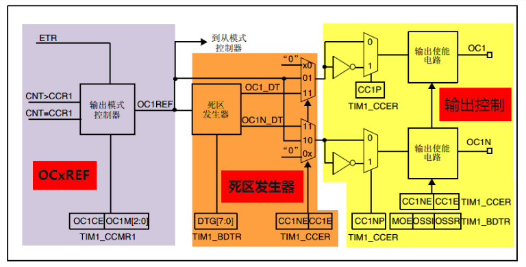

#### 第6部分——断路功能

**断路功能就是电机控制的刹车功能**，使能断路功能时，根据相关控制位状态修改输出信号电平，**断路源可以是时钟故障事件，由内部复位时钟控制器中的时钟安全系统(CSS)生成，也可以是外部断路输入IO，两者是或运算关系**，提供了硬件级的快速响应机制，**能够在微秒级别内切断PWM输出，防止故障扩大**

断路输入配置需要考虑极性和恢复模式：

- 极性选择：根据硬件设计选择高电平或低电平有效
- 自动恢复：AOE位控制故障解除后是否自动恢复输出
- 保护等级：LOCK级别防止关键配置被意外修改

```c_cpp
// 完整的断路功能初始化示例
void MX_TIM1_Init(void)
{
  TIM_ClockConfigTypeDef sClockSourceConfig = {0};
  TIM_MasterConfigTypeDef sMasterConfig = {0};
  TIM_OC_InitTypeDef sConfigOC = {0};
  TIM_BreakDeadTimeConfigTypeDef sBreakDeadTimeConfig = {0};
 
  htim1.Instance = TIM1;
  htim1.Init.Prescaler = 0;
  htim1.Init.CounterMode = TIM_COUNTERMODE_UP;
  htim1.Init.Period = 8399;  // 10kHz PWM @84MHz
  htim1.Init.ClockDivision = TIM_CLOCKDIVISION_DIV2;
  htim1.Init.RepetitionCounter = 0;
  htim1.Init.AutoReloadPreload = TIM_AUTORELOAD_PRELOAD_ENABLE;
  HAL_TIM_Base_Init(&htim1);
  
  // 配置输出比较通道
  sConfigOC.OCMode = TIM_OCMODE_PWM1;
  sConfigOC.Pulse = 2100;  // 25% 占空比
  sConfigOC.OCPolarity = TIM_OCPOLARITY_HIGH;
  sConfigOC.OCNPolarity = TIM_OCNPOLARITY_HIGH;
  sConfigOC.OCFastMode = TIM_OCFAST_DISABLE;
  sConfigOC.OCIdleState = TIM_OCIDLESTATE_RESET;
  sConfigOC.OCNIdleState = TIM_OCNIDLESTATE_RESET;
  HAL_TIM_PWM_ConfigChannel(&htim1, &sConfigOC, TIM_CHANNEL_1);
  
  // 配置断路和死区
  sBreakDeadTimeConfig.OffStateRunMode = TIM_OSSR_DISABLE;
  sBreakDeadTimeConfig.OffStateIDLEMode = TIM_OSSI_DISABLE;
  sBreakDeadTimeConfig.LockLevel = TIM_LOCKLEVEL_2;
  sBreakDeadTimeConfig.DeadTime = 67;
  sBreakDeadTimeConfig.BreakState = TIM_BREAK_ENABLE;
  sBreakDeadTimeConfig.BreakPolarity = TIM_BREAKPOLARITY_HIGH;
  sBreakDeadTimeConfig.AutomaticOutput = TIM_AUTOMATICOUTPUT_ENABLE;
  HAL_TIMEx_ConfigBreakDeadTime(&htim1, &sBreakDeadTimeConfig);
  
  // 启动PWM和互补输出
  HAL_TIM_PWM_Start(&htim1, TIM_CHANNEL_1);
  HAL_TIMEx_PWMN_Start(&htim1, TIM_CHANNEL_1);
}
```
