## 电机的简介

电机是一种可以在电能和机械能的之间相互转换的设备，其中发电机是将机械能转换为电能，电动机是将电能转换为机械能

## 电机的分类

电机可以简单的分为步进电机、直流电机、以及伺服电机，在直流电机中还分为**普通的直流电机、直流减速电机，有刷和无刷**

### 直流有刷电机

直流有刷电机（Brushed DC motor）具有结构简单、易于控制、成本低等特点， 在一些功能简单的应用场合，或者说在能够满足必要的性能、低成本和足够的可靠性的前提下， 直流有刷电机往往是一个很好的选择，而直流有刷电机有时候因为转速高，扭矩小不能符合应用要求，这个时候在普通直流有刷电机的基础上增加了一套齿轮减速箱， 用来提供更大的力矩和更低的转速。齿轮减速箱可以通过配置不同的减速比，提供各种不同的转速和力矩，为直流减速电机

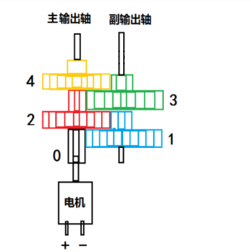

#### 直流有刷电机的最底层实现原理

磁铁的**异性相吸，同性排斥**是电机转动的基础，**通过开关结构开断来切换电流方向进而控制电磁铁的磁极方向**，再放一块固定的磁铁利用磁铁的特性让电磁铁开始运动，而控制电流方向需要不断更换电线位置过于不方便就发明了换向器来替代，**换向器每一对称区域的切换就会切换电流方向，并利用电刷与外部电源连接形成电路闭环

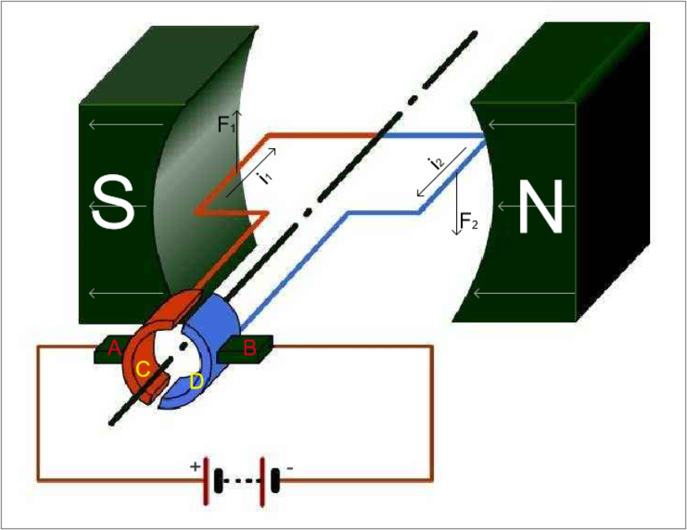

根据左手定则，会产生一对方向相反的安培力让电枢绕组开始运动

#### 直流有刷电机驱动

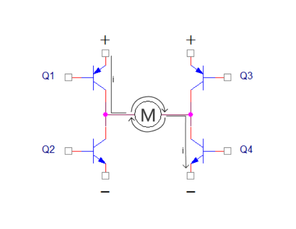

**由四个三极管管组成的H桥驱动电流，需要让电机转动需要一对三极管导通**，定义顺时针旋转为正转，则需要Q1和Q4导通；同理，反转需要Q3和Q2导通

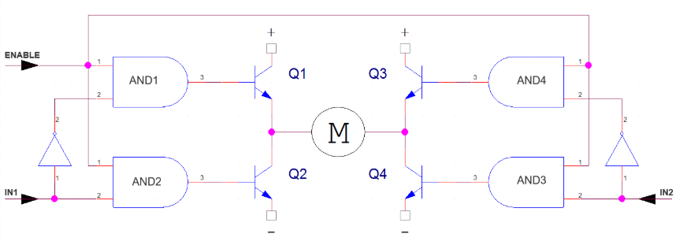

当同一侧的Q1和Q2同时导通时，电流将从电源先后经过Q1和Q2，然后直接流到电源负极， 在这个回路中除了三极管以外就没有其他负载（没有经过电机），这时电流可能会达到最大值，此时可能会烧毁三极管，改进后电路新增加了两个非门和4个与门，以及Q1和Q3换成了NPN三极管，这样就可以控制一侧的两个三极管的开关了（一侧的两个三极管不会同时导通，一次只能打开一个）

#### 直流减速电机的速度控制原理

利用PWM的占空比来控制电机速度，而占空比与电机转速的关系为

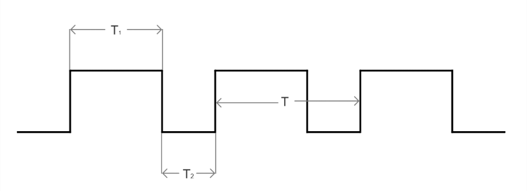

$D（占空比）= T1/T * 100%$ , 假设电机速度为V，最大速度为Vmax，则有 $V= Vmax  * D$;

#### 常用的有刷电机重要参数

- 空载转速：正常工作电压下电机不带任何负载的转速（单位为r/min（转/分））。 空载转速由于没有反向力矩，所以输出功率和堵转情况不一样，该参数只是提供一个电机在规定电压下最大转速的参考。
- 空载电流：正常工作电压下电机不带任何负载的工作电流（单位mA（毫安））。越好的电机，在空载时，该值越小。
- 负载转速：正常工作电压下电机带负载的转速。
- 负载力矩：正常工作电压下电机带负载的力矩 （N·m（牛米））。
- 负载电流：负载电流是指电机拖动负载时实际检测到的定子电流数值。
- 堵转力矩：**在电机受反向外力使其停止转动时的力矩。如果电机堵转现象经常出现， 则会损坏电机，或烧坏驱动芯片**。所以大家选电机时，这是除转速外要考虑的参数。 堵转时间一长，电机温度上升的很快，这个值也会下降的很厉害。
- 堵转电流：在电机受反向外力使其停止转动时的电流，此时电流非常大，时间稍微就可能会烧毁电机， 在实际使用时应尽量避免。
- **减速比：是指没有减速齿轮时转速与有减速齿轮时转速之比**。
- 功率：般指的是它的额定功率（单位W（瓦）），即在额定电压下能够长期正常运转的最大功率， 也是指电动机在制造厂所规定的额定情况下运行时, 其输出端的机械功率。

### 直流无刷电机

无刷直流电机（Brushless Direct Current Motor，简称BLDCM）由电动机主体和驱动器组成， 是一种典型的机电一体化产品，**无刷是指没有电刷和换向器（集电环）的电机**

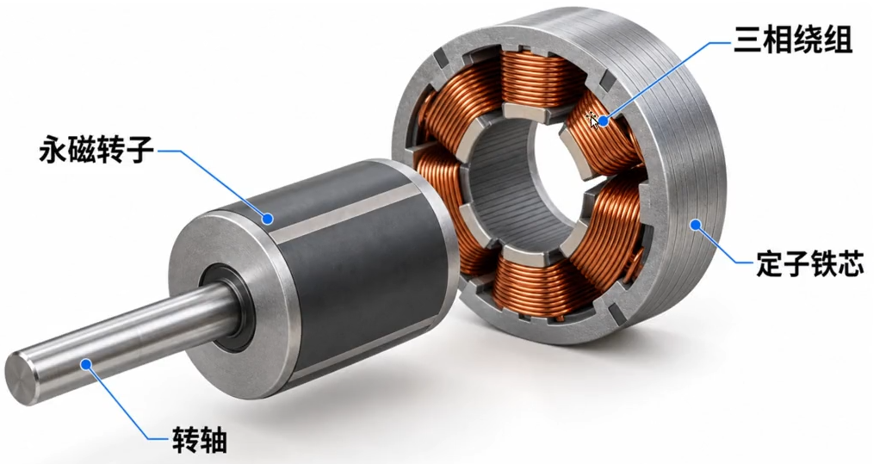

#### 无刷电机重要参数

- 额定电压：无刷电机适合的工作电压，由工作环境决定的，主要受限于工作环境下电子控制器支持的最高频率
- KV值：实际转速=KV值*工作电压，这就是KV的物理意义，就是在1V工作电压下每分钟的转速， KV值与匝数是呈反比例关系的，例如2212-850KV，匝数是30T(15圈)，那在28T的情况下的KV值是:850KV*30T/28T=910KV
- **转矩:(力矩、扭矩）电机中转子产生的可以用来带动机械负载的驱动力矩，我们可以理解为电机的力量。基本可以认为转矩和转速的乘积是一个定数，即同一个电机的转速越高，必定其转矩越低，相反也依然**
- **转速:电机每分钟的转速。**
- 槽极结构（N：槽数，P：极数）：铁芯极数（槽数)是指定子硅钢片的槽数量；磁钢极数（极数)是指转子上磁钢的数量

#### 直流无刷电机的工作原理

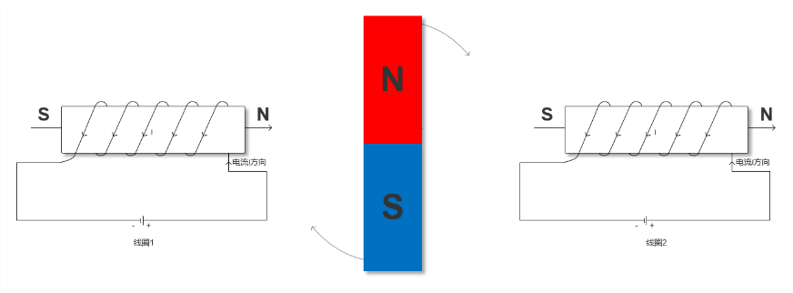

磁铁的**异性相吸，同性排斥**是电机转动的基础，可以知道磁铁两边通电后磁铁顺时针旋转，**当转子旋转至水平位置时，交换两个线圈中的电流方向，就可以让磁铁继续顺时针旋转了**

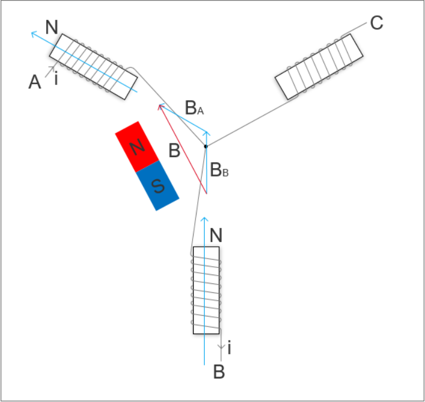

在A端上电源正极，在B端接电源负极，那么可以在线圈A和B中可以产生如图所示的磁场，因为磁场强度是矢量， 所以由磁场BB和BA可以得到合成磁场B，通过改变供电端口来控制合成磁场位置来让磁铁进行运动

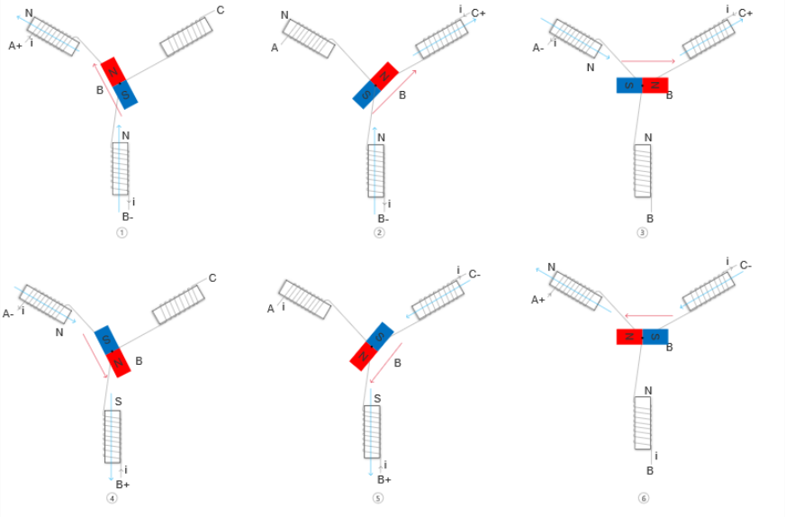

#### 有刷和无刷电机的区别

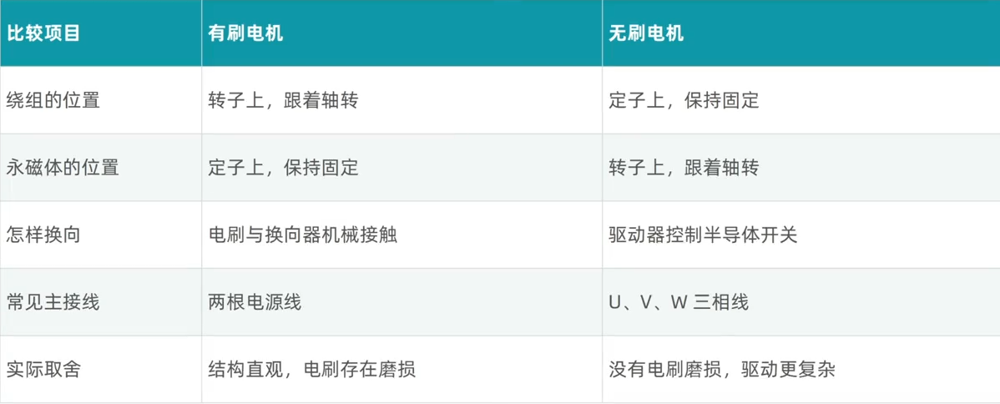

#### 直流无刷电机的驱动设计

使用一个叫做三相六臂全桥驱动电路来驱动无刷电机

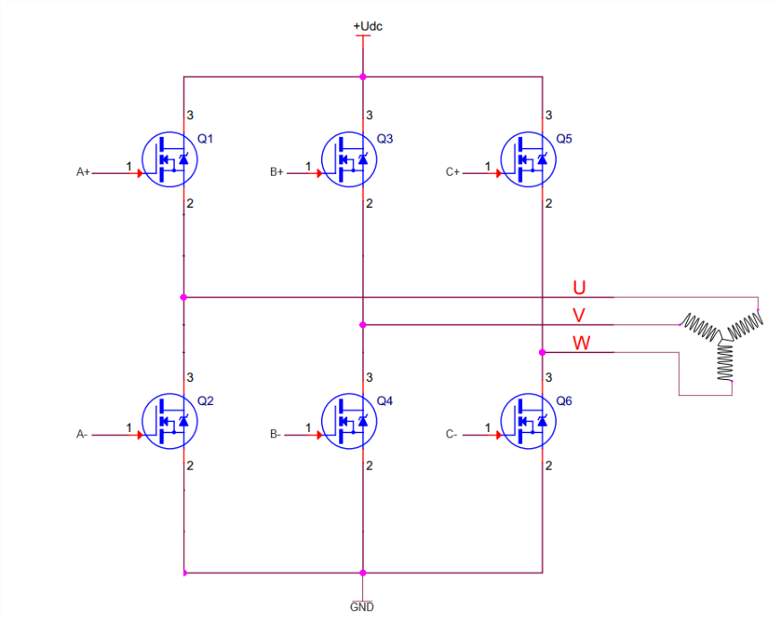

**通过PWM控制六个MOS管的开关来控制磁场的变化**，如Q1和Q6接通转子会显示2号情况（无刷电机原理第三张图），在想让一对MOS管导通时，是需要知道上一步导通的是哪两个MOS管， 而且第一步中MOS管导通时转子的位置是我们自己规定，在**实际使用中启动时转子的位置却是未知的， 因此，我们并不知道第一步应该导通哪两个MOS管，所以这里我们需要知道转子的位置信息**

##### 霍尔传感器

==霍尔效应：当电流垂直于外磁场通过半导体时， 载流子发生偏转，垂直于电流和磁场的方向会产生一附加电场，从而在半导体的两端产生电势差， 这一现象就是霍尔效应，这个电势差也被称为霍尔电势差==，而霍尔传感器输出电压与垂直施加到传感器的磁场的大小成比例，并根据磁场的方向输出正电压和负电压。没有垂直磁场施加时，其输出电压为0 V 

在BLDC中一般采用**3个开关型霍尔传感器测量转子的位置，由其输出的3位二进制编码去控制三相六臂全桥中的6 个MOS管的导通实现换相**,如果将一只霍尔传感器安装在靠近转子的位置，当N极逐渐靠近霍尔传感器即磁感器达到一定值时， 其输出是导通状态（**输出高电平 1**）；当N极逐渐离开霍尔传感器、磁感应逐渐小时，其输出仍然保持导通状态； 只有磁场转变为S极便达到一定值时，其输出才翻转为**截止状态（输出低电平 0）**。在S和N交替变化下传感器输出波形占高、 低电平各占50%

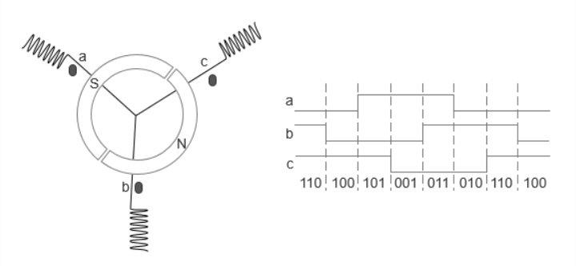

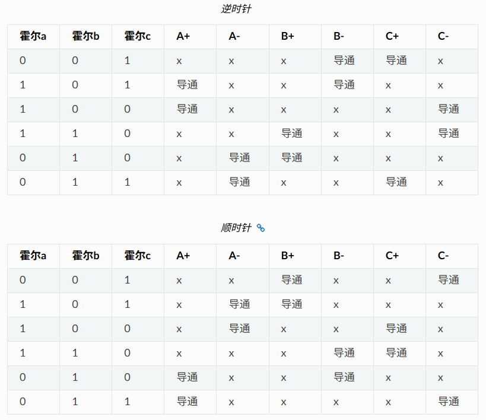

### 步进电机

步进电机又称为脉冲电机，基于最基本的电磁铁原理，它是一种可以自由回转的电磁铁，其动作原理是依靠气隙磁导的变化来产生电磁转矩

## 参考资料

[电机原理](https://www.bilibili.com/video/BV1954y1F7DL/?spm_id_from=333.337.search-card.all.click&vd_source=96bdf4ab347399ad421098d796ec4ed8)

[无刷电机原理](https://www.bilibili.com/video/BV1dc41137Gx/?share_source=copy_web&vd_source=d7e1208fe5361a609ec7ff75bbd339c0)
