## 什么是编码器？

编码器，是一种用来测量机械旋转或位移的传感器。这种传感器能够测量机械部件在旋转或直线运动时的位移位置或速度等信息， 并将其转换成一系列电信号

电机使用的编码器主要为选择编码器

### 编码器的分类

编码器可以根据不同的方式分出很多种类型。

- 例如根据检测原理，可分为光学式、磁式、感应式和电容式。 
- 根据内部机械结构的运动方式，可分为线性编码器和旋转编码器。
- 根据其刻度实现方法及信号输出形式， 又可分为增量式、绝对式以及混合式三种

#### 旋转编码器的分类

##### 增量式

	**增量式旋转编码器是将设备运动时的位移信息变成连续的脉冲信号，脉冲个数表示位移量的大小**。只有当设备运动的时候增量式编码器才会输出信号。 编码器一般会把这些信号分为通道A和通道B两组输出，并且这两组信号间有90°的相位差。同时采集这两组信号就可以知道设备的运动和方向

	增量式编码器是最常用的

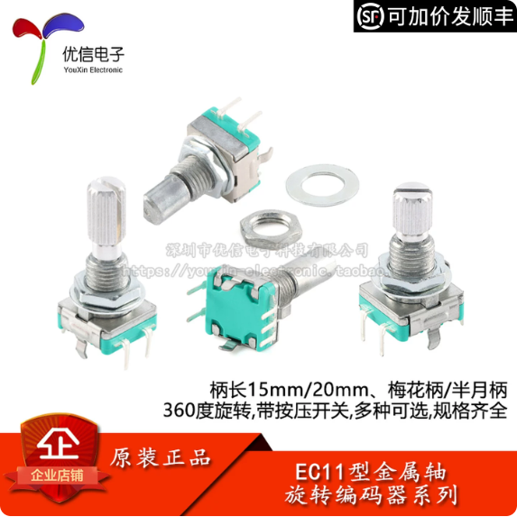

 

#### 绝对式编码器

绝对式旋转编码器是**将设备运动时的位移信息通过二进制编码的方式变成数字量直接输出**，绝对式编码器的码盘利用若干透光和不透光的线槽组成一套二进制编码， 这些二进制码与编码器转轴的每一个不同角度是唯一对应的，读取这些二进制码就能知道设备的绝对位置，所以叫它绝对式编码器，在需要抗干扰环境下较为常用

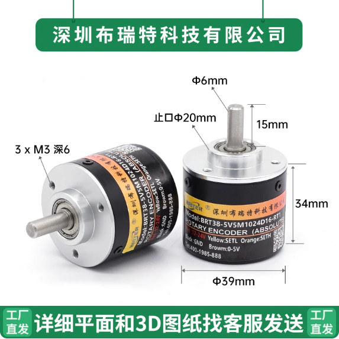

#### 混合式绝对式编码器

混合式绝对式编码器，它输出两组信息：一组信息用于检测磁极位置，带有绝对信息功能；另一组则和增量式编码器的输出信息完全相同

### 旋转编码器的原理

旋转编码器内部大都由码盘、光电检测装置和信号处理电路等部分构成

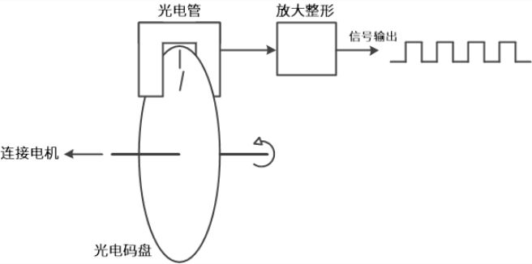

码盘上刻了若干圈线槽， 线槽等距并且可透光，当码盘旋转时就会周期性的透过和遮挡来自光电检测装置的光线，这样检测装置就会周期性的生成若干电信号，这样输出的高低电平的比例一直都是1:1

##### 增量式编码器原理

增量式编码器都有A、B两通道信号输出，这是因为**增量式编码器的码盘上有两圈线槽， 两圈线槽的之间会错开一定的角度，这个角度会使得光电检测装置输出的两相信号相差 1/4 周期(90°)**

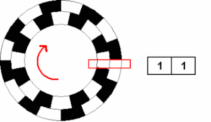

根据两相信号变化的先后顺序就可以判断运动方向，**记录输出的脉冲个数可以知道位移量的大小（总脉冲数除以一圈的脉冲数再乘以一圈的周长就知道位移量），同时通过输出信号的频率就能得到速度（输入捕获模式记录1s内的上升沿数量就可以知道信号的频率，再根据速度公式，位移除以时间）**

另一种较为常用的增量式编码器是霍尔编码器。**霍尔增量式编码器在结构上和光电式几乎相同，只不过检测原理变成了霍尔效应**。 内部元件也稍有不同，霍尔编码器的码盘上不是线槽，而是不同的磁极

**需要提高分辨率时，可触发A、B两通道信号的上升沿和下降沿对原脉冲数进行倍频。 但是当接收设备停机重启后，增量式编码器需要重新寻找参考零点。**

##### 绝对式编码器工作原理

绝对式编码器在总体结构上与增量式比较类似，都是由码盘、检测装置和放大整形电路构成，但是具体的码盘结构和输出信号含义不同。 绝对式编码器的码盘上有很多圈线槽，被称为码道

> 白色块透光表示0，黑色块不透光表示1。码盘上的二进制数逆时针依次增大

图中码盘有3条码道，一共可表示$2^3$=8个二进制数，所以**整个码盘被分成了8个扇区，每个扇区表示一个3位二进制数**，实际应用中二进制数的每一位不可能同时改变，或者出现码盘停在两个扇区中间，这些情况都很容易造成读数错误。**为了避免出现读数错误，可以使用格雷码来解决**

其码盘显示的格雷码为：

|十进制|格雷码|二进制|
|--|--|--|
|0|000|000|
|1|001|001|
|2|011|010|
|3|010|011|
|4|110|100|
|5|111|101|
|6|101|110|
|7|100|111|

###### 格雷码

**在一组数的编码中，若任意两个相邻的代码只有一位二进制数不同，则称这种编码为格雷码（Gray Code）**

将二进制数转化为格雷码使用移位异或，将格雷码转化为二进制使用下拉异或

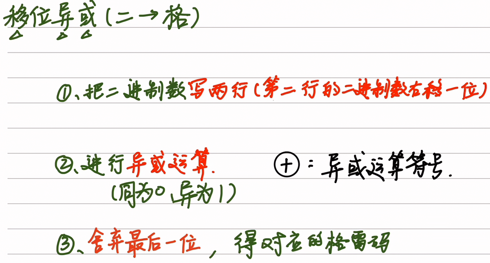

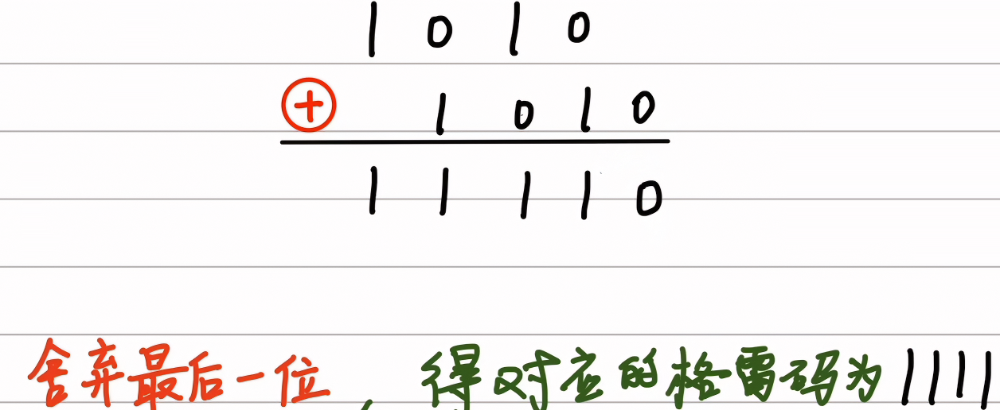

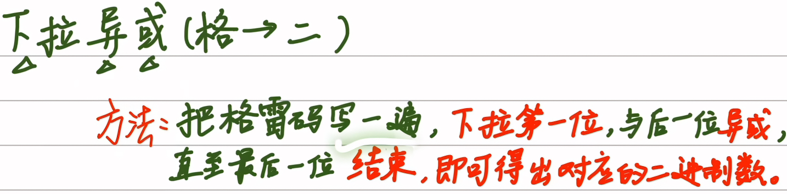

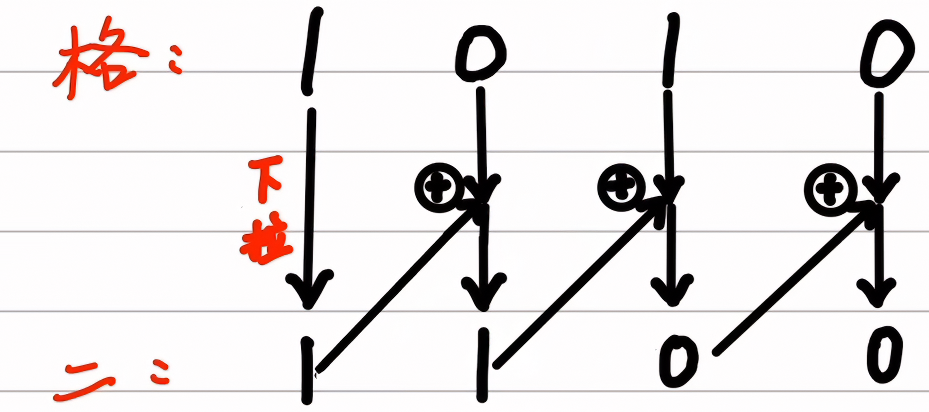

**绝对式编码器还分为单圈绝对式编码器和多圈绝对式编码器**，上面举的两个例子都是针对单圈也就是360°以内的情况，当码盘转动超过360°， 输出的编码会重复，这样不符合绝对式编码器数据唯一的要求，所以就出现了多圈绝对式编码器

### 编码器的重要参数

- **分辨率：**指编码器能够分辨的最小单位。对于增量式编码器，**其分辨率表示为编码器转轴旋转一圈所产生的脉冲数， 即脉冲数/转(Pulse Per Revolution或PPR)**。码盘上透光线槽的数目其实就等于分辨率，也叫多少线，较为常见的有5-6000线。 对于**绝对式编码器，内部码盘所用的位数就是它的分辨**率，单位是位(bit)，具体还分单圈分辨率和多圈分辨率
- **精度：**精度是指**编码器每个读数与转轴实际位置间的最大误差**，通常用角度、角分或角秒来表示，精度由码盘刻线加工精度、 转轴同心度、材料的温度特性、电路的响应时间等各方面因素共同决定
- **最大响应频率：**指编码器每秒输出的脉冲数，单位是Hz。计算公式：$最大响应频率 = 分辨率 * 轴转速/60$

## 为什么需要编码器？

**编码器的主要作用是将机械位移（角位移或直线位移）转换成电信号，用于提供设备的位置、速度和方向反馈，是自动化与运动控制系统的核心传感器**。 它能输出脉冲或数字编码，实现精准定位、速度测量和方向判断，广泛用于电机、机器人、数控机床等设备

## 如何使用编码器？

### 增量式编码器倍频技术

这里利用PWM的方波来进行举例，也是增量式编码器倍频（计数频率翻倍）技术最常用的方式

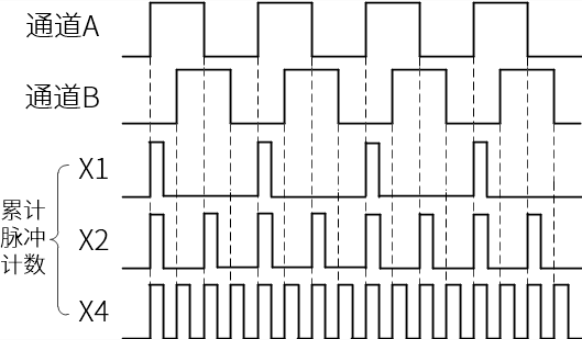

**倍频技术，就是让本来只对上升沿或者下降沿采样计数，设置为对上下变化沿都进行采集，对一个通道就是提高2倍，两个通道就是4倍**

### 倍频技术的实际应用

#### 编码器测速法

常用的编码器测速方法一般有三种：M法、T法和M/T法。

##### M法

M法：又叫做频率测量法。这种方法是在一个固定的定时时间内（以秒为单位），统计这段时间的编码器脉冲数，计算速度值

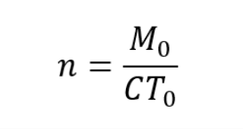

> n为转速，M0为时间段内统计到的总脉冲数，C为单圈脉冲数，T0为统计使用的定时时间

由公式可知转速n跟M0成正比。这就使得在**高速测量时M0变大，可以获得较好的测量精度和平稳性**， 但是如果速度很低，低到每个T0内只有少数几个脉冲，此时算出的速度误差就会比较大，并且很不稳定

**低速测量利用增量式编码器倍频技术来提高测量精度**

##### T法

T法：又叫做周期测量法。这种方法是建立一个已知频率的高频脉冲并对其计数，计数时间由捕获到的编码器相邻两个脉冲的间隔时间TE决定

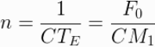

> 编码器相邻两个脉冲的间隔时间TE决定， 计数值为M1。设编码器单圈总脉冲数为C，高频脉冲的频率为F0

转速n跟M1成反比。从公式可以看出，在电机高转速的时候， 编码器脉冲间隔时间TE很小，使得测量周期内的高频脉冲计数值M1也变得很少，导致测量误差变大，而**在低转速时，TE足够大， 测量周期内的M1也足够多**，所以T法和M法刚好相反，更适合测量低速

##### M/T法

M/T法：这种方法综合了M法和T法各自的优势，既测量编码器脉冲数又测量一定时间内的高频脉冲数

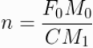

> 在一个相对固定的时间内，计数编码器脉冲数M0， 并计数一个已知频率为F0的高频脉冲，计数值为M1，计算速度值。设编码器单圈总脉冲数为C

转速n就只受M0和M1的影响。电机高速时，M0增大，M1减小，相当于M法， 低速时，M1增大，M0减小，相当于T法

## 概念补充

机械角度：专业概念为指**电机转子的实际空间几何角度**，即用物理工具（如圆规、编码器）可测量的角度。无论电机极对数多少，转子旋转一圈对应的机械角度始终为360°；以360°为标准，以人眼观察的出旋转的角度就是机械角度，例如风扇旋转了90度

电角度：**以电磁场周期变化为基础定义的角度**。在电机中，一对磁极（N-S）对应电角度360°。电角度反映了绕组中感应电动势或电流变化的周期性，其大小与极对数相关，**电角度=机械角度 X P**，P为极对数

### 过零处理

 

## 参考资料

[编码器基础知识](https://encoder.wiki/zh/bianmaqi/)
