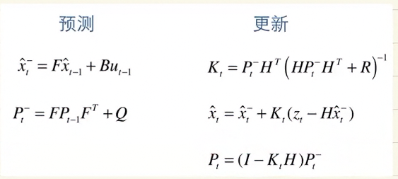
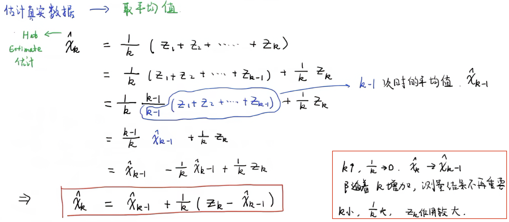
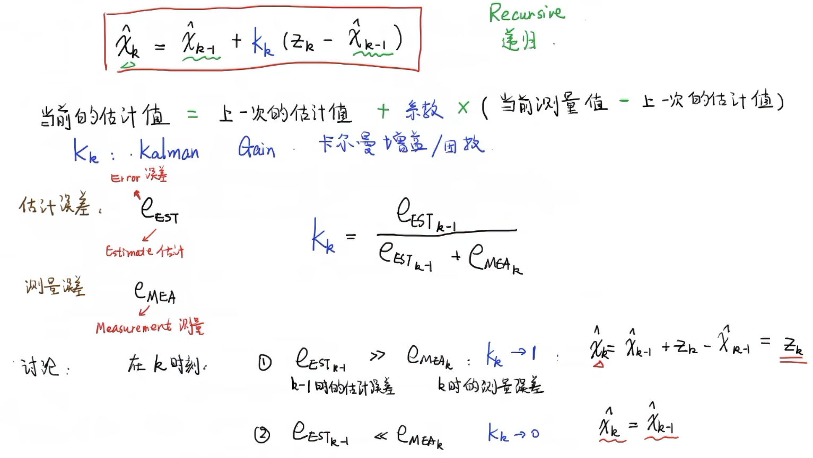
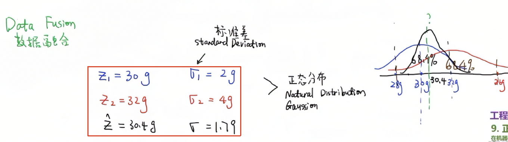
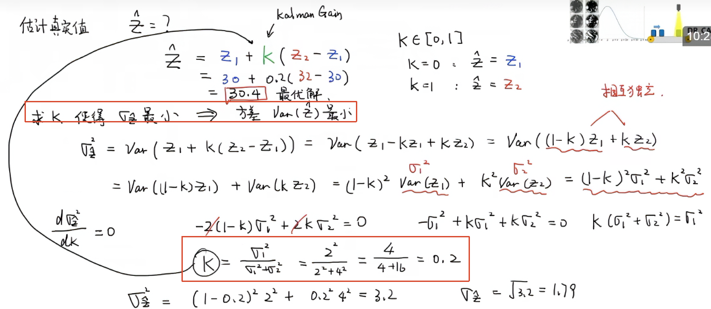
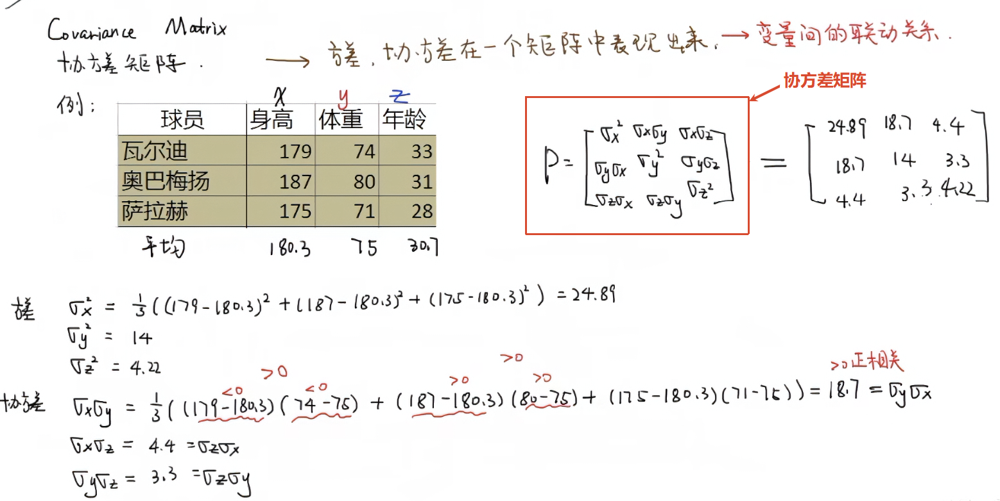
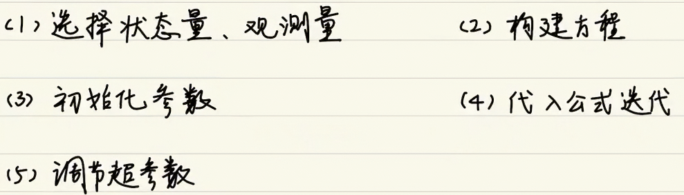

## 卡尔曼滤波算法

### 什么是卡尔曼滤波算法？

卡尔曼滤波算法是一种递归式对数据进行数字处理的算法

> 卡尔曼滤波算法总共有5个公式：
> 
> 预测公式包含先验估计公式和先验估计协方差公式，其中Q为外部引入的噪声
> 
> 更新公式包含修正估计公式，更新卡尔曼增益公式以及更新后验估计协方差公式

对对象的一个属性进行多次测量，因为有不可控误差，需要估计真实数据对测量数据取平均值

> $x_k$表示是估计值，k为测量次数，$z_k$为测量值

其递归思想体现在，当前估计值与上一次估计值相关，将1/k定义为$K_k$

根据$K_k$的公式可以推导两种结果，一种是估计值趋向于测量值，另一种还是估计值趋向于上一次估计值

#### 数据融合

多个测量数据之间的融合，其中各测量数据的误差都不同，如图有两个数据的测量数据和方差大小（误差大小）

其中测量数据遵循正态分布（什么是正态分布？）规律，估计真实值需要**合适的K值**得到最小方差（如何计算出最小方差？）来进行增益校准

#### 协方差矩阵

> 什么是协方差？在概率论与统计学中，协方差（英语：Covariance）用于衡量随机变量间的相关程度。

为什么需要计算出协方差？从不确定信息中挤出尽可能多的信息,就是表示状态分量之间的相关性,协方差矩阵的每个值是第i个变量和第j个变量之间的相关程度

#### 状态空间方程

#### 卡尔曼增益

什么是先验？什么是后验？

### 卡尔曼滤波的作用是什么？

滤波的作用是降低噪声——即降低不确定性

而不确定性的来源是：

1. 不存在完美的数学模型
2. 系统的扰动不可控
3. 测量传感器本身存在误差

**卡尔曼滤波的作用就是根据上一次最优预测状态数据推测出下一次最优预测状态数据，同时使用当前实际观测值修正当前值，输出最优结果**——hon

### 如何在实际中应用卡尔曼滤波？

#### 1.选择好需要滤波对象的状态量和观测量

这里使用MPU6050作为示例，其三轴位置量与三轴加速度量作为状态量，使用IIC读取MPU6050返回的六轴数据作为观测量

#### 2.构建方
