# cortex-m3内核的架构设计

> 将MCU内核简单的分为CPU，存储器系统，中断与异常，总线与接口，调试与跟踪系统五个部分

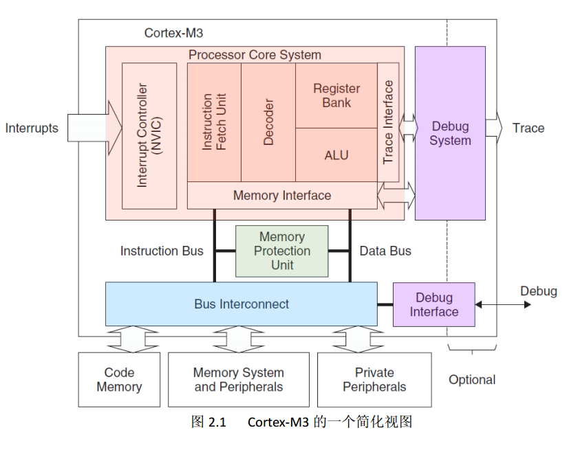

- **指令提取单元（Instruction Fetch Unit，简称 IFU）**是 CPU 前端负责从内存或缓存中获取并提供待执行指令的核心硬件模块
- **解码器（Decoder）**是一种将编码后的抽象数据或信号转换回人类可理解、或是原本格式的硬件、软件或神经网络模组
- **Register bank（通常也写作 register banks）**在计算机硬件和芯片设计中，意思是寄存器组、寄存器堆或组寄存器
- **Trace interface（跟踪接口）**在计算机领域中，通常指用于程序调试、性能分析、系统监控或分布式链路追踪的编程接口或硬件调试接口
- **内存保护单元（Memory Protection Unit，简称 MPU）**是一种集成在处理器中的硬件模块，用于设定和控制内存区域的访问权限
- **Bus interconnect（总线互连）**是计算机和芯片内部各组件之间传输数据的通信基础设施。它就像系统里的道路网，让处理器、内存和外设能够互相交换信息
- **调试接口（Debug Interface）**是开发者用来检查、诊断和修复硬件芯片或软件程序中错误的连接通道。它可以让外部工具直接读取内部状态、控制程序运行或烧录固件

## CPU

> CPU内部又可以分为寄存器组，操作模式，复位服务，堆栈操作

### 寄存器组

#### 通用寄存器组

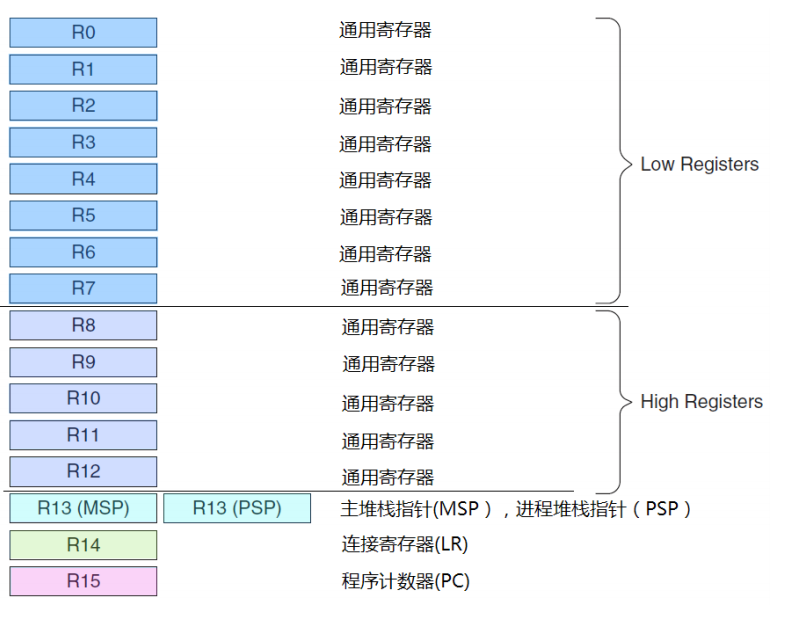

由图可知R0~R12都为通用寄存器，low registers能够被所有指令访问，high registers只能够被少部分指令访问到

#### 特殊寄存器

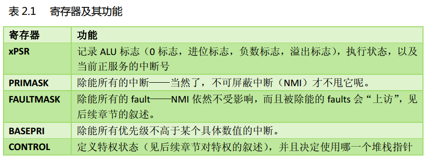

##### xPSR

程序状态寄存器在其内部又被分为三个子状态寄存器：

- 应用程序 PSR（APSR）
- 中断号 PSR（IPSR）
- 执行 PSR（EPSR）
  
  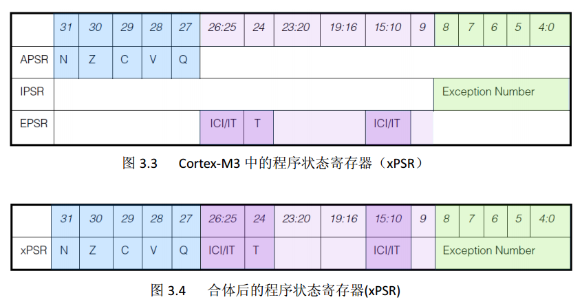
  
  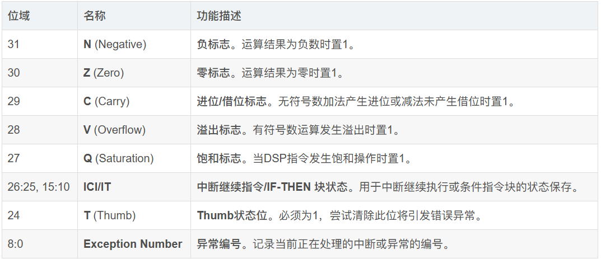

由图可知：

- APSR这些标志位由算术逻辑单元(ALU)根据运算结果自动设置，是**程序条件判断（如循环、分支）的直接依据**

- IPSR寄存器的作用就是存放这是异常处理的“导航仪”，它是只读的。它**存储了当前正在处理的中断或异常的编号**
- 执行PSR (EPSR)：这是指令执行的“状态锁”，它也是只读的，软件无法直接写入，**记录指令的执行进度**

> APSR​ 在特权和非特权（用户）模式下通常均可访问,IPSR和EPSR仅限于在特权模式下访问

##### 中断异常控制寄存器

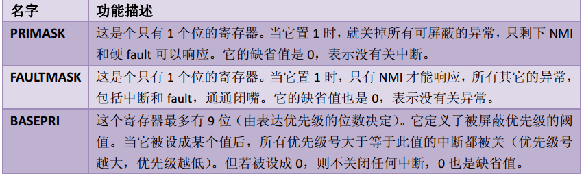

PRIMASK常用于关闭外部中断，而FAULTMASK常用于于OS的临界区保护关闭异常，而BASEPRI设置可以屏蔽的中断优先级，优先级等级低于阈值的都不会被响应与OS的中断控制类似

##### 控制寄存器

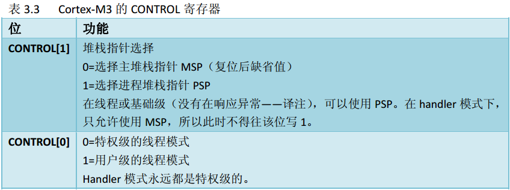

CONTROL主要是控制堆栈指针位置和设置权限等级，SVC异常的原理实现根据CONTROL寄存器实现

### 特权模式

从用户级到特权级的唯一途径就是异常：如果在程序执行过程中触发了一个异常，处
理器总是先切换入特权级，也可以这样理解只有特权能够进入到异常

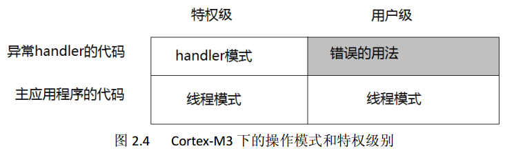

特权级和用户级的区别在于用户级对系统控制空间（SCS）的访问将被阻止——该空间包含了配置寄存器 s 以及调试组件的寄存器 s以及特殊寄存器

复位中断和svc异常中断处理利用control寄存器来让程序进入到主堆栈或者线程堆栈

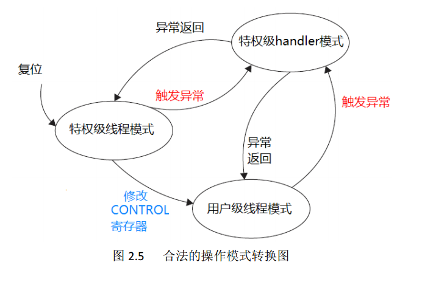

### 复位操作

#### 复位信号的分类

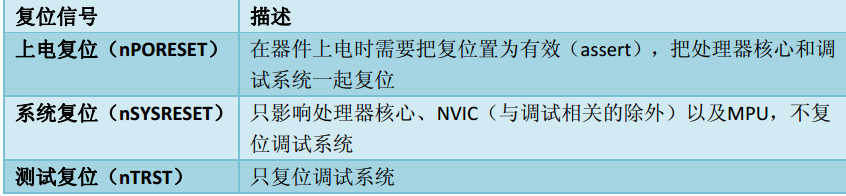

CPU和调试系统的复位范围作为复位信号分类的依据

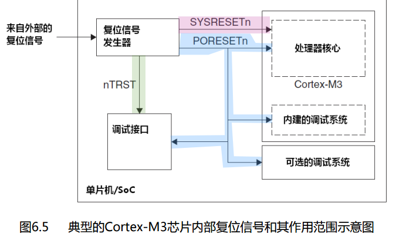

通过设置 NVIC 中应用程序中断与复位控制寄存器(AIRCR)的VECTRESET 位，可只复位处理器内核而不复位其它片上设施

#### 自复位控制

CM3 允许由软件触发复位序列，用于特殊的调试或维护目的（没事别玩啊）。在 CM3中，有两种方法可以执行自我复位。

- 第一种方法，是**通过置位 NVIC 中应用程序中断与复位控制寄存器(AIRCR)的 VECTRESET 位（位偏移：0）**，这种复位的作用范围覆盖了整个 CM3 处理器中，除了调试逻辑之外的所有角落，但是它**不会影响到 CM3 处理器外部的任何电路**

```
LDR R0, =0xE000ED0C ; NVIC AIRCR address 
LDR R1, =0x05FA0001 ; 置位 VECTRESET位，前面的0x05FA是访问钥匙
STR R1, [R0] ; 触发复位序列
deadloop 
B deadloop ; 该死循环保证后面的指令不可能被执行到
```

- **复位的第二种方法，是置位同一个寄存器中的 SYSRESETREQ 位。这种复位则会波及整个芯片上的电路**，大多数情况下，复位发生器在响应 SYSRESETREQ 时，它也会同时把 CM3 处理器的系统复位信号(SYSRESETn)置为有效

```
LDR R0, =0xE000ED0C ; NVIC AIRCR address 
LDR R1, =0x05FA0004 ; 置位 SYSRESETREQ，前面的0x05FA是访问钥匙
STR R1, [R0] ; 触发复位序列
deadloop 
B deadloop ; 该死循环保证后面的指令不可能被执行到
```

#### CPU复位后的启动流程

1. 从0x0000 0000的地址取出MSP的初始值
2. 从0x0000 0004的地址取出PC的初始值，该初始值为中断向量表的复位中断函数的地址（向量表中的每个数值都必须把 LSB 置 1（也就是奇数），指令集要求）
3. 访问复位中断地址执行指令，进入到启动文件startup

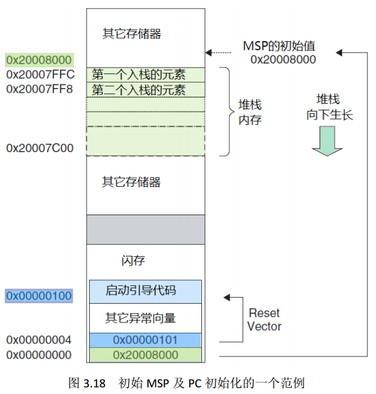 

#### 复位操作的实际应用

在stm32f4xx上共有三种类型的复位，分别为**系统复位、电源复位和备份域复位**。

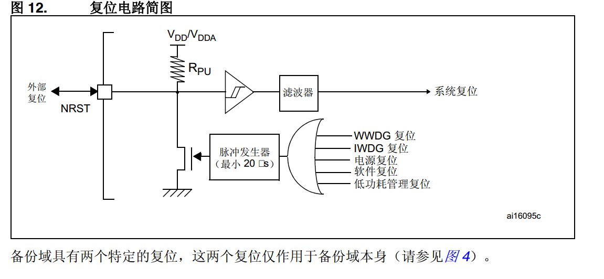

由图可知，复位实现原理是通过输入低电平脉冲触发系统复位，让内核，调试系统（nPORE），以及相关外设全部复位

##### 系统复位

**除了时钟控制寄存器 CSR 中的复位标志和备份域中的寄存器外，系统复位会将其它全部寄 
存器都复位为复位值**

发送系统复位的情况有：

1. NRST 引脚低电平（外部复位）
2. 窗口看门狗计数结束（WWDG 复位）
3. 独立看门狗计数结束（IWDG 复位）
4. 软件复位（SW 复位）（请参见软件复位）
5. 低功耗管理复位（请参见低功耗管理复位）

**通过RCC_CSR寄存器值来读取复位原因**

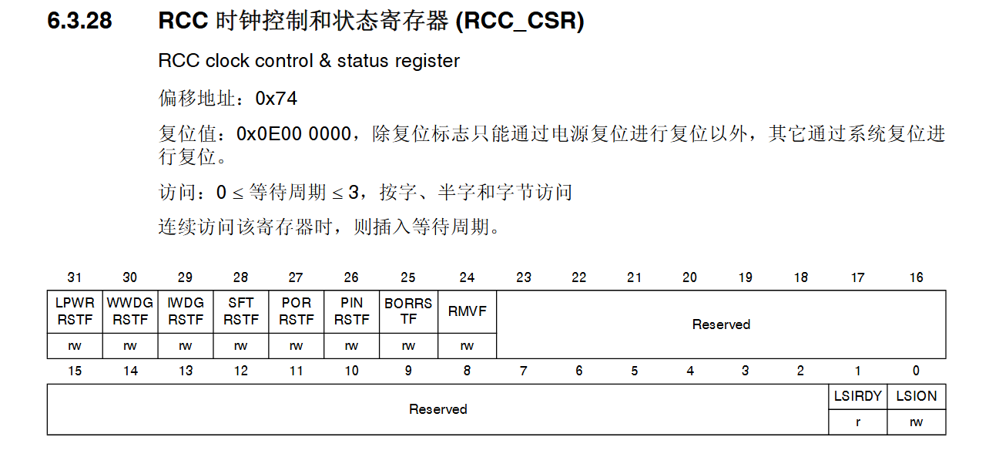

###### 软件复位

**对器件进行软件复位，必须将 Cortex™-M4F 应用中断和复位控制寄存器中的
SYSRESETREQ 位置 1**

###### 低功耗管理复位

引发低功耗管理复位的方式有两种：

1. 进入待机模式时产生复位：
此复位的使能方式是清零用户选项字节中的 nRST_STDBY 位。使能后，只要成功执行 
进入待机模式序列，器件就将复位，而非进入待机模式。
2. 进入停止模式时产生复位：
此复位的使能方式是清零用户选项字节中的 nRST_STOP 位。使能后，只要成功执行 
进入停止模式序列，器件就将复位，而非进入停止模式

##### 电源复位

**除备份域内的寄存器以外，电源复位会将其它全部寄存器设置为复位值**

只要发生以下事件之一，就会产生电源复位：

1. 上电/掉电复位（POR/PDR 复位）或欠压 (BOR) 复位
2. 在退出待机模式时

**这些源均作用于 NRST 引脚**，可以这样理解——电源复位是通过硬件复位引脚路径进行复位

##### 备份域复位

**备份域复位会将所有 RTC 寄存器和 RCC_BDCR 寄存器复位为各自的复位值。BKPSRAM 不受 此复位影响。BKPSRAM 的唯一复位方式是通过 Flash 接口将 Flash 保护等级从 1 切换到 0。**

只要发生以下事件之一，就会产生备份域复位：

1. 软件复位，通过将 RCC 备份域控制寄存器 (RCC_BDCR) 中的 BDRST 位置 1 触发。
2. 在电源 VDD 和 VBAT 都已掉电后，其中任何一个又再上电

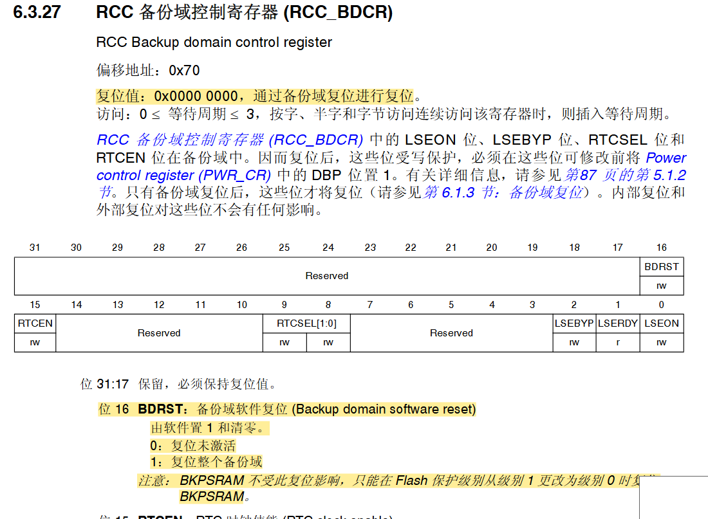

## 存储器系统

### 内存映射

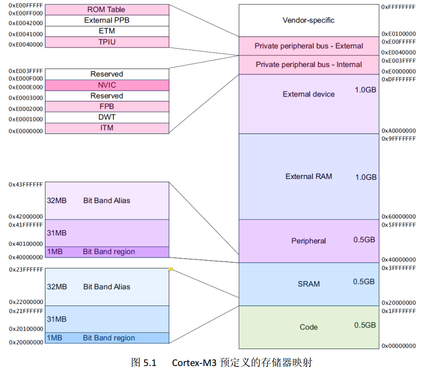

由图可知，m3存储主要分为，用户代码code地址，内部SRAM地址，片上外设地址，外部RAM地址，板上外设地址，内部私有外设总线 ，外部私有外设总线 ,最后是保留区域

#### 存储器的访问

CM3 在定义了存储器映射之外，还为存储器的访问规定了 4 种属性，分别是：

- 可否缓冲(Bufferable)，写操作是否可以使用写缓冲区
- 可否缓存(Cacheable)，是否可以通过 Cache（高速缓存）进行访问
- 可否执行(Executable)，是否允许处理器从该存储器区域获取并执行指令
- 可否共享(Sharable)，该存储器区域是否被多个总线主设备（如多个处理器或 DMA）共享

存储器系统的各部分的属性都不一样，

1. **代码区（0x0000_0000‐ 0x1FFF_FFFF）**。该区是可以执行指令的，缓存属性为 WT，即不可以缓存。此区亦可写数据。在此区上的数据操作是通过数据总线接口的（读数据使用 D‐Code，写数据使用 System），且在此区上的写操作是缓冲的。
2. **SRAM 区（0x2000_0000 – 0x3FFF_FFFF）**。此区用于片内 SRAM，写操作是缓冲的，并且可以选择 WB‐WA(Write Back, Write Allocated)缓存属性。此区亦可以执行指令，以允许把代码拷贝到内存中执行——常用于固件升级等维护工作。
3. **片上外设区(0x4000_0000 – 0x5FFF_FFFF)**。该区用于片上外设，因此是不可缓存的，也不可以在此区执行指令（这也称为 eXecute Never, XN。ARM 的参考手册大量使用此术语）。==APB和AHB总线的地址也在该区域==
4. **外部 RAM 区的前半段（0x6000_0000 ‐ 0x7FFF_FFFF）**。该区用于片外 RAM，可缓存（缓存属性为 WB‐WA），并且可以执行指令。
5. **外部 RAM 区的后半段（0x8000_0000 – 0x9FFF_FFFF）**。除了不可缓存(WT)外，同前半段
6. **外部外设区的前半段(0xA000_0000 – 0xBFFF_FFFF)**。用于片外外设的寄存器，也用于多核系统中的共享内存（需要严格按顺序操作，即不可缓冲）。该区也是个不可执行区。
7. **外部外设区的后半段(0xC000_0000 – 0xDFFF_FFFF)**。目前与前半段的功能完全一致。
8. **系统区(0xE000_0000 – 0xFFFF_FFFF)**。此区是私有外设和供应商指定功能区。此区不可执行代码。系统区涉及到很多关键部位，因此访问都是严格序列化的（不可缓存，不可缓冲）。而供应商指定功能区则是可以缓存和缓冲的。

> code区域用于执行用户代码，可以读取代码执行指令，并修改代码写入缓冲
> 
> SRAM区域用于加速读写速度支持缓存，并且存储运行时数据可以写入缓冲，为了加快CPU执行速率，也可以将指令复制一部分在SRAM中运行
> 
> 片上外设区域一般是都是各外设的寄存器地址，支持读写，但是不能利用缓存快速访问
> 
> 外部RAM区的后半段一般都是Flash地址，可写缓冲也可执行指令
> 
> 系统区因为存放的是内核组件，只有在特权级权限下才能够访问，还有一部分是保留区，可以由于自定义功能，缓冲缓存都可以

MPU会根据权限等级限制内存空间的访问

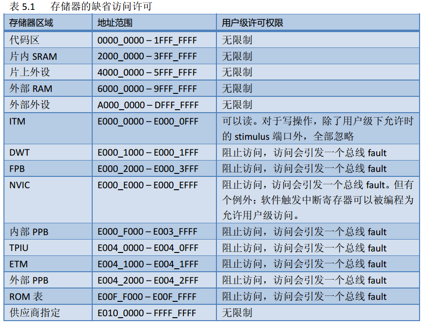

#### SRAM分区

**SRAM：Static Random-Access Memory，静态随机存取存储器**。所谓的“静态”，是指当设备保持供电时，SRAM中存储的数据可以保持不变；掉电时，其存储的数据会丢失

##### 硬件结构

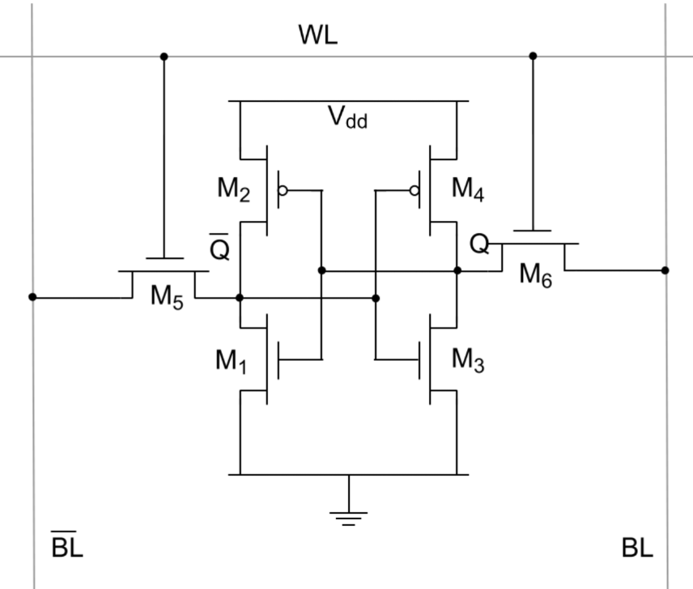

图中M1，M3，M5和M6为NMOS管，高电平导通；M2和M4为PMOS管，低电平导通。BL（Bit Line）为位线，用于读写数据。WL（Word Line）为字线，用于控制读写操作

##### SRAM数据段位置和分类

```
高地址 ──> ┌───────────────────────────────────────┐
           │          Stack (栈)                   │ 
           │  (局部变量、函数参数、返回地址)       │
           └───────────────────┬───────────────────┘
                               │ (向下生长)
                               ▼
                               
                               ▲
                               │ (向上生长)
           ┌───────────────────┴───────────────────┐
           │          Heap (堆)                    │
           │  (malloc / free 动态分配的内存)       │
           ├───────────────────────────────────────┤
           │          .bss 段 (BSS段)              │
           │  (未初始化/初始化为0的全局与静态变量) │
           ├───────────────────────────────────────┤
           │          .data 段 (数据段)            │
           │  (已初始化且不为0的全局与静态变量)    │
低地址 ──> └───────────────────────────────────────┘

```

<br/>

|数据段分类|存储内容|分配/管理方式|释放/销毁时机|运行时生长或分配方向|对应 Keil MDK 术语|
|--|--|--|--|--|--|
|.data (数据段)|已初始化且初值不为 0 的全局变量和 static 静态变量|编译器在编译时分配好固定大小（启动时从 Flash 拷贝初值）|程序结束时释放（生命周期贯穿整个程序）|固定大小，地址不改变|RW-Data|
|.bss (BSS段)|未初始化或初始化为 0 的全局变量和 static 静态变量|编译器分配大小，启动代码（Startup）在运行时全清零|程序结束时释放（生命周期贯穿整个程序）|固定大小，地址不改变|ZI-Data|
|Heap (堆)|malloc()、calloc()、new 等动态申请的内存空间|程序员手动在代码运行时申请|程序员手动 free() 或 delete（不释放会导致内存泄漏）|由低地址 ─> 高地址 动态增长|包含在 ZI-Data 中 (需在启动文件或配置中指定大小)|
|Stack (栈)|函数局部变量（非静态）、函数参数、函数调用返回地址|编译器在进入/退出函数时自动管理|函数执行完毕退出时，由编译器自动释放|由高地址 ─> 低地址 动态延伸|包含在 ZI-Data 中 (需在启动文件或配置中指定大小)|

---

#### Flash分区

##### flash硬件结构

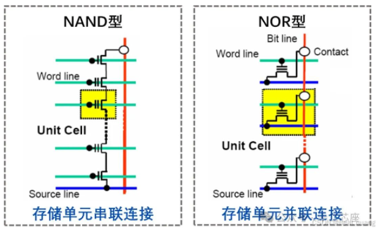

闪存由 存储数据的存储单元以及连接单元之间的布线, 包括**字线(Word Line)、位线(Bit Line) 和 源极线(Source Line) 组成**。

##### flash数据段位置和分类

```
低地址 ──> ┌───────────────────────────────────────┐
           │         Vector Table (中断向量表)     │
           │  (存放各中断服务函数的入口地址)       │
           ├───────────────────────────────────────┤
           │         .text 段 (代码段)             │
           │  (存放编译后的机器指令、可执行代码)  │
           ├───────────────────────────────────────┤
           │         .rodata 段 (只读数据段)       │
           │  (const 常量、字符串字面量)           │
           ├───────────────────────────────────────┤
           │         .data 段 的初值映像 (Flash LMA)│
           │  (系统启动时会被拷贝到 SRAM 的 .data 段)│
高地址 ──> └───────────────────────────────────────┘

```

<br/>

|数据段分类|存储内容|物理读写属性|运行时的去向 (执行位置)|是否占用 Flash 空间|对应 Keil MDK 术语|
|--|--|--|--|--|--|
|Vector Table (中断向量表)|复位向量、各中断服务函数入口地址、初始栈顶指针|只读 (Read-Only)|留在 Flash 中，由 MCU 硬件直接寻址读取|是|Code / RO-Data|
|.text (代码段)|机器指令、用户函数体代码、内联函数逻辑|只读 (Read-Only)|留在 Flash 中，MCU 的 PC 指针直接在此寻址执行|是|Code|
|.rodata (只读数据段)|const 全局变量、字符串字面量、固化的查找表|只读 (Read-Only)|留在 Flash 中，作为常量直接读取，不占用 SRAM|是|RO-Data|
|.data 初值映像 (数据段备份)|已初始化的全局变量、static 静态变量的初始值|只读 (Read-Only)|系统启动时被拷贝到 SRAM 中运行；Flash 只存其快照|是|RW-Data|
|.bss (BSS段占位符)|未初始化或初始化为 0 的全局与静态变量|-|仅在 Flash 中记录该段的总大小，启动时在 SRAM 中直接清零|否 (仅占几字节元数据)|ZI-Data|

---

#### 位带操作

**位带操作的意义是使用普通的加载/存储指令来对单一的比特进行读写**

支持位带操作的只有SRAM区域和片上外设区域，这两个区中的地址除了可以像普通的 RAM 一样使用外，它们还都有自己的“位带别名区”，**位带别名区把每个比特膨胀成一个 32 位的字，可以通过别名来控制对应的比特**

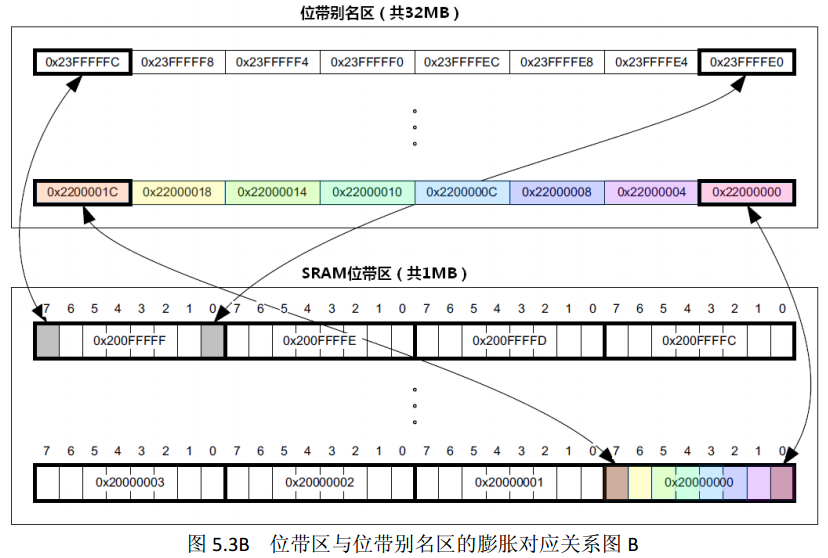

##### 使用位带操作的好处是什么？

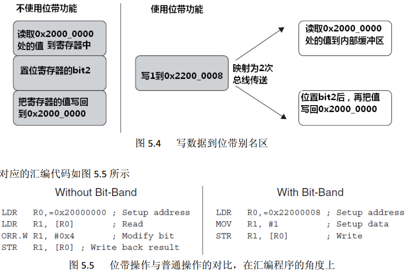

**减少了跳转步骤，提高了执行速度**

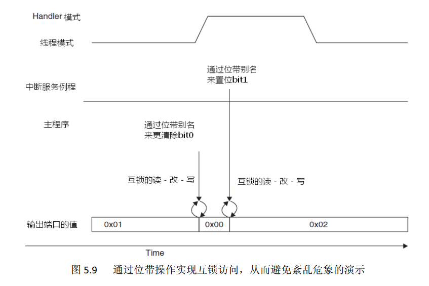

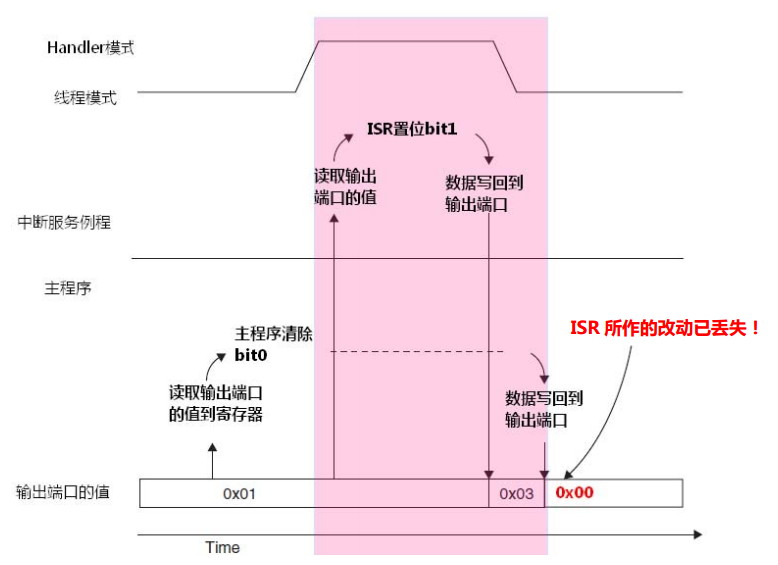

还可以用于实现共享资源在任务间的“互锁”访问。**多任务的共享资源必须满足一次只
有一个任务访问它——亦即所谓的“原子操作”**。

##### 如何使用别名

**使用位带功能时，要访问的变量必须用 volatile 来定义,让编译器不会半路利用寄存器值（可能因为一些环境因素导致寄存器值变化）来操作最后写入原地址**

支持位带操作的两个内存区的范围是：

```c_cpp
0x2000_0000‐0x200F_FFFF（SRAM 区中的最低 1MB）
0x4000_0000‐0x400F_FFFF（片上外设区中的最低 1MB）
```

对 SRAM 位带区的某个比特，记它所在字节地址为 A,位序号为 n(0<=n<=7)，则该比特
在别名区的地址为：

$$AliasAddr＝ 0x22000000+((A‐0x20000000) * 8+n)  * 4 =0x22000000+ (A‐0x20000000)  * 32 + n *  4$$

对于片上外设位带区的某个比特，记它所在字节的地址为 A,位序号为 n(0<=n<=7)，则该比特在别名区的地址为：
$$AliasAddr＝ 0x42000000+((A‐0x40000000)*8+n)*4 =0x42000000+ (A‐0x40000000)*32 + n*4$$
上式中，“*4”表示一个字为 4 个字节，“*8”表示一个字节中有 8 个比特

### 互斥访问

在互斥访问操作下，允许互斥体所在的地址被其它总线 master 访问，也允许被其它运
行在本机上的任务访问，但是 CM3 能够“驳回”有可能导致竞态条件的互斥写操作

### 堆栈实现

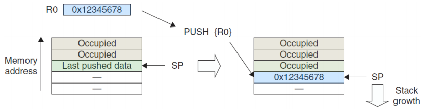

Cortex‐M3 使用的是“向下生长的满栈”模型。堆栈指针 SP 指向最后一个被压入堆栈的 32位数值。在下一次压栈时，SP 先自减 4，再存入新的数值，通俗一点就是m3的压栈是先从顶楼存放东西，一层一层往下走

#### 双堆栈实现

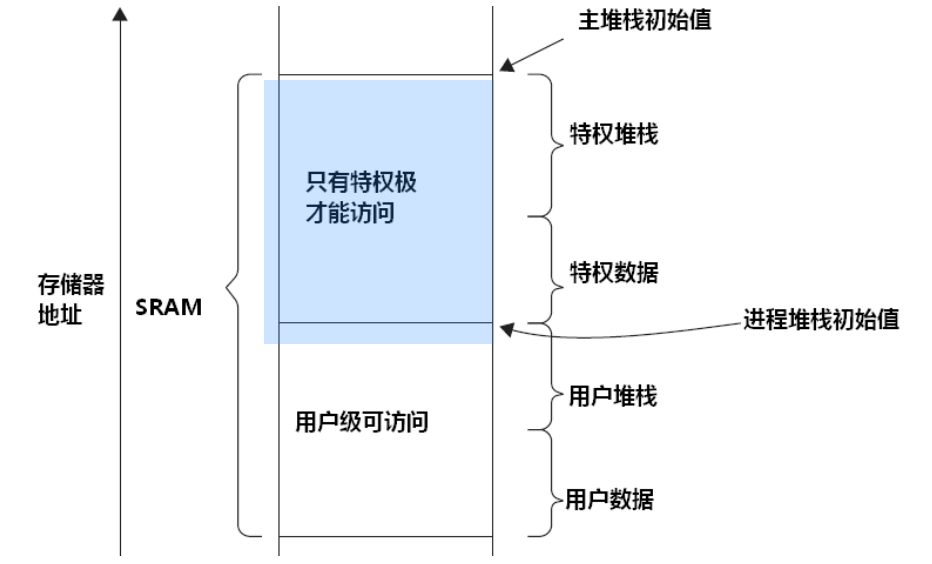

- **内核在执行关键部位的代码时，使用 MSP，并且在辅以 MPU 时，MSP 对应的堆栈只允许特权级访问**
- 服务例程使用 MSP（中断回调函数的执行）
- **通过 SysTick，实时内核的代码每隔固定时间都被调用一次，运行在特权级水平上，负责任务的调度、任务时间管理以及其它系统例行维护**
- 用户应用程序以线程的形式运行，使用 PSP，并且在用户级下运行

## 总线接口

### 流水线

**Cortex‐M3 处理器使用一个 3 级流水线。流水线的 3 级分别是：取指，解码和执行**

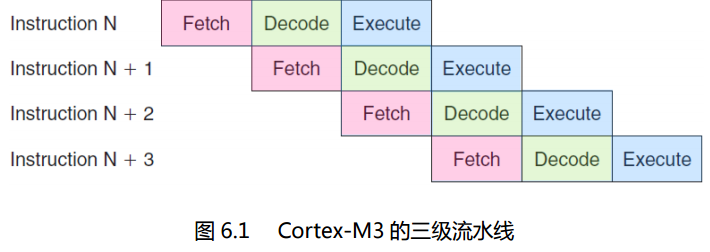

使用流水线技术可以提高处理器的主频，在同样的时间内能够处理的指令更多

### 总线框架

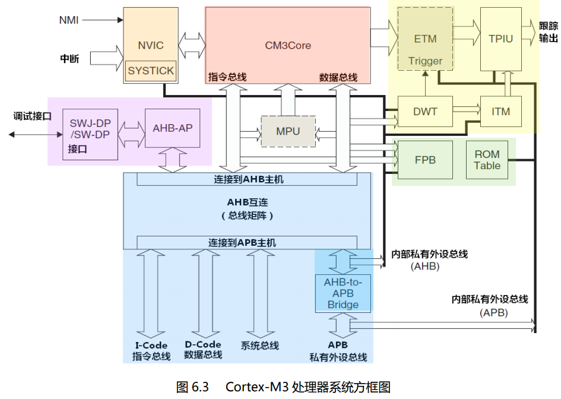

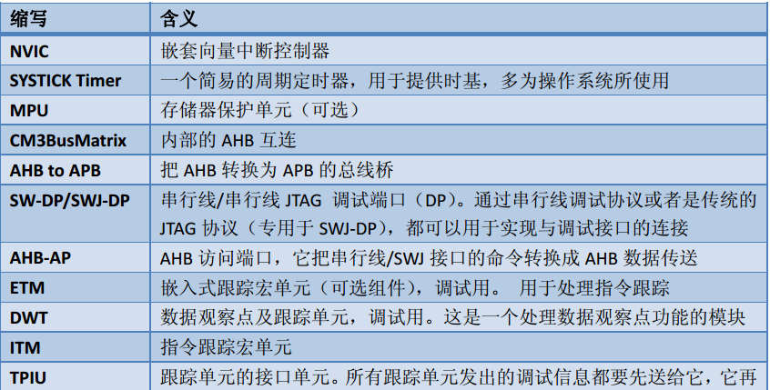


总线是什么?可以这样理解，系统中各部分之间相互联系的路线，例如各省之间的高速公路

### 各总线的作用

#### I-Code 总线（指令总线）

> 其实际作用就是在从访问属性为可执行的指定存储区域获取CPU需要的指令

**I‐Code 总线是一条基于 AHB‐Lite 总线协议的 32 位总线，负责在 0x0000_0000 –
0x1FFF_FFFF （代码区）之间的取指操作**；取指以字的长度执行，即使是对于 16 位指令也如此

#### D-Code总线（数据总线）

> 其实际作用就是从指定存储区域获取CPU需要的数据

**D‐Code 总线也是一条基于 AHB‐Lite 总线协议的 32 位总线，负责在 0x0000_0000 –
0x1FFF_FFFF （代码区）之间的数据访问操作**

#### 系统总线（S-BUS）

> 主要负责访问代码区以外的所有标准内存和外设寄存器（内部和外部都可以访问）

**系统总线也是一条基于 AHB‐Lite 总线协议的 32 位总线，负责在 0x2000_0000 –
0xDFFF_FFFF （SRAM区到板上外设区范围内）和 0xE010_0000 – 0xFFFF_FFFF（系统区和保留区） 之间的所有数据传送**，取指和数据访问都算上

#### 外部私有外设总线 （PPB）

> 主要用于运行时跟踪模式的数据输出和接入到总线矩阵中写入和读取外设寄存器和存储器内容

**这是一条基于 APB 总线协议的 32 位总线。此总线来负责 0xE004_0000 – 0xE00F_FFFF 之间的私有外设访问**，用于访问TPIU、ETM 以及 ROM 表以及外部调试设备，**外部 PPB 不支持非对齐访问**。因为该总线的宽度是 32 位并且是基于 APB 的，当你在为该存储区域设计外设时，必须确保所有的寄存器地址都是按字对齐的。另外，在编写这些设备的驱动程序时，最好让所有的访问都使用字的长度。最后，**PPB 访问永远是小端的**

#### 调试访问端口总线 

> <br/>

**调试访问端口总线接口是一条基于“增强型 APB 规格”的 32 位总线，它专用于挂接调
试接口，例如 SWJ‐DP 和 SW‐DP。**

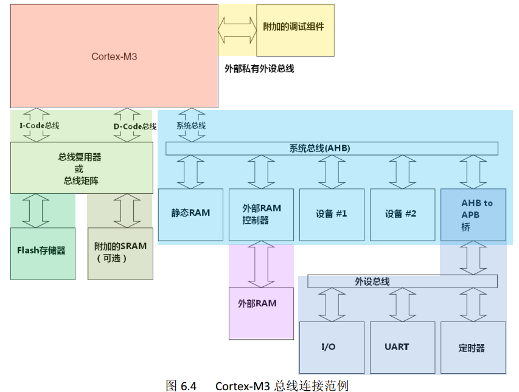

#### 杂项接口

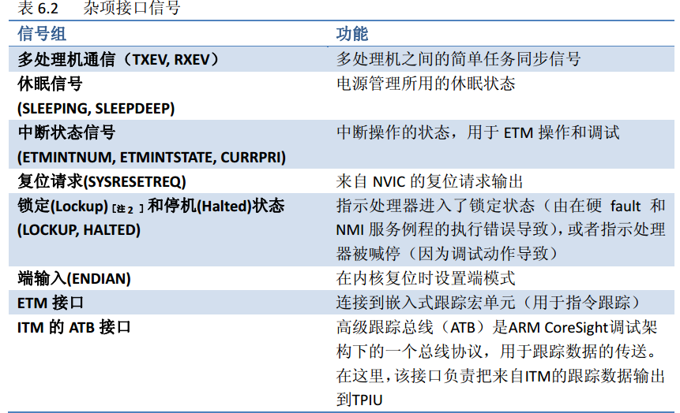

复位，中断，电源管理，跟踪系统通信等等

## 中断与异常

### NVIC

向量中断控制器，简称 NVIC，NVIC 是一个在 CM3 中内建的中断控制器，用于处理嵌套中断和路由中断位置，**所有 NVIC 的中断控制/状态寄存器都只能在特权级下访问。不过有一个例外——软件触发中断寄存器可以在用户级下访问以产生软件中断**

- SysTick 定时器：系统滴答定时器是一个非常基本的倒计时定时器，用于在每隔一
定的时间产生一个中断，即使是系统在睡眠模式下也能工作，SysTick定时器也是作为 NVIC 的一部分实现的。
- 在 NVIC 的中断控制及状态寄存器中，有一个 VECTACTIVE 位段记录了当前正服务异常的编号

#### 中段配置基础

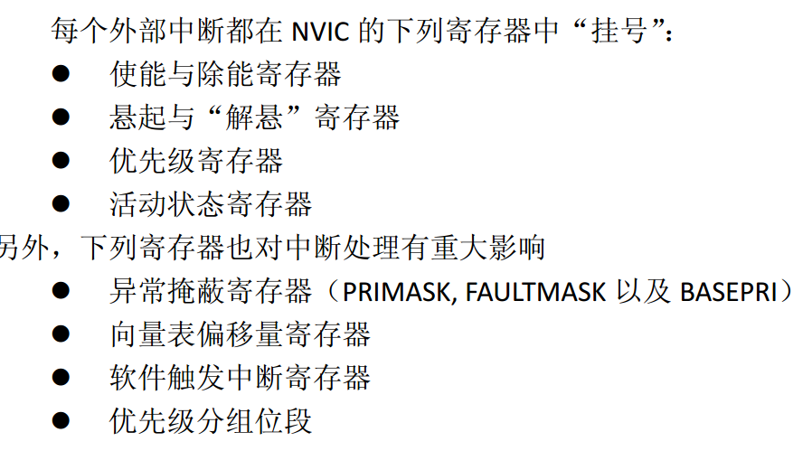

NVIC控制中断的使用权限，活跃状态，优先级分组，以及挂起，还有关于整体中断控制的中断向量表的位置与屏蔽等级和软件中断

#### SysTick定时器

**系统需要一个硬件定时器来产生操作系统需要的滴答中断，作为整个系统的时基**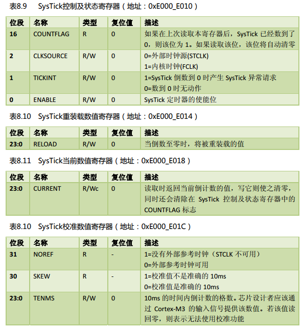

**OS通过设置SysTick重装载数值寄存器来产生恒定的系统心跳**

#### NVIC对于系统复位的接口

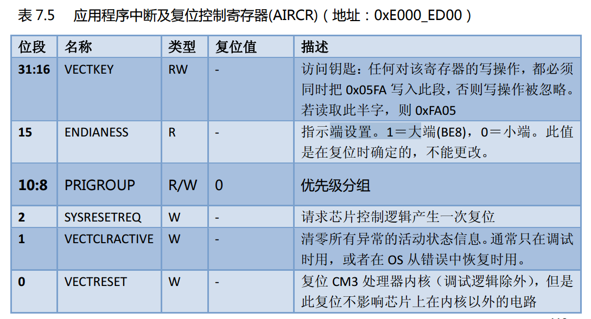

**NVIC重要的系统复位接口SYSRESETREQ,让系统所有寄存器都复位除了备份域寄存器**

### 系统异常清单

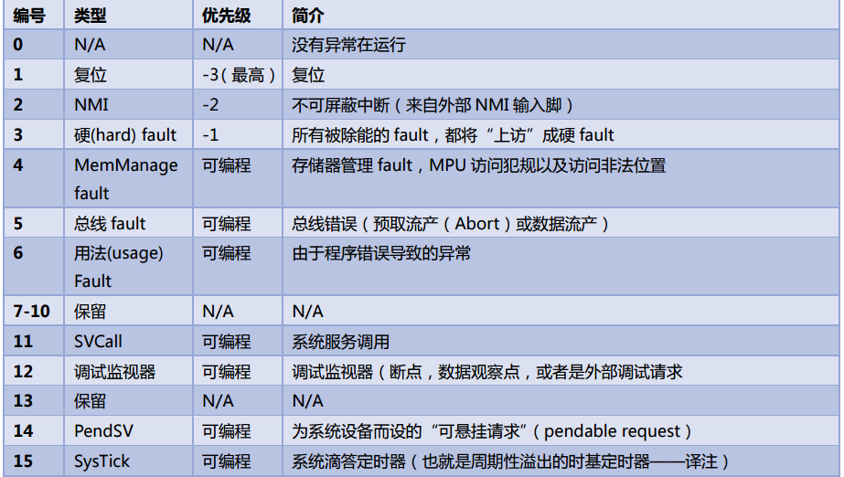

**如果一个发生的异常不能被即刻响应，就称它被“悬起”(pending)**，一个异常被悬起的原因，可能是系统当前正在执行一个更高优先级异常的服务例程，或者因相关掩蔽位的设置导致该异常被除能

> NMI异常指的是不可屏蔽中断（Non-Maskable Interrupt，简称 NMI），触发源一般为时钟崩溃，内存检验错误，硬件安全扩展故障

##### 中断优先级

**优先级的数值越小，则优先级越高**。CM3 支持中断嵌套，使得高优先级异常会抢占(preempt)低优先级异常。**有 3 个系统异常：复位，NMI 以及硬 fault，它们有固定的优先级**，并且它们的优先级号是负数，从而高于所有其它异常

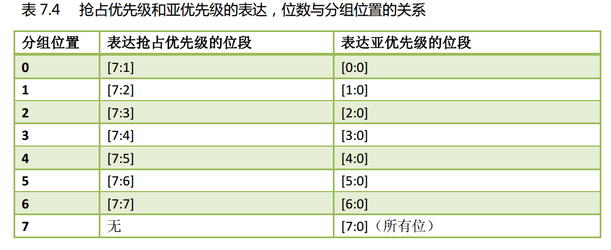

中断优先级由8bit决定，可以定义该8bit分别由抢占和亚优先级分配

#### 中断向量表

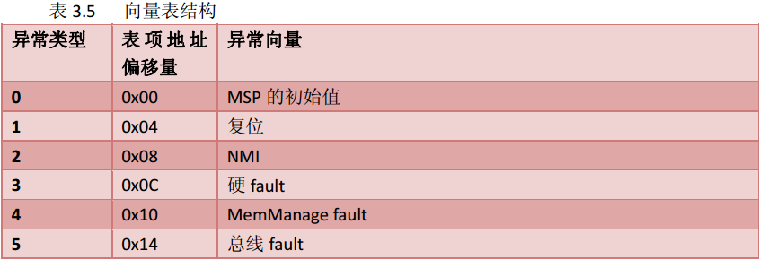

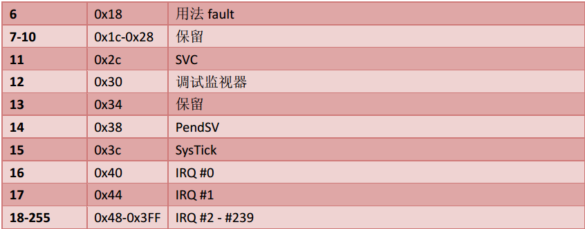

NVIC 中有一个寄存器，称为“向量表偏移量寄存器”（在地址 0xE000_ED08 处），通过修改它的值就能定位向量表。但必须注意的是：**向量表的起始地址是有要求的：必须先求出系统中共有多少个向量，再把这个数字向上增大到是 2 的整次幂，而起始地址必须对齐到后者的边界上**，现在有256个中断向量，每个向量占4个字节，总共需要256 x 4 = 1024个字节，而增大到最近的2的幂次方$2^{10}$，**起始地址对齐需要地址 % 1024 = 0** ，如0x0000-0000，0x0000-0400 = 1024

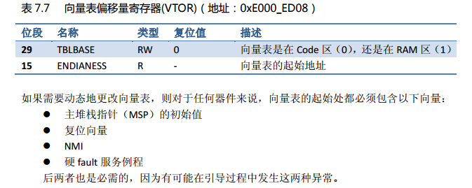

可以在 SRAM 中开出一块用于存储向量表。然后在引导完成后，就可以启用内存中的向
量表，从而实现向量可动态调整的功能。这样可以加快中断反应时间，通过清零压栈操作实现

### 

### 中断的全过程

#### 中断的使能与除能

CM3 中可以有 240 对使能位／除能位，每个中断拥有一对，**欲使能一个中断，你需
要写 1 到对应 SETENA 的位中；欲除能一个中断，你需要写 1 到对应的 CLRENA 位中**

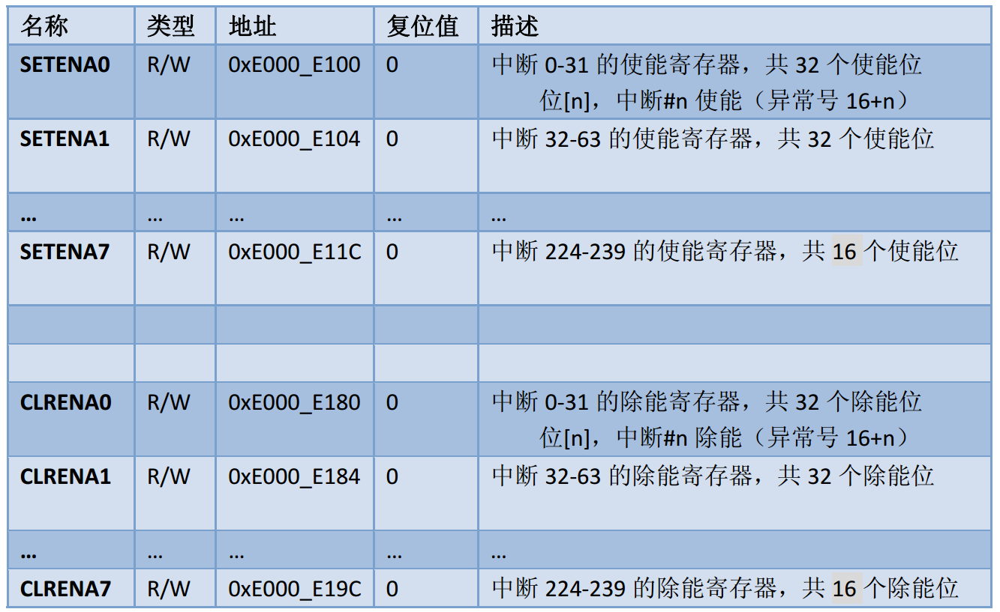

#### 中断输入和悬起

中断请求信号输入到NVIC中输出其中断编号，CPU查询中断向量表获取中断 handler地址执行中断函数

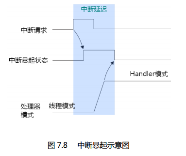

在NVIC得到中断信号后，根据中断编号的优先级判断是否立即执行，如果其优先级低于正在执行的中断，将中断请求的中断编号悬起（等待分配）并记录起来，**CPU响应之前，中断将悬起状态清除（ PRIMASK 或FAULTMASK 置位的时候软件清除了悬起状态标志），中断会被取消**，否则中断悬起位会被硬件自动清除

中断的悬起状态可以通过“中断设置悬起寄存器(SETPEND)”和“中断悬起清除寄存器(CLRPEND)”来读取，还可以写它们来手工悬起中断

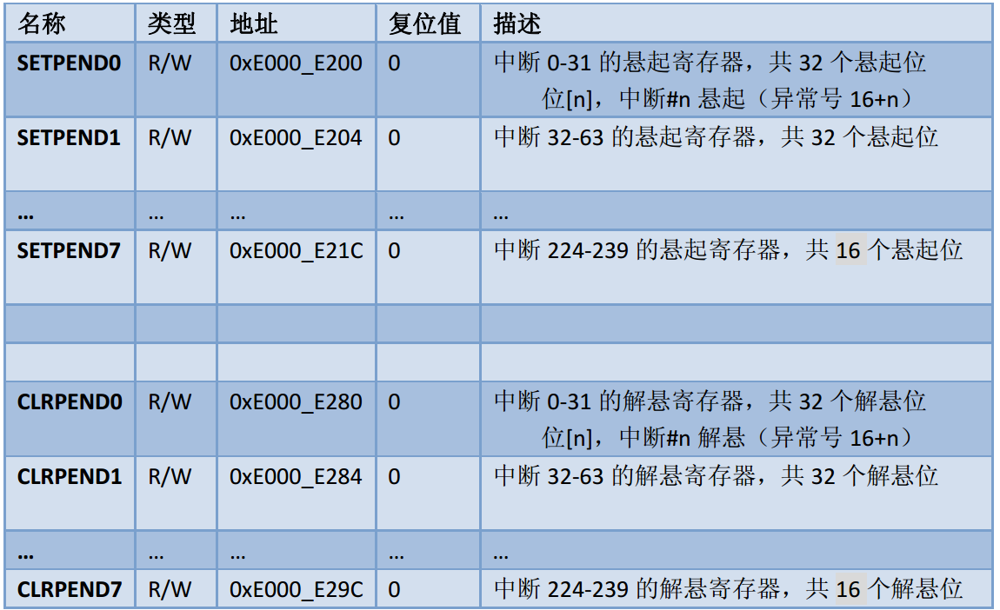

#### 中断响应

当CM3开始响应一个中断时会进行以下操作

- **入栈**，将CPU的关键寄存器内容压入到栈中
- **取向量**，从中断向量表中取得对应的服务程序入口地址
- 选择堆栈指针MSP/PSP，更新堆栈指针SP，更新连接寄存器LR，更新程序计数器PC

##### 入栈

响应异常的第一个行动，就是自动保存现场的必要部分：**依次把xPSR, PC, LR, R12以及
R3‐R0由硬件自动压入适当的堆栈中，不管是响应中断还是异常，根据SP指针内容，分别压入对应的堆栈中**，入栈由DBUS和SBUS总线负责

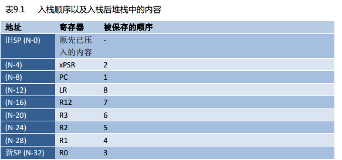

R0是最后被压入的，其内容为保存的堆栈指针地址SP

##### 取向量

**指令总线（I‐Code总线）：从向量表中找出正确的异常向量，然后在服务程序的入口处预取指，取向量和入栈是并行的——同时进行**

##### 更新寄存器

**在入栈和取向量的工作都完毕之后，执行服务例程之前**，还要更新一系列的寄存器：

- SP：在入栈中会把堆栈指针（PSP或MSP）更新到新的位置
- PSR：IPSR位段（地处PSR的最低部分）会被更新为新响应的异常编号
- PC：在向量取出完毕后，PC将指向服务例程的入口地址
- LR：LR的用法将被重新解释，其值也被更新成一种特殊的值，称为“EXC_RETURN”，
并且在异常返回时使用

###### 异常返回值

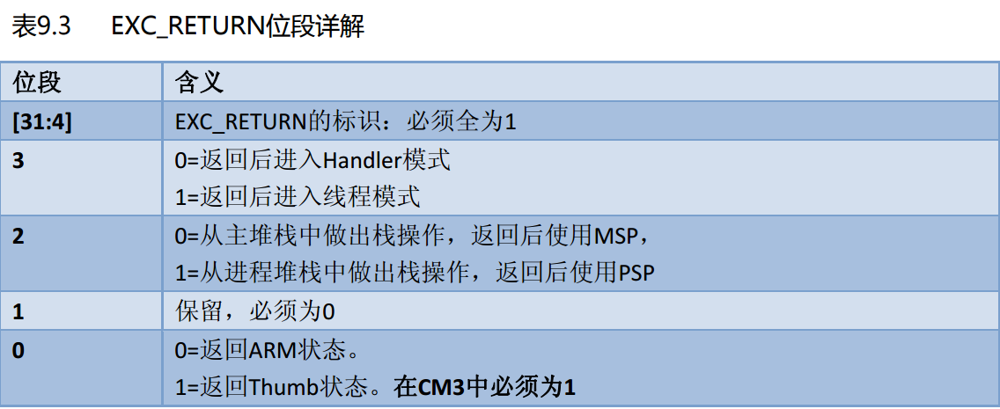

**用于返回到被打断之前的系统状态，权限模式，堆栈位置以及指令集**

常用的返回值有：

```
0xFFFF_FFF1 返回handler模式
0xFFFF_FFF9 返回线程模式，并使用主堆栈(SP=MSP)
0xFFFF_FFFD 返回线程模式，并使用线程堆栈(SP=PSP)
```

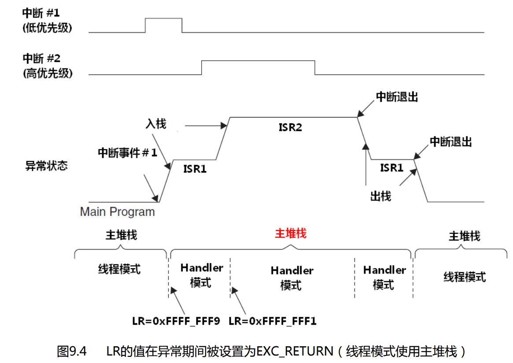

##### 中断延迟

中断延迟的定义是：**从检测到某中断请求，到执行了其服务例程的第一条指令时，已经流逝了的时间**

在CM3中，若存储器系统够快，且**总线系统允许入栈与取指同时进行，同时该中断可以立即响应，则中断延迟是雷打不动的12周期**（满足硬实时所要求的确定性）

#### 中断服务

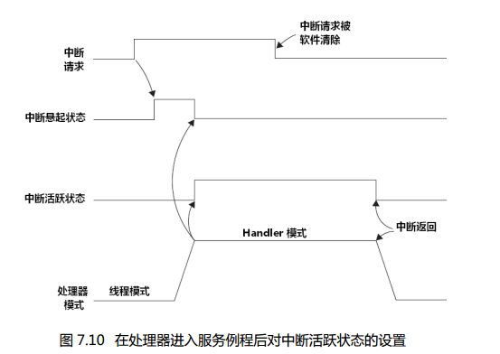

清除悬起位后，就进入到中断服务例程中，并将中断活跃状态位置一，并进入到特权级handle模式**（每个外部中断都有一个活动状态位。在处理器执行了其 ISR 的第一条指令后，它的活动位就被置 1，并且直到 ISR 返回时才硬件清零。）**

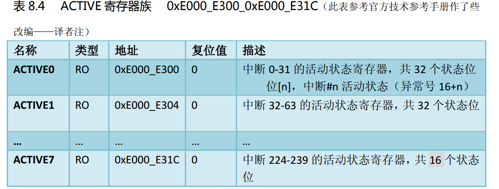

##### 中断丢失

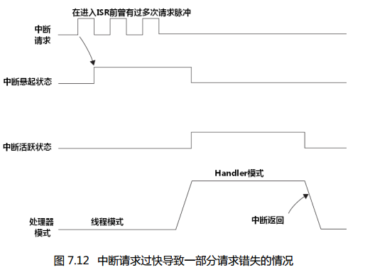

1. **在中断未响应之前，悬起位未清零，在该阶段，只会响应一次中断请求**，在该阶段多次请求中断，就会出现丢中断的情况
2. **在中断响应之前，将悬起位软件清零，导致中断无法响应**
3. NVIC未使能该中断，导致有中断请求信号，但是NVIC不对其响应
4. **多个事件使用同一个NVIC悬起位**——即对应同一中断编号，但是只能响应其中一个事件中断
5. **中断特殊寄存器将中断屏蔽了或者关闭了全局中断功能**

#### 中断结束

当异常服务例程执行完毕后，需要很正式地做一个“异常返回”动作序列，从而恢复先
前的系统状态，才能使被中断的程序得以继续执行

1. **出栈**：先前压入栈中的寄存器在这里恢复。内部的出栈顺序与入栈时的相对应，堆栈指针的值也改回去
2. **更新NVIC寄存器**：伴随着异常的返回，它的活动位也被硬件清除。对于外部中断，倘若中断输入再次被置为有效，悬起位也将再次置位，新一次的中断响应序列也可随之再次开始

当处理器在响应某异常时，如果又发生其它异常，但它们优先级不够高，则被阻塞，这里CM3进行了优化处理，**咬尾中断只需要重新取向量和更新寄存器即可**

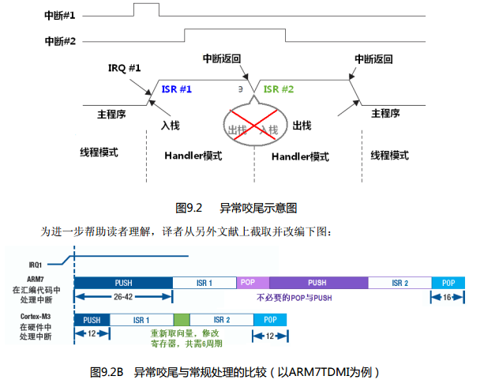

<br/>

### Fault类异常

NVIC也控制和记录fault异常的状态

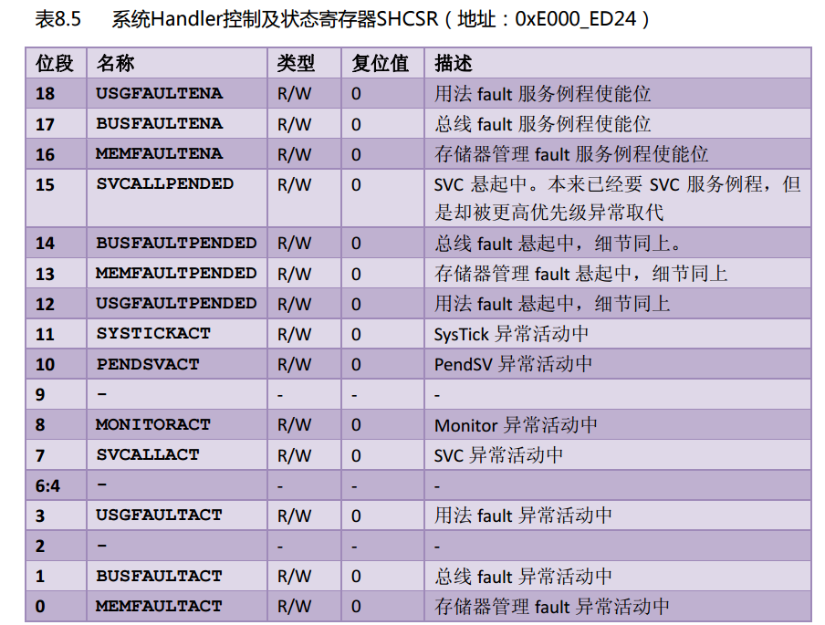

#### 总线faults

**当 AHB 接口上正在传送数据时，如果回复了一个错误信号(error response)，则会产生总线 faults**

##### 一般什么情况会返回错误信号：

1. 访问地址没有对应的存储器
2. 片上外设未初始化之前，试图访问外设
3. 数据传输时，某设备只接受字型数据，却试图送给它字节型数据
4. 在用户权限模式下访问特权模式才能访问的设备如中断
5. 中断处理起始阶段的堆栈 PUSH 动作也可能触发
6. 中断处理收尾阶段的堆栈 POP 动作也可能触发

这些总线异常情况出现，只要没有同级或更高优先级的异常正在服务，且 FAULTMASK=0，就会执行总线 fault 的服务例程，**如果总线fault 被除能，或者总线 fault 发生时正在处理同级或更高优先级异常，则总线 fault 被迫成为
“硬伤”——上访成硬 fault**

##### 如何知道是什么原因触发的总线fault？

NVIC 提供了若干个 fault 状态寄存器，其中一个名为**“总线 fault 状态寄存器”(BFSR)存储着发生总线fault的存储器地址和出现问题的指令地址（BFSR 中的 BFARVALID 位为 1）**

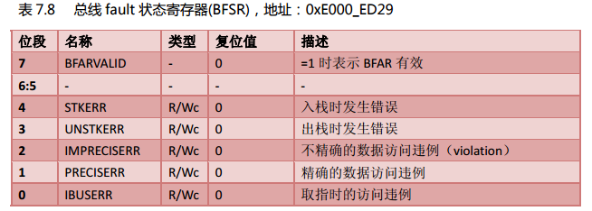

#### 存储器管理 faults 

**存储器管理faults多与MPU有关**，其诱因常常是某次访问触犯了MPU设置的保护策略。

##### 常见触发原因：

1. 访问了 MPU 设置区域覆盖范围之外的地址
2. 往只读region写数据
3. 用户级下访问了只允许在特权级下访问的地址

**如果此时处理器已经在处理同级或高优先级异常，或者 MemManage fault 服务例程被除能，则
和总线 fault 一样：上访成硬 fault**，而在如果硬 fault 服务例程或 NMI 服务例程的执行也导致了 MemManage fault，那就不可救要了——内核将被锁定（嵌套两层异常就会让内核锁定）

##### 存储fault状态获取

**NVIC 中有一个“存储器管理 fault 状态寄存器（MFSR）”，它指出导致 MemManage fault 的原因并将违法指令压栈，如果MMARVALID 位被置位，还会记录引发此 fault 时访问的地址——读取 NVIC“存储器管理地址寄存器（MMAR）”的值**


#### 用法faults

==导致用法 fault 的最常见原因就是试图切入 ARM 状态。只要在加载 PC 时，LSB
为零时就被视作试图切入 ARM 状态==，**如果 OS 在某中断活跃时尝试切入线程模
式，将触犯用法 fault 异常**


##### 用法 faults 发生的场合可以是：

- 执行了未定义的指令
- 无效的中断返回（LR 中包含了无效/错误的值）
- 使用多重加载/存储指令时，地址没有对齐。
  
  另外，通过设置 NVIC 的对应控制位，可以在下列场合下也产生用法 fault：

- 除数为零
- 任何未对齐的访问

**如果此时处理器已经在处理同级或高优先级异常，或者用法 fault 服务例程被除能，则和总线 fault 和 MemManage fault 一样：上访成硬fault**

##### 用法fault状态获取

**NVIC 中有一个“用法 fault 状态寄存器（UFSR）”，它指出导致用法 fault 的原因。在服务例程中，导致用法 fault 的指令地址被压入堆栈中**


#### 硬fault（hard fault）

**hard fault 是上文讨论的总线 fault、存储器管理 fault 以及用法 fault 上访的结果**。如果这些 fault 的服务例程无法执行，它们就会成为“硬伤”——上访（escalation）成硬 fault。另外，**在取向量（异常处理是对异常向量表的读取）时产生的总线 fault 也按硬 fault 处理**

##### hardfault状态读取

**在NVIC 中有一个硬 fault 状态寄存器（HFSR），它指出产生硬 fault 的原因。如果不是由于取向量造成的，则硬 fault 服务例程必须检查其它的 fault 状态寄存器，以最终决定是谁上访的**


### SVC和PendSV

SVC（系统服务调用，亦简称系统调用）和 PendSV（可悬起系统调用），SVC 用于产生系统函数的调用请求，通过提供一些系统服务函数，用户程序使用 SVC 发出对系统服务函
数的呼叫请求，以这种方法调用它们来间接访问硬件

NVIC中通过ICSR控制PendSV和SVC异常


##### SVC

用户程序通过svc间接访问系统服务对应的各类寄存器如NVIC，MPU，总线设置等等，**SVC异常是必须立即得到响应的**

其SVC的意义是：

1. 用户程序与系统服务解耦
2. 用户程序无需再关注底层硬件实现
3. 用户程序无需在特权模式下运行导致误操作
4. 由OS来控制具体的硬件实现


**SVC 的核心作用不是“普通任务之间的切换”，而是提供一个由软件主动触发的异常入口，让处理器从当前执行环境进入 Handler mode，并借助异常返回机制恢复任务上下文**

##### svc在freertos中的作用


**SVC异常在启动调度器后只触发一次异常，帮助找到第一个任务的上下文**

##### PendSV

PendSV 则不同，它是可以像普通的中断一样被悬起的，**OS利用PendSV来实现异步操作，悬起 PendSV 的方法是：手工往 NVIC 的 PendSV 悬起寄存器中写 1。悬起后，如果优先级不够高，则将缓期等待执行**

PendSV 的典型使用场合是在上下文切换时（在不同任务之间切换），将PendSV设置为最低优先级的异常，这样PendSV 异常会自动延迟上下文切换的请求，直到其它的 ISR 都完成了处理后才放行


### 异常响应期间的faults 

#### 入栈期间

- 中断的压栈操作引发了总线fault就会让本次入栈操作将被强行中止，并且把总线异常悬起或者在允许时立即响应
- 如果入栈操作引起MPU访问违例，则产生存储管理fault，并且必须立即执行MemFault服务例程，否则将无条件上访成硬fault
- 入栈是自动完成的，因此不可能产生用法fault

#### 出栈期间

- 如果在中断返回时的出栈期间引起了总线fault，则本次出栈操作将被强行中止，并且把
总线异常悬起或立即响应
- 如果是因MPU访问违例造成的MemManage fault，由MFSR.3（MUNSTKERR）指
示。且MemManage fault的服务例程必须能立即执行，否则无条件硬fault

#### 取向量期间

- **若是在取向量期间发生总线fault，则比较罕见，这也是最严重的，因此直接上硬fault，由硬fault状态寄存器（HFSR，
地址：0xE000_ED2C）中的VECTTBL位（位偏移：1）来指示**

#### 无效返回期间

- 如果LR中的EXC_RETURN不是合法的值（合法值见表9.4，包括企图返回ARM状态），则
引起用法fault。如果用法fault被除能，也上访成硬fault

## 电源管理

#### 进入到睡眠模式


系统可以利用系统控制寄存器让芯片进入到sleep或者stop状态，睡眠：由 CM3 处理器的 SLEEPING 信号指示；深度睡眠：由 CM3 处理器的 SLEEPDEEP 信号指示

#### 唤醒芯片，退出睡眠模式


- WFI只有当该中断的优先级比当前优先级要高（如果是在服务例程中使用 WFI），并且比 BASEPRI 掩蔽的高时，才唤醒处理器并执行 ISR

- WFE 则有点区别，不管优先级和掩蔽情况如何，只要 SETONPEND 置位，它就会不错过任何一个事件，在发生事件时一定把处理器唤醒

<br/>

## 多核通信

处理机有一个名为** TXEV（Transmit Event）**的输出信号，用于发送信号给其它处理机；还有一个名为 RXE**V（Receive Event）**的输入信号，以接收从其它处理机发来的信号


当处理机因为 WFE 而睡眠时，可以由外部事件——即 RXEV 唤醒，CM3提供了 SEV 指令（Send EVent）


## MPU

> 所谓“野指针”，就是指某个指针变量的值因故超出合法的范围，使其“枪口”乱指。程序逻辑错误、数组越界、堆栈溢出、指针未经初始化、对缓存与缓冲的处理不当、多任务环境中的紊乱条件，甚至是恶意地破坏等，都可以制造出野指针。如果使用野指针去读取或修改内存，则被读取或修改的位置是不可预料的。前者导致读回来的都是乱掉的数据，后者则会破坏未知用途的数据。这常常导致系统发生莫名其妙的功能紊乱，严重时会使系统毫无征兆，没有理由地失控、死机。

为不同的程序限定一个内存使用范围，从而使野指针或恶意破坏无法影响不允许访问的区域。此即存储器保护单元（MPU）。 MPU在执行其功能时，是以所谓的“region”为单位的。**一个region其实就是一段连续的地址**，只是它们的位置和范围都要满足一些限制（对齐方式，最小容量等）

### 控制用户模式下的访问范围


通过把PRIVDEFENA置位，可以在没有建立任何region就使能MPU的情况下，依然允许特权级程序访问所有地址，而只有用户级程序被卡死


**不管MPU如何限制，响应异常时的取向量操作总是不受影响的。 **

## 调试系统


 ### 调试功能的分类

1. 侵入式调试（这也是基本的调试机能）
   1.  停机以及单步执行程序
   2.  硬件断点
   3.  断点指令（BKPT）
   4.  数据观察点，作用于单一地址、一个范围的地址，以及数据的值。
   5.  访问寄存器的值（既包括读，也包括写）
   6.  调试监视器异常
   7.  基于 ROM 的调试（闪存地址重载(flash patching) ）
2. 非侵入式调试（大多数人更少接触到的，高级的调试机能）
   1. 在内核运行的时候访问存储器
   2.  指令跟踪，需要通过可选的嵌入式跟踪宏单元（ETM）
   3.  数据跟踪
   4.  软件跟踪（通过 ITM（指令跟踪单元））
   5.  性能速写（profiling）（通过数据观察点以及跟踪模块）

### 处理器的调试接口

CM3 支持两种调试主机接口（debug host interface ）:第一个是广为使用的JTAG 接口，还有一个新的“串行线(Serial Wire, SW)调试接口”

从外部调试器到 CM3 调试接口的连接，需要多级互联才能完成:

1. 第一步就是 通用DP接口模块，**将外部信号转化为一个通用的32位调试总线信号（DAP总线，其中高 8 位用于选择访问哪一个设备，由此可见最多可以在
DAP 总线上面挂 256 个设备）**
   
   
   
   其SWJ调试端口
2. 第二步将DAP信号连接到了一个称为“AHB‐AP”的AP 设备上，**将DAP总线的命令转化为AHB总线上的数据**
3. 第三步连接到总线矩阵，**访问CM3的整个存储器映射**，连 NVIC中的调试控制寄存器组也包括在内

### CoreSight 调试架构


与CM3的调试架构对比


## 跟踪系统

### 调试组件


在 CM3 中可以有 **3 种跟踪源：ETM, ITM 和 DWT**。其中，ETM 是一个可选组件，因此有些CM3芯片中没有配。在操作中，**每个跟踪源都被赋予一个7位的ID号（ATID）**，跟随它所发出的数据包一起送出，输出的数据包为ATB数据包

### DWT——数据观察点与跟踪

DWT提供功能有：

1. 以固定的周期采样 PC 的值
2. 中断事件跟踪
3. 它包含了 4 个比较器，可以配置成在发生比较匹配时，执行如下动作：
   1. 触发ETM发送ATB数据包
   2. 触发PC指令采样器事件
   3. 触发数据地址采样器
   4. 产生一个观察点调试事件
   5. 比较时钟周期计数器
4. 作为计数器，对下列项目进行计数
   1. **时钟周期（通常被使用获取系统准确运行周期）**
   2. **睡眠的时间周期（低功耗模式下需要）**
   3. 中断的额外开销（overhead）
   4. 每指令周期数（CPI）
   5. 被折叠（Folded）的指令
   6. 对加载/存储单元（LSU）的操作

#### 比较器的寄存器

每一个比较器都有 3 个寄存器，COMP 寄存器，MASK 寄存器，FUNCTION 控制寄存器，**COMP 寄存器是一个 32 位寄存器，用于存储要比较的值。MASK 寄存器可以用于
掩蔽数据地址的一些位，被掩蔽的位不参与比较，比较器的 FUNCTION 寄存器用于决定该比较器的功能**

 ### ITM——指令跟踪宏单元

ITM 有如下的功能：

- **软件可以直接把控制台消息写到 ITM stimulus 端口，从而把它们输出成跟踪数据**。
- DWT 可以产生跟踪数据包，并通过 ITM 把它们输出。
- **ITM 可以产生时间戳数据包并插入到跟踪数据流中，用于帮助调试器求出各事件的
发生时间**

**欲使用 ITM，必须把 DEMCR.TRCENA 位置位，否则 ITM 处于除能状态，无法使用。另外，在 ITM 寄存器中还有一个锁。在编程 ITM 之前，必须写入一个访问钥匙值
0xC5AC_CE55（CoreSight 的 ACCESS）到这个解锁寄存器。**

#### 基于 ITM 的软件跟踪

ITM 的一个主要用途，就是支持调试消息的输出（例如，printf 格式的输出）ITM 包含了 32 个刺激(stimulus)端口，允许不同的软件把数据输出到不同的端口，从而让调试主机可
以把它们的消息分离开。**因为ITM内部有FIFO缓冲区，不会像串口一样输出信息有很大的延迟并且不会对应用程序产生较大影响**

#### 基于ITM和DWT的硬件跟踪

ITM 也能用于输出硬件跟踪数据，这些数据由 DWT 产生，ITM 则担任跟踪数据包的归并单元，欲使用 DWT 跟踪，需要在 ITM 控制寄存器中置位 DWTEN 位，剩
下的 DWT 跟踪设置在 DWT 中完成


也就是DWT的数据需要交给ITM组合成数据包才能发送出去

#### ITM时间戳

当一个新的跟踪数据包进入了 ITM 的 FIFO 时，ITM就会把一个差分的时间戳数据包插入到跟踪数据流中

### ETM——嵌入式跟踪宏单元

ETM 功能块用于提供指令跟踪（即指令执行的历史记录），ETM 中也有一个 FIFO 缓冲区，为跟踪数据流的捕捉提供够用的时间，ETM一般是会输出其程序执行流的信息不会输出其处理器当前执行这里的地址

### TPIU——跟踪端口接口单元

I**TM, DWT 和 ETM 的跟踪数据都在 TPIU 处汇聚。TPIU 用于把这些跟踪数据格式化并输出到片外**，以供跟踪端口分析仪之类的设备接收使用

#### 输出模式分类

1. 带时钟模式(Clocked mode)，使用最多4位的并行数据输出端口
2. **串行线观察器（SWV）模式，使用单一位的SWV输出**

**欲使用TPIU，需要先把DECMR.TRCENA置位，还要编程“协议选择寄存器”和“跟踪端口尺寸寄存器”，这个工作由跟踪捕捉软件完成**

### FPB——闪存地址重载及断点单元

FPB有两项功能：

- 硬件断点（共6个）支持。产生一个断点事件，从而使处理器进入调试模式（地址匹配时进入到停机或调试监视器异常）
-  **把代码地址空间中的指令或字面值(literal data)重载到SRAM中。**

可以通过编程比较器，**把指令空间的地址重载（重映射）到SRAM地址空间中。当使用此功能时，需要编程REMAP寄存器，以提供需要重映射内容的基址**


### ROM表

**ROM表，它记录了NVIC和各个调试功能块的地址**，ROM表位于0xE00F_F000。通过分析ROM表中的内容，可以计算出系统和调试组件在存储器系统中的位置

在CM3的ROM表中，**第一条目的内容应当是：NVIC的入口地址相对于ROM表入口地址的偏移量**，NVIC入口地址= 0xE00F_F000 + 0xFFF0_F000 = 0xE000_E000（进位位被忽略）


<br/>

**数值的最低两个位用于指示该设备是否存在(bit[1])以及后面还有没有其它的表项(bit[0])。在正常情况下，NVIC, DWT和FPB总是必须存在的，因此最后两位永远是1。**