## 电源

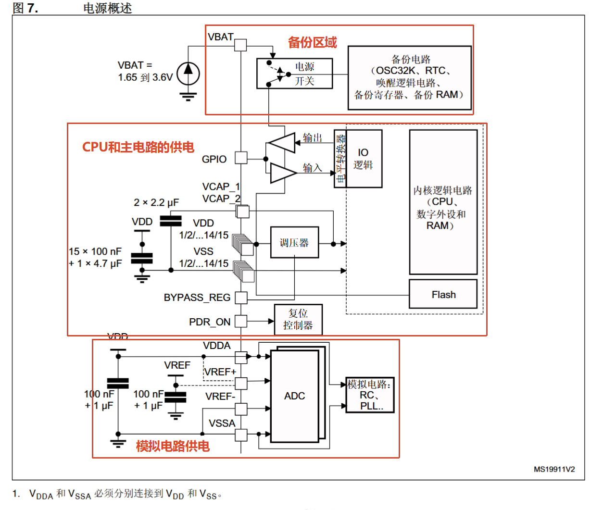

- 其中VDD为器件的工作电压要求在1.8v~3.6v，经过==调压器稳定电压为1.2v为CPU，DMA等外设，以及内存RAM和flash区域供电==

- VREF为用于ADC的校准电压，可以单独连接外部参考电压的输入,VREF+的输入范围为2.4~VDDA
- VDDA为ADC独立电源电压，可以单独滤波并屏蔽PCB上噪声，同时作为模拟电路，RC滤波电路以及锁相环的供电电源
- VBAT为电池供电电压，**VDD关闭后保留备份域的RTC相关寄存器和备份SRAM的内容，为RTC，LSE振荡器，备份SRAM（仅可由 CPU 访问的 4 KB 内存区域）这些供电，才能保存备份域信息**

> 在 tRSTTEMPO(VDD 启动后的一段延迟)期间或检测到 PDR 后,  VBAT 与 VDD 之间的电源开关仍连接到 VBAT。  在启动阶段,如果 VDD 的建立时间小于 tRSTTEMPO (有关   tRSTTEMPO 的值,请参见数据手册)且 VDD > VBAT + 0.6 V,会有  电 流 经 由 VDD 和 电 源 开 关 (VBAT) 之 间 连 接 的 内 部 二 极 管 注 入  VBAT 引脚。  如果连接到 VBAT 引脚的电源/电池无法承受此注入电流,则强烈建 议在该电源与 VBAT 引脚之间连接一个低压降二极管。

### 备份域

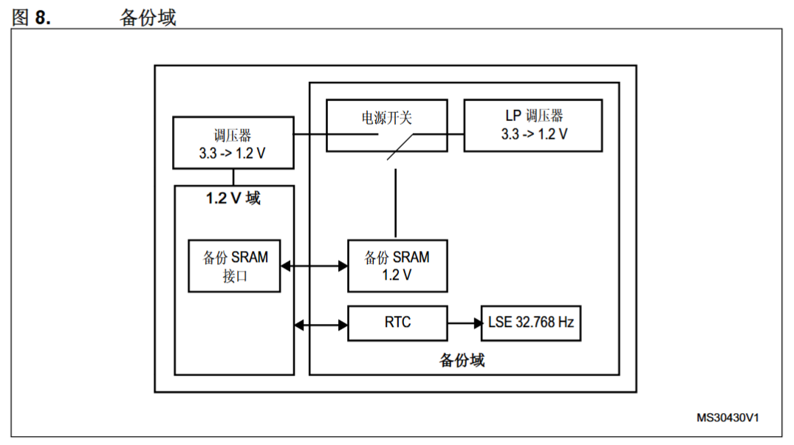

<br/>

### 调压器

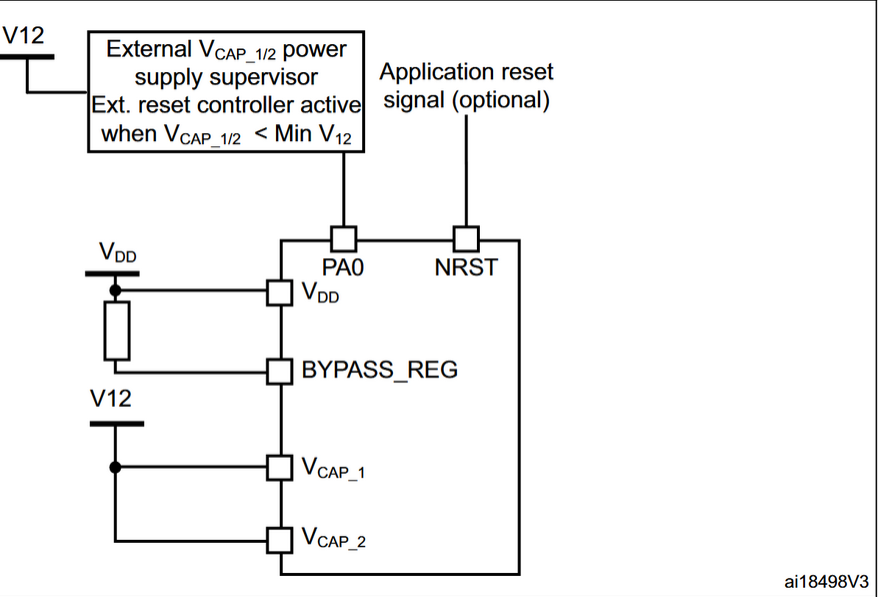

> 应在 VCAP_1 和 VCAP_2 引脚上连接一个或两个外部陶瓷电容,通过

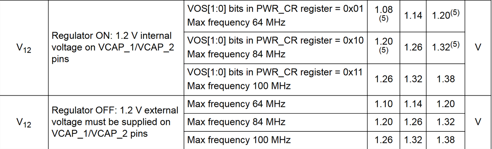

**嵌入式线性调压器为备份域和待机电路以外的所有数字电路供电。调压器输出电压约为 1.2 V**

在停止模式下，调压器为数字电路提供低功率，只让SRAM和寄存器的内容保存，在待机模式下，调压器掉电，只有待机电路和备份域保留

### 电源监控

上电复位 (POR)/掉电复位 (PDR)，当VDD  /VDDA  低于指定阈值 VPOR/PDR  时,器件无需外部复位电路便会保持复位状态

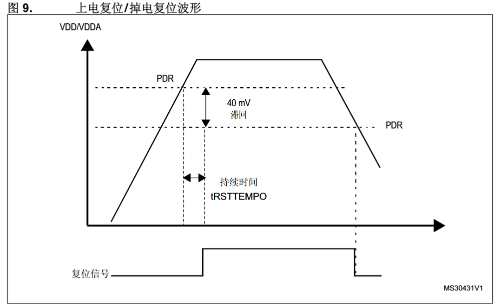

当复位信号为低电平时为复位状态，复位信息为高电平时为运行状态，上电期间,欠压复位 (BOR) 将使器件保持复位状态,直到电源电压达到指定的 VBOR 阈值

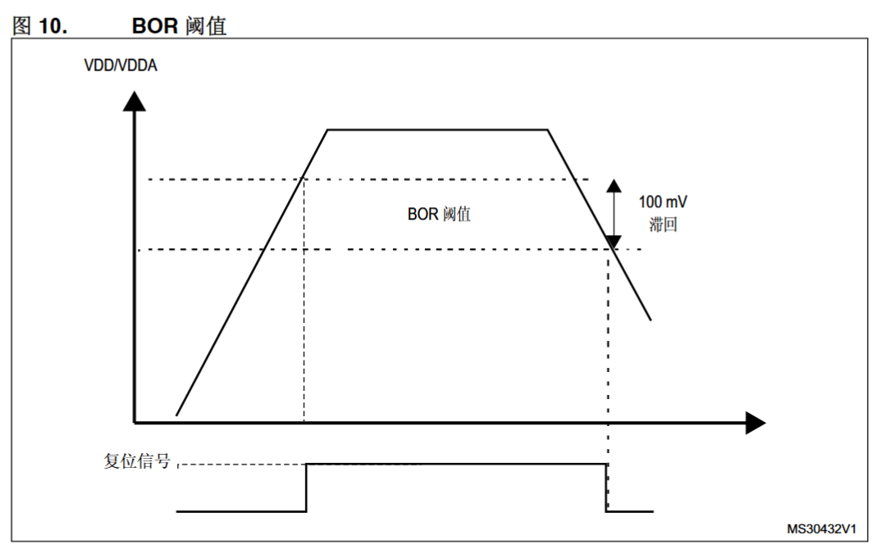

利用PVD监视VDD电源，并连接到EXTI线16上，如果EXTI使能，可以产生中断，该功能的用处之一就是可以在中断 服务程序中执行紧急关闭系统的任务

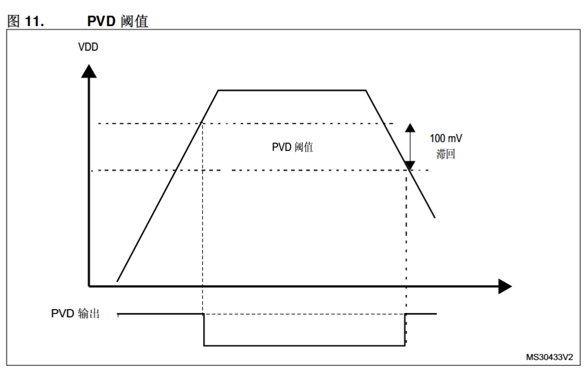

## 睡眠模式

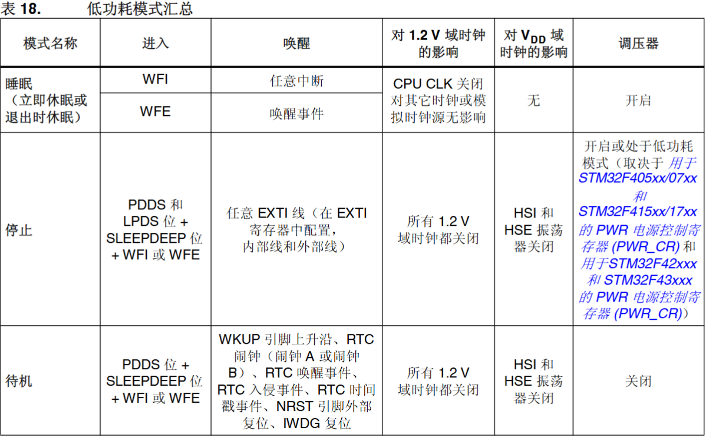

睡眠模式(CortexTM-M4F 内核停止,外设保持运行)，所有中断或者事件即可唤醒，执行 WFI(等待中断)或 WFE(等待事件)指令即可进入睡眠模式，同时系 统控制寄存器中 SLEEPONEXIT 位的设置为零，执行指令后立即进入睡眠状态，置位为一等待最低优先级的ISR退出再进入睡眠模式

如果使用 WFI 指令进入睡眠模式,则嵌套向量中断控制器 (NVIC) 确认的任意外设中断都会将器件从睡眠模式唤醒。  如果使用 WFE 指令进入睡眠模式,MCU 将在有事件发生时立即退出睡眠模式，唤醒事件如下：

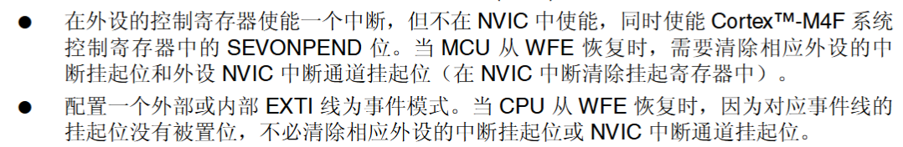

## 停止模式

在停止模式下,1.2 V 域中的所有时钟都会停止,PLL、HSI 和 HSE RC 振荡器也被禁止。==内部 SRAM 和寄存器内容将保留==。  将 PWR_CR 寄存器中的 FPDS 位置 1 后,Flash 还会在器件进入停止模式时进入掉电状 态。Flash 处于掉电模式时,将器件从停止模式唤醒将需要额外的启动延时

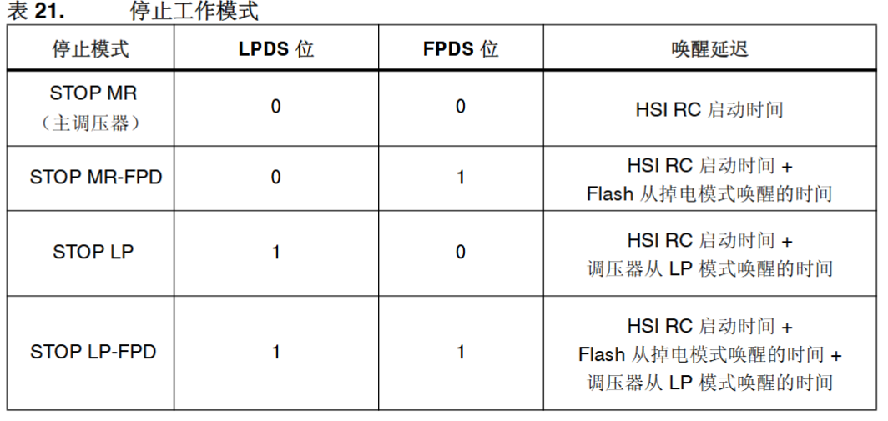

<br/>

通过发出中断或唤醒事件退出停止模式时,将选择 HSI RC 振荡器作为系统时钟

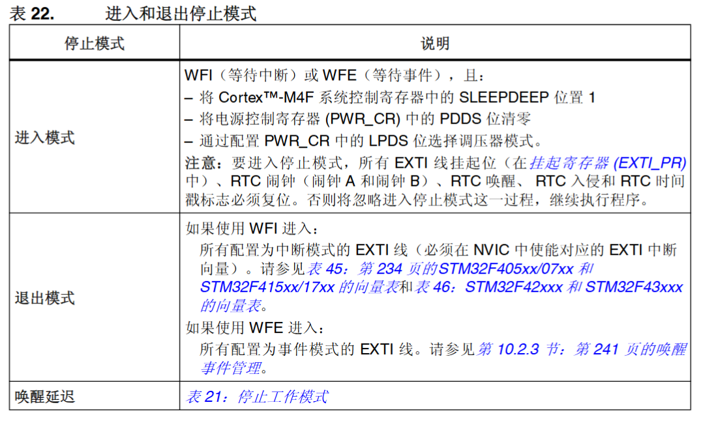

EXTI的中断或者事件都可以唤醒停止模式**在停止模式下,ADC 或 DAC 也会产生功耗,除非在进入停止模式前将其禁止。要禁止这些 转换器,必须将 ADC_CR2 寄存器中的 ADON 位和 DAC_CR 寄存器中的 ENx 位都清零**

## 待机模式

待机模式下可达到最低功耗。待机模式基于 CortexTM-M4F 深度睡眠模式,其中调压器被禁 止。因此 1.2 V 域断电。PLL、HSI 振荡器和 HSE 振荡器也将关闭。==除备份域(RTC 寄存 器、RTC 备份寄存器和备份 SRAM)和待机电路中的寄存器外,SRAM 和寄存器内容都将 丢失==

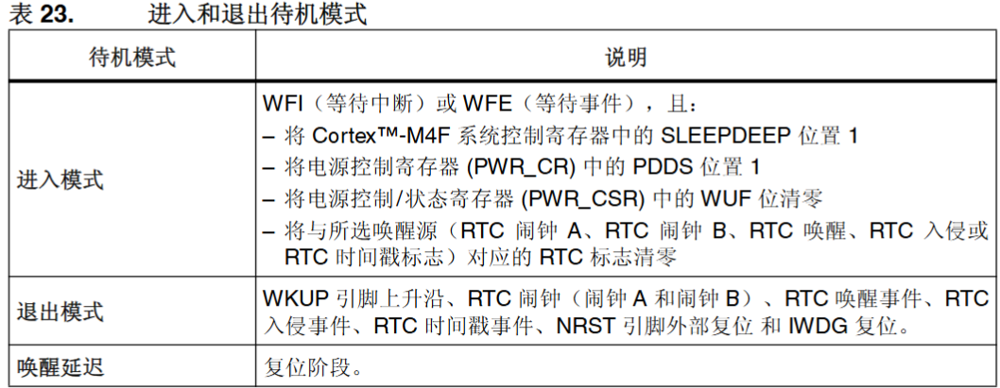

检测到外部复位(NRST 引脚)、IWDG 复位、WKUP 引脚上升沿、RTC 闹钟、入侵事件 或时间戳时间时,微控制器退出待机模式

## Tickless模式

无滴答空闲模式的作用是**当系统处于空闲状态时，尽可能避免 SysTick 的周期性打扰，让 MCU 长时间沉睡，从而降低功耗**，根据config中设定的宏提供的MCU低功耗函数选择进入到不同低功耗模式


其中实现tickless模式的具体流程为：

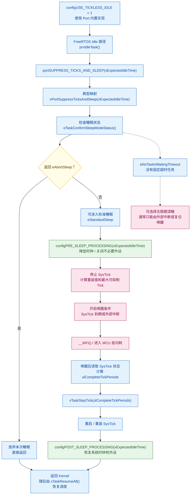

```c_cpp
__weak void vPortSuppressTicksAndSleep( TickType_t xExpectedIdleTime )​
{​
    uint32_t ulReloadValue, ulCompleteTickPeriods, ulCompletedSysTickDecrements;​
    TickType_t xModifiableIdleTime;​
​
    /* 限制最大空闲时间，防止 SysTick 重装载值溢出 */​
    if( xExpectedIdleTime > xMaximumPossibleSuppressedTicks )​
    {​
        xExpectedIdleTime = xMaximumPossibleSuppressedTicks;​
    }​
​
    /* 暂停 SysTick 计数器，避免继续产生中断 */​
    portNVIC_SYSTICK_CTRL_REG &= ~portNVIC_SYSTICK_ENABLE_BIT;​
​
    /* 计算 SysTick 的 reload 值：​
     * 当前剩余计数值 + (期望空闲时间 - 1 个 tick 的时间) */​
    ulReloadValue = portNVIC_SYSTICK_CURRENT_VALUE_REG + ( ulTimerCountsForOneTick * ( xExpectedIdleTime - 1UL ) );​
​
    /* 减去暂停 SysTick 所导致的补偿延迟 */​
    if( ulReloadValue > ulStoppedTimerCompensation )​
    {​
        ulReloadValue -= ulStoppedTimerCompensation;​
    }​
​
    /* 进入临界区，但不使用 taskENTER_CRITICAL()，保留唤醒中断 */​
    __disable_irq();​
    __dsb( portSY_FULL_READ_WRITE );​
    __isb( portSY_FULL_READ_WRITE );​
​
    /* 如果此时有任务就绪或调度器即将恢复，放弃睡眠 */​
    if( eTaskConfirmSleepModeStatus() == eAbortSleep )​
    {​
        /* 重新设置 SysTick reload 为当前剩余值，完成当前 tick */​
        portNVIC_SYSTICK_LOAD_REG = portNVIC_SYSTICK_CURRENT_VALUE_REG;​
​
        /* 重启 SysTick */​
        portNVIC_SYSTICK_CTRL_REG |= portNVIC_SYSTICK_ENABLE_BIT;​
​
        /* 恢复正常的 reload 值 */​
        portNVIC_SYSTICK_LOAD_REG = ulTimerCountsForOneTick - 1UL;​
​
        /* 重新打开中断 */​
        __enable_irq();​
    }​
    else​
    {​
        /* 设置计算好的重装载值 */​
        portNVIC_SYSTICK_LOAD_REG = ulReloadValue;​
​
        /* 清除当前计数值，确保从0重新开始 */​
        portNVIC_SYSTICK_CURRENT_VALUE_REG = 0UL;​
​
        /* 启动 SysTick */​
        portNVIC_SYSTICK_CTRL_REG |= portNVIC_SYSTICK_ENABLE_BIT;​
​
        /* 调用预睡眠钩子函数，允许用户进行额外处理 */​
        xModifiableIdleTime = xExpectedIdleTime;​
        configPRE_SLEEP_PROCESSING( xModifiableIdleTime );​
​
        /* 若钩子函数未屏蔽 WFI 指令，则执行睡眠 */​
        if( xModifiableIdleTime > 0 )​
        {​
            __dsb( portSY_FULL_READ_WRITE );​
            __wfi();  // 进入睡眠等待中断唤醒​
            __isb( portSY_FULL_READ_WRITE );​
        }​
​
        /* 睡眠唤醒后的处理钩子 */​
        configPOST_SLEEP_PROCESSING( xExpectedIdleTime );​
​
        /* 恢复中断（立刻让唤醒中断执行） */​
        __enable_irq();​
        __dsb( portSY_FULL_READ_WRITE );​
        __isb( portSY_FULL_READ_WRITE );​
​
        /* 再次关闭中断，防止 SysTick 被错误处理 */​
        __disable_irq();​
        __dsb( portSY_FULL_READ_WRITE );​
        __isb( portSY_FULL_READ_WRITE );​
​
        /* 关闭 SysTick，但不清除 COUNTFLAG */​
        portNVIC_SYSTICK_CTRL_REG = ( portNVIC_SYSTICK_CLK_BIT | portNVIC_SYSTICK_INT_BIT );​
​
        /* 判断唤醒来源是否为 SysTick（通过 COUNTFLAG） */​
        if( ( portNVIC_SYSTICK_CTRL_REG & portNVIC_SYSTICK_COUNT_FLAG_BIT ) != 0 )​
        {​
            uint32_t ulCalculatedLoadValue;​
​
            /* SysTick 计数已经归零，即为自然唤醒​
             * 计算当前 tick 剩余时间，设置 reload 补偿 */​
            ulCalculatedLoadValue = ( ulTimerCountsForOneTick - 1UL ) - ( ulReloadValue - portNVIC_SYSTICK_CURRENT_VALUE_REG );​
​
            /* 如果补偿值太小或非法，则使用默认 reload */​
            if( ( ulCalculatedLoadValue < ulStoppedTimerCompensation ) ||​
                ( ulCalculatedLoadValue > ulTimerCountsForOneTick ) )​
            {​
                ulCalculatedLoadValue = ( ulTimerCountsForOneTick - 1UL );​
            }​
​
            portNVIC_SYSTICK_LOAD_REG = ulCalculatedLoadValue;​
​
            /* 因为下一次 SysTick 中断即将发生，所以只跳过 xExpectedIdleTime - 1 个 tick */​
            ulCompleteTickPeriods = xExpectedIdleTime - 1UL;​
        }​
        else​
        {​
            /* 非 SysTick 唤醒，计算真实睡眠的 tick 周期数 */​
            ulCompletedSysTickDecrements = ( xExpectedIdleTime * ulTimerCountsForOneTick ) - portNVIC_SYSTICK_CURRENT_VALUE_REG;​
​
            ulCompleteTickPeriods = ulCompletedSysTickDecrements / ulTimerCountsForOneTick;​
​
            /* 设置 reload 值为当前 tick 剩余时间 */​
            portNVIC_SYSTICK_LOAD_REG = ( ( ulCompleteTickPeriods + 1UL ) * ulTimerCountsForOneTick ) - ulCompletedSysTickDecrements;​
        }​
​
        /* 重新启动 SysTick，并设置其初始值为0 */​
        portNVIC_SYSTICK_CURRENT_VALUE_REG = 0UL;​
        portNVIC_SYSTICK_CTRL_REG |= portNVIC_SYSTICK_ENABLE_BIT;​
​
        /* 更新内核维护的 tick 值，跳过休眠期间的时间 */​
        vTaskStepTick( ulCompleteTickPeriods );​
​
        /* 恢复常规 SysTick reload 值 */​
        portNVIC_SYSTICK_LOAD_REG = ulTimerCountsForOneTick - 1UL;​
​
        /* 最终退出前开启中断 */​
        __enable_irq();​
    }​
}​
​
```

<br/>

```c_cpp
//FreeRTOSConfig.h​
​
/* USER CODE BEGIN Defines */​
/* Section where parameter definitions can be added (for instance, to override default ones in FreeRTOS.h) */​
#define configEXPECTED_IDLE_TIME_BEFORE_SLEEP 5000​
/* USER CODE END Defines */

//freertos.c​
​
#ifndef configEXPECTED_IDLE_TIME_BEFORE_SLEEP​
    #define configEXPECTED_IDLE_TIME_BEFORE_SLEEP    2​
#endif​
 ​
#if configEXPECTED_IDLE_TIME_BEFORE_SLEEP < 2​
    #error configEXPECTED_IDLE_TIME_BEFORE_SLEEP must not be less than 2​
#endif​
​
/* USER CODE BEGIN PREPOSTSLEEP */​
__weak void PreSleepProcessing(uint32_t ulExpectedIdleTime)​
{​
/* place for user code */​
​
  osPrintf("Enter tickless mode\r\n");​
         ​
  __HAL_RCC_GPIOA_CLK_DISABLE();​
  __HAL_RCC_GPIOB_CLK_DISABLE();​
  __HAL_RCC_GPIOC_CLK_DISABLE();​
  __HAL_RCC_GPIOD_CLK_DISABLE(); ​
  __HAL_RCC_GPIOE_CLK_DISABLE();​
  ​
  HAL_SuspendTick();​
​
}​
​
__weak void PostSleepProcessing(uint32_t ulExpectedIdleTime)​
{​
/* place for user code */​
​
  __HAL_RCC_GPIOA_CLK_ENABLE();​
  __HAL_RCC_GPIOB_CLK_ENABLE();​
  __HAL_RCC_GPIOC_CLK_ENABLE();​
  __HAL_RCC_GPIOD_CLK_ENABLE();​
  __HAL_RCC_GPIOE_CLK_ENABLE();​
​
  HAL_ResumeTick();​
  ​
  osPrintf("Exit tickless mode\r\n");​
}​
/* USER CODE END PREPOSTSLEEP */​
​
```
