## 1.什么是CAN通信协议？

CAN总线是一种异步串行通讯低层网络,CAN总线的物理层使用双绞线作为网络介质，两个信号分别称作CAN_HI和CAN_LO，他们组成一对**差分信号**，由CAN总线节点的物理层接口——总线收发器驱动

1. CAN总线的数据帧是面向二进制位编码的结构化位流，每个数据帧都包含帧起始域、仲裁域、控制域、数据域、CRC校验域、确认域、帧结束域和帧间隔域等

2. ==CAN通信协议将二进制位‘0’定义为“显性位”或“显性信号”、‘1’定义为“隐性位”或“隐性信号”==。在传输显性位‘0’时，CAN_HI信号将被拉高到CAN总线收发器的工作电源电压VDD， 同时CAN_LO信号将被拉低到CAN总线收发器GND；传输隐性位‘1’时，CAN总线收发器不驱动CAN_HI和CAN_LO两个信号，即两个信号处于浮空状态，此时两总线信号受120欧姆终端匹配的影响都保持2V左右；换种说法，**两线电压差CAN_H - CAN_L = 0V时为逻辑1，CAN_H - CAN_L = 2V时为逻辑0**
3. 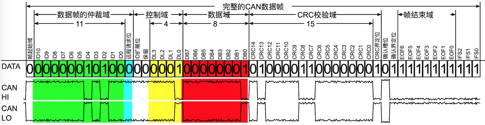

4. CAN总线发送帧/消息ID和远程请求标志位的过程称作抢占总线的仲裁过程,CAN总线的竞争和仲裁机制需要收发器的支持。CAN总线收发器不仅具有差分驱动和差分接收能力，还具有收发环路，即发送的同时还支持接收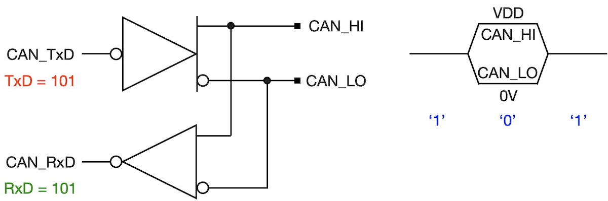
5. CAN 总线收发器（CAN Transceiver）把控制器的数字信号 TxD 转换成 CAN_H / CAN_L 差分信号，并再**从总线上读回 RxD，这也是CAN总线收发器的存在意义**
6. 总线上各节点之间的关系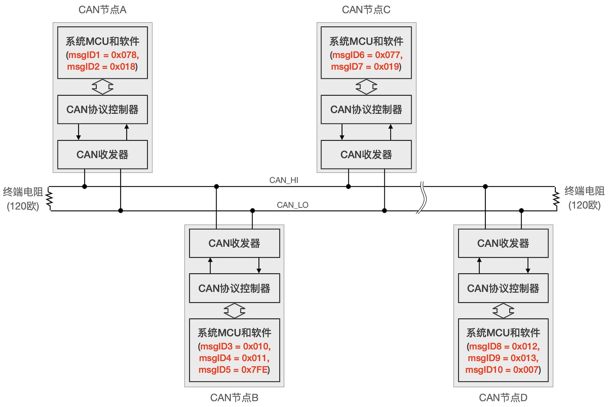
7. CAN物理层的分类
   1.  CAN闭环总线通讯网络,它的总线最大长度为40m，通信速度最高为1Mbps，总线的两端各要求有一个“120欧”的电阻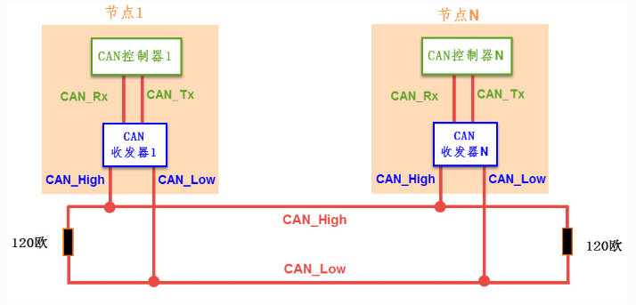
   2.  CAN开环总线通讯网络,,最大传输距离为1km， 最高通讯速率为125kbps，两根总线是独立的、不形成闭环，要求每根总线上各串联有一个“2.2千欧”的电阻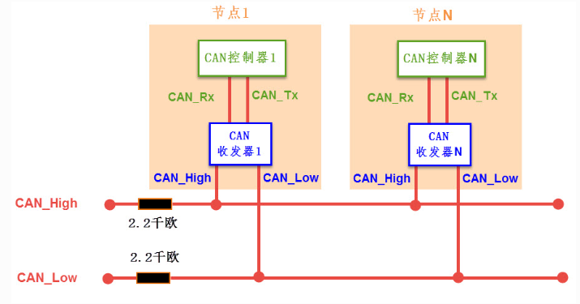

## 2.CAN为什么存在？

CAN总线具有以下几个特点：

1. 高可靠性。CAN总线采用无主的网络架构，网络传输不依赖于主机的可靠性。CAN总线采用消息ID和消息体的传输机制(无网络节点ID)，每个节点可发送或接收多个ID的消息，任何节点失效都不会影响其他节点和网络。
2. 低成本。CAN总线物理层采用低压差分信号，CAN总线物理层接口的收发器成本与RS485收发器相接近，但CAN总线收发器具有网络侦测能力(每个节点都可以检测自己发出的信号)。
3. 高传输效率。CAN总线使用面向位流编码的短数据帧，每个位都采用不归零编码，数据域最大长度位8字节。传输短数据帧时占用的网络周期短，受干扰或导致错误数据位的概率低，而且重传的时间也短。
4. 易组网。CAN总线采用消息ID(11位或29位两种长度的消息ID)的二进制‘0’位的多少分配消息传输优先级，允许多个节点自动竞争和仲裁获取总线的占用权，甚至支持即插即用的节点。
5. 开放协议和生态系统。CAN总线得到广泛应用的关键应归功于Bosch最初采用的开放版权策略，以及由半导体制造商(协议栈的硬件化)、汽车零部件开发商、软件开发商和行业协会等共同参与而打造的CAN总线生态。

## 3.如何使用CAN通信协议

### 3.1CAN的通信协议组成

CAN总线的标准化被分割成6个部分，即ISO 11898-1~6， 这个6个部分分别对CAN总线的链路层和物理层、高速物理介质附属层、低速物理介质附属层、时间触发的CAN通讯(即TTCAN)、低功耗的高速物理附属层、 可选择性唤醒的高速物理附属层等

#### 3.1.1CAN 2.0A

协议帧一般分为帧起始域（域也可以叫做段），仲裁域，控制域和CRC域以及确认域，帧结束域和帧间隔域

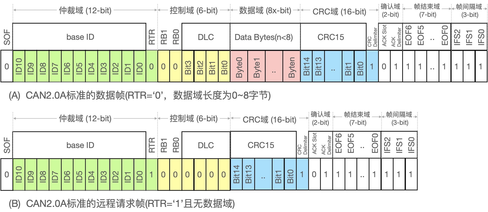

#### 3.1.2 CAN 2.0B

CAN2.0B扩展了仲裁域中ID位数从11bit到29bit

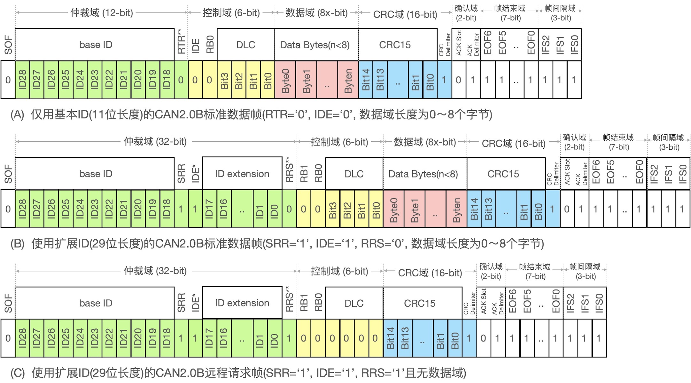

#### 3.1.3 CAN FD

在2015年又扩展了CAN FD通信协议，==CAN FD标准的最大变化是增加数据域的字节个数(最大64个字节)和该域的波特率， 而且CAN FD标准不支持远程请求帧==。在理论上，CAN FD仍兼容CAN2.0B标准，即支持两种标准的CAN网络节点可以共享同一个CAN网络， 继续保留11位宽度ID的数据帧

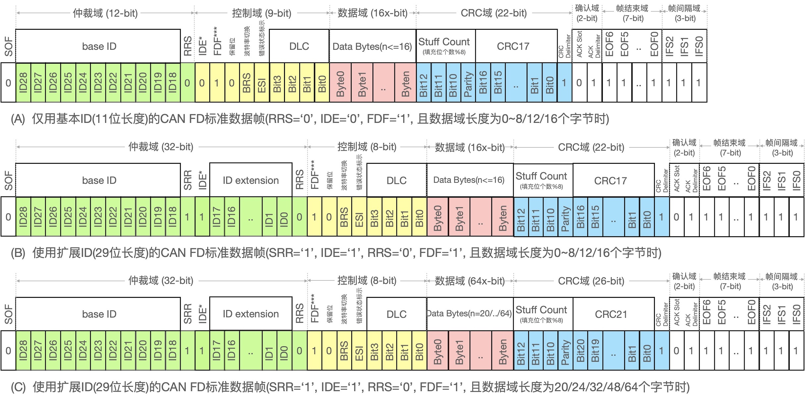

1. BRS位是CAN FD标准数据帧的控制域中新增的一个关键位，当**BRS（Bit Rate Switch）为‘1’时，该位之后且直到CRC界定符之间的每一个位的传输波特率将切换位为8倍速**； 顾名思义，ESI位在正常传输时保持‘0’，除非发送节点侦测到错误则将此位发送成‘1’

2. CAN FD标准是首次采用2种不同波特率传输单个数据帧的机制,使用规则是仲裁域到控制域BRS位(包含该位)采用低波特率(兼容CAN2.0B不超过1Mbps)， BRS位之后直到CRC界定符的所有位采用8倍速传输，确认域、帧结束域和帧间隔域则恢复低波特率传输

#### 3.1.4 协议帧中各域的组成与意义

CAN总线定义四种帧类型，分别为数据帧、远程帧、错误帧和过载帧

##### 3.1.4.1数据帧

数据帧：用于发送单元向接收单元传送数据的帧

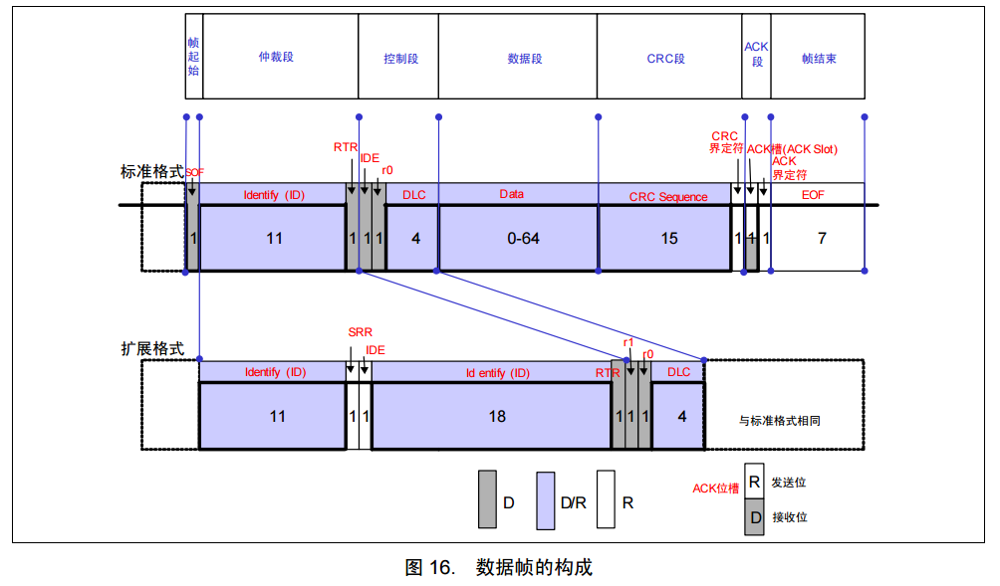

> 图片中的每段内的数字表示的是每段占用的bit位数，D为显性电平，R为阴性电平

###### 帧起始

SOF: 表示该帧的开始，输出显性逻辑0，即电压差2v（1bit）

###### 仲裁段

base ID: 该区段用于标识当前帧的优先级，数值越小，优先级越高，禁止高 7 位都为隐性。（11bit）

RTR：远程传输请求位，0时表示为数据帧，1表示为远程帧，一般发送显性电平0（1bit）

IDE：** 标识符扩展位，0时表示为标准格式，1表示为扩展格式**——即表示添加了18bit ID（1bit）

ID externtion: 该区段同样用于标识当前帧的优先级（18bit）

SRR：替代远程请求位，在扩展格式中占位用，必须为1（1 bit）

###### 控制段

RB0~1: 这是设计者留下的保留位，用于通信协议功能自定义扩展的，根据BR后的数字来决定多少，保留位必须全部以显性电平发送（一般占1~2个bit）

DLC：数据长度代码，0~8表示数据长度为0~8 Byte（4bit）

###### 数据段

Data Field：传输的数据0~64bit，从 MSB（最高位）开始输出；（0~8 Byte）

###### CRC段

CRC Sequence：CRC 的计算范围包括帧起始、仲裁段、控制段、数据
段，校验算法G(x) = x15 + x14 + x10 + x8 + x7 + x4 + x3 + 1；CAN FD中也会扩展到CRC17（15bit or 17bit）

DEL：校验段和应答段的隐性界定符——用于分隔的位（1 bit）

###### ACK段

ACK槽：应答，确认数据是否正常接收，所谓正常接收是指不含填充错误、格式错误、 CRC 错误。发送节点将此位为阴性电平1，接收节点正常接收数据后将此位置为显性电平0（1 bit）

发送 ACK 的是在既不处于总线关闭态也不处于休眠态的所有接收单元中，接收到正常消息的单元

ACK界定符：应答段和帧结束段的分隔的位

###### 帧结束段

EOF：连续7个隐性位（1）表示帧结束（7 bit）

###### FD CAN 数据帧扩展

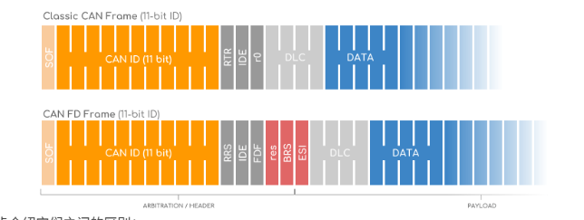

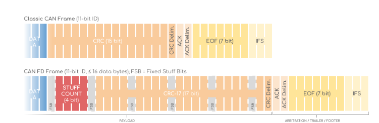

RTR 与 RRS：远程传输请求 (RTR) 用于传统 CAN 总线，以识别数据帧及其对应的远程帧。在 CAN FD 总线中，完全不支持远程帧——远程请求替换 (RRS) 始终占主导地位 (0) (1 bit)

r0 与 FDF：在经典 CAN 中，r0 为保留基因且为显性基因（0）。在 CAN FD 中，它被命名为 FDF 且为隐性基因（1）（1bit）

res：这个新的保留位与 r0 的作用相同 （1bit）

==BRS：比特率开关 (BRS) 可以设置为显性 (0)，表示 CAN FD 数据帧以仲裁速率（即最高 1 Mbit/s）发送。设置为隐性 (1) 则表示数据帧的剩余部分以更高的比特率（最高 8 Mbit/s）发送 （1bit）==

ESI：错误状态指示符 (ESI) 位默认为显性 (0)，即“错误激活”。如果发送器变为“错误被动”，则 ESI 位为隐性 (1)，表示其处于错误被动模式。（1bit）

SBC：填充位计数 (SBC) 位于 CRC 校验之前，由 3 个格雷码位和一个奇偶校验位组成。其后的固定填充位可以视为第二个奇偶校验位。添加 SBC 的目的是为了提高通信可靠性

==CRC：在传统 CAN 总线中，循环冗余校验码 (CRC) 为 15 位；而在 CAN FD 总线中，CRC 为 17 位（最多 16 个数据字节）或 21 位（20-64 个数据字节）。传统 CAN 总线中，CRC 校验码可以包含 0 到 3 个填充位；而在 CAN FD 总线中，为了提高通信可靠性，始终包含 4 个固定的填充位==

##### 3.1.4.2 帧间隔

ITM：帧间空间（帧间隔），Intermission (ITM)，又称Interframe Space (IFS)，连续3个隐性位，但它不属于数据帧。==帧间空间是用于将数据帧和远程帧与前面的帧分离开来的帧==。数据帧和远程帧可通过插入帧间空间将本帧与前面的任何帧（数据帧、遥控帧、错误帧、过载帧）分开。过载帧和错误帧前不能插入帧间空间。

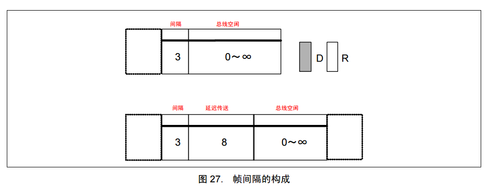

间隔：3个位的隐性位

延迟传输：**8个位的隐性位,只在处于被动错误状态**的单元刚发送一个消息后的帧间隔中包含的段。

**总线空闲：隐性电平，至少大于11个隐性位（1位ack界定符，7位EOF结束段，3位帧间隔 = 11位），才会认为总线空闲**

##### 3.1.4.3 遥控帧

接收单元向发送单元请求发送数据所用的帧。遥控帧由 6 个段组成。遥控帧没有数据帧的数据段

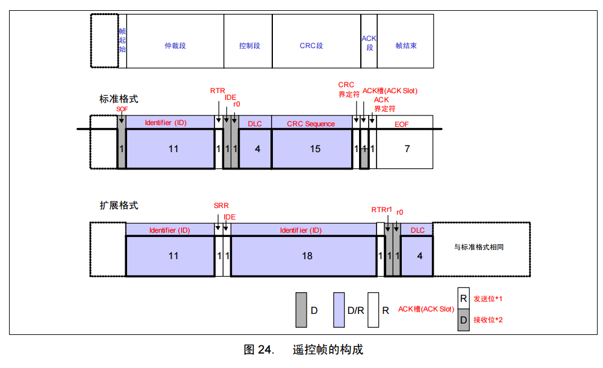

与数据帧不同的地方有RTR必须为阴性电平1，且无数据段

遥控帧的数据长度码以所请求数据帧的数据长度码表示

##### 3.1.4.4 错误帧

用于在接收和发送消息时检测出错误通知错误的帧。错误帧由错误标志和错误界定符构成

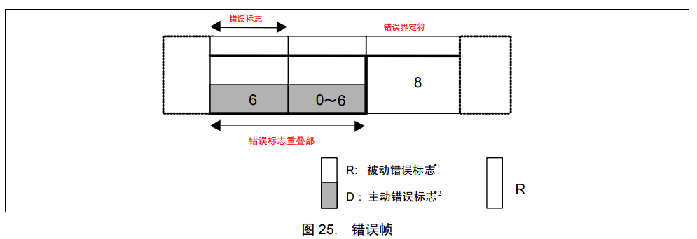

错误标志：错误标志包括主动错误标志和被动错误标志两种

1. 主动错误标志：6 个位的显性位。检查到错误可以主动发送错误
2. 被动错误标志：6 个位的隐性位。检查到错误只能发出被动错误

错误界定符：8个位的隐性位

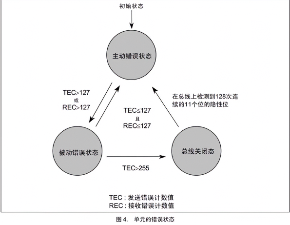

**每个设备都有TEC和REC来管理通信错误，确定自己的状态**

##### 3.1.4.5 过载帧

过载帧是用于接收单元通知其尚未完成接收准备的帧。过载帧由过载标志和过载界定符构成

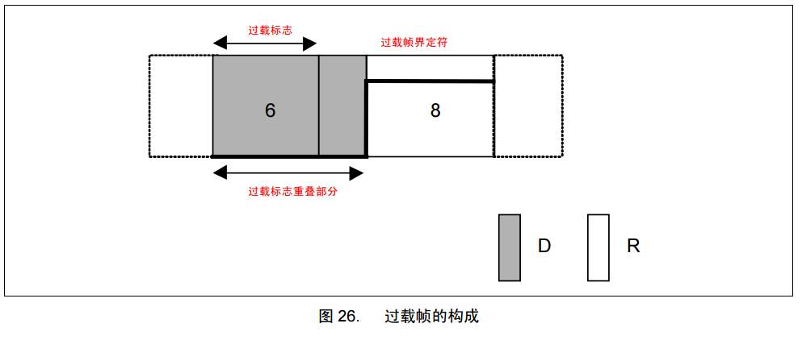

过载标志：6 个位的显性位（与错误帧的主动错误标志组成一样）

过载帧界定符：8个为的隐性位（与错误帧的错误界定符组成一样）

#### 3.1.5 总线仲裁机制——非破坏性仲裁

在总线空闲态，最先开始发送消息的单元获得发送权，采用**逐位仲裁**

1. 多个单元同时开始发送时，各发送单元从仲裁段的第一位开始进行仲裁。连续输出显性电平最多的单元可继续发送，CAN的收发器每发送一位就会从总线回读当前电平状态

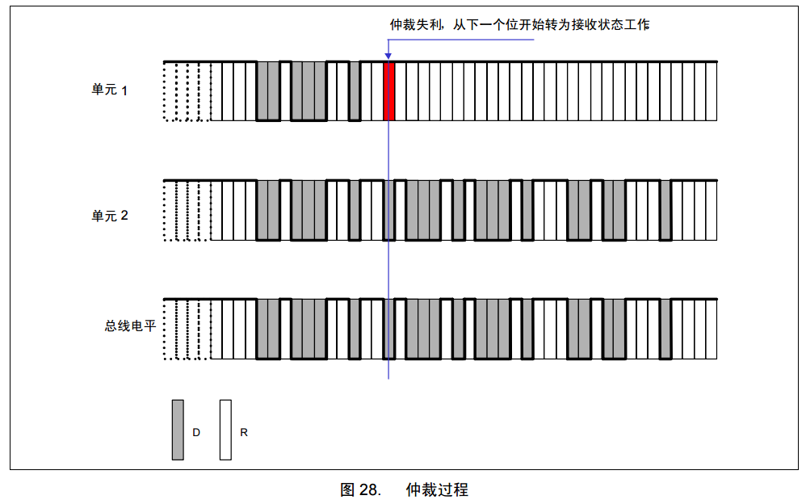

2. **仲裁段的显性电平越多其id数越小，而显示出其优先级越高**，根据id来判断优先级的情况下就会出现**ID号相同的问题，此时有RTR位来决定，RTR输出显性电平的优先**（此时数据帧比遥控帧优先级高）

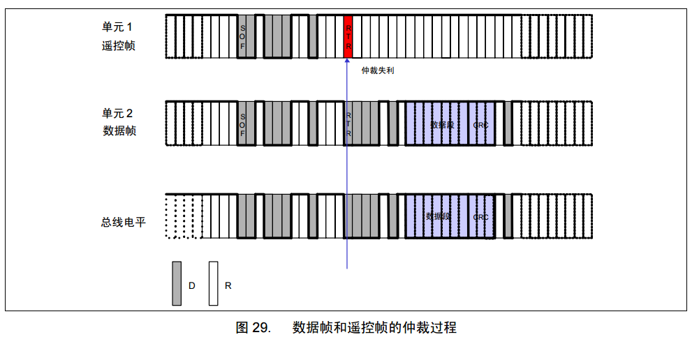

3. 还有一种情况就是扩展格式和标准格式ID的数据帧总线竞争，还是标准格式的 RTR 位为显性位的具有优先权，可继续发送——**标准格式比扩展格式优先级高，因为SRR始终为隐性电平1**

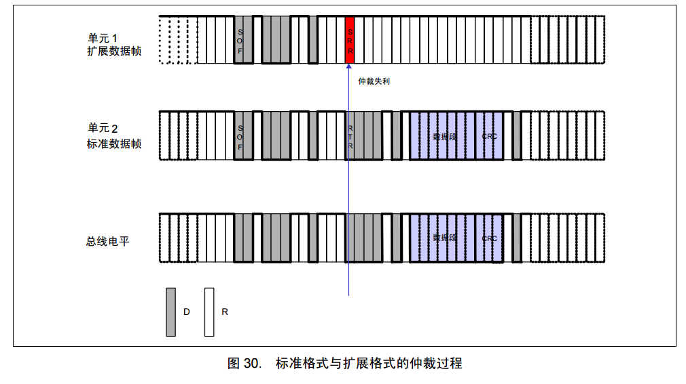

#### 3.1.6 位填充

位填充是为防止突发错误而设定的功能。当同样的电平持续 5 位时则添加一个位的反型数据。

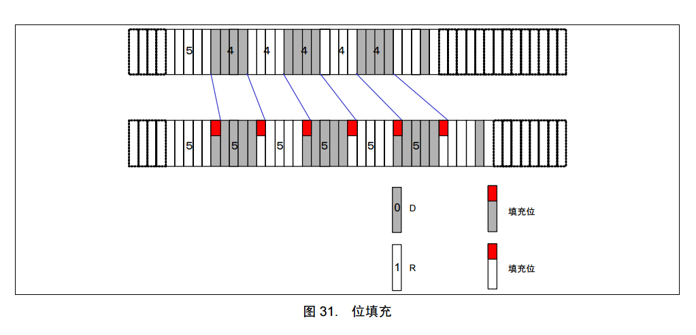

对于接收单元来说，接收到5个连续相同电平，会将第5个电平删除后等待接收第6个电平，如果第6个电平和前5个电平相同，暂停接收发送错误帧

#### 3.1.7 错误类型

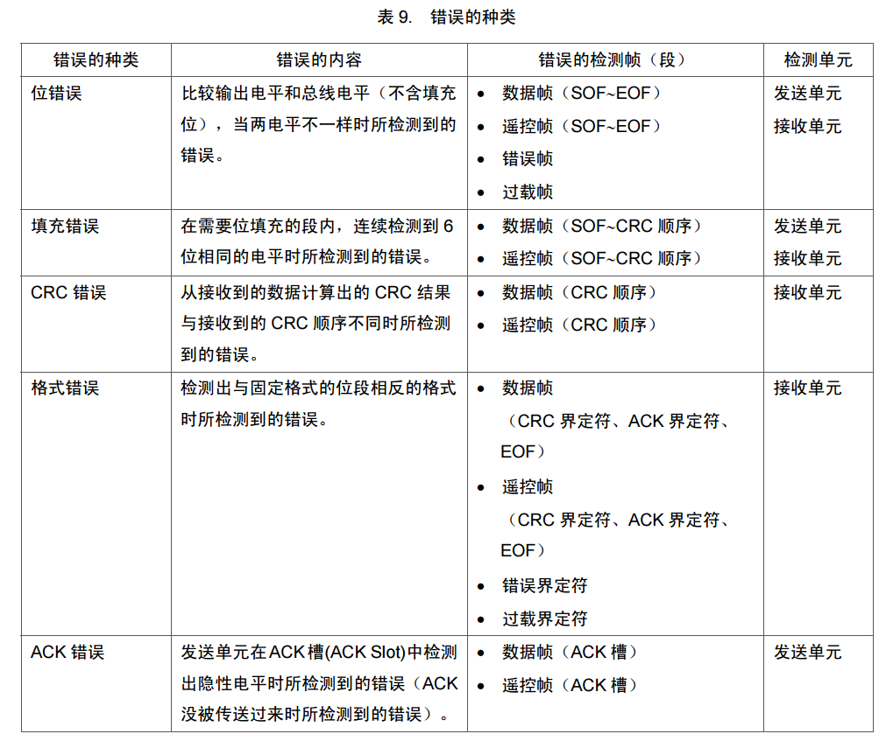

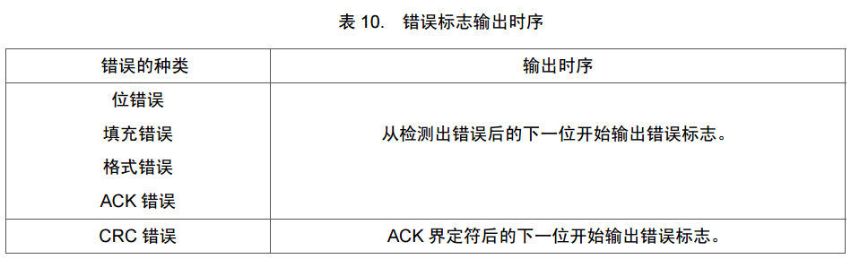

#### 位同步

因为CAN通信为异步通信，为了抗干扰，CAN为了实现位同步，CAN协议把每一个数据位的时序分解成如图 CAN位时序分解图 所示的SS段、 PTS段、PBS1段、PBS2段，这四段的长度加起来即为一个CAN数据位的长度。分解后最小的时间单位是Tq，而一个完整的位由8~25个Tq组成，**发送方以约定的位时长每隔一个固定时间发送一个位数据**

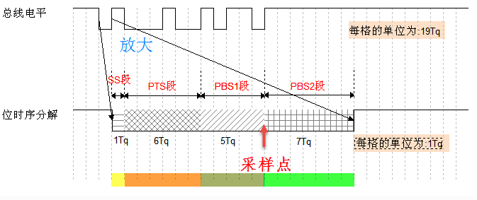

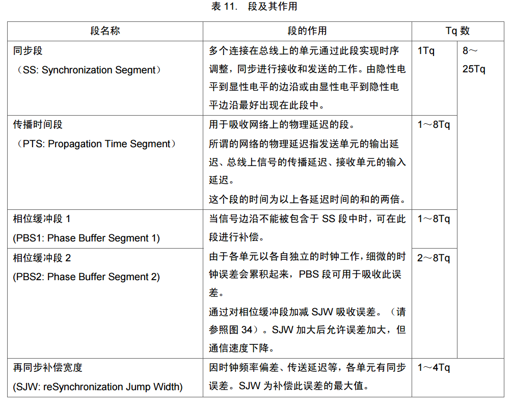

假设上图中的1Tq=1us，而每个数据位由19个Tq组成， 则传输一位数据需要时间T1bit =19us，从而每秒可以传输的数据位个数为：

1x106­/19 = 52631.6 (bps)

##### 硬同步

当总线出现帧起始信号时，把自己的位时序中的SS段平移至总线出现下降沿的部分，获得同步，**硬同步是为了解决初始数据跳变沿没有在SS段导致后续通信失败的问题**，发送和接受方都定义一个位时序计时器,在总线接受到SOF的下降沿时让总线上各设备的位时序周期同步

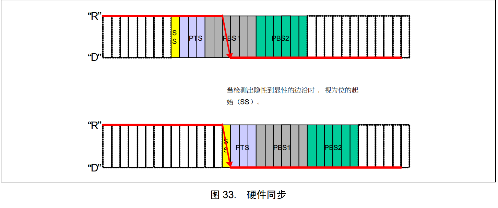

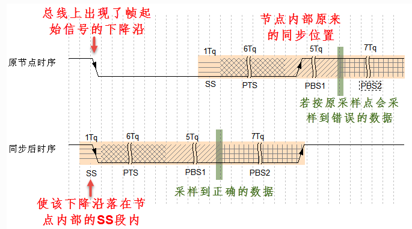

##### 重新同步（再同步）

重新同步利用普通数据位的高至低电平的跳变沿来同步(帧起始信号是特殊的跳变沿)，重新同步的方式分为超前和滞后两种情况，以总线跳变沿与SS段的相对位置进行区分，**重新同步解决的问题是长期通信后，时序偏移数据跳变沿不在SS段，利用定义SJW个Tq扩展一下PBS来让通信重新同步让数据跳变沿回到SS段**

1.  相位超前时的重新同步 ， 节点从总线的边沿跳变中，检测到它内部的时序比总线的时序相对超前2Tq
2. 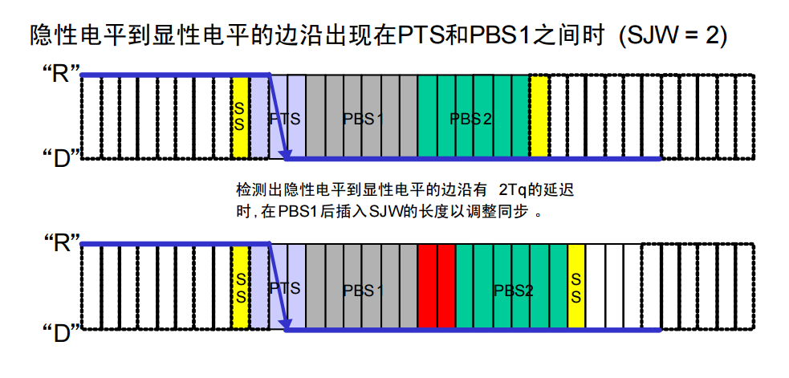

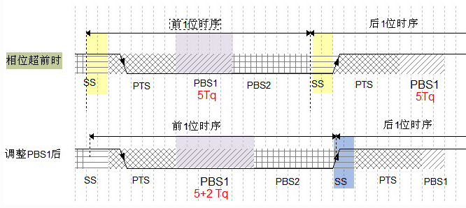

2.  相位滞后时的重新同步 ，节点从总线的边沿跳变中， 检测到它的时序比总线的时序相对滞后2Tq
3. 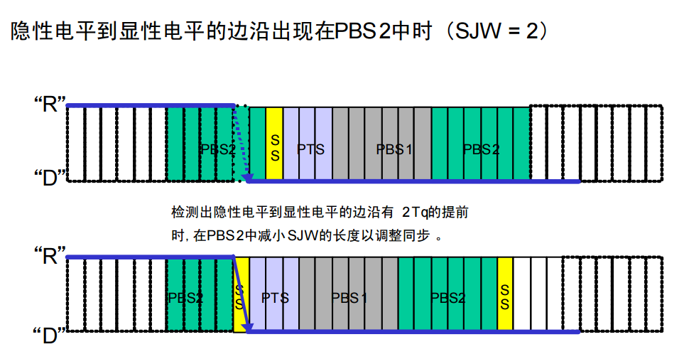

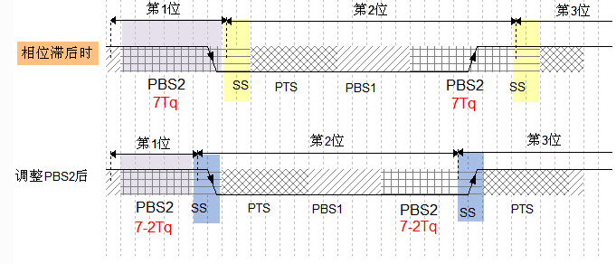

 ==PBS1和PBS2中增加或减少的这段时间长度被定义为“重新同步补偿宽度SJW (reSynchronization Jump Width)”。== 一般来说CAN控制器会限定SJW的最大值，如限定了最大SJW=3Tq时，单次同步调整的时候不能增加或减少超过3Tq的时间长度——**即补偿误差时序的Tq个数，最大为3个Tq**

##### 采用可能遇到的问题

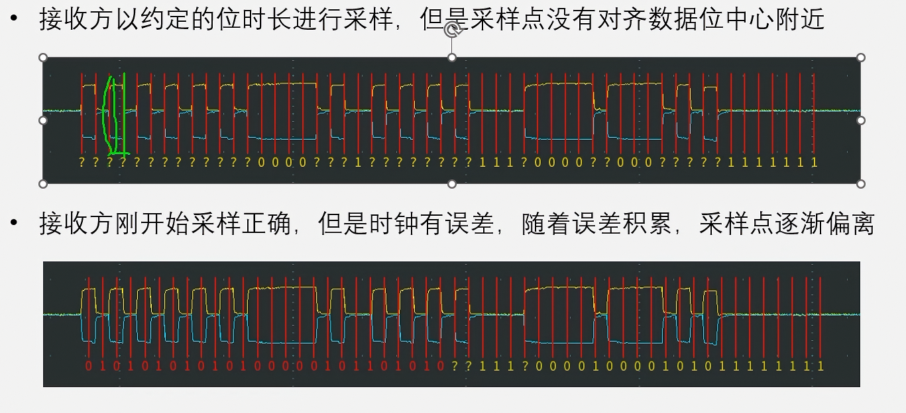

- 第一个问题是采样点的初始位置没有对齐,解决办法就是使用硬同步

- 第二个问题是发送或者接受方有时钟延迟，导致采样点偏移数据采样错误，解决方法是重新同步

####  离线恢复机制

错误管理：错误计数器递增TEC或者REC，超过阈值进入Error Passive → Bus-Off状态。

CAN总线的离线恢复（Bus-Off Recovery）：

**当节点发送错误计数器（TEC）≥256 时，节点进入 Bus-Off 状态**，Bus-Off状态下节点 不能收发任何帧

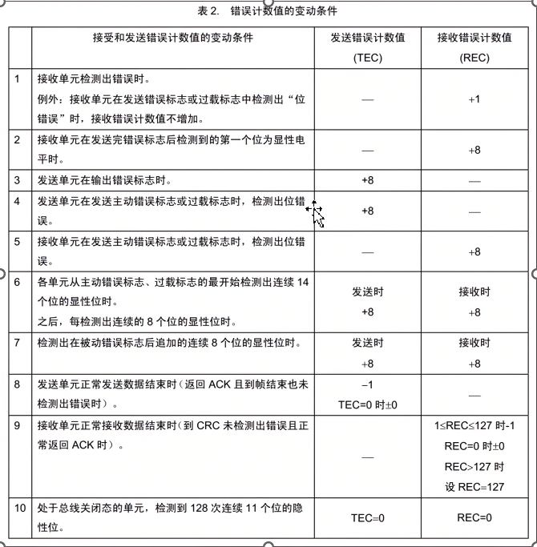

**恢复条件：检测到 128次连续11个隐性位（即128次空闲总线）**

恢复后错误计数器清零，节点重新变为主动错误状态

实际应用中，通常用软件监测Bus-Off事件，执行延时+重新初始化CAN控制器 的恢复策略。

### 3.2 CAN总线的硬件接口

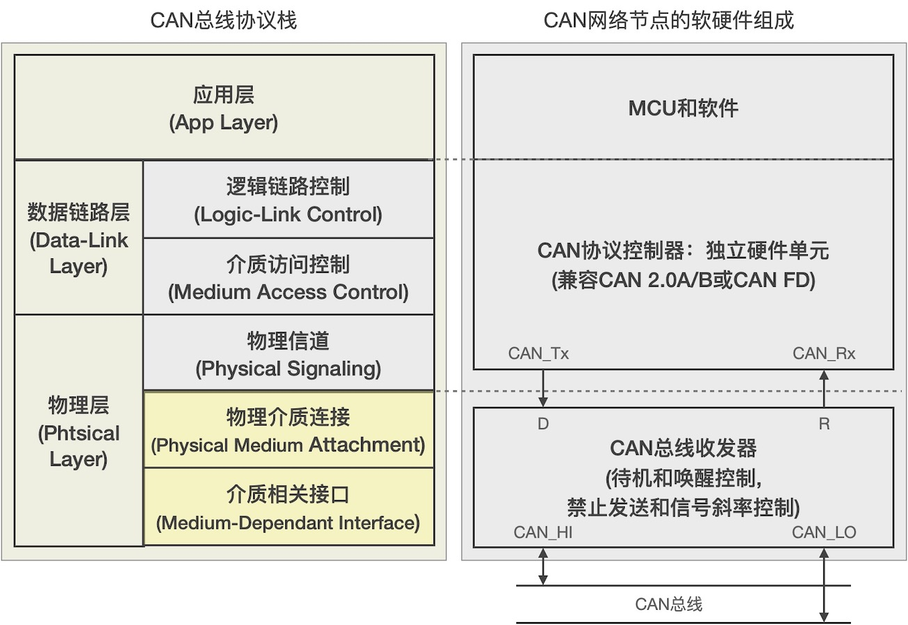

CAN通信协议硬件化下来也就需要协议控制器和CAN收发器作为一个节点与其他节点通信的必要硬件

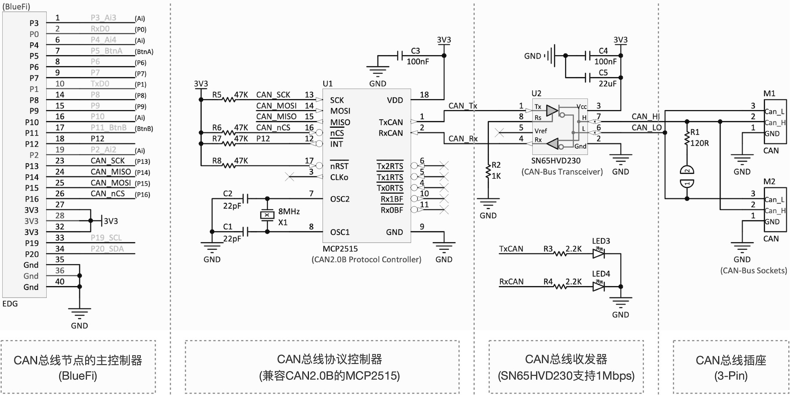

#### MCU内部的CAN总线结构

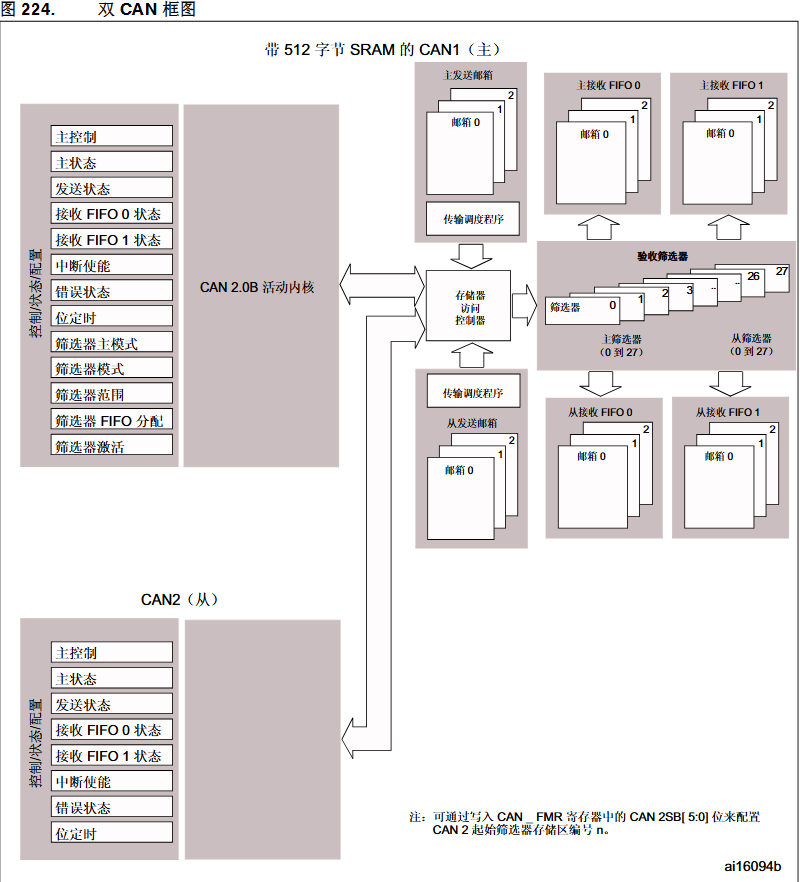

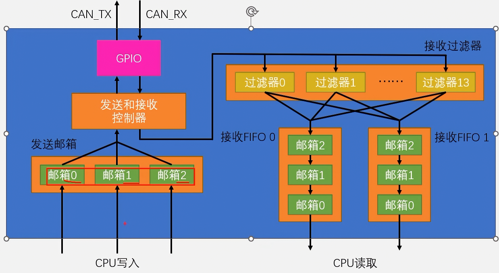

其核心结构是FIFO缓冲区和过滤器以及邮箱，

- 过滤器根据报文ID来过滤报文减轻CPU负担
- FIFO缓冲器，让CPU可以实现异步操作，释放CPU资源，减少CPU占用时间

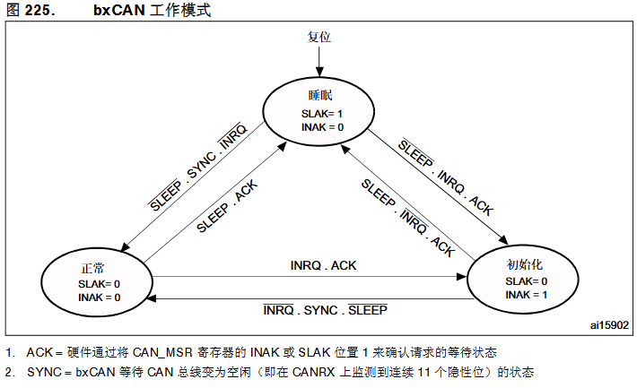

bxCAN的三种工作模式，**初始化模式下所有从 CAN 总线传入和传出的消息都将停止**，一旦初始化完成,软件必须向硬件请求进入正常模式,这样才能在 CAN 总线上进行同步（进入正常模式之前,bxCAN 必须始 终在 CAN 总线上实现同步。为**了进行同步,bxCAN 将等待 CAN 总线空闲**）, 并开始接收和发送，为降低能耗功耗,bxCAN 具有低功耗模式,称为睡眠模式，**SLEEP 位清零或是检测到 CAN 总线活动时,bxCAN 即被唤醒**

##### 测试模式

1. 静默模式——只接收自身和其他节点数据
   
   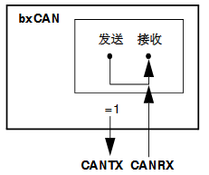
   
   静默模式下，**对外一直发送隐性电平1**，并将内部发送数据直接发送到内部接受模块并且能够从总线接收到其他节点的数据（对外静默，只负责接收自己和其他节点数据）
2. 环回模式——对外发送并将数据发送给内部，不接收外部数据
   
   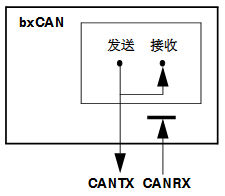
   
   环回模式下，无法接收其他节点的数据，**只能接收到设备自己发送的数据，同时也可以向总线发送数据**
3. 环回静默模式——只对内发送并只接收内部数据
   
   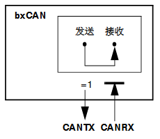
   
   环回静默模式下，**设备与总线上其他设备不通信，只与自身进行通信**，即内部发送直接与内部接收连接

##### 发送过程

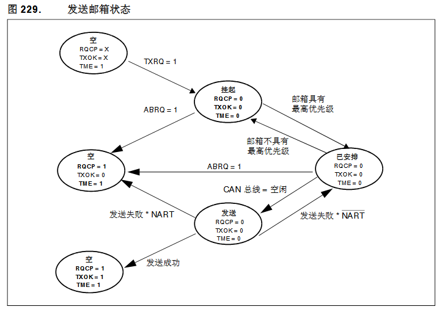

图中显示为单个邮箱的发送状态，其发送过程为

1. 邮箱处于空闲状态，CAN总线处于空闲状态，bxCAN为正常模式
2. TXRQ = 1，邮箱进入到挂起态，判断其优先级进行响应
3. 邮箱优先级为可执行邮箱最高优先级进入到阻塞状态
4. CAN总线空闲就可发送CAN报文，发送失败返回空闲状态或者阻塞状态
5. 发送成功将邮箱状态重新置为空闲状态

##### 接收过程

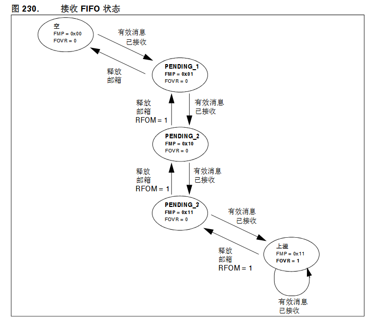

图中为三个邮箱的接收过程：

1. FIFO邮箱处于空闲状态
2. 接受到数据放入到第一个邮箱中，依次类推有数据输入就放入到下一个邮箱中
3. 当三个邮箱都存放数据时，进入到溢出状态，再有数据输入会将数据丢失
4. 处理器从邮箱中读取数据后，需要将邮箱释放

##### 过滤器寄存器

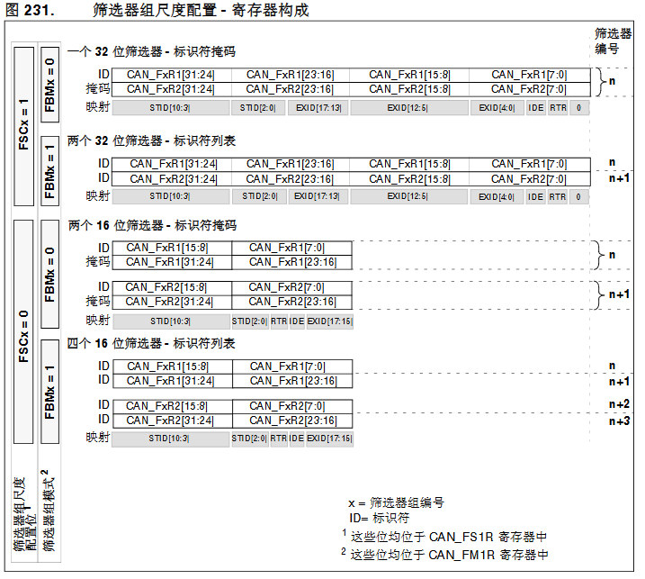

**过滤器的作用就是过滤掉广播信息中不是指向设备ID的信息**

##### 位时序计算

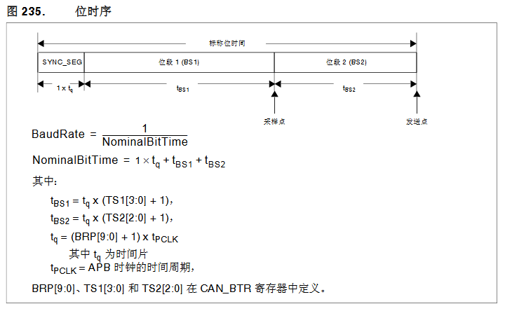

位同步需要根据mcu的CAN外设的位时序计算出各段的$T_q$

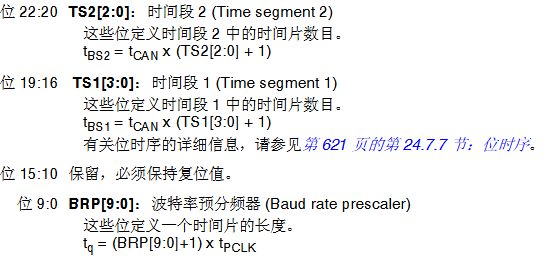

#### 物理层

为什么使用双绞线？

||Min|名义值|Max|
|--|--|--|--|
|总线长（/m）|0||40|
|支线长（/m）|0||1|
|节点距（/m）|0.1||40|
|终端电阻（/Ω）|100|120|130|
|特征阻抗$Z_O$（/Ω）|95|120|140|
|单位电阻（Ω/m）||70||
|双绞线单位延迟（ns/m）||5||

单位延迟计算：

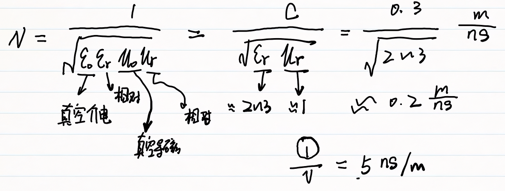

特征阻抗计算：

 

## 参考资料

[车载网络技术(进阶教程)](https://www.bilibili.com/video/BV1e34y117FQ/?utm_source=chatgpt.com&vd_source=6f77320ec3e6e86d4e2e004a411d3f96&spm_id_from=333.788.videopod.episodes&p=2)

[CAN总线入门教程](https://www.bilibili.com/video/BV1vu4m1F7Gt/?spm_id_from=333.788.videopod.episodes&vd_source=8599f11aa9cca17e6373aac78baf1844&p=7)

[总线关闭（BUS OFF）的概念和处理方式](https://blog.csdn.net/wendy_mooncat/article/details/144477239#:~:text=CAN%E5%8D%8F%E8%AE%AE%E6%8F%90%E4%BE%9B%E4%BA%86%E6%80%BB%E7%BA%BF%E5%85%B3%E9%97%AD%E7%8A%B6%E6%80%81%E7%9A%84%E6%81%A2%E5%A4%8D%E7%AD%96%E7%95%A5%EF%BC%8C%E5%8D%B3%E4%B8%8A%E5%B1%82%E6%8E%A7%E5%88%B6%E4%B8%94%E9%80%9A%E4%BF%A1%E8%8A%82%E7%82%B9%E6%A3%80%E6%B5%8B%E5%88%B0128%E6%AC%A111%E4%B8%AA%E8%BF%9E%E7%BB%AD%E9%9A%90%E6%80%A7%E5%90%8E%EF%BC%8CECU%E5%8F%AF%E4%BB%A5%E6%B8%85%E9%9B%B6TEC%E5%92%8CREC%E5%B9%B6%E9%87%8D%E6%96%B0%E8%BF%9B%E5%85%A5%E4%B8%BB%E5%8A%A8%E9%94%99%E8%AF%AF%E7%8A%B6%E6%80%81%E3%80%82%20%E8%AF%B4%E6%98%8E%EF%BC%9A%E4%BB%A5%E4%B8%8B%E8%AE%A1%E6%95%B0%E5%99%A8%E7%B4%AF%E5%8A%A0%E5%8E%9F%E5%88%99%EF%BC%8C%E7%BF%BB%E8%AF%91%E8%87%AAISO-11898%3A2015%2012.1.4.2%20Error,counting%E7%AB%A0%E8%8A%82%E3%80%82%20%E5%BD%93%20Receiver%20%E6%A3%80%E6%B5%8B%E5%88%B0%E9%94%99%E8%AF%AF%E6%97%B6%EF%BC%8C%E6%8E%A5%E6%94%B6REC%E5%BA%94%E5%A2%9E%201%EF%BC%8C%E9%99%A4%E9%9D%9E%E6%A3%80%E6%B5%8B%E5%88%B0%E7%9A%84%E9%94%99%E8%AF%AF%E6%98%AF%E5%9C%A8%E5%8F%91%E9%80%81%E6%9C%89%E6%95%88%E9%94%99%E8%AF%AF%E6%A0%87%E5%BF%97%E6%88%96%E8%BF%87%E8%BD%BD%E6%A0%87%E5%BF%97%E6%97%B6%E5%8F%91%E7%94%9F%E7%9A%84%E4%BD%8D%E9%94%99%E8%AF%AF%E3%80%82)

[CAN总线技术基础讲解合集](https://www.bilibili.com/video/BV1gD4y1U7bJ/?spm_id_from=333.788.videopod.episodes&vd_source=6f77320ec3e6e86d4e2e004a411d3f96&p=3)

[CAN入口与接口](https://theembeddedsystem.readthedocs.io/en/latest/c8_can/intro_can.html)

[CAN通讯实验](https://doc.embedfire.com/mcu/stm32/f429tiaozhanzhe/std/zh/latest/book/CAN.html)

[CAN入门教程](G:\BaiduNetdiskDownload\嵌入式\开发板\STM32F4神舟号开发板光盘资料(1))
