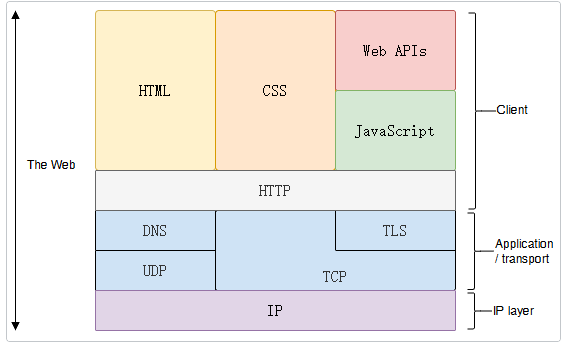
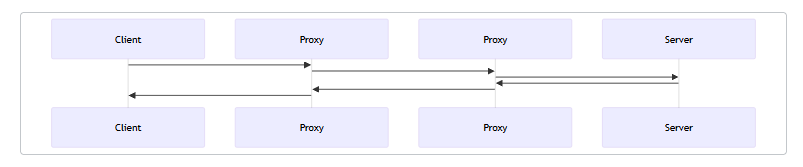
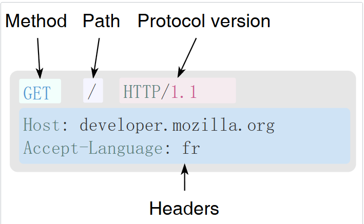
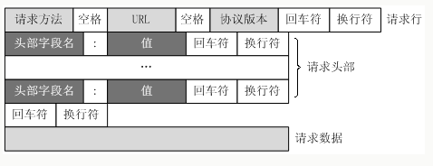
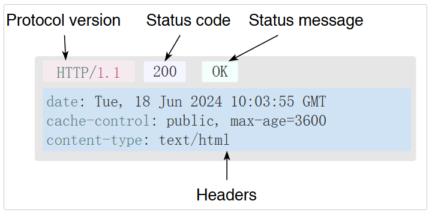
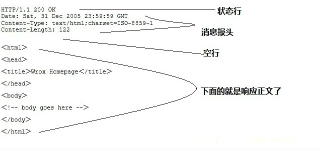
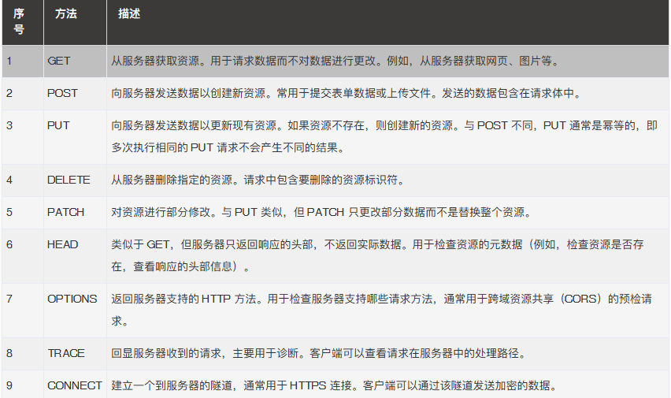

## 1.HTTP是什么？

超文本传输协议（HTTP）是一个用于传输超媒体文档（例如 HTML）的应用层协议，同时，也是一种客户端—服务器（client-server）协议——请求是由接受方(通常是 Web 浏览器)发起的；HTTPS（超文本传输安全协议，Hypertext Transfer Protocol Secure）是 HTTP 的安全版本，它在 HTTP 下增加了 SSL/TLS 协议，提供了数据加密、完整性校验和身份验证

HTTP将应用层的媒体文档如HTML,MP4,JPEG,CSS等等通过TCP，UDP等协议转发给下层只至到另一个任意的主机的任意应用进程中

- HTTP 是无连接：无连接的含义是限制每次连接只处理一个请求，服务器处理完客户的请求，并收到客户的应答后，即断开连接，采用这种方式可以节省传输时间。
- HTTP 是媒体独立的：这意味着，只要客户端和服务器知道如何处理的数据内容，任何类型的数据都可以通过HTTP发送，客户端以及服务器指定使用适合的 MIME-type 内容类型。
- HTTP 是无状态：HTTP 协议是无状态协议，无状态是指协议对于事务处理没有记忆能力，缺少状态意味着如果后续处理需要前面的信息，则它必须重传，这样可能导致每次连接传送的数据量增大，另一方面，在服务器不需要先前信息时它的应答就较快。

### 1.1 HTTP的组成

HTTP由客户端client，代言人proxy以及server服务器三个部分组成

#### client 客户端

用户代理是任何能够代表用户行为的工具，如我们常用的浏览器，QQ或者微信

浏览器显示一个页面，需要发送请求获取一些数据——描述这个页面的HTML文档，展示用的布局信息CSS以及图片和视频，web浏览器——将这些组合再一起就是一个网页了

#### server 服务器

服务器负责管理client需要的文档，实际上可能是一台机器，也可能是共享负载的一组服务器集群（负载均衡）或是其他类型的软件（如缓存、数据库服务、电商服务等）

服务器就是一台“随时待命、为你提供服务”的电脑，负责接收你的指令并给出回应；而数据库是运行在服务器上的一种特殊软件，负责安全、高效地替你保管所有重要的数据

#### proxy 代理

代理就是一个位于请求者和提供者之间的通信中继节点。它接管你的请求，代替你向外发送，再把收到的响应转交给你。

你可以理解为，你在淘宝上买了个快递，你是客户端，淘宝是服务器，快递是数据文档，而快递员就是代理，他的任务就是将快递送到你的手上

### 1.2 HTTP流

1.打开一个 TCP 连接

2.发送一个 HTTP 报文

3.读取服务器返回的 HTTP 报文

4.关闭连接或者为后续请求重用连接

### 1.3 HTTP报文

HTTP报文有两种类型，请求和响应

#### 1.3.1 请求报文格式

1.method方法：通常是由一个动词，像 GET、POST 等，或者一个名词，像 OPTIONS、HEAD 等，来定义客户端执行的动作

2.Path路径(URL)：指的是你要向服务器获取的那个具体资源的位置，假设你想访问一张完整的图片，它的完整链接是：[https://www.example.com/images/cat.jpg]，发送http的请求报文中，/images/cat.jpg 就是 Path（路径）

3.Protocol version：HTTP协议的版本号

4.Headers标头：这里会放入一下目标主机名，客户端可以接收的语言或者cookie身份通信证甚至user agent告诉服务器我用的什么浏览器，举个例子如点外卖时加的备注我xxx不吃香菜

#### 响应报文格式

1.Protocol version：HTTP协议的版本号

2.Status code：来指明对应请求已成功执行与否，以及不成功时相应的原因

3.Status message：可以理解为状态码的简短注释

4.Header：含了服务器环境信息、响应体的大小、服务器支持的压缩类型等。
常见的响应头包括Content-Type、Content-Length、Server、Set-Cookie等。

### HTTP 2.0

相比于http1.0，http2.0改进了很多方面

- 多路复用：HTTP/2 允许同时发送多个请求和响应，而不是像 HTTP/1.1 一样只能一个一个地处理。这样可以减少延迟，提高效率，提高网络吞吐量。
- 二进制传输：HTTP/2 使用二进制协议，与 HTTP/1.1 使用的文本协议不同。二进制协议可以更快地解析，更有效地传输数据，减少了传输过程中的开销和延迟。
- 头部压缩：HTTP/2 使用 HPACK 算法对 HTTP 头部进行压缩，减少了头部传输的数据量，从而减少了网络延迟。
- 服务器推送：HTTP/2 支持服务器推送，允许服务器在客户端请求之前推送资源，以提高性能。
- 改进的安全性：HTTP/2 默认使用 TLS（Transport Layer Security）加密传输数据，提高了安全性。
- 兼容 HTTP/1.1：HTTP/2 可以与 HTTP/1.1 共存，服务器可以同时支持 HTTP/1.1 和 HTTP/2。如果客户端不支持 HTTP/2，服务器可以回退到 HTTP/1.1。

## 2.使用HTTP的目的和意义？

HTTP 为 Web 浏览器与 Web 服务器之间的通信而设计的，但也可以用于其他目的；而HTTPS 的主要作用是在不安全的网络上创建一个安全信道，并可在使用适当的加密包和服务器证书可被验证且可被信任时，对窃听和中间人攻击提供合理的防护

## 3.如何使用HTTP？

## 附录

### 1.常用请求方法

### 2.常用响应头信息

[HTTP响应头信息](https://www.runoob.com/http/http-header-fields.html)

## 3.常用状态码

[HTTP状态码](https://www.runoob.com/http/http-status-codes.html)

## 参考资料

1.[菜鸟教程HTTP](https://www.runoob.com/http/http-header-fields.html)

2.[面向开发者的 Web 技术](https://www.runoob.com/http/http-header-fields.html)
