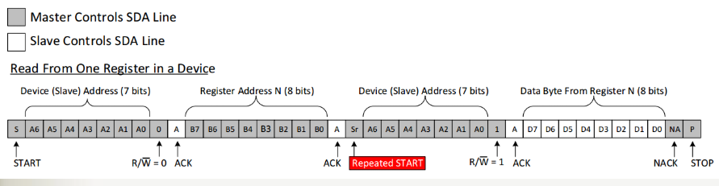
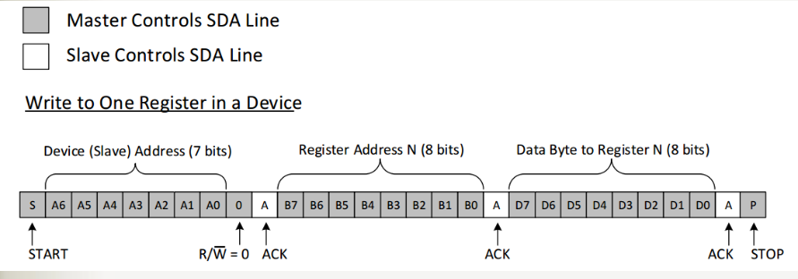
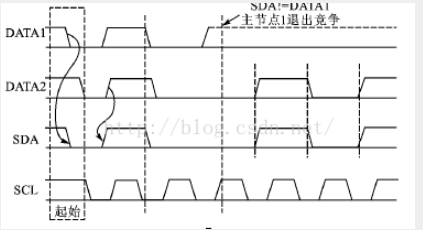

## IIC总线死锁

### 什么是IIC总线死锁？

当Slave输出应答信号或者输出数据0时，Master发生异常复位，此时SCL会保持或被释放为高电平，但因为Slave没有复位，就会继续应答，保持SDA为低电平，直到SCL变为低电平；Master复位后，检测到SCL为高，SDA为低，则认为I2C总线被占用，然后一直等待总线被释放(SCL、SDA均为高)；最终Master和Slave相互等待，形成I2C死锁现象

### 如何处理和避免总线死锁问题

1. Master检测到SDA被拉低超过一段时间后，主动复位Slave，使其释放SDA；但这种方法需要Slave有复位引脚，且Master可以控制Slave的复位引脚使之复位。
2. **Master检测到SDA被拉低超过一段时间后，推送9个Clock高低电平交替脉冲到SCL总线上(当死锁发生在Slave发送的第1位数据上时，最多需要9个时钟周期才能结束通讯)，使Slave释放SDA为高电平**

## IIC总线的上拉电阻是如何选择的？

总线电容Cb是器件引脚、连接导线的总电容。在上升时间(tr)一定的情况下，此电容限制了上拉电阻Rp的最大值。通常单个I2C芯片引脚的输入电容约为 10 pF 左右,标准模式（100 kHz）和快速模式（400 kHz）：**规范允许的最大总线电容通常为 400 pF**。

### 电容充电公式

在标准的 RC（电阻-电容）直流充电电路中，电容两端的电压随时间变化的计算公式如下：

$$V_c(t) = V_s \left(1 - e^{-\frac{t}{RC}}\right)$$

**变量说明：**

- $V_c(t)$：在时间 $t$ 时电容两端的电压 (单位：V)
- $V_s$：电源的直流电压 (单位：V)
- $e$：自然对数的底数 (约等于 2.718)
- $t$：从开始充电算起经过的时间 (单位：s)
- $R$：电路中的电阻阻值 (单位：Ω)
- $C$：电容器的电容量 (单位：F)

---

#### 相关核心公式

**1. 时间常数 ($\tau$)**
在评估硬件电路（如 MCU 的 RC 复位电路或低通滤波）的响应速度时，通常会引入时间常数 $\tau$：

$$\tau = R \cdot C$$

当充电时间 $t = \tau$ 时，电容两端的电压会达到电源电压的 **63.2%**。通常认为在 $3\tau$ 到 $5\tau$ 的时间后，电容已经基本充满。

**2. 充电电流公式**
随着电容两端电压的上升，充电电流会呈指数级下降：

$$I(t) = \frac{V_s}{R} e^{-\frac{t}{RC}}$$

**3. 电荷量公式**
电容在充电过程中积累的电荷量 $Q$ 变化如下，其中 $Q_{max} = C \cdot V_s$：

$$Q(t) = Q_{max} \left(1 - e^{-\frac{t}{RC}}\right)$$

### IIC上升沿时间计算

电容充到0.3VDD的时间：$$v(t_1)= 0.3×VDD = VDD \left(1 - e^{-\frac{t_1}{RC}}\right)$$那么$$t_1 = 0.3566749×RC$$

电容充到0.7VDD的时间：

$$v(t_2)= 0.7×VDD = VDD \left(1 - e^{-\frac{t_2}{RC}}\right)$$

那么$$t_2 = 1.2039729×RC$$

上升沿时间：$$t_r = t_2-t_1 = 0.8473×RC$$

### 上拉电阻阻值计算

	根据您当前正在查看的网页内容，I2C总线上拉电阻的最大值和最小值计算公式如下：

#### 1. 上拉电阻的最大值公式 $R_{p(max)}$

上拉电阻的最大值主要受总线电容 $C_b$ 和信号规定的上升时间 $t_r$ 的限制。通过RC充电电路计算（电容从 $0.3V_{DD}$ 充电到 $0.7V_{DD}$ 的时间），推导出的公式为：

$$R_{p(max)} = \frac{t_r}{0.8473 \times C_b}$$

**参数说明：**

- $R_{p(max)}$：上拉电阻的最大取值，单位为欧姆（$\Omega$）。
- $t_r$：上升时间（电容电压从 $0.3V_{DD}$ 上升到 $0.7V_{DD}$ 的时间），单位为秒（s）。
- $C_b$：总线上的负载总电容，单位为法拉（F）。

---

#### 2. 上拉电阻的最小值公式 $R_{p(min)}$

> 标准模式和快速模式的额定最小吸电流为3 mA，快速增强模式为20 mA

上拉电阻的最小值主要受电源电压 $V_{DD}$ 和器件允许的最大灌电流限制（以保证输出低电平时电压不超过 $V_{ol(max)}$）。根据欧姆定律，其计算公式为：

$$R_{p(min)} = \frac{V_{DD} - V_{ol(max)}}{I_{ol}}$$

**参数说明：**

- $R_{p(min)}$：上拉电阻的最小取值，单位为欧姆（$\Omega$）。
- $V_{DD}$：电源电压，单位为伏特（V）。
- $V_{ol(max)}$：输出低电平时的最大电压，单位为伏特（V）。
- $I_{ol}$：输出低电平时的灌电流（额定最小吸电流），单位为安培（A）。

> $V_{ol(max)}$（最大输出低电平电压）：在嵌入式系统中，通常规定为 0.4V。这意味着只要引脚上的电压被拉低到 0.4V 以下，总线上的器件就会稳定地将其识别为逻辑“0”。
> 
> $I_{ol}$（额定最小灌电流/吸电流）：在标准模式（100 kHz）和快速模式（400 kHz）下，通常为 3 mA。在快速模式+（1 MHz）下，需要更强的总线驱动能力，通常为 20 mA。

#####  3.3v系统下最小上拉电阻计算

- 设定电源电压 $V_{DD} = 3.3V$
- 设定低电平阈值 $V_{ol(max)} = 0.4V$
- 设定常规灌电流 $I_{ol} = 3mA$ （针对 400kHz 快速模式）

根据公式 $R_{p(min)} = \frac{V_{DD} - V_{ol(max)}}{I_{ol}}$ 计算：$$R_{p(min)} = \frac{3.3V - 0.4V}{0.003A} \approx 966 \Omega$$

#### 4. 为什么工程中常用4.7k欧电阻

##### 1. 速度与波形的平衡（对抗寄生电容）

首先，根据上升时间公式 $t_r = 0.8473 \times R \times C_b$可知。在 400kHz 模式下，规范要求最大上升时间 $t_r \le 300\text{ns}$。使用 4.7kΩ 电阻时，它允许的总线电容最大约为 75pF。对于绝大多数常见的微控制器（如 STM32 或 ESP32）挂载两三个传感器（如温湿度、EC 或气体传感器模块）的常规 PCB 走线来说，75pF 是一个非常安全且典型的电容覆盖范围，能够确保方波边缘足够陡峭

那上拉电阻太小和太大都会有什么影响呢？太大上升时间太长了会导致采样错误，通信失败,还有就是根据电容充电公式可知，电容或者电阻过大都会影响到电容两端之间的电压降低——即总线上的电压

##### 2.功耗与灌电流的平衡 

上拉电阻太小会导致无法将电压通过mos管下拉到低电平$Vol(max)$（0.4v）以下，==总线电压一直为高电平，这样无法正常检测到器件的应答，读取到的数据都是0xff，或者总线直接死锁了==

同时电阻过小，如（如 1kΩ），$I_{ol} = 3.3\text{V} / 1\text{k}\Omega = 3.3\text{mA}$，如果总是处于总线低电平状态，那系统功耗会增加；而4.7kΩ，$I_{ol} = 3.3\text{V} / 4.7\text{k}\Omega \approx 0.7\text{mA}$，系统功耗就大大降低了，非常适合低功耗场景

## IIC总线读取多字节数据的时序是怎么样的？

### 常用地址段

7 位地址（最常用）：理论 128 个地址，保留 16 个 → 实际可用 112 个

10 位地址（扩展模式）：扩展到了1024个地址，需要两字节发送地址。第一字节高5位固定为11110，后跟10位地址的高2位+R/W位，第二字节是低8位，10位地址向后兼容7位地址设备

==应答信号为低电平时，规定为有效应答位(ACK简称应答位)，表示接收器已经成功地接收了该字节；应答信号为高电平时，规定为非应答位(NACK)，一般表示接收器接收该字节没有成功==

只有一种情况下的非应答位是正确的，==主机从从机中读取数据的过程中，主机不想再接收数据，主机会给从机反馈一个非应答位(NACK)，注意，这种情况是主机给从机反馈一个非应答位(NACK==

#### IIC通信频率

标准模式：100Kbps
快速模式：400Kbps
快速模式+：1Mbps
高速模式：3.4Mbps

### IIC主机读数据

### IIC主机写数据

## IIC总线一主多从，是如何对从机进行仲裁？多主模式下又是如何进行仲裁？

它的第一个阶段是比较地址位。如果每个主机都尝试寻址相同的器件，仲裁会继续比较数据位（如果是主机—发送器），或者比较响应位

### 仲裁原理

**利用开漏输出的特点，线与的原理，低电平拉低总线的特性**，例如：此时有两个主机在发送数据，A发101……，B发100……，两个主机每发送一位数据前就与总线电平进行比较（逐位仲裁），前两位都与总线电平一致，第三位时总线电平为低电平,A主机发送的与总线电平不同停止发送，B主机控制总线

** I2C总线上的仲裁分两部分：SCL线的同步和SDA线的仲裁**

#### SCL的同步机制

正是由于线“与”逻辑功能的原理，当多个节点同时发送时钟信号时，在总线上表现的是统一的时钟信号。这就是SCL的同步原理

#### SDA仲裁

节点在发送1位数据后，比较总线上所呈现的数据与自己发送的是否一致。是，继续发送；否则，退出竞争

## 参考资料

[电容-维基百科](https://zh.wikipedia.org/wiki/%E9%9B%BB%E5%AE%B9)

[彻底搞懂IIC总线（7）I2C总线硬件电气连接-上拉电阻-阻尼电阻-总线电容-I3C协议](https://www.cnblogs.com/deliweier-wangshuping/p/16248412.html)

[IIC时序分析](https://www.cnblogs.com/xuyan123/p/14134246.html)

[IIC总线的仲裁机制](https://www.cnblogs.com/amxiang/p/16907973.html)

[IIC死锁产生机理与解决办法](https://www.cnblogs.com/wcat/p/17602998.html)