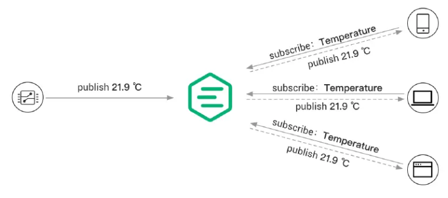
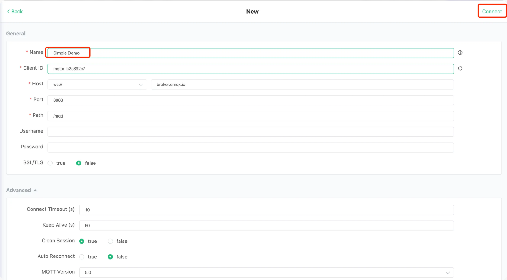
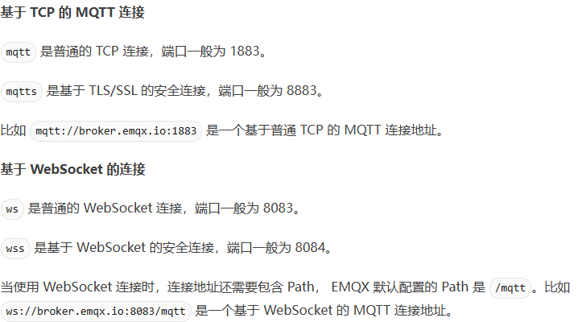
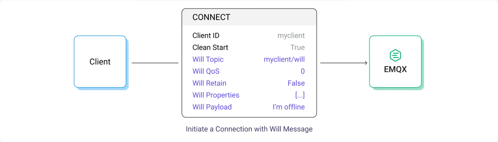
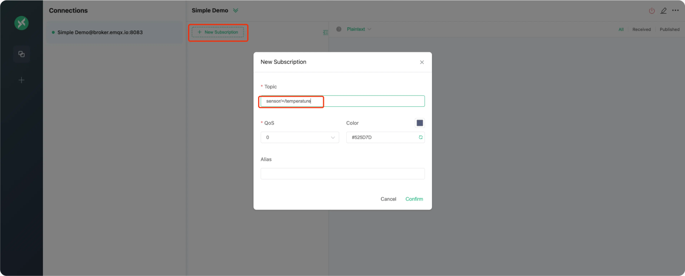
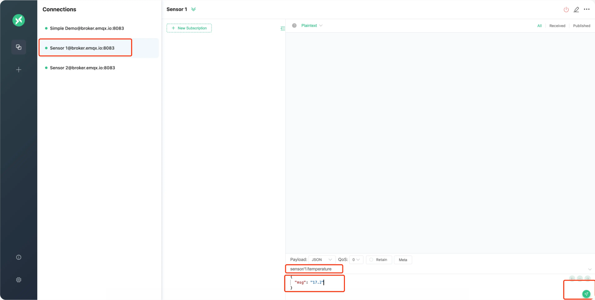
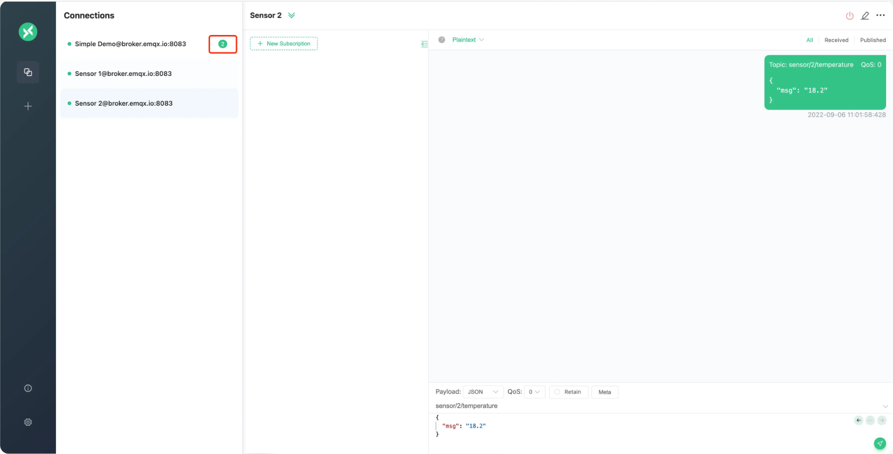
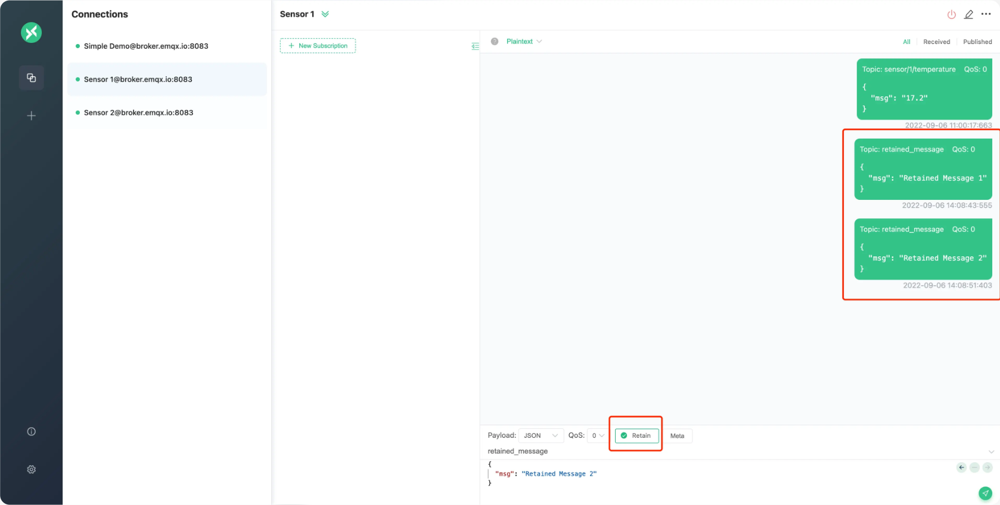
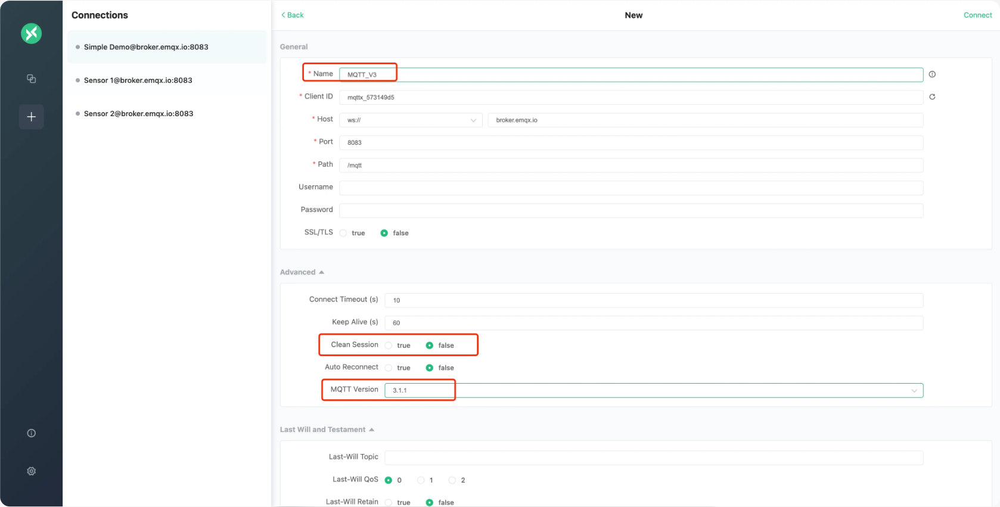
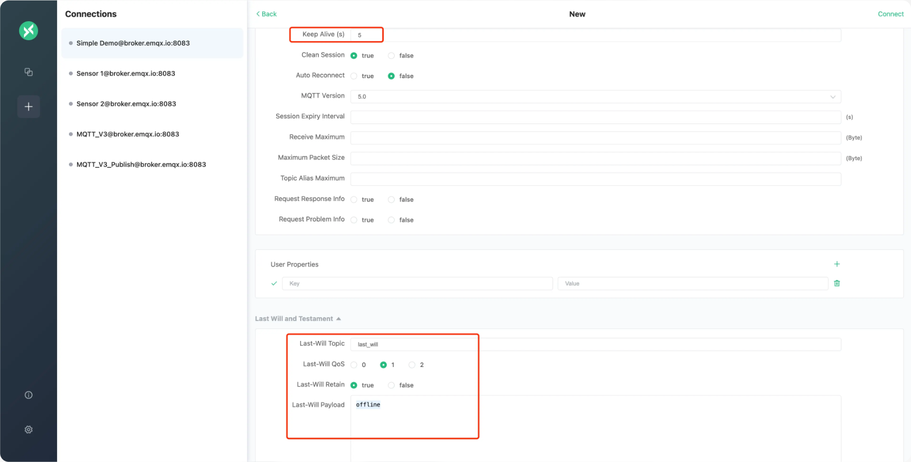

## 什么是MQTT？

MQTT（Message Queuing Telemetry Transport）是一种轻量级、基于**发布-订阅模式的消息传输协议**，适用于**资源受限的设备和低带宽、高延迟或不稳定的网络环境**。它在物联网应用中广受欢迎，能够实现传感器、执行器和其它设备之间的高效通信。

### 协议的架构设计

 MQTT 客户端通过主题（Topic）发布或订阅消息，通过 MQTT Broker 集中管理消息路由，并依据预设的服务质量等级(QoS)确保端到端消息传递可靠性

MQTT由客户端和broker组成



### 通信对象

MQTT采用多主模式即——任何运行 MQTT 客户端库的应用或设备都是 MQTT 客户端

单个客户端可以订阅多个客户端的主题的发布消息，并且自身也可以通过topic发布信息被其他客户端订阅

### 通信方式

#### MQTT 发布/订阅过程。

> 利用Broker进行消息转发，将客户端之间进行解耦处理

例如：温度传感器作为客户端连接到 MQTT Broker，并通过发布操作将温度数据发布到一个特定主题（例如 Temperature）。MQTT Broker 接收到该消息后会负责将其转发给订阅了相应主题（Temperature）的订阅者客户端

#### 主题

**MQTT 主题本质上是一个 UTF-8 编码的字符串**，是 MQTT 协议进行消息路由的基础。主题通过 / 来区分层级，类似于 URL 路径，例如：

```javascript
chat/room/1
```

MQTT 主题支持以下两种通配符：+ 和 #。

+：表示单层通配符即单个主题层级匹配的通配符，例如 a/+ 匹配 a/x 或 a/y。
#：表示多层通配符即匹配主题中任意层级的通配符，例如 a/# 匹配 a/x、a/b/c/d。

> 注意：通配符主题只能用于订阅，不能用于发布。

#### Qos

MQTT 提供了三种服务质量（QoS），在不同网络环境下保证消息的可靠性。

- QoS 0：消息最多传送一次。**如果当前客户端不可用，它将丢失这条消息。**使用 QoS 0 传递消息时，消息的可靠性完全依赖于底层的 TCP 协议， TCP 只能保证在连接稳定不关闭的情况下消息的可靠到达，一旦出现连接关闭、重置，仍有可能丢失当前处于网络链路或操作系统底层缓冲区中的消息
- QoS 1：消息至少传送一次。**QoS 1 加入了应答与重传机制**，发送方只有在收到接收方的 PUBACK 报文以后，才能认为消息投递成功，其应答机制QoS 1 需要在 PUBLISH 报文中设置 Packet ID，而作为响应的 PUBACK 报文，则会使用与 PUBLISH 报文相同的 Packet ID，副作用是容易接收到重复信息，因为报文发送链路的延迟可能让发送方未接收到响应的情况下重发报文，但是接收方可能已经接收到了但是未来得及发送响应报文
- QoS 2：消息只传送一次。解决了 QoS 0、1 消息可能丢失或者重复的问题，但是**每一次的 QoS 2 消息投递，都要求发送方与接收方进行至少两次请求/响应流程**

#### 报文格式

**MQTT 有效载荷是指 MQTT 消息中包含的实际数据**。尽管 MQTT 协议对有效载荷的格式没有硬性要求，并且允许传输任何形式的二进制数据

这里主要说明json格式报文

##### JSON

JSON（JavaScript Object Notation）是一种轻量级的数据交换格式。它既易于机器解析和生成，又便于人类阅读和编写，通常用于描述对象或事件。例如：

```javascript
{"temperature": "22.1"}
```

<br/>

### 数据校验

## MQTT的意义是什么？

MQTT 所具有的适用于物联网特定需求的特点和功能，使其成为物联网领域最佳的协议之一。它的主要特点包括：

- **轻量级**：物联网设备通常在处理能力、内存和能耗方面受到限制。MQTT 开销低、报文小的特点使其非常适合这些设备，因为它消耗更少的资源，即使在有限的能力下也能实现高效的通信。
- **可靠**：物联网网络常常面临高延迟或连接不稳定的情况。MQTT 支持多种 QoS 等级、会话感知和持久连接，即使在困难的条件下也能保证消息的可靠传递，使其非常适合物联网应用。
- **安全通信**：安全对于物联网网络至关重要，因为其经常涉及敏感数据的传输。为确保数据在传输过程中的机密性，MQTT 提供传输层安全（TLS）和安全套接层（SSL）加密功能。此外，MQTT 还通过用户名/密码凭证或客户端证书提供身份验证和授权机制，以保护网络及其资源的访问。
- **双向通信**：MQTT 的发布-订阅模式为设备之间提供了无缝的双向通信方式。客户端既可以向主题发布消息，也可以订阅接收特定主题上的消息，从而实现了物联网生态系统中的高效数据交换，而无需直接将设备耦合在一起。这种模式也简化了新设备的集成，同时保证了系统易于扩展。
- **连续、有状态的会话**：MQTT 提供了客户端与 Broker 之间保持有状态会话的能力，这使得系统即使在断开连接后也能记住订阅和未传递的消息。此外，客户端还可以在建立连接时指定一个保活间隔，这会促使 Broker 定期检查连接状态。如果连接中断，Broker 会储存未传递的消息（根据 QoS 级别确定），并在客户端重新连接时尝试传递它们。这个特性保证了通信的可靠性，降低了因间断性连接而导致数据丢失的风险。
- **大规模物联网设备支持**：物联网系统往往涉及大量设备，需要一种能够处理大规模部署的协议。MQTT 的轻量级特性、低带宽消耗和对资源的高效利用使其成为大规模物联网应用的理想选择。通过采用发布-订阅模式，MQTT 实现了发送者和接收者的解耦，从而有效地减少了网络流量和资源使用。此外，协议对不同 QoS 等级的支持使得消息传递可以根据需求进行定制，确保在各种场景下获得最佳的性能表现。
- **语言支持**：物联网系统包含使用各种编程语言开发的设备和应用。MQTT 具有广泛的语言支持，使其能够轻松与多个平台和技术进行集成，从而实现了物联网生态系统中的无缝通信和互操作性。您可以阅读我们的 MQTT 客户端编程系列文章，学习如何在 PHP、Node.js、Python、Golang、Node.js 等编程语言中使用 MQTT。

## 如何使用MQTT？

### 1.准备好MQTT Broker

选择私有部署或完全托管的云服务来建立自己的 MQTT Broker。或者您也可以使用免费的公共 Broker

### 2.准备MQTT客户端

使用 MQTTX 提供的支持浏览器访问的 MQTT 客户端工具，访问地址为 https://mqttx.app/web-client/ 。 MQTTX 还提供了桌面客户端和命令行工具

### 3.创建 MQTT 连接

在使用 MQTT 协议进行通信之前，客户端需要创建一个 MQTT 连接来连接到 Broker



- **服务器地址**：MQTT 的连接地址通常包含 ：服务器 IP 或者域名、服务器端口、连接协议
  - 
- **Client ID（客户端ID）**：连接到服务器的每个客户端都必须要有唯一的 Client ID。**Client ID 的长度通常为 1 至 23 个字节的 UTF-8 字符串**。如果客户端使用一个重复的 Client ID 连接至服务器，将会把已使用该 Client ID 连接成功的客户端踢下线。
- **用户名与密码（Username & Password）**:如果设置了用户名与密码认证，那么最好要使用 mqtts 或 wss 协议，大多数 MQTT 服务器默认为匿名认证，匿名认证时用户名与密码设置为空字符串即可
- **保活周期（Keep Alive）**：保活周期，是一个以秒为单位的时间间隔。客户端在无报文发送时，将按 Keep Alive 设定的值定时向服务端发送心跳报文，**确保连接不被服务端断开**，服务器没有在 Keep Alive 的 1.5 倍时间内收到来自客户端的任何包，则会认为和客户端之间的连接出现了问题，此时服务器便会断开和客户端的连接
- **遗嘱消息（Last Will）**:设置了遗嘱消息的 MQTT 客户端异常下线时，MQTT 服务器会发布该客户端设置的遗嘱消息

### 通过通配符订阅主题



### 发送和接收MQTT消息

在页面下方的发布主题中输入 sensor/1/temperature，在消息框中输入以下 JSON 格式的消息，然后点击右下方的发布按钮发送消息



simple demo就会接收到消息



### 保留消息

当 MQTT 客户端向服务器发布消息时，可以设置保留消息标志。保留消息存储在消息服务器上，后续订阅该主题的客户端仍然可以收到该消息——即有后续的客户端订阅该主题，会将该保留消息发送给客户端



### Clear Session

该功能是为将客户端离线情况下，将该客户端订阅的消息缓存一部分在服务器中，客户端重新上线后发送给客户端，需要客户端连接时设置 Clean Session 为 false



### 遗嘱消息

MQTT 客户端在向服务器发起 CONNECT 请求时，可以选择是否发送遗嘱消息标志，并指定遗嘱消息的主题和有效载荷

MQTT 客户端异常离线（在断开连接前没有向服务器发送 DISCONNECT 消息），MQTT 服务器会发布遗嘱消息



<br/>

## 参考文献

[MQTT 协议快速入门 2025：基础知识和实用教程](https://www.emqx.com/zh/blog/the-easiest-guide-to-getting-started-with-mqtt)

[如何在 MQTT 中处理 JSON、十六进制和二进制数据](https://www.emqx.com/zh/blog/how-to-process-json-hex-and-binary-data-in-mqtt)

[JSON教程](https://www.runoob.com/json/json-syntax.html)
