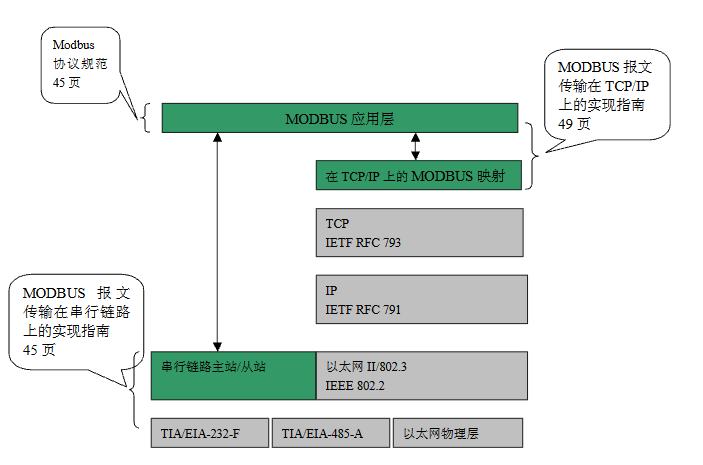
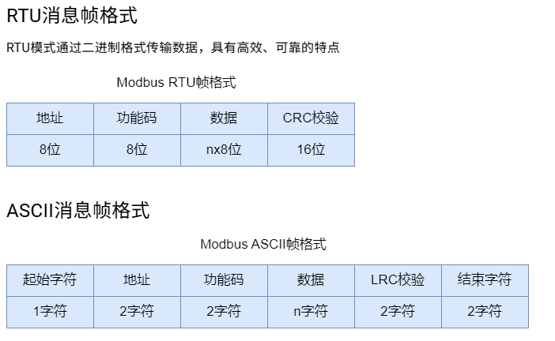
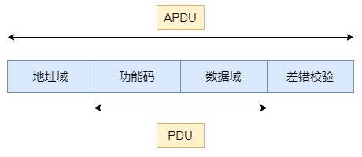
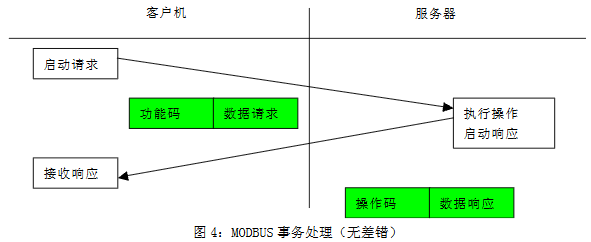
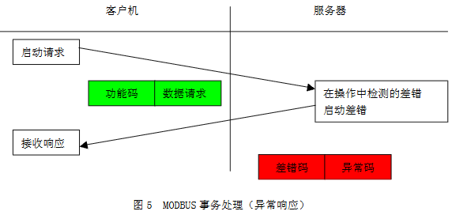
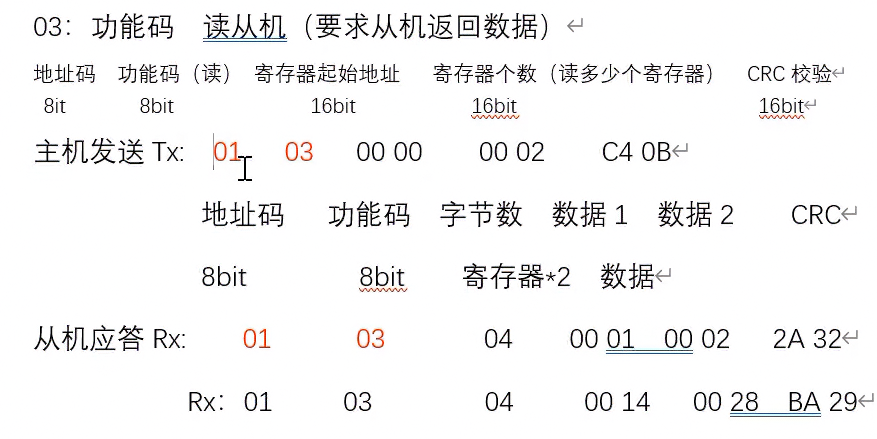
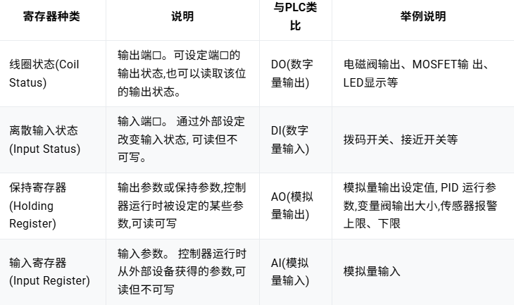
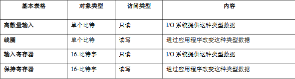
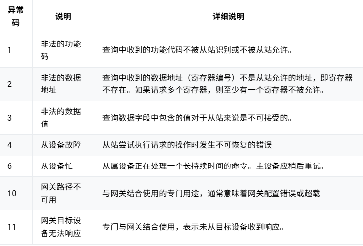

## 什么是Modbus？

Modbus 协议是一种通信协议，允许设备通过各种类型的介质进行通信，如串行线和以太网。它是由生产可编程逻辑控制器（PLC）的 Modicon（施耐德） 公司于 1979 年开发的，旨在使这些设备能够相互通信

### 架构设计

Modbus遵循主从架构（Master-Slave Architecture），在通信网络中，通常有一个主设备（Master）和一个或多个从设备（Slave）。主设备负责发出请求，从设备接收并响应请求

### 通信方式

Modbus协议有多个版本：

- **Modbus RTU（Remote Terminal Unit）**：基于串行通信（如RS-232、RS-485）的协议。数据以二进制格式发送，传输效率高，通常用于串行链路。
- **Modbus ASCII**：与Modbus RTU类似，但数据以ASCII码格式发送，传输速率较低，但易于调试。
- **Modbus TCP/IP**：基于以太网的版本，采用TCP/IP协议栈来传输Modbus数据包，适用于局域网或广域网环境。它允许更灵活的网络拓扑，并支持更多设备接入。

#### 通信帧格式

Modbus通信的基本单位是“帧”，一帧包括以下几个部分：

- **地址域**：用于标识目标设备的地址。
- **功能码（Function Code）**：定义要执行的操作，如读取寄存器、写入数据等。
- **数据域**：根据功能码携带相应的数据（如寄存器地址、寄存器值等）。
- **校验码**：用于确保数据传输的完整性（在Modbus RTU和ASCII中使用）。

> 常用功能码：
> 
> 01 (0x01)：读线圈状态。
02 (0x02)：读离散输入状态。
03 (0x03)：读保持寄存器。
04 (0x04)：读输入寄存器。
05 (0x05)：写单个线圈。
06 (0x06)：写单个保持寄存器。
15 (0x0F)：写多个线圈。
16 (0x10)：写多个保持寄存器。

- **地址域**：消息帧中可能的从设备地址是0～247（十进制），单个设备的实际地址范围是1～247，0为广播地址
- **功能码**：功能码域由1个字节构成，因此其取值范围为1～255（十进制），从设备根据功能码执行对应的功能，执行完成后，正常情况下则在返回的响应消息帧中设置同样的功能码；**如果出现异常，则在返回的消息帧中将功能码最高位（MSB）设置为1**

#### 通信过程

> PDU是Modbus协议定义的一个与基础通信层无关的简单协议数据单元。
> 
> ADU（即APPLICATION DATA UNIT，应用数据单元）引入一些附加域。

Modbus 协议定义了**PDU模型，即功能码+数据的格式**；而为了适应多种传输模式，在PDU的基础上增加了必要的前缀（如地址域）和后缀（如差错校验），形成了ADU模型。

1. 主机发送PDU，功能码占一个字节,有效的码字范围是十进制1～255（其中128～255为异常响应保留）
2. 从机接收到主机发来的PDU，根据功能码发送对应的响应PDU报文
3. 如果从机无法对主机的PDU正确应答会发送一个错误码

配合RS485的实际输入输出报文结构

### Modbus寄存器

Modbus寄存器是指一块内存区域，用于存储数据和状态信息的基本单元。Modbus寄存器根据存放的数据类型以及各自读写特性，将寄存器分为4个部分

其数据模型

### 错误码处理

当 Modbus 从站识别出数据包，但确定请求中存在错误时，它将返回异常代码回复——异常功能码+异常码，其中异常功能码即将请求功能码的最高有效位置1，异常码指示差错类型

## 为什么要发明Modbus？

该协议的初衷是为了与其所生产的可编程逻辑控制器（PLC）配套使用，而可编程逻辑控制器在制造业中广泛应用于工业机电过程的自动化

## 如何使用Modbus？

Modbus协议广泛应用于工业控制系统中，尤其是在以下场景中：

- 设备间数据采集和监控（如PLC与传感器、HMI的连接）。
- 过程自动化中的数据传输。
- 远程监控和控制系统（如SCADA系统）。

## 参考资料

[Modbus 协议：工业通信协议的先驱](https://www.emqx.com/zh/blog/modbus-protocol-the-grandfather-of-iot-communication)

[Modbus初学者教程](https://blog.redisant.cn/docs/modbus-tutorial/)

[用人话讲modbus rtu协议](https://b23.tv/1lPQeML)

[单片机应用实践篇之RS485通信及MODBUS通信协议](https://www.bilibili.com/video/BV1Gq4y1y7FG/?buvid=YA4CD0A1C0D38B794C88913B70CD3847C869&from_spmid=search.search-result.0.0&is_story_h5=false&mid=MbAfGD3uUOJEuHN6IhF20g%3D%3D&plat_id=116&share_from=ugc&share_medium=iphone&share_plat=ios&share_session_id=46A4D258-D4BF-44D5-85EE-E419C1C06A18&share_source=COPY&share_tag=s_i&spmid=united.player-video-detail.0.0&timestamp=1757487855&unique_k=dnn0x7o&up_id=483942191&vd_source=6f77320ec3e6e86d4e2e004a411d3f96)

[]
