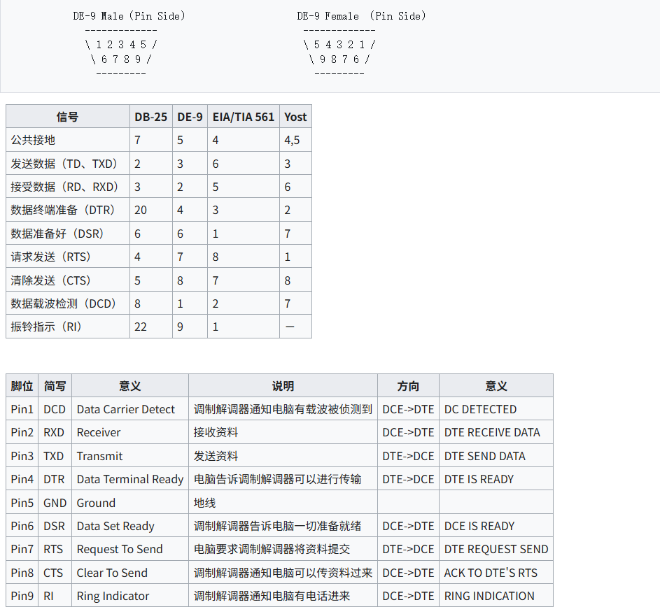
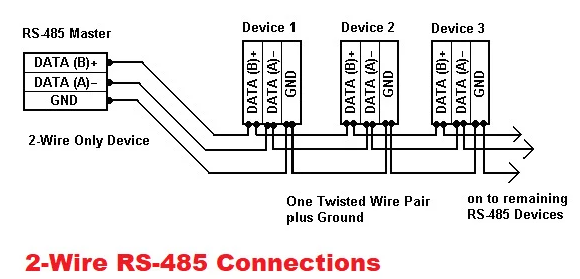
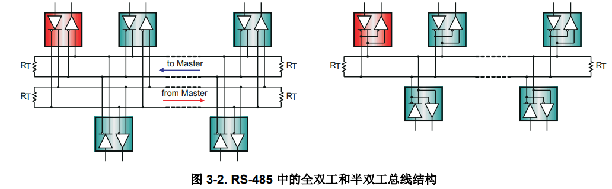
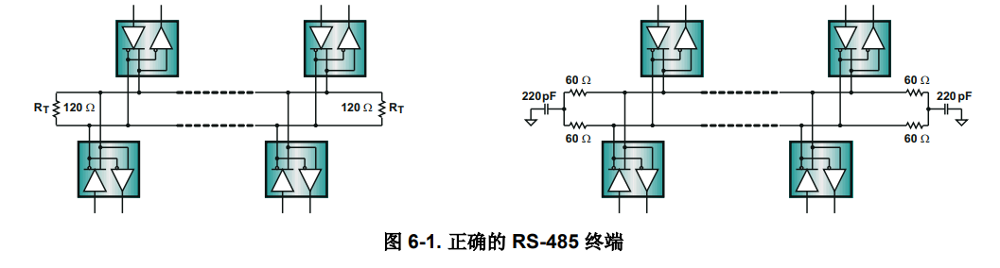
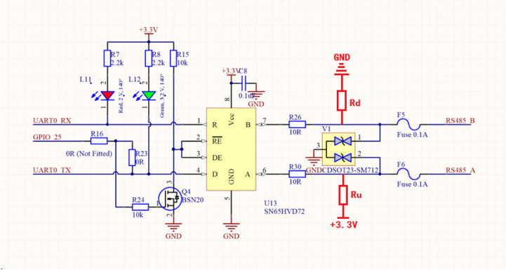

## RS232

RS232的优点是传输线少，配线简单，发送距离可以较远。

最常用的编码格式是异步起停（asynchronous start-stop）格式，它使用一个起始比特后面紧跟7或8个数据比特（bit），然后是可选的奇偶校验比特，最后是一或两个停止比特

其实际硬件接口和各IO功能：

### 在应用层对数据的处理

常用的数据包结构一般为：帧头 + 长度 + 命令 + 数据负载 + CRC校验 + 帧尾

保证可靠性的方法：

- CRC 校验：检测数据错误
- 超时重传：没收到 ACK 就重发
- 帧同步：用特定帧头标识消息起始
- 流控：硬件流控（RTS/CTS）或软件流控（XON/XOFF）防止接收方溢出

#### 流控

RTS/CTS:

1. 发送方硬件请求发送数据（Require ToSend）——即RTS
2. 接收方硬件允许发送数据（Clear ToSend）——即CTS

XON/XOFF：

1. 接收方发送指定的指令（通常是 ASCII 字符）停止总线通信——XOFF（Transmit Off）
2. 接收发发送指定的指令（通常是 ASCII 字符）打开总线通信——XON（Transmit On）

在高速传输场景下为什么还需要 RTS/CTS 硬件流控？

解决发送方速度快于接收方处理速度，接收方缓冲区溢出导致数据丢失该问题

## RS485

### 什么是RS485?

#### 架构设计

串行 EIA-485 连接是使用两根或三根电线的电缆完成的：一根数据线、一根带反转数据的电线，通常还有一根零线,RS-485 标准建议使用菊花链连接其节点，也称为合用线或总线拓扑

- 10Mbps 最大数据速率（距离为 40 英尺）
-  4000 英尺的最大电缆长度（速率为 100kbps）

而**RS485可以根据收发器来设置为半双工或者全双工**

因为是差分信息传输，**为了防止信号反射需要添加电阻，RS-485 标准建议采用 Z0 = 120W 的电缆**，因此电缆干线通常与 120W 电阻端接，线缆的末尾处各一个

> 电阻不匹配的后果：信号反射导致波形振铃、数据错误。 验证方法：示波器看波形是否有振铃和过冲

而RS-485 指定了一个单位负载 (UL) 的假设项，它表示大约 12kW 的负载阻
抗。符合标准的驱动器必须能够驱动这些单位负载中的 32 个——即**总线上最多可以有32个节点设备**

#### 通信方式

**逻辑1由两线(A+和B-)之间电压差在+2V~+6V之间表示，逻辑0由两线(A+和B-)之间电压差在-2V~-6V之间表示**

软件485就是发送通过RS485的软件控制脚（就是上图中的GPIO25），GPIO25输出高电平，RE=DE=0V，进入接收模式；GPIO25输出低电平，RE=DE=3.3V，进入发送模式，相当于软件对交互过程进行控制。

#### 错误处理

一般使用Modbus RTU作为RS485的应用层协议，来支持错误处理

### 为什么要设计RS485？

### 如何使用RS485？

### 参考文献

[RS485协议及RS485总线应用特点详解](https://www.ebyte.com/news/3850.html)