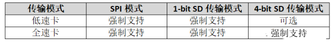
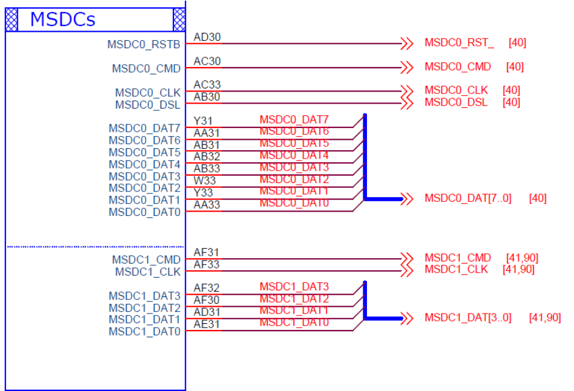
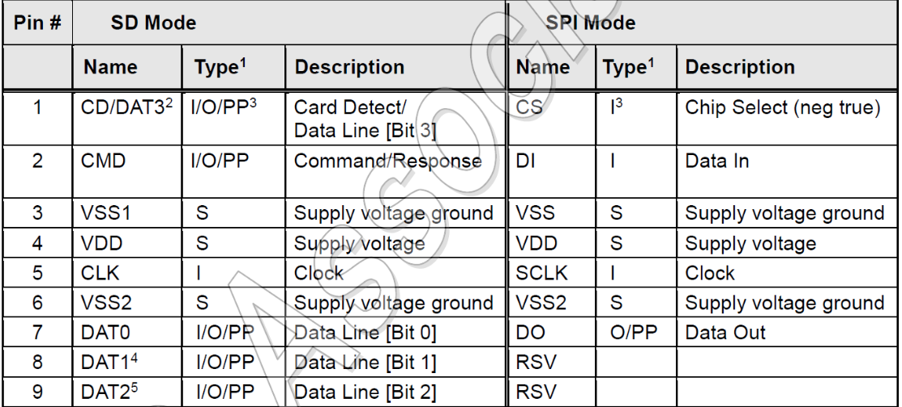

## 什么是SDIO？

SDIO(Secure Digital Input and Output)，即安全数字输入输出接口，SDIO协议是由SD卡协议演进而来，向前兼容SD卡协议，在SD卡协议基础上增加了CMD52、CMD53命令

### 分类

按速度分类有两种：

- 全速的SDIO卡，传输率可以超过100Mbps；
- 低速的SDIO卡，支援的时脉速率在0至400KHz之间

按SDIO的信号传输模式有SPI、1-bit、4-bit三种：

### 架构设计

SDIO总线有两端，其中一端是主机（HOST）端，另一端是设备端（DEVICE），采用HOST- DEVICE架构设计——即一主多从模式

常用的引脚为这些

- CLK信号:HOST给DEVICE的时钟信号。
- CMD信号：双向的信号，用于传送命令和反应。
- DAT0-DAT3 信号:四条用于传送的数据线。

### 通信方式

## 为什么要设计SDIO?

## 如何使用SDIO？

## 参考文献