## TCP/IP是什么？

**TCP/IP 是供已连接因特网的计算机进行通信的通信协议**，指传输控制协议/网际协议（Transmission Control Protocol / Internet Protocol）， 定义了电子设备（比如计算机）如何连入因特网，以及数据如何在它们之间传输的标准

可以这样理解TCP/IP是计算机接入网络的一套标准，计算机的数据需要按这套标准输出，不然就无法将数据传输给其他电脑

而TCP/IP内包含一系列处理数据的协议：

TCP (传输控制协议) - 应用程序之间通信
UDP (用户数据报协议) - 应用程序之间的简单通信
IP (网际协议) - 计算机之间的通信

## TCP/IP为什么存在？

我们将利用两台任意之间的任意应用进程的数据交换来观察TCP/IP的作用

### 接收数据

这里**计算机网络使用的数据链路层通信协议为以太网**（ETH），主机从网络上接收和发送到数据单元都是以太帧，主机通过以太网驱动将主机内多个应用进程的数据发送到网络上，或者从网络上获取多个应用进程需要的数据，而**数据链路层的基础是物理层——以太网常用的为光纤**

在数据链路层之上，**计算机网络的网络层一般为IP协议**，该协议主要是记录各主机的地址，让主机可以指定数据其来源和目的地，而**以太网驱动和IP模块之间的的数据单元被称为IP包**

> 驱动（driver）是一种直接和网络接口硬件（network interface hardware）通信的软件。
模块（module）是和驱动、网络应用以及其他模块通信的软件

数据经过网络层到达主机后，需要找到**计算机网络的传输层模块——TCP或UDP**，IP 头中的协议类型字段决定了该传给谁；

数据到达传输层模块后，需要根据TCP/UDP头中的端口号决定了该传给哪个应用，这里使用**浏览器的HTTP协议作为应用层协议**，HTTP接收到服务器（这里为另一台主机）响应的信息和需要的数据文档

```mermaid
flowchart LR
  subgraph HOSTA["主机 A"]
    direction TB
    S1["应用进程 A"]
    S2["传输层 TCP"]
    S3["网络层 IP"]
    S4["链路层 MAC"]
    S5["物理层 PHY"]
  end

  subgraph MEDIUM["物理层线路"]
    direction LR
    LINE["物理链路<br/>电缆 / 光纤 / 无线信道"]
  end

  subgraph HOSTB["主机 B"]
    direction TB
    R5["物理层 PHY"]
    R4["链路层 MAC"]
    R3["网络层 IP"]
    R2["传输层 TCP"]
    R1["应用进程 B"]
  end

  S1 -->|"应用数据"| S2
  S2 -->|"TCP 段"| S3
  S3 -->|"IP 数据报"| S4
  S4 --> S5
  S5 -->|"比特流发送"| LINE
  LINE -->|"物理传输"| R5

  R5 -->|"比特流接收"| R4
  R4 -->|"IP 数据报"| R3
  R3 -->|"TCP 段"| R2
  R2 -->|"重组后的数据"| R1

  R1 -.->|"ACK应答 / 反向数据"| R2
  R2 -.-> R3
  R3 -.-> R4
  R4 -.-> R5
  R5 -.-> LINE
  LINE -.-> S5
  S5 -.-> S4
  S4 -.-> S3
  S3 -.-> S2
  S2 -.-> S1
```

### 发送数据

浏览器通过HTTP协议发送数据，请求HTML,CSS等数据文档，HTTP的请求报文发送到TCP/UDP模块中，**TCP/UDP模块在应用数据前加上TCP/UDP数据头就形成了TCP数据段/UDP数据段**

TCP/UDP数据段发送到IP模块，**IP模块在TCP/UDP数据段前加上IP头形成了IP包**

IP包被发送到以太网驱动中，**以太网驱动在IP包的头部添加MAC帧头，尾部添加FCS帧尾，这样就变成了以太帧**，而将以太帧转化为bit流通过物理层发送到网络上

## UDP/TCP传输层协议

### UDP/TCP是什么？

UDP (用户数据报协议），它为调用它的应用程序提供了一种不可靠、无连接的服务

TCP (传输控制协议），它为调用它的应用程序提供了一种可靠的、 面向连接的服务，其可靠性表现为通过使用流量控制、序号 确认和定时器 ，TCP 确保正确地 、按序地将数据从发送进程交付给接收进程；其面向连接部分体现为TCP 拥塞控制防止任何一条 TCP 连接用过多流量来淹没通信主机之间的链路和交换设备。 TCP 力求为每个通过一条拥塞网络链路的连接平等地共享网络链路带宽 这可以通过调节 TCP连接的发送端发送进网络的流量速率来做到

### 套接字编程

#### UDP套接字编程

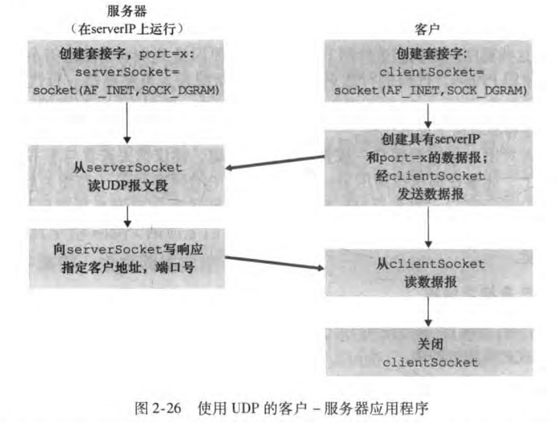

- AF_INET其作用是什么？ AF_INET 指示了底层网络使用了 IPv4
- SOCK_DGRAM其作用是什么？这意味着它是一个 UDP 套接字

- UDP的收发函数：serverSocket . recvfrom(2048) ,serverSock.et.sendto{modifiedMessage.encode() , client.Address）
  
   

#### TCP套接字编程

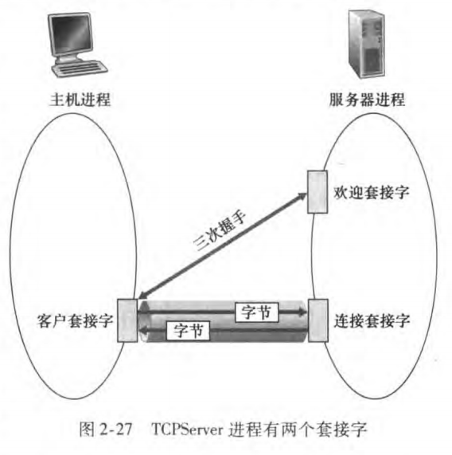

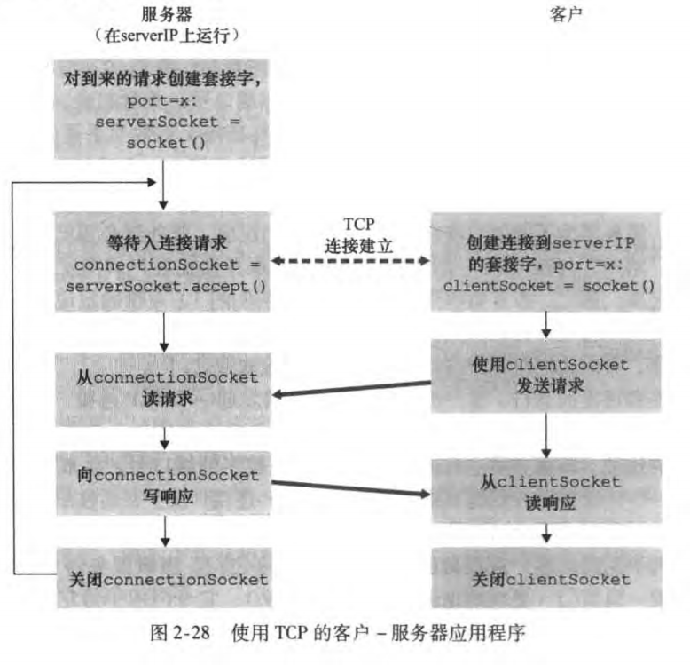

- SOCK_ STREAM，这表明它是一个 TCP 套接字
- 客户与服务器进行连接：clientSocket. connect ((serverName , serverPort)）
- TCP的socket收发函数：clientSocket.send(sentence .encode()) 
modifiedSentence = clientSocket . recv(1024} 
- 关闭客户和服务器之间的TCP连接：client:.Socket. close () 

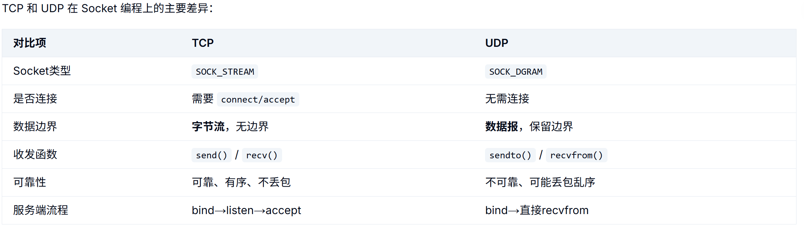

#### Linux下的网络编码核心

Linux 网络编程核心就是 Socket 编程，主要步骤：

- TCP 服务端：socket() → bind() → listen() → accept() → read()/write() → close()

- TCP 客户端：socket() → connect() → read()/write() → close() 

- UDP：socket() → bind() → sendto()/recvfrom() → close()

### 多路复用和多路分解

> 套接字 = IP 地址 + 端口号 组合起来的一个标识，是"应用程序 ↔ 传输层(TCP/UDP)"之间的接口，一个通信端点（通信端点)

将运输层报文段中的数据交付到正确的套接字的工作称为多路分解。具体一点就是将从下层接收到的数据发送给对应的app进程中

在源主机从不同套接字中收集数据块，并为每个数据块封装上首部信息（这将在以后用于分解）从而生成报文段，然后将报文段传递到网络层，所有这些工作称为多路复用（ multiplexing）；就是将多个app进程的请求信息包装一下变成报文段发送给网络层

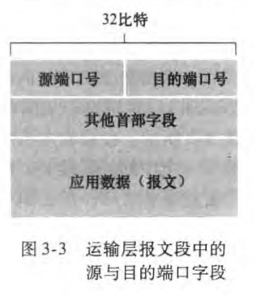

由图可知端口号为16bit数，大小为0~65535；而0~1023的端口号被称作为周知端口号一般被HTTP（默认端口一般为80）或者FTP（默认端口为21）的应用层协议使用

#### 无连接的多路复用和多路分解

> UDP 套接字是由一个二元组全面标识的，该二元组包含一个目的 IP 地址和一个目的端口号

运输层从范围 1024 ~ 65535 内分配一个端口号，该端口号是当前未被该主机中任何其他 UDP 端口使用的号，这个分配的端口号就是UDP的源端口号，在A到B的报文段中，
源端口号用作“返回地址”的 部分，即当B需要回发A一个报文段给A时，B到A的报文
段中的目的端口号便从A的报文段中的源端口号中取值

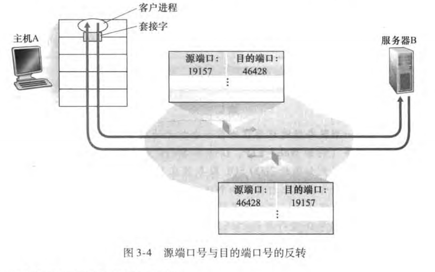

#### 面向连接的多路复用和多路分解

> TCP 套接字是由一个四元组（源 IP 地址，源端口号，目的 IP 址．目的端口号）来标识的

服务器主机可以支持很多并行的 TCP 套接字，每个套接字与一个进程相联系，并由其
四元组来标识每个套接字 ，当一个 TCP 报文段到达主机时、所有4个字段（源 IP地址．
源端口，目的 IP 地址，目的端口）被用来将报文段定向 （分解）到相应的套接字

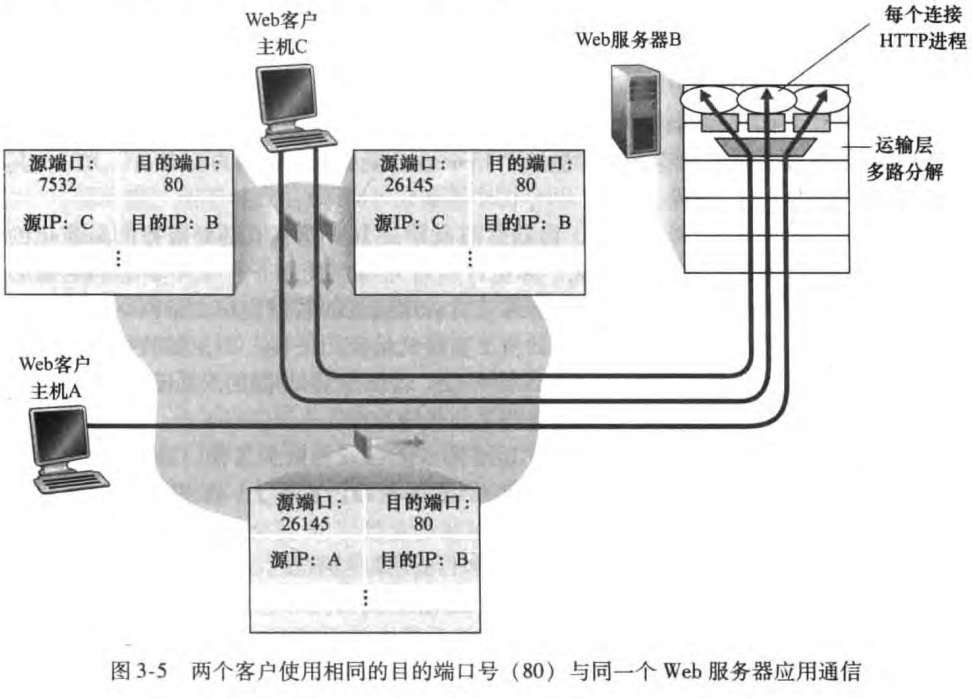

### 无连接运输：UDP

使用 UDP 时，在发送报文段之前，发送方和接收方的运输层实体之间没有握手.正因为如此， UDP 被称为无连接的

#### UDP的优点

- 关于发送什么数据以及何时发送的应用层控制更为精细，因为TCP的拥塞控制是不管可靠交付需要用多长时间的——即TCP是不适合用于实时应用
- 无须连接建立，TCP 在开始数据传输之前要经过3次握手，UDP 却不需要任何准备即可进行数据传输，这样UDP就没有这些连接延迟了，这也是DNS 运行在 UDP 之上而不是运行在 TCP 之上的主要原因
- 无连接状态，TCP 需要在端系统中维护连接状态 。此连接状态包括接收和发送缓存
拥塞控制参数以及序号与确认号的参数。UDP无需维护这些数据，空间利用率相对较高
- 分组首部开销小，每个 TC 报文段都有 20 字节 的首部开销，而 UDP 仅有 8 字节
的开销

#### UDP的报文结构

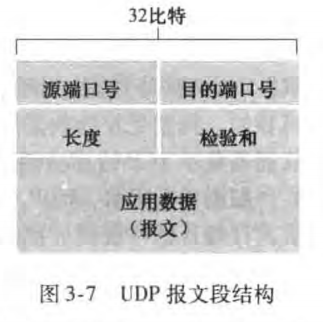

长度字段指示了在 UDP 报文段中的字节数 （首部加数据）

接收方使用检验和来检查在该报文段中是否出现了差错

#### UDP校验和

检验和用千确定当 UDP 报文段从源到达目的地移动时． 其中的比特是否发生了改变

**发送方的 UDP 对报文段中的所有 16 比特字的和进行反码运算，求和时遇到的任何溢出都被回卷，得到的结果被放在 UDP 报文段中的检验和字段。**

### 面向连接到运输：TCP

#### 可靠数据运输原理

对于数据丢失和超时问题的解决机制：

1. 重传 :接收方收到有差错的分组时，发送方将重传该分组文；为了实现基于时间的重传机制，需要一个倒计数定时器 (countrl wn timer ) , 
个给定的时间量过期后，可中断发送方
2. 差错检测
3. 接收方反馈

一组数据发送等待接收在停等协议中对于信道的利用率太低了，有个简单的办法就是发送方可以在等待确认之前发送3个报文，其利用率也基本上提高3倍，数据的不断发送可以被看成是填充到1条流水线中，故这种技术被称为流水线 （pipelining)

解决流水线的差错恢复有两种基本方法是：回退 N 步(Go-Back- N, GBN) 和选择重传 (Selectiv Repeat, SR）

##### 回退N步：允许发送方发送多个分组（当有多个分组可用时）而不需等待确认，但它也受限于在流水线中未确认的分组数不能超过某个最大允许数N

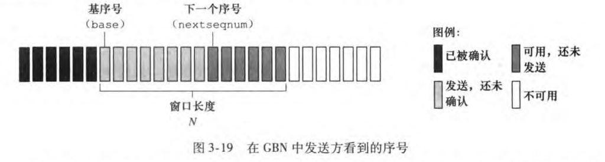

GBN 协议也常被称为 滑动窗口协议

而GBN发送单个分组的差错就能够引起 GBN 重传大量分组，许多分组根本没有必要重传 随着信道差错率的增加，流水线可能会被这些不必要重传的分组所充斥

##### 选择重传 (SR) 协议通过让发送方仅重传那些它怀疑在接收方出错（即丢失或受损）的分组而避免了不必要的重传

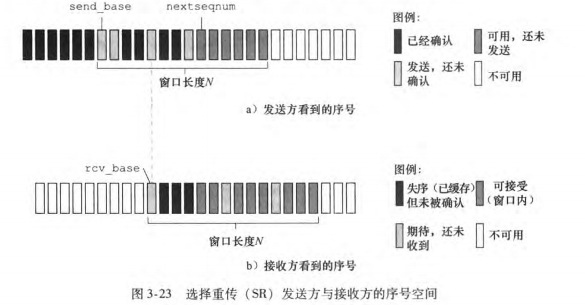

SR接收方将确定一个正确接收的分组而不管其是否按序。失序的分组将被缓存直到所有丢失分组（即序号更小的分组 ）皆被收到为止

#### TCP连接

TCP 被称为是面向连接的 (connection- oriented) , 这是因为在一个应用进程可以开始
向另一个应用进程发送数据之前，这两个进程必须先相互＂握手”，即它们必须相互发送
某些预备报文段，以建立确保数据传输的参数

发起连接请求的进程称为客户进程，而另一个被请求到叫服务器进程,：**客户首先发送 个特殊的 TCP 报文段，服务器用另一个特殊的 TCP 报文段来响应，最后客户发送第三个特殊报文段作为响应，其中第三个特殊报文段可以承载应用层数据，在种连接建立过程被称为三次握手**

发送缓存是发起三次握手期间设置的缓存之一，TCP从缓存中取出并放入报文段的数据数量要受限于**最大报文段长度(MSS)**,MSS通常由本地发送主机发送到**最大链路层帧长度(MTU)**来决定，TCP IP 首部长度（通常 40 字节），以太网和 PPP 链路 协议都具有1500 字节的 MTU, MSS 的典型值为 1460字节

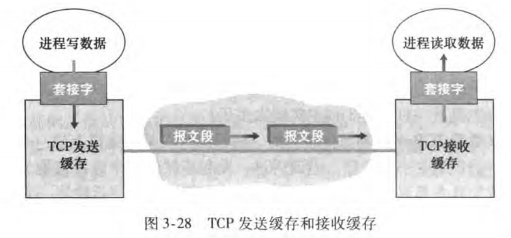

一对进程之间发送和接收到的数据都会被放入到缓存中，套接字再从缓存中读取或者发送数据，这样设计能够实现一定程度上的异步，释放CPU资源

**TCP协议为什么是可靠连接？**

1. 超时重传，利用定时器倒计时，设定一个时间窗口，等待数据发送或是接收数据的时间超过时间窗口，就对数据分组进行重传
2. 滑动窗口和流量控制，将数据分为四组，将已发送未确认，能用未发送到数据设置一个最大发送长度N
3. 三次握手，将客户进程和服务器进程进行连接
4. TCP发送报文结构中，有ACK，数据校验以及序列号的机制用于错误处理

#### TCP报文段结构

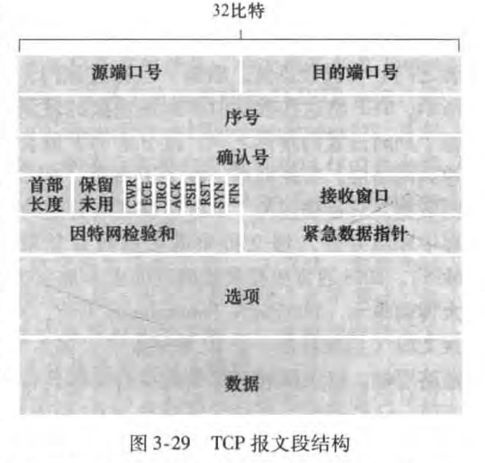

- 32 比特的序号字段 （sequence number field) 和 32 比特的确认号字段(acknowl
edgment number field） 这些字段被 TCP 发送方和接收方用来实现可靠数据传输服务，**一个报文段的序号 (sequence number for a segment) 因此是该报文段首字节的字节流编号**，
- 16 比特的接收窗口字段 (receive window field ) , 该字段用于流量控制
- 4 比特的首部长度字段 (header length field) , 该字段指示了以 32 比特的字为单位
的 TCP 首部长度
- 可选与变长的选项字段 (options field) , 该字段用于发送方与接收方协商最大报文
段长度 (MSS) 时
- ACK 比特用于指示确认字段中的值是有效的，即该报文段包括一个对已被成功接收报文段的确。 AST、SYN、FIN 特用于连接建立和拆除，PSH 比特被置位时，就指示接收方应立即将数据交给上层。最后， URG 比特用来指示报文段里存在着被发送端的上层实体置为＂紧急＂的数据。紧急数据的最后一个字节由 16 比特的 紧急数据指针字段( urgent data pointer field) 指出

#### TCP三次握手细节

1. 第一次握手，报文段的首部（参见图 3-29) 中的一个标志位（即 SYN 比特）被置为 因此，这个**特殊报文段被称为 SYN 报文段**，客户端会随机选择1个初始序号 (client_isn)
2. 第二次握手，一旦包含 TCP SYN 报文段的 IP 数据报到达服务器主机，服务器会从该数据报中提取出 TCP SYN 报文段，为该 TCP 连接分配 TCP 缓存和变量，并向该客户 TCP 发送允许连接的报文段，首先， SYN 比特被置为 1。其次，该 TCP 报文段
首部的确认号字段被置为 client_isn + 1。最后，服务器选择自己的初始序号
(server_isn) , 并将其放置到 TCP 报文段首部的序号字段中。**该允许连接的报文段被称为 SYNACK 报文段 (SYN ACK segment)**
3. 第三次握手，在收到 SYNACK 报文段后，客户也要给该连接分配缓存和变量。 客户主机则向服务器发送另外一个报文段,该 SYN 比特被置为0,握手第3个阶段可以在报文段负载中携带客户到服务器的数据
   
   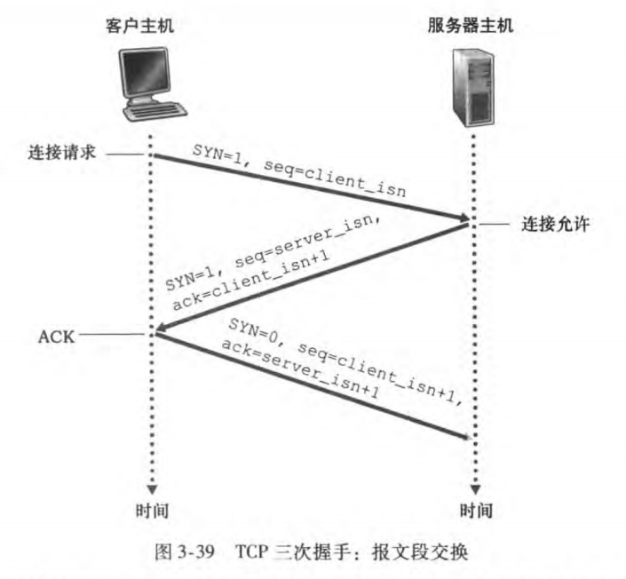
4. 为什么需要初始序号？为什么需要3次握手，而不是两次握手？
   
   如果只有两次：
   
   服务端无法确认客户端是否收到了自己的 SYN+ACK
旧的、延迟的 SYN 包到达服务端会被误认为新连接，服务端分配资源等待，但客户端早已放弃

#### TCP四次挥手

这个特殊的报文段让其首部中的1个标志位即 FIN 比特（ 见图 3-29) 被设置为1当服务器接收到该报文段后，就向发送方回送一个确认报文段。 然后，服务器发送它自己的终止报文段，其 FIN 比特被置1。最后，该客户对这个服务器的终止报文段进行确认

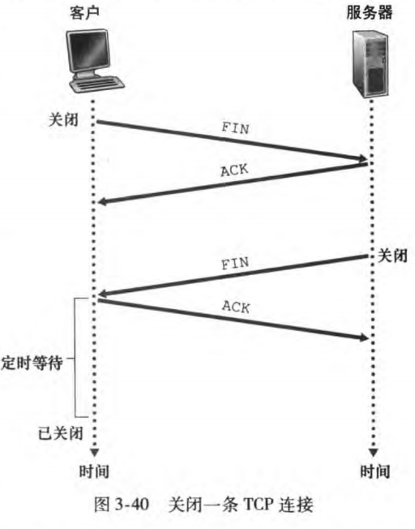

#### 拥塞控制

慢启动：cwnd 从 1 开始指数增长，直到达到 ssthresh

拥塞避免：cwnd 线性增长（每 RTT 加 1），避免过快增长

快重传：收到 3 个重复 ACK 立即重传丢失报文

快恢复：快重传后 ssthresh = cwnd/2，cwnd = ssthresh，进入拥塞避免（而非慢启动）

核心思想是探测网络容量，遇到拥塞就退让。

#### 流量控制

 

### UDP/TCP为什么存在？

UDP TCP 最基本的责任是，将两个端系统间 IP 的交付服务扩展为运行在端系统上的两
个进程之间的交付服务

进程到进程的数据交付和差错检查是两种最低限度的运输层服务、也是UDP 所能提供的仅有的两种服务

## IP通信协议

**网络层的作用从表面上看极为简单，即将分组从一台发送主机移动到一台接收主机**

### 路由器

路由器的作用是：

1. **转发**分组数据
2. 进行**路由选择**决定数据分组走的数据路径

> 转发 (forwanling) 是指将分组从一个输入链路接口转移到适当的输出链路接口的路由器本地动作
> 
> 路由选择 (routing) 是指确定分组从源到目的地所采取的端到端路径的网络范围处理过程

每台网络路由器中有一个个关键元素是它的转发表 (fonvarding table)，分组首部数据在表中有相对应的转发路径索引

#### 控制平面

路由选择算法决定了插入该路由器转发表的内容，这是传统的方法；远程控制器计算和分发转发表以供每台路由器所使用，这是SDN方法

#### 网络服务模型

网络服务模型主要的功能是对网络层数据传输定义其特性，比如：

1. 确保交付，让分组能够到达目的地
2. 具有时间延时限制的确保交付
3. 有序交付，让分组按发送顺序到达目的地
4. 确保最小带宽
5. 安全性，对网络层运输的数据进行加密，在目的地才能够进行解密

#### 路由器的工作原理

路由器的结构如图所示：

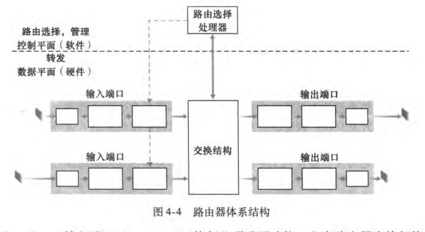

- 交换结构：交换结构将路由器的输入端口连接到它的输出端口，这种交换结构完全
包含在路由器之中，即它是一个网络路由器中的网络！

- 路由选择处理器：路由选择处理器执行控制平面功能，即传统方式下负责执行路由选择协议，维护路由选择表,并为该路由器计算转发表；SDN方式下，负责与远程控制器进行通信，，目的是接收由远程控制器计算的转发表项，并且安装到输入端口中

##### 输入端口

对于输入数据的处理，路由器使用转发表来查找输出端口，使得到达的分组能经过交换结构转发到该输出端口

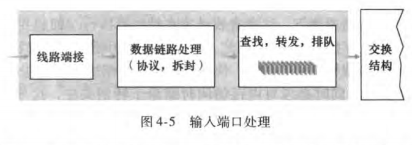

##### 交换结构

其交换结构的三种交换方式分别是：经内存交换、经总线交换、经互联网络交换

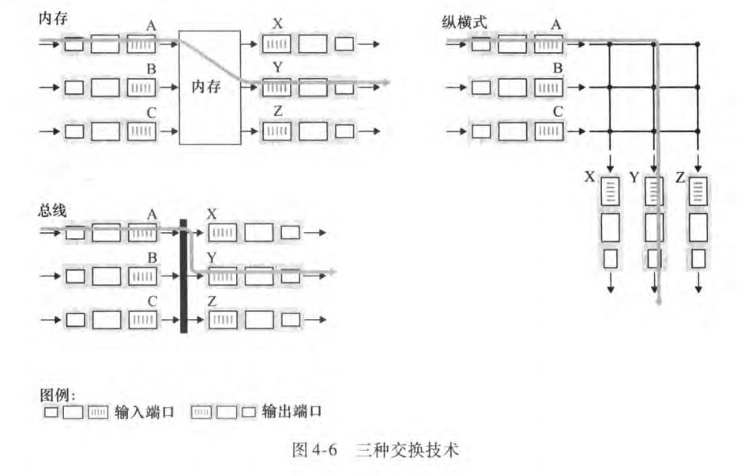

##### 输出端口

输出端口处理取出已经存放在输出端口内存中的分组并将其发送到输出链路上

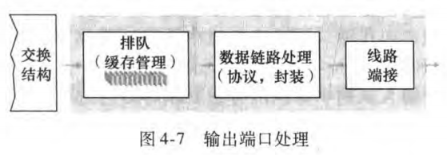

#### 分组调度

因为路由器有多个输入输出端口，这个时候需要合理的调度来输出数据，就产生了一些排队规则：

1. 先进先出——FIFO（(First-ln-First- Out），先排队先输出
2. 优先权排队——到达输出链路的分组被分类放人输出队列中的优先权类,非抢占式优先级排队，只能等待低优先级类输出完毕才能继续传输，不能打断其传输
3. 循环排队——这些输出分组类轮流进行输出
4. 加权公平排队——WFQ 和循环排队的不同之处在于，每个类在任何时间间隔内可能收到不同数量的服务，每个类 i被分配一个权$w_i$ 使用 WFQ 方式零在类 i有分组要发送的任何时间间隔中，第i类将确保接收到的服务部分等于$w_i /w_j$，也就是谁的权重谁先输出

### IP地址

TCP/IP 使用 4 组数字来为计算机编址。每个计算机必须有一个唯一的 4 组数字的地址
一组数字就是一个字节，即计算机地址是由4个字节，比如：192.168.1.60。

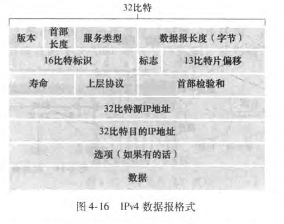

- 版本（号）：4比特规定了数据报的 IP 协议版本。通过查看版本号，路由器能
够确定如何解释 IP 数据报的剩余部分
- 服务类型 ：(TOS) 比特包含在 IPv4 首部中，以便使不同类型的 IP据报（例如，一些特别要求低时延、高吞吐量或可靠性的数据报） 能相互区别
开来
- 标识、标志 、片偏移:这三个字段与所谓 IP 分片有关
- 寿命 (Time-To-Live, TTL)：该字段用来确保数据报不会永远（如由于长时间
的路由选择环路）在网络中循环
- 协议：该字段通常仅当一个 IP 数据报到达其最终目的地时才会有用，该字段值
指示了 IP 数据报的数据部分应交给哪个特定的运输层协议
- 首部校验和：首部检验和是这样计算的，将首部中的每2个字节当作一个数，用反码算术对这些数求和
- 数据（有效载荷）：IP 数据报中的数据字段包含要交付给目的地的运输层报文段
- **IP 数据报有总长为 20 字节的首部（假设尤选项） 如果数据报承载一个TCP 文段，则每个（无分片的）数据报共承载了总长 40 字节的首部 (20 字节的IP首 部加 20 字节的TCP 首部）以及应用层报文**

#### 网络地址转换

NAT使能路由器对外界隐藏了家庭网络的细节（另 外，你也许想知道家庭网络计算机是从哪儿得到其地址，路由器又是从哪儿得到它的IP 地址的 .在通常的情况下 ，答案是相同的，即 DHCP! 路由器从 ISP 的DHCP 服务器得到它的地址、 并且路由器运行一个 DHCP 服务器，为位于 NAT-DHCP 路由器控制的家庭网络地址空间中的计算机提供地址）

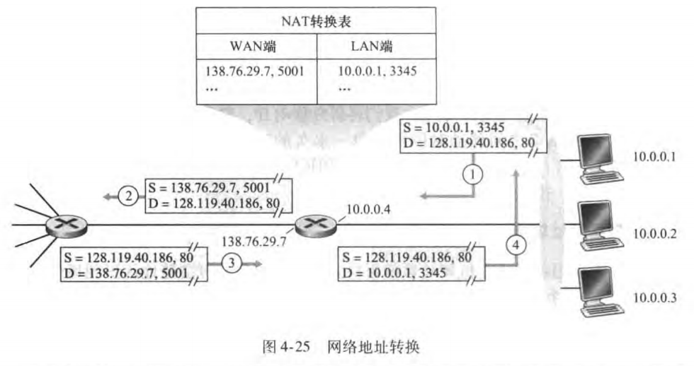

 

### IP V6

#### 为什么会v6会被发明？

IP 地址用一个 32 位二进制的数表示一个主机号码，但 32 位地址资源有限

#### IP V6报文格式

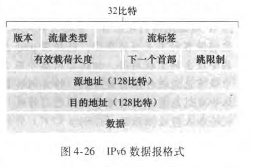

IPv6 引入了一种称为任播地址 （却ye address)型地址，这种地址可以使数据报交付给一组主机中的任意一个

- 流标签 ：IPv6 有一个难以捉摸的流 (flow) 定义,，该字段可用于“给属于特殊流的分组加上标签，这些特殊流是发送方要求进行特殊处理的流
- 下一个首部 ：该字段标识数据报中的内容（数据字段）需要交付给哪个协议
- 跳限制：转发数据报的每台路由将将对该字段的内容减1， 如果跳限制计数达到0, 则该数据报将被丢弃，类似于IPV4的寿命
- 因为因特网层中的运输层（如 TCP UDP) 和数据链路层（如以太网）协议执行了检验操作，**IPV6删除了首部校验和**

#### 什么是IP V6地址

IPv6 地址的 128 位（16 个字节）写成 8 个 16 位的无符号整数，每个整数用 4 个十六进制位表示

**冒号十六进制记法允许零压缩**，即一串连续的0可以用一对冒号取代，例如：

建议中规定，在任一地址中，只能使用一次零压缩

#### 域名

用于 TCP/IP 地址的名字被称为域名。runoob.com 就是一个域名
**DNS 服务器负责将域名翻译为 TCP/IP 地址**，同时负责使用新的域名信息更新彼此的系统

## 参考资料

[TCP/IP协议族教程](https://arthurchiao.art/blog/rfc1180-a-tcp-ip-tutorial-zh/)