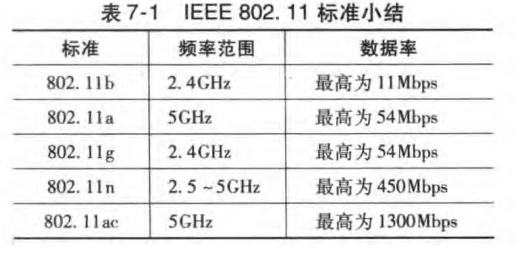
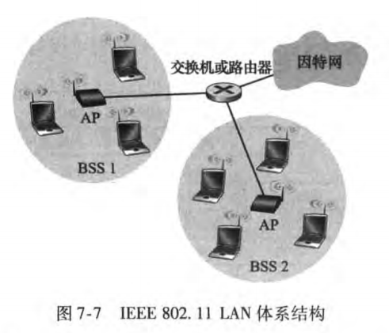
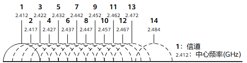
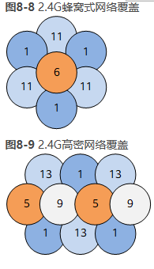
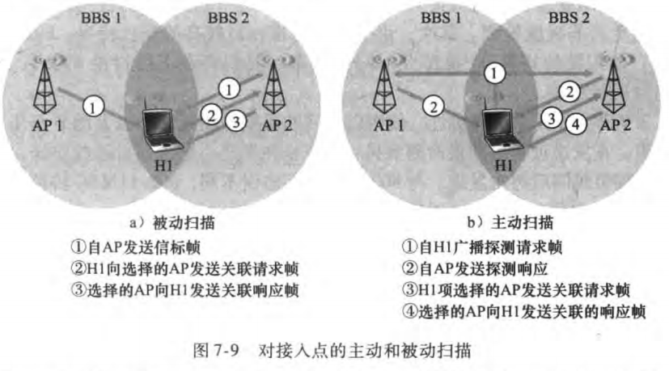
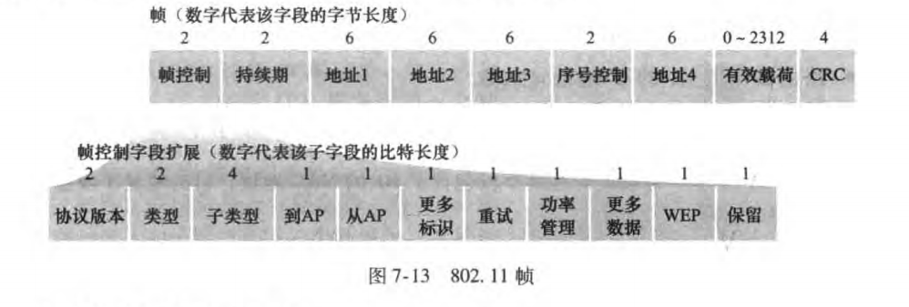

## WIFI

IEEE 802. 11 无线LAN (也称为 WiFi），该协议族中有多套不同的标准，帧结构以及使用相同的CSMA/CA协议，但是在物理层的工作频率范围不同

### 体系结构

体系结构的基本构件模块是**基本服务集 （Basic Service Set, BSS）**，一 个BSS 包含一个或多个无线站点和一个在802. 术语中称为**接入点 (Access Point, AP） **的中央基站 (base station)

- 每个 802. 11 无线站点都具有6字节的 MAC 地址

- 每个 AP 的无线接口也具有一个MAC 地址

- 与以太网类似，这些 MAC 地址由 IEEE 管理

### 信道

> 信道是信号在通信系统中传输的通道，由信号从发射端传输到接收端所经过的传输媒质所构成

每一个AP都会被分配一个单字或双字的**服务集标识符(Service Set Identifier, SSID)**，例如打开手机的WiFi开关，会显示在你手机信号能够搜集到的WiFi名称——该名称就是SSID，而每一个AP通常还会再分配一个信道号

#### 信道的意义

通过计算结果会发现单个AP的覆盖范围有限，通常需要部署多个AP才能完成完整的网络覆盖。多个AP的组网中，相邻AP间通常会存在同频干扰问题，需要通过规划无线信号工作的频段和信道来减少同频干扰问题。另外通过信道捆绑可以提高无线终端的网络速率。

#### 2.4G频道

一般场景通常推荐采用1、6、11这种至少分别间隔4个信道的信道组合方式来部署蜂窝式的无线网络覆盖

#### WIFI丛林

WiFi 丛林 (WiFi jungle) 是一个任意物理位置，在这里无线站点能从两个或多个 AP 中收到很强的信号

为了获得因特网接入，你的无线站点需要加入其中一个子网并因此需要与其中的 AP 相**关联 (associate)**，你的无线站点创建一个虚拟线路，无线站点只能通过关联的AP进行互联网访问，而关联的AP才可以向你的无线站点发送数据帧，那无线站点怎么关联AP？

802.11 标准要求每个 AP 周期性地发送信标帧 (beacon frame) , 每个信标帧包括该AP的SSID和MAC 地址，而你的无线站点会在固定频道如2.4G扫描11个信道，找出可用的AP，**扫描信道和监听信标帧的过程被称为被动扫描**

#### 802.11帧

- **帧的核心是有效载荷，它通常是由一个 IP 数据报或者 ARP 分组组成**
- 地址1是要接收该帧的无线站点的 MAC 地址
- 地址 2 是传输该帧的站点的 MAC 地址
- 地址3是ap的bss连接网络的这个路由器接口的 MAC 地址
