## 整体架构

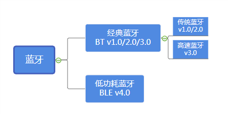

蓝牙整体可以分为两类，一类为传统蓝牙——即音箱，手机，耳机等设备使用的用于数据流传输的蓝牙；一类为低功耗蓝牙——常用于手表，鼠标长时间待机的设备

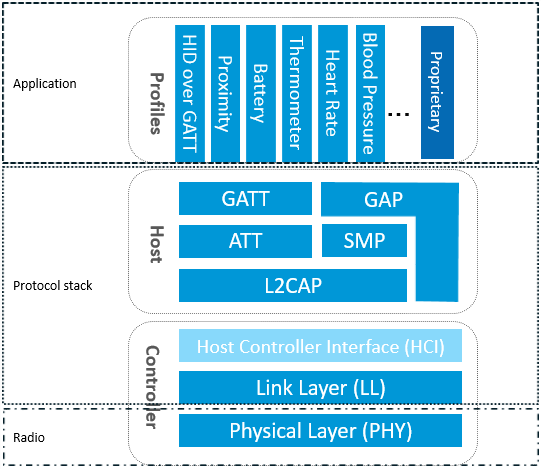

蓝牙协议主要可以分为两个层次，一个是application，在应用层根据具体应用需求进行设计；一个是core，主要对蓝牙技术的规范和描述，并且是实现的关键部分

- Host负责在逻辑链路的基础上，进行更为友好的封装，这样就可以屏蔽掉蓝牙技术的细节
- Controller负责定义RF、Baseband等偏硬件的规范，并在这之上抽象出用于通信的逻辑链路

### 各层简要描述

BLE协议栈包含如下部分：

- PHY层——确定与其他设备通信的物理方式，一般为2.4频道通过信道与其他设备连接
  - PHY层用来指定BLE所用的无线频段，调制解调方式和方法等。PHY层做得好不好，直接决定整个BLE芯片的功耗，灵敏度以及selectivity等射频指标。

- LL层——转发消息平台，将输入和输出的消息决定发送给谁，类似于微信
  - LL层是整个BLE协议栈的核心，也是BLE协议栈的难点和重点。像Nordic的BLE协议栈能同时支持20个link（连接），就是LL层的功劳。LL层要做的事情非常多，比如具体选择哪个射频通道进行通信，怎么识别空中数据包，具体在哪个时间点把数据包发送出去，怎么保证数据的完整性，ACK如何接收，如何进行重传，以及如何对链路进行管理和控制等等。LL层只负责把数据发出去或者收回来，对数据进行怎样的解析则交给上面的GAP或者GATT。

- HCI层——适配层，将具体实现加载到抽象中
  - HCI是可选的，HCI主要用于2颗芯片实现BLE协议栈的场合，用来规范两者之间的通信协议和通信命令等。

- GAP层——为应用层提供蓝牙最基础功能
  - GAP是对LL层payload（有效数据包）如何进行解析的两种方式中的一种，而且是最简单的那一种。GAP简单的对LL payload进行一些规范和定义，因此GAP能实现的功能极其有限。GAP目前主要用来进行广播，扫描和发起连接等。

- L2CAP层——作为一个招待，判断数据是否为"VIP"，VIP走加密通道，普通用户走普通通道
  - L2CAP对LL进行了一次简单封装，LL只关心传输的数据本身，L2CAP就要区分是加密通道还是普通通道，同时还要对连接间隔进行管理。

- SMP层——数据加密，数据身份验证，是个保安，保护数据的进出
  - SMP用来管理BLE连接的加密和安全的，如何保证连接的安全性，同时不影响用户的体验，这些都是SMP要考虑的工作。

- ATT层——定义应用层常用的API，方便其调用
  - ATT层用来定义用户命令及命令操作的数据，比如读取某个数据或者写某个数据。BLE协议栈中，开发者接触最多的就是ATT。BLE引入了attribute概念，用来描述一条一条的数据。Attribute除了定义数据，同时定义该数据可以使用的ATT命令，因此这一层被称为ATT层。

- GATT层——将ATT命令整理后作为一个命令集，格式统一，方便使用
  - GATT用来规范attribute中的数据内容，并运用group（分组）的概念对attribute进行分类管理。没有GATT，BLE协议栈也能跑，但互联互通就会出问题，也正是因为有了GATT和各种各样的应用profile，BLE摆脱了ZigBee等无线协议的兼容性困境，成了出货量最大的2.4G无线通信产品。

### GAP层

> GAP（Generic Access Profile），它在用来控制设备连接和广播。GAP 使你的设备被其它设备可见，并决定了你的设备是否可以或者怎样与合同设备进行交互

GAP 给设备定义了若干角色，其中主要的两个是：外围设备（Peripheral）和中心设备（Central）。 

- 外围设备：这一般就是非常小或者简单的低功耗设备，用来提供数据，并连接到一个更加相对强大的中心设备。例如小米手环。

- 中心设备：中心设备相对比较强大，用来连接其他外围设备。例如手机等。

为了方便理解，可以这样认为外围设备为从机（仆人servant），中心设备为主机（主人master）,通常从机会设定一个广播间隔，每个广播间隔中，它会重新发送自己的广播数据，这样主机就能扫描相应的信道发现从机并建立起GATT连接，进行数据交换

### ATT层

ATT（Attribute Protocol），属性协议，前面说过，每个蓝牙设备就是用来提供服务的，而服务就是众多数据的合集，这个合集可以称为数据库，数据库里面每个条目都是一个Attribute

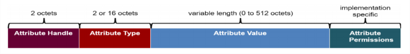

这是ATT指令的结构，其中各元素的内容分别是：

- Attribute Handle：这是attribute的句柄，16-bit长度——2字节，用于客户端访问服务器的attribute，包含了attribute的地址
- Attribute Type：attribute的类型，2字节或16字节，在BLE中常使用UUID定义数据类型，UUID 是 通用唯一识别码（Universally Unique Identifier）的缩写，是一种软件建构的标准，其目的是让分布式系统中的所有元素，都能有唯一的辨识信息，而**需要配合UUID的基地址来组成128bit的UUID**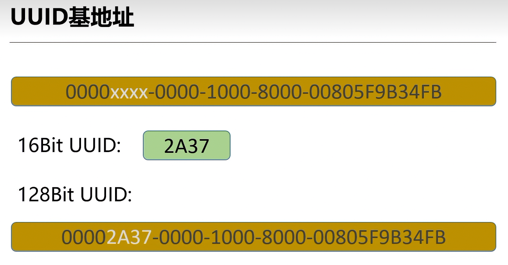
- Attribute Value：就是数据真正的值，0到512字节长
- Attribute permissions，Attribute的权限属性，权限属性不会直接在空口包中体现，而是隐含在ATT命令的操作结果中，其权限属性一般有：
  1. Open，直接可以读或者写
  2. No Access，禁止读或者写
  3. Authentication，需要配对才能读或者写，由于配对有多种类型，因此Authentication又可以衍生多种子类型，比如带不带MITM，有没有LESC。
  4. Authorization，跟open一样，不过Server返回Attribute的值之前需要应用先授权，也就是说应用可以在回调函数里面去修改读或者写的原始值。


---

客户端（主机）与服务器（从机）之间的通信，客户端发送请求到服务器，服务器根据请求返回响应，请求和响应的数据类型为一条response/响应命令或者PDU**（某一层协议向下传递的带有控制或有效载荷的数据单元）**

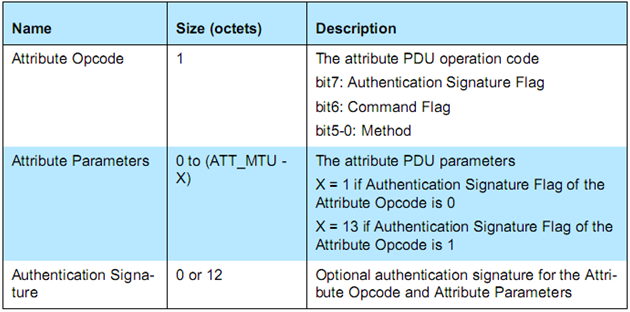

opcode的method主要有：

```
- Requests      : Client->Server, 请求回应 
- Responses     : Server->Client, 响应请求. 
- Commands      : Client->Server, 命令 
- Notifications : Server->Client, 服务端通知 
- Indications   : Server->Client, 请求确认 
- Confirmations : Client->Server, Ind确认
```

### GATT层

GATT 的全名是 Generic Attribute Profile（通用属性协议），它定义两个 BLE 设备通过叫做 Service 和 Characteristic 的东西进行通信

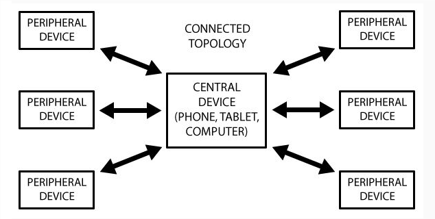

一个外设只能连接一个中心设备，而一个中心设备可以连接多个外设

#### GATT结构

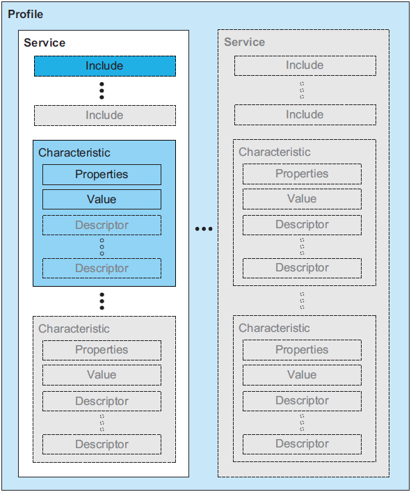

GATT中最上层是Profile，**Profile由一个或多个服务(Service)组成服务是由Characteristics组成**，或是其他服务的引用(Reference)Characteristic包含一个值(Value)，可能包含该Value的相关信息。

**Service包含如下元素**：

- 主要服务（Primery Services），暴露设备的主要可用功能；
- 次要服务（Secondary Services），旨在由主要服务引用；
- 扩展服务，保证扩展某项Service时的兼容性；
- 结合服务，引用其他服务，融合在一起，称为其他组合的行为；

**Characteristic（特性）包含如下元素**

- 声明（Declaration），标识一个Characteristic的开始；

- 性质（读取/写入/通知/指示/广播/命令/签名认证）；

- 数值句柄：特性值的存储位置；

- 特性UUID；

- 值（Value），包含此特性的实际值；

- 描述符（Descriptors），描述符包含此特性的附加信息或配置；
  1. 附加信息；
  2. 任何数量；
  3. 任何顺序；
  4. 可以是供应商特定的；

##### 自定义特性

1. 创建服务对象，并进行UUID和权限初始化（读写和通知权限）
2. 将服务对象放入服务集合中
3. 将服务注册到GATT的profile中

### nrf54280与sniff的通信

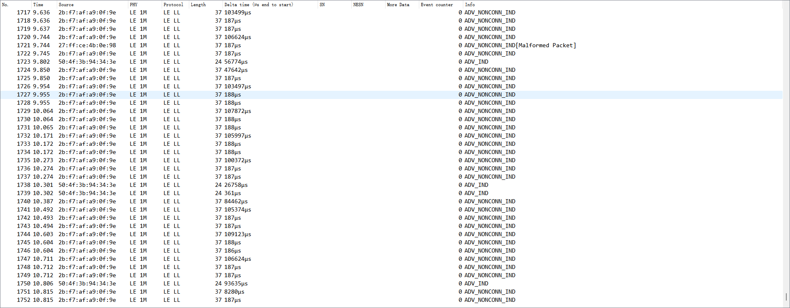

- No.帧序号。        按抓包先后顺序排列的索引。     记录编号：特工笔记里的第几条发现。​
- Time绝对时间戳。记录捕获该包的具体时间（秒）。接头时间：发现传单的确切时刻。​
- Source源地址。   发送该包设备的 MAC 地址。     杂货铺编号：老王店面的唯一门牌号（d8:f4:...）。​
- PHY物理层类型。LE 1M 表示使用 1 Mbps 速率的 GFSK 调制。    传单规格：标准 1M 大小的纸张。​
- Protocol协议层。LE LL 代表 Link Layer（链路层）。行动准则：属于地下工作的基本通讯规矩。​
- Length数据长度。Payload（有效载荷）的大小。情报分量：这次传单上写了多少字。​
- Delta time增量时间。当前包与前一个包之间的时间间隔。张贴频率：老王贴两张传单之间隔了多久（比如 498μs）。​
- SN / NESN序列号 / 预期序列号。用于连接后的数据流控和重传。暗号顺序：确认这句情报是不是紧接着上一句。​
- More Data更多数据标志位。为 1 表示发完这个包后紧接着还有数据。未完待续：老王示意“别走，我还有话要说”。​
- Event counter连接事件计数器。记录当前处于第几次连接事件。会面届数：这是你们第几次正式在店里碰头。​
- Info详细信息。显示包类型（如 ADV_IND 代表通用广播）。情报摘要：一眼看出这包是“传单”还是“暗号”

#### 通信过程

蓝牙通信总共有五种状态

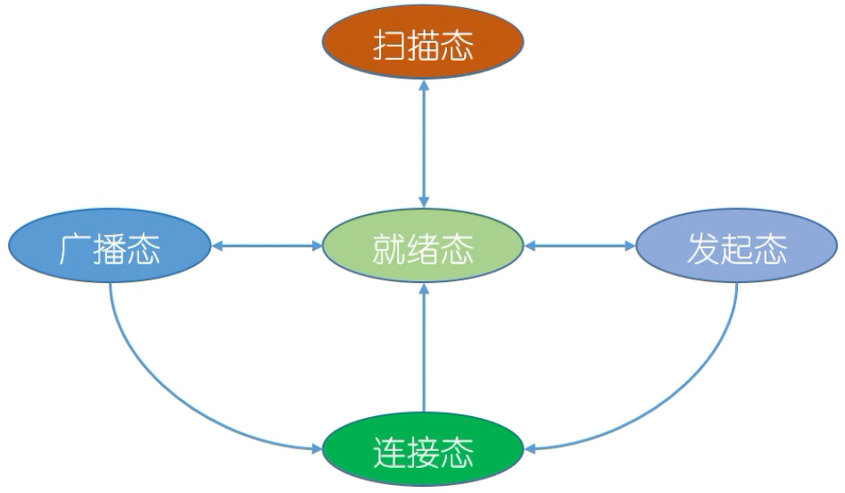

1. 中心设备扫描（扫描态）37,38,39信道（避免与2.4gWiFi信道冲突），外围设备定时广播PUD数据（广播态）
2. 为了进一步验证身份，中心设备会发起一个scan request请求，以获取外围设备的唯一身份证信息。scan response中会包含设备的唯一身份证号码（128bit的UUID），用于确认对方身份是否合法。通过scan response可以查看设备的名称和UUID，确认身份后可以发起连接请求（就绪态）
3. 在点击connect后，会捕捉到一个信号，产生一个接头申请表，定义了未来连接的频率和参数。建立连接后，通信会切换到局部信道（0到36），并采用跳频机制避免信道冲突。连接建立后，主从机关系从central和peripheral转变为master和slave，接头地址（accessaddress）在广播时为8E89BED6，建立连接后切换为AF9a8CD5，用于标识通信双方。（连接态）
   > 802 15. 网络以 TDM 方式工作于无须许可证的 2. 4GHz 无线电波段，每个时隙长度为 625µs 在每个时隙内，发送方利用79 个信道中的一个进行传输，同时从时隙到时隙以一个已知的伪随机方式变更信道。这种被称作跳频扩展频谱 (Frequency-Hopping Spread Spectrum, FHSS)的信道跳动形式
4. 对数据进行进行加密
5. 主机和从机通过GATT的profile来进行通信，使用profile中记录的service下的characteristic命令
6. 通知方式：notify只负责通知，不等待响应；indicate发送通知，必须等待请求
7. 静默通信，每30ms发送空包
8. 单次最大数据长度（MTU）默认 23 字节（有效 20 字节）

### 蓝牙通信帧

蓝牙每2m就定义一个信道，蓝牙有40个信道，37,38,39为广播信道，其他为数据信道

#### 数据包

数据包有MAC地址和用户数据组成

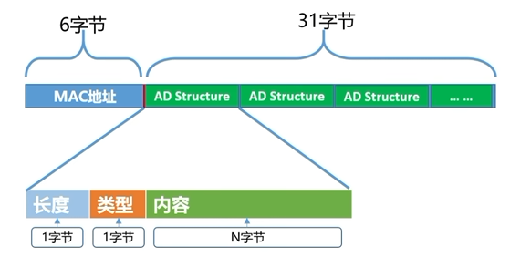

**一个数据包的最大长度为37字节**，用户数据由多个广播数据结构体组成，未使用完31字节会自动补零

#### 蓝牙数据包广播类型

1. 可连接非定向
2. 可连接定向
3. 不可连接非定向
4. 可扫描非定向

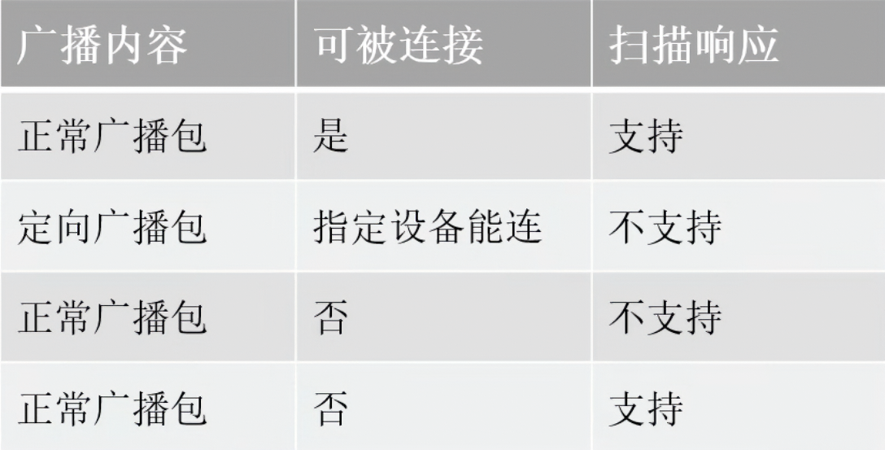

这是四种类型的区别
