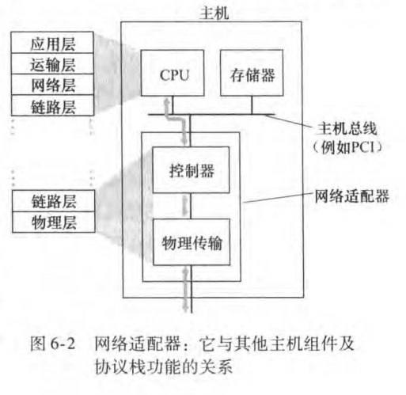
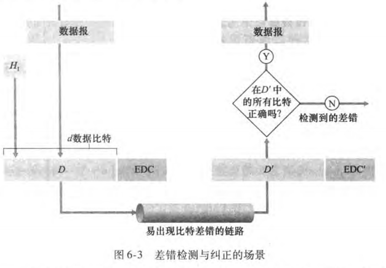
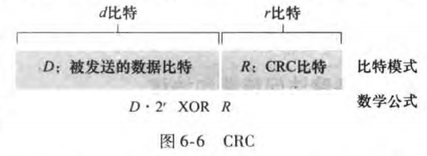
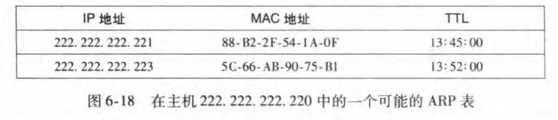
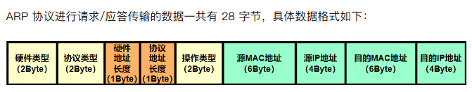
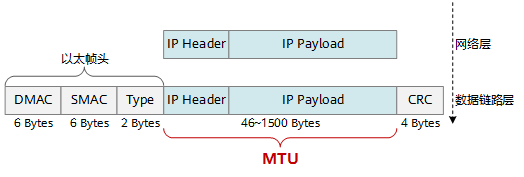
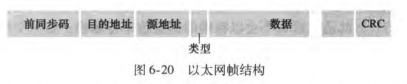
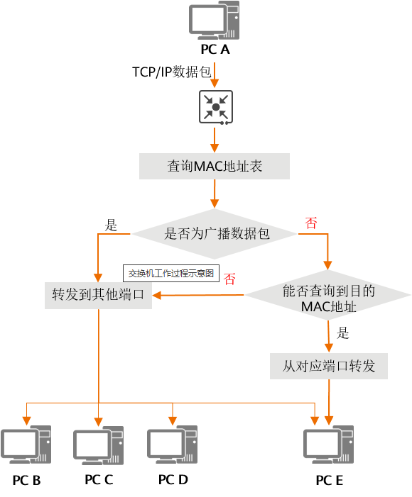
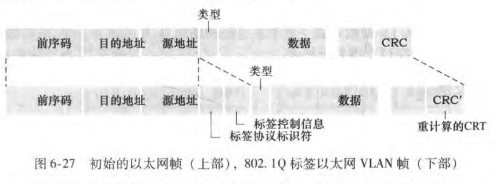

## 链路层

**运行链路层协议（即第2层） 协议的任何设备均称为节点**，节点包括主机、路由器、交换机和 WiFi 接入点，**沿着通信路径连接相邻节点的通信信道称为链路**

### 链路层的服务

#### 链路接入

媒体访问控制 (Medium Access Control, MAC） 协议规定了帧在链路上传输的规则

#### 可靠交付

链路层可靠交付服务通常用于易于产生高差错率的链路，例如无线链路，其目的是本地（也就是在差错发生的链路上）纠正一个差错，而不是通过运输层或应用层协议迫使进行端到端的数据重传

#### 差错检测和纠正

链路层的差错检测通常更复杂，并且用硬件实现。差错纠正类似于差错检测，区别在于接收方不仅能检测帧中出现的比特差错 ，而且能够准确地确定帧中的差错出现的位置（并因此纠正这些差错）

简单来说就是链路层的差错机制，能够定位和改正错误，不只是知道有问题

### 链路层的实现

链路层的主体部分是在**网络适配器** （networkadapter) 实现的，网络适配器有时也称为 **网络接口卡** (Ne vork Interface Card, NIC)也就是网卡

### 差错检验

传输数据中检测差错的3种技术：奇偶校验（它用来描述差错检测和纠正背后隐含的基本思想） 、检验和方法（它通常更多地应用于运输层）和循环冗余检测（它通常更多地应用在适配器中的链路层）

#### 奇偶校验

差错检测最简单的方式就是用单个奇偶校验位 (parity bit)，发送到信息有d比特，偶校验方案，就是d+1比特中1的个数是偶数；奇校验方案，就是d+1比特中1的个数是奇数

#### 校验和方法

因特网检验和 （Internet checksum) 就基于这种方法，即数据的字节作为 16 比特的整数对待并求和

#### 循环冗余检测

现今的计算机网络中广泛应用的差错检测技术基于**循环冗余检测 (Cyc ic Redundancy 
Check, CRC) 编码**

所有 CRC 计算采用模 算术来做，在加法中不进位，在减法中不借位，即按位异或

## 局域网

### 链路层寻址和ARP

主机和路由器具有链路层地址，为什么在网络层和链路层都需要地址呢？

#### MAC地址

并不是主机或路由器具有链路层地址，而是它们的适配器（ 即网络接口）具有链层地址，链路层地址有各种不同的称呼：** LAN 地址 **(LAN address) 、**物理地址** （physical address) 或 **MAC 地址** (MAC address)

MAC 地址长度为6字节，共有 $2^{48}$ 个可能的 MAC 地址	,通常用十六进制表示法，地址的每个字节被表示为一对十六进制数

适配器的 MAC 地址与人的社会保险号相似，后者也具有扁平寻址结构，而且无论人到哪里该号码都不会变化——MAC地址是不会根据网络接入位置变化，是于机器绑定在一起的

#### 地址解析协议ARP

##### ARP的存在意义

ARP的作用是将IP地址转化为MAC地址

##### ARP的具体内容

每台主机或路由器在其内存中具有 ARP (ARP table) , 这张表包含 IP 地址到 MAC 地址的映射关系,表中还包含一个TTL （寿命）值，指示了将映射删除的时间

**如果 ARP 表中当前没有该目的主机的表项 又该怎么办呢？**发送方构造一个称为 ARP 分组 (ARP packet) 的特殊分组 ARP 分组有几个字段，包括发送和接收IP 地址及 MAC 地址，该分组有查询和响应两种类型，查询就是询问主机和路由器的IP地址对应的MAC地址

#### ARP分组的传输

ARP特殊分组通过广播形式发送给每个适配器，让适配器检测自己的IP地址于ARP分组的目的IP地址是否匹配，如果匹配就返回带有MAC地址映射的响应ARP分组

### 具有碰撞检测的载波侦听多路访问 (CSMA/CD)

> 如果其他人正在说话，等到他们说完话为止。 在网络领域中，被称为载波侦听 (carrier sensing) 
> 
> 如果与他人同时开始说话， 停止说话。 在网络领域中，这被称为碰撞检测 (colli￾ion detection ) 

使用CSMA/CD协议时，一个站不可能同时进行发送和接收，进行的是半双工通信。

注：电磁波在1km电缆的传播时延约为5us（需要记住！）

#### CSMA/CD协议的工作过程：

1. 准备发送：适配器从网络层获得一个分组，加上以太网的首部和尾部，组成以太网帧，，放入网卡的缓存中，但在**发送之前，必须先检测信道**。
2. 检测信道：不停地检测信道，一直等待信道空闲，并在96比特时间内信道保持空闲（保证了帧间最小时间间隔），就发送这个帧。在发送过程中仍不停地检测信道，即网络适配器要边发送边监听。这里只有两种可能性：
   1. 发送成功：在争用期内一直未检测到碰撞，这个帧发送成功，回到（1）
   2. 发送失败：在争用期内检测到碰撞，这是立即停止发送数据，并按规定发送认为干扰信号。适配器接着就执行指数退避算法，等待r倍512比特时间后，返回到步骤（2），继续检测信道。若重传16次仍不能成功，则停止重传向上报错。
3. **以太网每发完一帧，一定要把已经发送的帧暂时保留一下**。如果在争用期内检测出发生了碰撞，那么还要在推迟一段时间后再把这个帧重传一次

#### 二进制指数后退算法

使用该算法的目的是让：当碰撞节点数较少时，时间间隔较短；碰撞节点数量较大时，时间间隔较长

一个节点等待的实际时间量是 R·512 比特时间，R为0~$2^n - 1$的范围的一个整数

### 以太网

> 集线器 (hub)是将多条双绞线或光纤集合连接在同一段物理介质下的设备，它作用于各个比特而不是作用于帧，Hub有多个I/O端口，信号由任一端口进入后，经过再生或放大转发至其他所有端口

采用基 于集线器的星形拓扑的以太网也是一个广播局域网，即无论何时集线器从它的一个接口接收到一个比特，它向其所有其他接口发送该比特的副本

#### 以太网帧结构

- 数据字段，其MTU最大值为1500，超过这个数，IP数据报就需要分片传输，数据字段的最小长度是 46 字节，IP数据报不够46字节会进行填充，在 10Mbps 以太网中，这个“往返最长时间”（称为时隙时间 Slot Time）被计算并标准化为发送 512 bits 所需的时间，也就是 64 字节，一个基本的以太网帧包含 18 字节的固定开销,64-18 = 46
- 目的地址，包含了目的适配器的MAC地址，6个字节
- 源地址，包含了该帧发送到网络上的适配器MAC地址
- 类型，用于存放网络层协议的类型，2个字节
- CRC（别名FCS），让接收适配器对帧数据进行检验，4个字节——CRC32
- 前同步码，该前同步码的前7字节的值都 10101010; 最后1个字节是 10101011（帧开始界定符），总共8个字节，前7个字节用于唤醒接收适配器，并同步时钟；
- 以太网协议是不可靠协议，为网络层提供不可靠服务，不知道接收适配器是否已经接收完成，传输的数据是否正确

####  交换机

交换机是一种为所连接的IT设备提供网络通信的设备，主要作用是转发传输数据，实现网络设备之间的通信互联。可概括为以下功能：

- 对网络进行分段和隔离，划分多个虚拟网段，提高网络的安全性。 
- 识别接收到的数据，精准向目标设备转发，提高网络的性能。
- 对不同端口、用户和应用进行流量控制和管理，优化网络环境，提高网络的可靠性和稳定性。
- 优化数据传输方式，提高传输速率。

可以这么理解交换机是转发信息的平台，通过控制数据传输的范围和流量输出来提高网络的稳定性和网速

##### 交换机的工作原理

**交换机对数据包的转发是建立在物理地址（MAC地址）基础之上的**，对于IP网络协议来说，它是透明的，即交换机在转发数据包时，不知道也无须知道信源机和信宿机的IP地址，只需知其目的MAC地址。

##### 交换机 VS 路由器

路由器是一个链接两个或多个网络的设备。接收数据后，路由器会先依据路由表找出通往目的IP地址的最短路径，然后转发到下一地址。

路由器和交换机都可以在网络中传送转发数据，但是两者之间也有一定的区别。

- 交换机主要功能是用于数据交换，路由器主要功能是用于路由转发。
- **交换机根据MAC地址进行数据转发，而路由器是根据IP地址进行数据转发**。
- 路由器能在多条路径中选择最佳的路径，提升交换数据的传输速率。

#### 虚拟网络层VLAN

##### VLAN的意义

1. 解决流量隔离问题，限制流量广播的范围
2. 交换机的无效使用
3. 方便管理用户，无需修改物理布线

交换机使用VLAN来解决这些问题，在单一物理网络中，定义多个虚拟网络，限制广播范围

##### VLAN帧结构

VLAN 标签 (VLAN tag)由一个2字节的标签协议标识符（TPID），一个2字节的标签控制信息字段（包含12bit的VLAN标志字段）和一个3bit优先权字段组成
